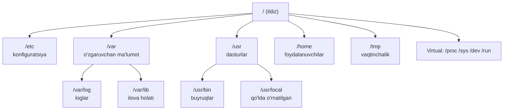
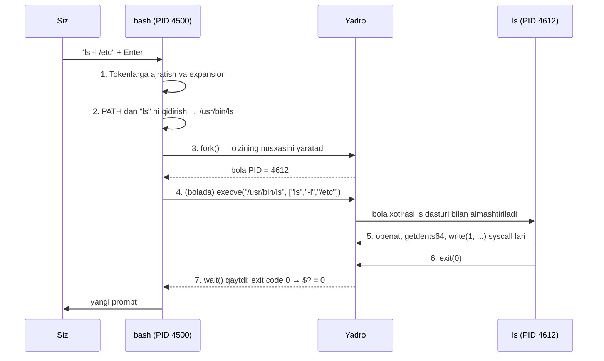
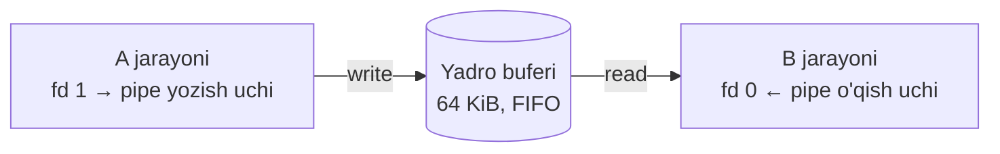
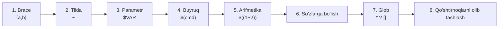
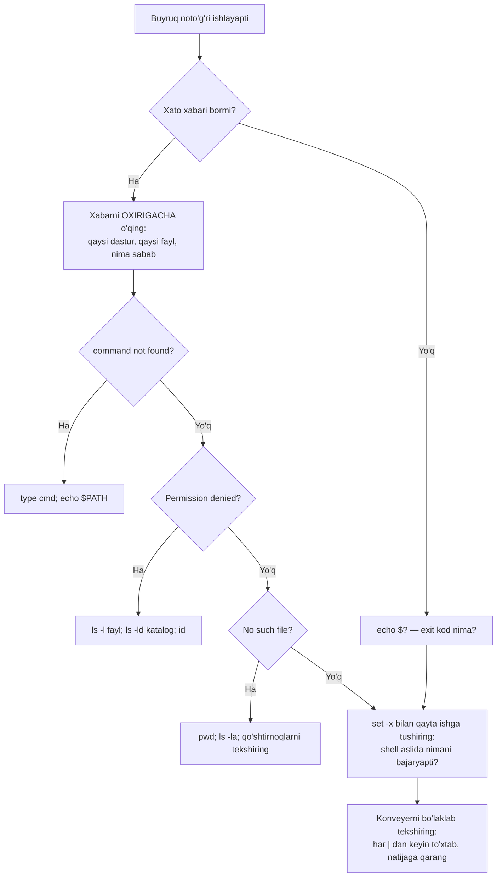

<!-- @section: why -->

## Muammo: server sizga "ekran" bermaydi

Tasavvur qiling: tungi soat 03:00, monitoring qo'ng'iroq qildi — sayt javob bermayapti. Siz SSH orqali serverga kirdingiz. Qarshingizda faqat qora ekran va miltillab turgan kursor. Sichqoncha yo'q, "Mening kompyuterim" yo'q, fayl menejeri yo'q.

Shu paytda sizdan talab qilinadigan narsa — **bir necha soniyada** quyidagi savollarga javob topish:

- Disk to'lib qolmadimi? Qaysi katalog joyni yeb qo'ydi?
- Oxirgi 10 daqiqada logda nechta `500` xatosi bor? Ular qaysi IP dan kelyapti?
- Qaysi konfiguratsiya faylida `8080` port yozilgan?

Grafik interfeysda bu savollarning har biri — daqiqalab bosish. Buyruq qatorida — bitta satr:

```bash
grep ' 500 ' /var/log/nginx/access.log | awk '{print $1}' | sort | uniq -c | sort -rn | head
```

## Yechim: Unix falsafasi

1970-yillarda Bell Labs muhandislari (Ken Thompson, Dennis Ritchie, Doug McIlroy) hozirgacha amal qiladigan uchta g'oyani ilgari surdi:

1. **Har bir dastur bitta ishni qilsin — lekin yaxshi qilsin.** `grep` faqat qidiradi, `sort` faqat saralaydi, `wc` faqat sanaydi.
2. **Dasturlar birga ishlasin.** Birining chiqishi ikkinchisining kirishi bo'la olsin — bu **pipe** (quvur) g'oyasi.
3. **Universal interfeys — matn oqimi.** Dasturlar bir-biri haqida hech narsa bilmaydi, ular faqat matn satrlarini o'qiydi va yozadi.

Natijada 20–30 ta kichik buyruqni bilgan odam ulardan **cheksiz ko'p** kombinatsiya yasay oladi — xuddi LEGO g'ishtchalari kabi.

> **Analogiya.** Grafik dastur — tayyor taom: nima berilsa, shuni yeysiz. Buyruq qatori — oshxona: masalliqlar (buyruqlar) va ularni birlashtirish usuli (pipe) bor, xohlagan taomingizni o'zingiz pishirasiz.

## Nega aynan DevOps muhandisiga kerak

| Vaziyat | Grafik interfeys | Buyruq qatori |
|---|---|---|
| 50 ta serverda bir xil ish | 50 marta qo'lda | `for h in $(cat hosts); do ssh $h '...'; done` |
| Ishni takrorlash | Skrinshotli yo'riqnoma | Skript — o'zi hujjat, o'zi dastur |
| Avtomatlashtirish (CI/CD) | Imkonsiz | Pipeline ning har qadami — shell buyrug'i |
| Konteyner ichida debug | GUI umuman yo'q | `docker exec -it ... sh` |
| Sekin aloqa (SSH) | Ishlamaydi | Bir necha bayt yetarli |

Bu kursdagi **hamma narsa** — Docker, Kubernetes, Terraform, Ansible, CI/CD — oxir-oqibat shell buyruqlari orqali boshqariladi. Dockerfile dagi `RUN` — shell buyrug'i. GitHub Actions dagi `run:` — shell buyrug'i. Kubernetes dagi probe — shell buyrug'i bo'lishi mumkin. Shuning uchun bu dars — butun kursning poydevori.

## Bu darsda nimaga erishamiz

Buyruqlarni yodlash emas, **modelni tushunish** muhim. Agar siz quyidagi uchta narsani tushunsangiz, notanish buyruqni ham bir daqiqada o'zlashtirasiz:

1. **Fayl tizimi qanday tuzilgan** — nima qayerda yotadi (FHS).
2. **Ma'lumot qanday oqadi** — stdin, stdout, stderr, pipe, redirect.
3. **Shell buyruqni ishga tushirishdan oldin nima qiladi** — expansion va quoting.

<!-- @section: theory -->

## Fayl tizimi ierarxiyasi (FHS)

Windows da har bir disk alohida daraxt (`C:\`, `D:\`). Linux da esa **bitta daraxt** bor, ildizi — `/`. Boshqa disklar shu daraxtning biror shoxiga "ulanadi" (mount). Qaysi katalogda nima yotishini **FHS** (Filesystem Hierarchy Standard — fayl tizimi ierarxiyasi standarti) belgilaydi.



| Katalog | Nima saqlanadi | DevOps uchun ahamiyati |
|---|---|---|
| `/etc` | Tizim va xizmatlar konfiguratsiyasi (matnli fayllar) | Deyarli har kuni: `/etc/nginx/`, `/etc/ssh/sshd_config`, `/etc/hosts` |
| `/var/log` | Loglar | Nosozlikda birinchi qaraladigan joy |
| `/var/lib` | Ilovalarning doimiy holati | `/var/lib/docker`, `/var/lib/postgresql` — disk to'lishining odatiy aybdorlari |
| `/usr/bin`, `/usr/sbin` | Paket menejeri o'rnatgan dasturlar | Zamonaviy Ubuntu da `/bin` → `/usr/bin` ga symlink ("usr merge") |
| `/usr/local` | Paket menejerisiz, qo'lda o'rnatilganlar | O'z skript va binarlaringiz: `/usr/local/bin` |
| `/opt` | Mustaqil, "bir katalogda hammasi" dasturlar | Tashqi vendor dasturlari |
| `/home/<user>` | Foydalanuvchi fayllari | `~` shu yerga ishora qiladi; root uchun — `/root` |
| `/tmp` | Vaqtinchalik fayllar | Qayta yuklanganda tozalanadi; hamma yoza oladi (sticky bit) |
| `/run` | Ishlab turgan tizim holati (PID fayllar, socketlar) | `tmpfs` — xotirada; `/run/docker.sock` |
| `/proc` | Yadro va jarayonlar haqida **virtual** fayllar | `/proc/cpuinfo`, `/proc/<pid>/` — diskda joy egallamaydi |
| `/sys` | Qurilmalar va yadro sozlamalari (virtual) | cgroup lar: `/sys/fs/cgroup` |
| `/dev` | Qurilma fayllari | `/dev/sda`, `/dev/null`, `/dev/urandom` |
| `/boot` | Yadro va yuklovchi | To'lib qolsa yadro yangilanmaydi |

**Nega bunday bo'lingan?** Zaxira va xavfsizlik uchun: `/etc` ni zaxiralasangiz — butun konfiguratsiya qo'lingizda; `/var` alohida diskda bo'lsa — loglar to'lib ketsa ham tizim (`/`) ishlayveradi; `/usr` ni faqat-o'qish rejimida ulash mumkin.

## "Hamma narsa — fayl"

Linux ning eng kuchli abstraksiyasi: disk, terminal, tarmoq ulanishi, jarayon haqidagi ma'lumot — barchasi **fayl kabi** ochiladi, o'qiladi va yoziladi.

```bash
cat /proc/loadavg          # yadro "fayl" orqali yuklamani aytadi
echo 1 > /proc/sys/net/ipv4/ip_forward   # "fayl"ga yozib, yadro sozlamasini o'zgartirish
head -c 16 /dev/urandom | base64         # qurilma "fayli"dan tasodifiy baytlar
```

Shu sababli bir xil vositalar (`cat`, `grep`, `echo`, `>`) hamma narsa bilan ishlaydi.

## Uch standart oqim

Har bir jarayon ishga tushganda yadro unga uchta ochiq "fayl" beradi. Ular **file descriptor** (fayl deskriptori — ochiq faylga ishora qiluvchi kichik butun son) bilan raqamlanadi:

| FD | Nomi | Vazifasi | Sukut bo'yicha |
|---|---|---|---|
| 0 | **stdin** | Kirish — jarayon shu yerdan o'qiydi | Klaviatura |
| 1 | **stdout** | Asosiy natija | Terminal ekrani |
| 2 | **stderr** | Xatolar va diagnostika | Terminal ekrani |

**Nega xatolar alohida oqimda?** Chunki natija ko'pincha keyingi dasturga uzatiladi. Agar xato xabarlari ham shu oqimga aralashsa, keyingi dastur ularni "ma'lumot" deb qabul qilardi. Alohida oqim tufayli natija quvurga ketadi, xato esa ekranda sizga ko'rinadi.


## Pipe va redirect

**Redirect** (yo'naltirish) — oqimni terminaldan faylga yoki fayldan oqimga burish:

| Yozuv | Ma'nosi |
|---|---|
| `cmd > fayl` | stdout → fayl (fayl **ustidan yoziladi**) |
| `cmd >> fayl` | stdout → fayl oxiriga qo'shiladi |
| `cmd 2> fayl` | stderr → fayl |
| `cmd > fayl 2>&1` | stdout → fayl, so'ng stderr ham "stdout qayerga qarasa, o'sha yerga" |
| `cmd &> fayl` | Yuqoridagining bash dagi qisqa shakli |
| `cmd < fayl` | stdin fayldan olinadi |
| `cmd 2>/dev/null` | Xatolarni "qora tuynuk"ka tashlash |

**Pipe** (`|`) — chap buyruqning stdout ini o'ng buyruqning stdin iga ulaydi. Muhim nuqta: **faqat stdout** uzatiladi, stderr terminalga chiqaveradi.

## Matn bilan ishlash uchligi: grep, sed, awk

| Vosita | Asosiy vazifa | Qachon |
|---|---|---|
| `grep` | Andozaga mos **satrlarni tanlash** | "Qaysi satrlarda X bor?" |
| `sed` | Oqimdagi matnni **o'zgartirish** | "X ni Y ga almashtir", "3-satrni o'chir" |
| `awk` | Satrni **ustunlarga bo'lib** qayta ishlash | "5-ustun 500 bo'lsa, 1-ustunni chiqar" |

Uchovi ham **regex** (regular expression — matn andozalarini tavsiflash tili) dan foydalanadi. Uch xil "lahja" bor: BRE (asosiy, `grep` sukut bo'yicha), ERE (kengaytirilgan, `grep -E`, `awk`) va PCRE (Perl uslubi, `grep -P`). Farqi: BRE da `+ ? | ( )` oddiy belgi, ularni maxsus qilish uchun `\` kerak; ERE da ular darhol maxsus.

## Shell expansion va quoting

Siz Enter bosganingizda shell buyruqni **darhol ishga tushirmaydi**. Avval satrni qayta yozadi — bu **expansion** (kengaytirish). Masalan `ls *.log` buyrug'ida `ls` dasturi hech qachon yulduzchani ko'rmaydi: shell uni fayl nomlari ro'yxatiga almashtirib bo'lgan bo'ladi.

**Qo'shtirnoqlar** — expansion ni boshqarish vositasi:

| Yozuv | `$VAR` | `*` (glob) | Bo'sh joy bo'yicha bo'lish |
|---|---|---|---|
| `'bittalik'` | ochilmaydi | ochilmaydi | yo'q |
| `"qo'shtirnoq"` | **ochiladi** | ochilmaydi | yo'q |
| qo'shtirnoqsiz | ochiladi | ochiladi | **bo'linadi** |

Oltin qoida: **o'zgaruvchini doim qo'shtirnoq ichida yozing — `"$fayl"`**. Aks holda nomida bo'sh joy bo'lgan fayl ikki argumentga bo'linib ketadi.

## Exit code

Har bir jarayon tugaganda 0–255 oralig'idagi son qaytaradi: **exit code** (chiqish kodi). `0` — muvaffaqiyat, boshqa har qanday son — xato. Bu "true/false" ning teskarisi kabi ko'rinadi, lekin mantiq bor: muvaffaqiyat bitta, xato turlari esa ko'p.

Exit code — avtomatlashtirishning asosi: CI pipeline qadam muvaffaqiyatli o'tganini aynan shu son orqali biladi.

## Atamalar lug'ati

| Atama | Ma'nosi | Misol |
|---|---|---|
| FHS | Kataloglar tuzilishi standarti | `/etc` — konfiguratsiya |
| file descriptor | Ochiq faylga ishora qiluvchi son | 0, 1, 2 |
| stdin / stdout / stderr | Kirish / natija / xato oqimlari | `2>` — stderr ni yo'naltirish |
| pipe | Ikki jarayonni ulovchi yadro buferi | `ps aux \| grep nginx` |
| redirect | Oqimni fayl bilan bog'lash | `> out.txt` |
| glob | Fayl nomlari andozasi | `*.conf`, `log?.txt` |
| regex | Matn andozalari tili | `^ERROR.*timeout$` |
| expansion | Shell ning buyruq satrini qayta yozishi | `~` → `/home/talaba` |
| exit code | Jarayon natijasi kodi | `$?` |

<!-- @section: internals -->

## Shell buyruqni qanday ishga tushiradi

`ls -l /etc` yozib Enter bosdingiz. Ichkarida quyidagilar sodir bo'ladi:



Muhim xulosalar:

- Shell **o'zi** `ls` ni bajarmaydi — u faqat yangi jarayon tug'diradi va kutadi.
- Bola jarayon ota-onaning ochiq fayl deskriptorlarini (0, 1, 2) **meros oladi**. Redirect shu merosga asoslanadi: `fork` dan keyin, `exec` dan oldin shell bola jarayonda fd 1 ni boshqa faylga "ulaydi", `ls` esa buni bilmaydi ham.
- `cd` kabi buyruqlar **builtin** (shell ichiga o'rnatilgan): alohida jarayonda bajarilsa, katalog faqat o'sha bola uchun o'zgarardi.

O'zingiz ko'ring:

```bash
type ls cd echo
# ls is /usr/bin/ls          ← tashqi dastur
# cd is a shell builtin      ← shell ichida
# echo is a shell builtin

strace -f -e trace=execve,clone bash -c 'ls /etc > /dev/null' 2>&1 | head
# clone(...) = 4612           ← fork (Linux da clone syscall orqali)
# execve("/usr/bin/ls", ["ls", "/etc"], ...) = 0
```

## Pipe ichida nima bor

`A | B` yozganingizda shell `pipe()` tizim chaqiruvini bajaradi. Yadro xotirada **bufer** ajratadi (Linux da sukut bo'yicha 64 KiB = 16 sahifa) va ikkita deskriptor qaytaradi: biri yozish, ikkinchisi o'qish uchun.



Bundan uchta amaliy oqibat kelib chiqadi:

1. **Ikkala jarayon parallel ishlaydi.** `A` tugashini kutib, keyin `B` boshlanmaydi. Shuning uchun `tail -f log | grep ERROR` jonli ishlaydi.
2. **Qarshi bosim (backpressure).** Bufer to'lsa, `A` ning `write()` chaqiruvi bloklanadi — `B` o'qib ulgurmaguncha kutadi. Bufer bo'sh bo'lsa, `B` ning `read()` i kutadi. Ma'lumot diskka tushmaydi, xotira to'lib ketmaydi.
3. **SIGPIPE.** `B` chiqib ketsa (masalan `head -5` beshta satrni olib bo'ldi), `A` ning navbatdagi yozuvi `SIGPIPE` signaliga duch keladi va `A` ham to'xtaydi. Shu tufayli `cat ulkan.log | head -5` butun faylni o'qib o'tirmaydi.

```bash
cat /proc/sys/fs/pipe-max-size     # 1048576 — bufer chegarasi
yes | head -3; echo "exit kodlar: ${PIPESTATUS[@]}"
# y
# y
# y
# exit kodlar: 141 0       ← 141 = 128 + 13 (SIGPIPE): "yes" signal bilan to'xtagan
```

## Redirect ichida: nega tartib muhim

`2>&1` yozuvi "stderr ni stdout ga ula" degani emas. Aniq ma'nosi: **"fd 2 ni fd 1 HOZIR qayerga qarab turgan bo'lsa, o'sha joyning nusxasiga aylantir"** (`dup2(1, 2)` tizim chaqiruvi). Yo'naltirishlar **chapdan o'ngga** bajariladi.

To'g'ri tartib — `cmd > out.txt 2>&1`:

| Qadam | fd 1 (stdout) | fd 2 (stderr) |
|---|---|---|
| Boshida | terminal | terminal |
| `> out.txt` | **out.txt** | terminal |
| `2>&1` | out.txt | **out.txt** (fd 1 ning nusxasi) |

Xato tartib — `cmd 2>&1 > out.txt`:

| Qadam | fd 1 (stdout) | fd 2 (stderr) |
|---|---|---|
| Boshida | terminal | terminal |
| `2>&1` | terminal | **terminal** (fd 1 hozir terminal!) |
| `> out.txt` | **out.txt** | terminal — o'zgarmadi |

Natija: xatolar ekranda qoladi, faylga tushmaydi. Bu — eng ko'p uchraydigan xatolardan biri (cron vazifalarida ayniqsa).

## Expansion tartibi

Bash buyruq satrini qat'iy tartibda qayta ishlaydi:



Bu tartib amaliy oqibatlarga ega:

```bash
f="Mening hisobotim.txt"
touch "$f"
ls -l $f
# ls: cannot access 'Mening': No such file or directory
# ls: cannot access 'hisobotim.txt': No such file or directory
```

Nima bo'ldi? 3-qadamda `$f` matnga aylandi, 6-qadamda bo'sh joy bo'yicha **ikki so'zga bo'lindi**. `"$f"` yozilganda 6-qadam qo'llanmaydi.

```bash
echo {web,db}-{1..2}       # brace birinchi: web-1 web-2 db-1 db-2
echo "*.log"               # qo'shtirnoq ichida glob ochilmaydi: *.log
echo ~/x "~/x"             # /home/talaba/x ~/x — tilda qo'shtirnoq ichida ochilmaydi
```

Shell qanday ochganini ko'rish uchun: `set -x` (har bir buyruq bajarilishidan oldin `+` bilan chiqariladi), o'chirish — `set +x`.

## Fayl nomi, inode va katalog

Katalog — bu "papka" emas, balki **jadval**: `fayl nomi → inode raqami`. Faylning egasi, ruxsatlari, hajmi va ma'lumot bloklari manzili **inode** da saqlanadi; nomi esa faqat katalogda.

```bash
ls -li /etc/hostname
# 131085 -rw-r--r-- 1 root root 11 Noy 10 09:00 /etc/hostname
# ^^^^^^ inode raqami        ^ hard link lar soni
```

Shundan kelib chiqadi:

- `mv` bir fayl tizimi ichida **bir zumda** ishlaydi: faqat katalogdagi yozuv o'zgaradi, ma'lumot ko'chirilmaydi.
- **Hard link** — bitta inode ga ikkinchi nom. Ikkalasi teng huquqli; biri o'chirilsa, ma'lumot qoladi.
- **Symlink** (soft link) — boshqa **yo'l** yozilgan alohida kichik fayl. Asl fayl o'chirilsa — "osilib qolgan" havola.
- Faylni o'chirish huquqi faylning emas, **katalogning** `w` bitiga bog'liq (chunki o'zgaradigan narsa — katalog jadvali).

<!-- @section: commands -->

## Navigatsiya va ko'rish

```bash
ls -lah /var/log
```

```text
total 2.1M
drwxrwxr-x  9 root   syslog 4.0K Noy 10 00:00 .
drwxr-xr-x 13 root   root   4.0K Okt  2 11:20 ..
-rw-r-----  1 syslog adm    312K Noy 10 09:12 auth.log
-rw-r-----  1 syslog adm    1.2M Noy 10 09:12 syslog
drwxr-xr-x  2 root   adm    4.0K Noy 10 00:00 nginx
```

```tahlil
{"command":"ls -lah /var/log","parts":[{"t":"ls","d":"Katalog mazmunini ko'rsatadi (list)"},{"t":"-l","d":"Uzun format: ruxsatlar, havolalar soni, egasi, guruhi, hajmi, vaqti, nomi"},{"t":"-a","d":"Yashirin (nuqta bilan boshlanadigan) fayllarni ham ko'rsatadi, jumladan . va .."},{"t":"-h","d":"Hajmni odam o'qiydigan birlikda (K, M, G) — faqat -l bilan ma'noga ega"},{"t":"/var/log","d":"Qaysi katalog. Ko'rsatilmasa — joriy katalog"}]}
```

Uzun formatdagi birinchi ustunni o'qish: `-rw-r-----` → birinchi belgi tur (`-` fayl, `d` katalog, `l` symlink), keyin uch guruh: egasi `rw-`, guruh `r--`, boshqalar `---`. Batafsil — keyingi darsda.

| Buyruq | Vazifasi | Foydali bayroqlar |
|---|---|---|
| `pwd` | Joriy katalog | |
| `cd -` | Oldingi katalogga qaytish | `cd` (argumentsiz) → uy katalogi |
| `ls -lt` | Vaqt bo'yicha, yangisi tepada | `-r` teskari, `-S` hajm bo'yicha |
| `tree -L 2` | Daraxt ko'rinishi | `-d` faqat kataloglar |
| `less fayl` | Sahifalab ko'rish | `/so'z` qidirish, `G` oxiri, `q` chiqish |
| `tail -f fayl` | Fayl oxirini jonli kuzatish | `-n 100` oxirgi 100 satr; `-F` rotatsiyadan keyin ham kuzatadi |
| `head -n 20` | Boshidan 20 satr | `-c 100` — 100 bayt |

## Fayllar bilan amallar

| Buyruq | Vazifasi | E'tibor bering |
|---|---|---|
| `mkdir -p a/b/c` | Oraliq kataloglari bilan yaratish | `-p` siz `a` mavjud bo'lmasa xato; `-p` bilan mavjud bo'lsa ham xato bermaydi (idempotent) |
| `cp -a manba manzil` | Nusxalash | `-a` = rekursiv + ruxsat, egalik va vaqtlarni saqlaydi. `-r` ularni saqlamaydi |
| `mv eski yangi` | Ko'chirish / nom o'zgartirish | Manzilda shu nomli fayl bo'lsa — **so'ramasdan ustidan yozadi** |
| `rm -r katalog` | O'chirish | Savat yo'q. Qaytarib bo'lmaydi |
| `ln -s /asl/yo'l havola` | Symlink | Argumentlar tartibi: avval **asl**, keyin **nom** |
| `touch fayl` | Bo'sh fayl / vaqtni yangilash | |

> ⚠️ **Ehtiyot bo'l: `rm -rf`**
> `rm -rf "$DIR/"` — agar `DIR` bo'sh bo'lsa, bu `rm -rf /` ga aylanadi. Skriptlarda doim `set -u` (aniqlanmagan o'zgaruvchi — xato) ishlating yoki `"${DIR:?bo'sh}"` yozing. Buyruqni ishga tushirishdan oldin `rm` o'rniga `ls` yozib, nima o'chishini ko'rib oling.

## grep — satrlarni tanlash

```bash
grep -rn --include='*.conf' 'listen' /etc/nginx/
```

```text
/etc/nginx/sites-enabled/default:2:    listen 80 default_server;
/etc/nginx/sites-enabled/default:3:    listen [::]:80 default_server;
```

```tahlil
{"command":"grep -rn --include='*.conf' 'listen' /etc/nginx/","parts":[{"t":"grep","d":"Andozaga mos satrlarni chiqaradi"},{"t":"-r","d":"Rekursiv: katalog ichidagi barcha fayllarni ko'radi. O'chirilsa — 'Is a directory' xatosi"},{"t":"-n","d":"Har bir mos satr oldiga qator raqamini qo'yadi — faylni tahrirlashda darhol topasiz"},{"t":"--include='*.conf'","d":"Faqat shu andozadagi fayllarni qidiradi. Qo'shtirnoq shart: aks holda shell yulduzchani o'zi ochib yuboradi"},{"t":"'listen'","d":"Qidirilayotgan andoza (regex). Bittalik qo'shtirnoq — shell hech narsani o'zgartirmasligi uchun"},{"t":"/etc/nginx/","d":"Qayerdan qidirish"}]}
```

| Bayroq | Ma'nosi | Misol |
|---|---|---|
| `-i` | Katta-kichik harfni farqlamaslik | `grep -i error` |
| `-v` | **Teskari**: mos kelmaganlarni chiqarish | `grep -v '^#'` — izohlarni tashlash |
| `-c` | Mos satrlar **soni** | `grep -c ' 500 ' access.log` |
| `-o` | Faqat mos kelgan **qism** | `grep -oE '[0-9]+\.[0-9]+\.[0-9]+\.[0-9]+'` |
| `-E` | Kengaytirilgan regex (`+ ? \| ()`) | `grep -E 'error\|warn'` |
| `-A 3` / `-B 3` / `-C 3` | Keyingi / oldingi / ikki tomondan 3 satr | Stack trace ni ko'rish |
| `-l` | Faqat fayl nomlari | `grep -rl 'TODO' src/` |
| `-w` | Butun so'z sifatida | `grep -w 'root'` (`chroot` ga mos kelmaydi) |
| `-F` | Regex emas, oddiy matn | `grep -F '1.2.3.4'` (nuqta — nuqta) |

Konfiguratsiyaning "toza" ko'rinishi (izoh va bo'sh satrlarsiz):

```bash
grep -vE '^\s*(#|$)' /etc/ssh/sshd_config
```

## sed — oqimni tahrirlash

```bash
sed -i.bak 's/^Port 22$/Port 2222/' /etc/ssh/sshd_config
```

```tahlil
{"command":"sed -i.bak 's/^Port 22$/Port 2222/' /etc/ssh/sshd_config","parts":[{"t":"sed","d":"Stream editor: matnni satrma-satr o'qib, qoidani qo'llaydi"},{"t":"-i.bak","d":"Faylning O'ZINI o'zgartiradi (in-place), avval .bak kengaytmali zaxira nusxa yaratadi. Faqat -i bo'lsa zaxirasiz"},{"t":"'s/^Port 22$/Port 2222/'","d":"s/andoza/almashtirish/ — ^ satr boshi, $ satr oxiri. Langarlar bo'lmasa 'Port 2200' ham o'zgarib ketardi"},{"t":"/etc/ssh/sshd_config","d":"Qaysi fayl"}]}
```

| Ifoda | Vazifasi |
|---|---|
| `s/a/b/` | Har satrda **birinchi** mos kelganni almashtirish |
| `s/a/b/g` | Har satrda **hammasini** |
| `s#/var/www#/srv/www#g` | Ajratuvchi `/` bo'lishi shart emas — yo'llar uchun `#` qulay |
| `-n '10,20p'` | Faqat 10–20-satrlarni chiqarish |
| `'/^#/d'` | `#` bilan boshlanadigan satrlarni o'chirish |
| `'5i\yangi satr'` | 5-satr oldiga qo'shish |
| `-E 's/(\w+)@(\w+)/\2 da \1/'` | Guruhlar: `\1`, `\2` |

> ⚠️ **Ehtiyot bo'l: `sed -i`**
> Zaxirasiz `-i` qaytarib bo'lmaydi. Avval `-i` siz ishga tushirib, natijani ekranda ko'ring; faqat shundan keyin `-i.bak` qo'shing.

## awk — ustunlar bilan ishlash

`awk` har satrni maydonlarga bo'ladi: `$1`, `$2`, … (`$0` — butun satr, `NF` — maydonlar soni, `NR` — satr raqami).

```bash
awk '$9 >= 500 {print $1, $7}' /var/log/nginx/access.log
```

```text
198.51.100.23 /api/orders
198.51.100.23 /api/orders
```

```tahlil
{"command":"awk '$9 >= 500 {print $1, $7}' /var/log/nginx/access.log","parts":[{"t":"awk","d":"Har satrni maydonlarga bo'lib qayta ishlaydigan til"},{"t":"'$9 >= 500 {print $1, $7}'","d":"SHART {AMAL}: 9-maydon (HTTP status) 500 dan katta-teng bo'lsa, 1-maydon (IP) va 7-maydonni (URL) chiqar. Vergul — orasiga bo'sh joy qo'yadi"},{"t":"/var/log/nginx/access.log","d":"Kirish fayli. Ko'rsatilmasa stdin dan o'qiydi"}]}
```

| Namuna | Vazifasi |
|---|---|
| `awk -F: '{print $1, $7}' /etc/passwd` | Ajratuvchi `:` — foydalanuvchi va uning shell i |
| `awk '{s += $10} END {print s}'` | 10-ustun yig'indisi |
| `awk 'NR > 1'` | Birinchi (sarlavha) satrni tashlab ketish |
| `awk '{c[$1]++} END {for (k in c) print c[k], k}'` | Guruhlab sanash (`sort \| uniq -c` ning muqobili) |
| `awk '$3 > 80 {print "OGOH:", $0}'` | Shart bo'yicha filtr |

## Klassik konveyer: "eng ko'p uchraydigan N ta"

```bash
awk '{print $1}' access.log | sort | uniq -c | sort -rn | head -5
```

```text
   1287 203.0.113.7
    342 198.51.100.23
     96 192.0.2.44
```

Qadamma-qadam: `awk` IP ustunini ajratadi → `sort` bir xillarini yonma-yon qo'yadi → `uniq -c` ketma-ket takrorlarni sanaydi → `sort -rn` son bo'yicha kamayish tartibida → `head` yuqoridagilarni oladi.

**`sort` o'chirilsa nima bo'ladi?** `uniq` faqat **qo'shni** takrorlarni birlashtiradi. Saralanmagan kirishda bir xil IP bir necha marta alohida sanaladi — natija noto'g'ri, lekin xato xabari bo'lmaydi.

## find va xargs

```bash
find /var/log -type f -name '*.log' -mtime +7 -size +10M
```

```tahlil
{"command":"find /var/log -type f -name '*.log' -mtime +7 -size +10M","parts":[{"t":"find","d":"Katalog daraxtini aylanib, shartlarga mos fayllarni topadi"},{"t":"/var/log","d":"Qidiruv boshlanadigan katalog"},{"t":"-type f","d":"Faqat oddiy fayllar (d — katalog, l — symlink)"},{"t":"-name '*.log'","d":"Nom andozasi (glob). Qo'shtirnoq shart — aks holda shell joriy katalogdagi fayllarga ochib yuboradi"},{"t":"-mtime +7","d":"7 kundan OLDIN o'zgartirilgan. +7 = '7 dan ko'p', -7 = 'oxirgi 7 kun ichida'"},{"t":"-size +10M","d":"10 mebibaytdan katta. Shartlar orasida sukut bo'yicha VA (AND)"}]}
```

Topilgan fayllar ustida amal bajarish:

```bash
# Xavfsiz usul: nomlar NUL belgisi bilan ajratiladi — bo'sh joy va yangi satr muammosi yo'q
find /var/log -name '*.log' -mtime +30 -print0 | xargs -0 -r gzip

# find ning o'z imkoniyati: {} + — bir nechta faylni bitta buyruqqa beradi
find /var/www -type f -name '*.php' -exec chmod 644 {} +
```

`xargs` bayroqlari: `-0` — NUL ajratuvchi; `-r` — kirish bo'sh bo'lsa buyruqni umuman ishga tushirmaydi; `-n 1` — har elementga alohida buyruq; `-P 4` — 4 ta parallel jarayon; `-I {}` — o'rnini ko'rsatish.

> ⚠️ **Ehtiyot bo'l: `find ... -delete`**
> `-delete` ni shartlardan **keyin** yozing. `find /tmp -delete -name '*.tmp'` — avval hammasini o'chiradi, keyin nomni tekshiradi. Avval `-delete` siz ishga tushirib, ro'yxatni ko'ring.

## Exit code va buyruqlarni bog'lash

```bash
grep -q 'ERROR' app.log; echo $?
# 0  → topildi
# 1  → topilmadi
# 2  → xato (masalan fayl yo'q)
```

| Yozuv | Ma'nosi |
|---|---|
| `A && B` | `A` muvaffaqiyatli bo'lsagina `B` |
| `A \|\| B` | `A` xato bersagina `B` |
| `A ; B` | Natijadan qat'i nazar ketma-ket |
| `$?` | Oxirgi buyruqning exit kodi |
| `${PIPESTATUS[@]}` | Pipe dagi **har bir** buyruqning kodi (bash) |

Pipe ning exit kodi — **oxirgi** buyruqniki. Shuning uchun `false | true` → `0`. Skriptlarda buni tuzatish uchun:

```bash
set -euo pipefail
# -e          : biror buyruq xato bersa — skript to'xtaydi
# -u          : aniqlanmagan o'zgaruvchi — xato
# -o pipefail : pipe dagi istalgan buyruq xato bersa, butun pipe xato hisoblanadi
```

## Yordam olish

| Buyruq | Qachon |
|---|---|
| `man grep` | To'liq qo'llanma. Ichida `/so'z` — qidirish, `n` — keyingisi |
| `man 5 crontab` | Bo'lim raqami: 1 — buyruqlar, 5 — fayl formatlari, 8 — administrator buyruqlari |
| `grep --help` | Qisqa bayroqlar ro'yxati |
| `type cd` | Buyruq nima: builtin, alias yoki fayl |
| `apropos partition` | Kalit so'z bo'yicha qo'llanmalarni qidirish |
| `tldr tar` | Amaliy misollar (alohida o'rnatiladi) |

<!-- @section: lab -->

## Lab 1. Log tahlili: hujumchini topish

**Maqsad:** pipe konveyeri yordamida access logdan foydali ma'lumot chiqarish.

**Muhit:** ilovadagi **Linux terminal sandbox** (Vositalar → Linux terminal sandbox) yoki istalgan Ubuntu VM. Sandbox da `/var/log/nginx/access.log` tayyor.

**Qadamlar:**

1. Log faylini ko'rib chiqing va formatini tushuning:

   ```bash
   sudo head -3 /var/log/nginx/access.log
   ```

   Kutilgan natija — har satrda: IP, vaqt, so'rov, status kodi, hajm. Maydonlarni sanang: IP — `$1`, URL — `$7`, status — `$9`.

2. Jami nechta so'rov borligini aniqlang (`wc -l`).

3. Status kodlari bo'yicha taqsimotni chiqaring: qaysi koddan nechta.

4. Eng ko'p so'rov yuborgan IP ni toping.

5. `/api/login` ga muvaffaqiyatsiz (`401`) urinishlar qaysi IP dan kelganini aniqlang.

**Tekshirish:** 3-qadam natijasida `200` eng ko'p uchrashi, 5-qadamda bitta IP ikki marta chiqishi kerak.

<details><summary>💡 Yechimni ko'rsatish</summary>

```bash
# 2
sudo wc -l /var/log/nginx/access.log

# 3 — status kodlari taqsimoti
sudo awk '{print $9}' /var/log/nginx/access.log | sort | uniq -c | sort -rn

# 4 — eng faol IP
sudo awk '{print $1}' /var/log/nginx/access.log | sort | uniq -c | sort -rn | head -1

# 5 — login ga 401 olganlar
sudo awk '$7 == "/api/login" && $9 == 401 {print $1}' /var/log/nginx/access.log | sort | uniq -c
```

E'tibor bering: `sudo` faqat `awk` ga tegishli — faylni o'qiydigan aynan u. `sudo cat fayl | awk ...` ham ishlaydi, lekin ortiqcha jarayon.

</details>

## Lab 2. Konfiguratsiyani xavfsiz o'zgartirish

**Maqsad:** `grep` bilan topish, `sed` bilan o'zgartirish, natijani tekshirish.

**Qadamlar:**

1. `/etc/ssh/sshd_config` dagi faol (izohga olinmagan) sozlamalarni chiqaring.
2. `PermitRootLogin yes` ni `no` ga almashtiring — avval **faylni o'zgartirmasdan** natijani ekranda ko'ring.
3. Natija to'g'ri bo'lsa, o'zgarishni zaxira nusxa bilan faylga yozing.
4. O'zgarganini tekshiring va zaxira nusxa bilan farqini ko'ring.

**Tekshirish:**

```bash
sudo grep -c '^PermitRootLogin no$' /etc/ssh/sshd_config   # 1 chiqishi kerak
```

<details><summary>💡 Yechimni ko'rsatish</summary>

```bash
# 1
sudo grep -vE '^\s*(#|$)' /etc/ssh/sshd_config

# 2 — sinov: fayl o'zgarmaydi
sudo sed 's/^PermitRootLogin yes$/PermitRootLogin no/' /etc/ssh/sshd_config | grep PermitRoot

# 3 — zaxira bilan yozish
sudo sed -i.bak 's/^PermitRootLogin yes$/PermitRootLogin no/' /etc/ssh/sshd_config

# 4
sudo grep PermitRoot /etc/ssh/sshd_config
sudo diff /etc/ssh/sshd_config.bak /etc/ssh/sshd_config
```

Haqiqiy serverda bundan keyin: `sudo sshd -t` (sintaksis tekshiruvi) va `sudo systemctl reload ssh`. **Joriy SSH sessiyani yopmang** — avval ikkinchi terminalda kira olishingizni tekshiring.

</details>

## Lab 3. Yo'naltirishlarni his qilish

**Maqsad:** stdout va stderr alohida oqim ekanini o'z ko'zingiz bilan ko'rish.

**Qadamlar:**

1. Ham natija, ham xato beradigan buyruqni bajaring:

   ```bash
   ls /etc/hostname /yoq-fayl
   ```

2. Faqat natijani `ok.txt` ga, faqat xatoni `err.txt` ga yozing.
3. Ikkalasini bitta `hammasi.txt` fayliga yozing.
4. Endi tartibni ataylab buzing: `ls /etc/hostname /yoq-fayl 2>&1 > buzuq.txt` — ekranda nima qoldi? Faylga nima tushdi? Nega?

<details><summary>💡 Yechimni ko'rsatish</summary>

```bash
ls /etc/hostname /yoq-fayl > ok.txt 2> err.txt
ls /etc/hostname /yoq-fayl > hammasi.txt 2>&1
ls /etc/hostname /yoq-fayl 2>&1 > buzuq.txt
# Ekranda: ls: cannot access '/yoq-fayl': No such file or directory
cat buzuq.txt
# /etc/hostname
```

4-qadamda `2>&1` bajarilgan paytda fd 1 hali terminalga qarab turgan edi — stderr terminalning nusxasini oldi. Keyin fd 1 faylga burildi, lekin fd 2 ga bu ta'sir qilmadi.

</details>

## Qo'shimcha chaqiriq

Bitta satrda: `/var/log` ichidagi **eng katta 5 ta faylni** hajmi bilan chiqaring (ruxsat xatolari ko'rinmasin). Ishora: `find ... -printf '%s %p\n'` yoki `du -a`, keyin `sort -rn | head`.

<!-- @section: breakfix -->

Quyidagi uchta vaziyatda buyruq "ishlaydi", lekin noto'g'ri natija beradi. Bunday xatolar eng xavflisi — chunki xato xabari yo'q.

## 1. Cron loglari bo'sh

Zaxira skripti har kecha cron orqali ishlaydi. Bir kuni zaxira yaratilmagani ma'lum bo'ldi, lekin log faylida hech qanday xato yo'q — faqat avvalgi muvaffaqiyatli xabarlar.

```breakfix
{"title":"Xatolar logga tushmayapti","lang":"shell","broken":"# /etc/cron.d/backup\n0 3 * * * root /opt/scripts/backup.sh 2>&1 >> /var/log/backup.log","hints":["Yo'naltirishlar chapdan o'ngga bajariladi.","\"2>&1\" bajarilgan paytda stdout hali qayerga qarab turgan edi?","Avval stdout ni faylga yo'naltiring, keyin stderr ni stdout ga ulang."],"solution":"# /etc/cron.d/backup\n0 3 * * * root /opt/scripts/backup.sh >> /var/log/backup.log 2>&1","explain":"\"2>&1 >> fayl\" tartibida stderr avval stdout ning o'sha paytdagi manziliga (cron da — pochta/hech qayer) ulanadi, keyin faqat stdout faylga buriladi. To'g'ri tartib: \">> fayl 2>&1\"."}
```

## 2. Tozalash skripti fayllarni "topa olmayapti"

Yuklangan fayllar katalogini tozalaydigan skript `No such file or directory` xatolarini beradi, garchi fayllar mavjud bo'lsa ham.

```text
rm: cannot remove './Yillik': No such file or directory
rm: cannot remove 'hisobot': No such file or directory
rm: cannot remove '2025.pdf': No such file or directory
```

```breakfix
{"title":"Bo'sh joyli fayl nomlari","lang":"shell","broken":"#!/bin/bash\ncd /var/www/uploads\nfind . -name '*.pdf' -mtime +90 | xargs rm","hints":["Xato xabariga qarang: bitta fayl nomi uch bo'lakka bo'linib ketgan.","xargs sukut bo'yicha kirishni bo'sh joy va yangi satr bo'yicha bo'ladi.","find da -print0, xargs da -0 — nomlar NUL belgisi bilan ajratiladi."],"solution":"#!/bin/bash\ncd /var/www/uploads\nfind . -name '*.pdf' -mtime +90 -print0 | xargs -0 -r rm","explain":"\"Yillik hisobot 2025.pdf\" nomi xargs tomonidan uchta alohida argumentga bo'lingan. -print0 / -0 juftligi nomlarni NUL bayt bilan ajratadi (fayl nomida NUL bo'lishi mumkin emas). -r — hech narsa topilmasa rm ni umuman ishga tushirmaydi."}
```

## 3. Deploy skripti xatodan keyin ham davom etadi

Testlar yiqildi, lekin skript baribir production ga deploy qildi.

```breakfix
{"title":"Xato e'tiborsiz qoldi","lang":"shell","broken":"#!/bin/bash\nset -e\n\nnpm test | tee test.log\necho \"Testlar o'tdi, deploy boshlanmoqda...\"\n./deploy.sh production","hints":["set -e bor-ku — nega to'xtamadi? Pipe ning exit kodi qaysi buyruqniki?","\"npm test | tee\" da oxirgi buyruq — tee, u doim 0 qaytaradi.","set -o pipefail qo'shing."],"solution":"#!/bin/bash\nset -euo pipefail\n\nnpm test | tee test.log\necho \"Testlar o'tdi, deploy boshlanmoqda...\"\n./deploy.sh production","explain":"Pipe ning exit kodi sukut bo'yicha OXIRGI buyruqniki. tee muvaffaqiyatli yozdi → 0 → set -e hech narsani sezmadi. pipefail bilan pipe dagi istalgan buyruq xato bersa, butun pipe xato hisoblanadi."}
```

<!-- @section: errors -->

## Debug metodikasi: buyruq kutilganidek ishlamasa



Eng foydali odat: **uzun konveyerni birdaniga yozmang**. Birinchi buyruqni yozing, natijaga qarang, keyin `|` qo'shib keyingisini yozing.

## Xatolar jadvali

| Xato xabari / simptom | Sabab | Qanday tekshiriladi | Yechim |
|---|---|---|---|
| `bash: foo: command not found` | Dastur o'rnatilmagan yoki `PATH` da yo'q | `type foo`; `echo $PATH` | O'rnatish yoki to'liq yo'l bilan chaqirish |
| `bash: ./script.sh: Permission denied` | Faylda `x` biti yo'q | `ls -l script.sh` | `chmod +x script.sh` yoki `bash script.sh` |
| `bash: ./script.sh: /bin/bash^M: bad interpreter` | Fayl Windows da saqlangan (CRLF satr oxirlari) | `file script.sh` → "with CRLF line terminators" | `sed -i 's/\r$//' script.sh` yoki `dos2unix` |
| `No such file or directory` (fayl bor-ku!) | Nomda bo'sh joy, qo'shtirnoqsiz o'zgaruvchi; yoki nisbiy yo'l boshqa katalogdan | `pwd`; `ls -la`; `set -x` | `"$var"`; absolyut yo'l |
| `Argument list too long` | Glob juda ko'p faylga ochildi (yadro chegarasi `ARG_MAX`) | `ls \| wc -l` | `find ... -exec ... {} +` yoki `xargs` |
| `grep: /var/log: Is a directory` | Katalog berilgan, `-r` yo'q | — | `grep -r` |
| `sed: -e expression #1, char N: unknown option to 's'` | Andoza ichida ajratuvchi belgi (`/`) bor | — | Boshqa ajratuvchi: `s#a/b#c/d#` |
| `Binary file X matches` | Faylda ikkilik baytlar bor | `file X` | `grep -a` (matn deb hisobla) |
| `unbound variable` | `set -u` ostida aniqlanmagan o'zgaruvchi | — | `${VAR:-standart}` |
| Xatolar faylga yozilmayapti | `2>&1 > fayl` tartibi | — | `> fayl 2>&1` |
| `uniq -c` bir xil qiymatni bir necha marta chiqaradi | Kirish saralanmagan | — | Oldiga `sort` |
| `cmd > fayl` → `Permission denied`, garchi `sudo` yozilgan bo'lsa ham | Yo'naltirishni `sudo` emas, **sizning** shell ingiz bajaradi | — | `cmd \| sudo tee fayl > /dev/null` |
| `rm` dan keyin `df` da joy bo'shamadi | Fayl hali biror jarayonda ochiq | `sudo lsof +L1` | Jarayonni qayta ishga tushirish |
| Skript cron da ishlamaydi, qo'lda ishlaydi | cron da `PATH` qisqa, muhit boshqa | cron logiga `env` chiqarib ko'ring | To'liq yo'llar; skript boshida `PATH=` |

## Debug uchun asosiy buyruqlar

```bash
set -x; buyruq; set +x     # shell aslida nimani bajarayotganini ko'rish
bash -n script.sh          # sintaksisni ishga tushirmasdan tekshirish
type -a buyruq             # buyruq qayerdan olinmoqda (alias, builtin, fayl)
echo "$?" "${PIPESTATUS[@]}"
cat -A fayl | head         # ko'rinmas belgilar: $ — satr oxiri, ^M — CR, ^I — tab
strace -e trace=openat buyruq 2>&1 | tail   # dastur qaysi fayllarni ochishga urinmoqda
shellcheck script.sh       # statik analizator — bash xatolarining aksariyatini topadi
```

<!-- @section: production -->

## Xavfsizlik

**1. Sirlarni buyruq qatoriga yozmang.** Argumentlar `ps aux` orqali serverdagi **barcha foydalanuvchilarga** ko'rinadi va `~/.bash_history` ga yoziladi.

```bash
# Yomon: parol ps da va tarixda
mysql -u root -pMaxfiy123 -e 'SHOW DATABASES'

# Yaxshi: fayldan (ruxsati 600) yoki muhit o'zgaruvchisidan
mysql --defaults-extra-file=/root/.my.cnf -e 'SHOW DATABASES'
```

**2. `curl ... | sudo bash` dan saqlaning.** Avval yuklab oling, o'qing, keyin ishga tushiring. Imkon bo'lsa checksum ni tekshiring.

**3. O'zgaruvchilarni doim qo'shtirnoqqa oling.** Bu faqat qulaylik emas — xavfsizlik: foydalanuvchi kiritgan `* ; rm -rf ~` kabi qiymat qo'shtirnoqsiz o'zgaruvchi orqali buyruqqa aylanishi mumkin.

**4. `/tmp` da taxmin qilinadigan nomli fayl yaratmang.** `mktemp` ishlating:

```bash
tmp=$(mktemp)            # /tmp/tmp.Xk3j9aLq1Z — tasodifiy nom, ruxsati 600
trap 'rm -f "$tmp"' EXIT # skript qanday tugasa ham tozalanadi
```

## Ishonchlilik

**Har bir skript shu bilan boshlansin:**

```bash
#!/usr/bin/env bash
set -euo pipefail
```

**Buzg'unchi buyruqdan oldin "quruq yurish":**

```bash
find /data/cache -mtime +30 -print | head     # avval nima topilishini ko'ring
find /data/cache -mtime +30 -delete           # keyin o'chiring
```

**Faylni atomar yangilang.** To'g'ridan-to'g'ri `> config.yml` yozsangiz, yozuv o'rtasida o'qigan jarayon yarim faylni ko'radi. To'g'ri usul — vaqtinchalik faylga yozib, `mv` qilish (bir fayl tizimi ichida `mv` atomar):

```bash
generate_config > config.yml.tmp && mv config.yml.tmp config.yml
```

## Performance

| Maslahat | Nega |
|---|---|
| `grep -F` — regex kerak bo'lmasa | Oddiy matn qidiruvi tezroq |
| `LC_ALL=C sort` / `LC_ALL=C grep` | Unicode qoidalarisiz bayt bo'yicha — katta fayllarda bir necha baravar tez |
| Avval filtrlang, keyin saralang | `grep X big \| sort` ≫ `sort big \| grep X` |
| `cat fayl \| grep X` o'rniga `grep X fayl` | Ortiqcha jarayon va nusxalashsiz |
| `xargs -P $(nproc)` | Mustaqil vazifalarni parallel bajarish |
| Siqilgan loglar uchun `zgrep`, `zcat` | Ochmasdan qidirish |
| Jonli log uchun `tail -F \| grep --line-buffered` | Aks holda `grep` chiqishni bufer to'lguncha ushlab turadi |

## Kuzatuv va audit

- Tarixga vaqt qo'shing: `export HISTTIMEFORMAT='%F %T '` — "kim, qachon" savoliga javob.
- Muhim amallardan oldin sessiyani yozib oling: `script -a /root/ish-$(date +%F).log`.
- Uzoq ishlaydigan buyruqlarni `tmux` yoki `screen` ichida bajaring — SSH uzilsa ham ish to'xtamaydi.

## Production ga tegishdan oldingi tekshiruv ro'yxati

- [ ] Men qaysi serverdaman? (`hostname`, prompt da muhit nomi)
- [ ] Qaysi foydalanuvchiman? (`whoami`)
- [ ] Qaysi katalogdaman? (`pwd`)
- [ ] Buzg'unchi buyruqni avval `echo` yoki `ls` bilan sinab ko'rdimmi?
- [ ] O'zgartiradigan faylimning zaxira nusxasi bormi?
- [ ] Konfiguratsiyani qayta yuklashdan oldin sintaksisni tekshirdimmi? (`nginx -t`, `sshd -t`)
- [ ] Orqaga qaytish rejam bormi?

## Anti-pattern lar

| Anti-pattern | Nima uchun yomon | To'g'risi |
|---|---|---|
| `for f in $(ls *.log)` | Bo'sh joyli nomlarda buziladi | `for f in *.log` |
| `chmod -R 777 .` | "Ishlab ketdi" — endi hamma yoza oladi | Aniq egalik va minimal ruxsat |
| `rm -rf $DIR/*` | `DIR` bo'sh bo'lsa — `rm -rf /*` | `"${DIR:?}"/*` + `set -u` |
| `cat fayl \| grep \| awk \| sed` hammasi alohida | Ko'pincha bitta `awk` yetadi | `awk '/x/ {print $2}' fayl` |
| `kill -9` birinchi urinishda | Jarayon tozalanishga ulgurmaydi | Avval `kill` (SIGTERM) |
| `ls` chiqishini skriptda tahlil qilish | Format o'zgaruvchan | `find`, `stat`, glob |

<!-- @section: interview -->

### 1. `2>&1` nimani anglatadi va nega tartib muhim?

🟢 Junior

**Namunaviy javob.** `2>&1` — "2-deskriptorni (stderr) 1-deskriptor (stdout) hozir qayerga qarab turgan bo'lsa, o'sha joyga yo'naltir" degani. Ichkarida bu `dup2(1, 2)` tizim chaqiruvi. Yo'naltirishlar chapdan o'ngga bajariladi, shuning uchun `cmd > fayl 2>&1` da avval stdout faylga buriladi, keyin stderr uning nusxasini oladi — ikkalasi faylda. `cmd 2>&1 > fayl` da esa stderr terminalning nusxasini olib qoladi va faqat stdout faylga tushadi.

**Intervyuer nimani kutadi:** "nusxa olinadi, bog'lanmaydi" degan tushunchani; amaliy oqibatni (cron loglari).

**Qo'shimcha savol:** `&>` nima? Bu POSIX `sh` da ishlaydimi? (Yo'q — bash kengaytmasi.)

### 2. Hard link va symlink farqi nima?

🟢 Junior

**Namunaviy javob.** Hard link — mavjud inode ga yana bitta nom; ikkala nom teng huquqli, biri o'chirilsa ma'lumot qoladi, chunki inode dagi havolalar hisoblagichi nolga tushmagan. Hard link fayl tizimi chegarasidan chiqa olmaydi va kataloglarga qo'yilmaydi. Symlink — ichida boshqa yo'l yozilgan alohida fayl: boshqa fayl tizimiga va katalogga ishora qila oladi, lekin asl fayl o'chirilsa "osilib qoladi".

**Intervyuer nimani kutadi:** inode tushunchasini; har birining qo'llanish holatini (symlink — `sites-enabled`, versiyalarni almashtirish; hard link — zaxira vositalarida joy tejash).

**Qo'shimcha savol:** `ls -l` dagi ikkinchi ustun nimani bildiradi?

### 3. `/proc` nima? U diskda joy egallaydimi?

🟢 Junior

**Namunaviy javob.** `/proc` — virtual fayl tizimi (`procfs`). Undagi "fayllar" diskda yo'q: ularni o'qigan paytingizda yadro javobni shu zahoti generatsiya qiladi. Har bir jarayon uchun `/proc/<pid>/` katalogi bor: `cmdline`, `environ`, `fd/` (ochiq fayllar), `status`. Tizim bo'yicha: `/proc/cpuinfo`, `/proc/meminfo`, `/proc/loadavg`. `ps`, `top`, `free` kabi vositalar aynan shu yerdan o'qiydi. `/proc/sys` orqali yadro parametrlarini o'zgartirish ham mumkin (`sysctl` shuni qiladi).

**Qo'shimcha savol:** O'chirilgan, lekin jarayon hali ochiq ushlab turgan faylni qanday tiklaysiz? (`/proc/<pid>/fd/N` dan nusxalash.)

### 4. Pipe dagi birinchi buyruq xato bersa, exit code nima bo'ladi?

🟡 Middle

**Namunaviy javob.** Sukut bo'yicha pipe ning exit kodi — oxirgi buyruqniki. `false | true` → 0. Bu CI skriptlarida xavfli: `make test | tee log` testlar yiqilsa ham 0 qaytaradi. Yechim — `set -o pipefail`: pipe dagi eng o'ngdagi nolga teng bo'lmagan kod qaytariladi. Alohida kodlarni ko'rish uchun bash da `${PIPESTATUS[@]}` massivi bor.

**Intervyuer nimani kutadi:** `set -euo pipefail` ni bilishni va nima uchun har biri kerakligini.

**Qo'shimcha savol:** `set -e` ning qanday tuzoqlari bor? (`if`, `&&`, `||` ichidagi xatolar skriptni to'xtatmaydi.)

### 5. `find . -name *.log` nega ba'zan ishlaydi, ba'zan xato beradi?

🟡 Middle

**Namunaviy javob.** Chunki yulduzchani `find` emas, shell ochadi. Agar joriy katalogda `.log` fayllar bo'lmasa, glob hech narsaga mos kelmaydi va o'zgarishsiz `find` ga yetib boradi — ishlaydi. Agar bitta `a.log` bo'lsa, buyruq `find . -name a.log` ga aylanadi — faqat shu nomni qidiradi. Ikki va undan ko'p bo'lsa — `find . -name a.log b.log` → "paths must precede expression" xatosi. To'g'risi: `find . -name '*.log'`.

**Intervyuer nimani kutadi:** expansion shell da sodir bo'lishini tushunishni.

### 6. `sudo echo "x" > /etc/fayl` nega "Permission denied" beradi?

🟡 Middle

**Namunaviy javob.** `sudo` faqat `echo` ni root sifatida ishga tushiradi. Yo'naltirishni (`>`) esa buyruq ishga tushishidan oldin **mening** shell im — oddiy foydalanuvchi huquqi bilan — bajaradi va faylni ocha olmaydi. Yechimlar: `echo "x" | sudo tee /etc/fayl > /dev/null` yoki `sudo sh -c 'echo "x" > /etc/fayl'`.

**Qo'shimcha savol:** `tee -a` nima qiladi?

### 7. Katta log faylida eng ko'p uchraydigan 10 ta IP ni qanday topasiz?

🟡 Middle

**Namunaviy javob.** `awk '{print $1}' access.log | sort | uniq -c | sort -rn | head -10`. `uniq -c` faqat qo'shni takrorlarni sanagani uchun oldidan `sort` shart. Fayl juda katta bo'lsa, `sort` diskka vaqtinchalik fayllar yozadi; tezlashtirish uchun `LC_ALL=C` qo'yaman yoki saralashsiz bitta o'tishda sanayman: `awk '{c[$1]++} END {for (ip in c) print c[ip], ip}' access.log | sort -rn | head -10` — xotirada faqat noyob IP lar soni qadar yozuv saqlanadi.

**Intervyuer nimani kutadi:** har bir bosqich nega kerakligini; katta hajmda ishlash haqida o'ylashni.

### 8. `rm` bilan katta faylni o'chirdim, lekin `df` da joy bo'shamadi. Nega?

🔴 Senior

**Namunaviy javob.** `rm` faqat katalogdagi nomni (havolani) o'chiradi. Inode va ma'lumot bloklari havolalar soni nolga tushgan **va** faylni ochiq ushlab turgan jarayon qolmagandagina bo'shatiladi. Agar biror jarayon (odatda log yozayotgan xizmat) faylni hali ochiq ushlab tursa, joy band qolaveradi. Topish: `lsof +L1` — havolalari 0 bo'lgan ochiq fayllar. Yechim: xizmatni qayta ishga tushirish yoki log ni qayta ochishga majburlash (`kill -HUP`, `nginx -s reopen`). Shoshilinch holatda qayta ishga tushirmasdan joy bo'shatish: `: > /proc/<pid>/fd/<N>` — faylni nol uzunlikka qisqartiradi. Kelajakda: `rm` emas, `truncate -s 0 fayl` va logrotate.

**Intervyuer nimani kutadi:** inode / ochiq deskriptor modelini; xizmatni to'xtatmasdan hal qilish usulini.

### 9. Pipe ichida `while read` da o'zgaruvchi nega "yo'qoladi"?

🔴 Senior

```bash
count=0
cat fayl | while read -r line; do count=$((count + 1)); done
echo "$count"   # 0 !
```

**Namunaviy javob.** Bash da pipe ning har bir bo'lagi alohida **subshell** da (bola jarayonda) ishlaydi. `while` sikli bolada bajariladi, `count` bolaning nusxasida o'zgaradi va bola tugashi bilan yo'qoladi. Yechimlar: yo'naltirish orqali o'qish — `while read -r line; do ...; done < fayl` (subshell yo'q); process substitution — `done < <(buyruq)`; yoki `shopt -s lastpipe`.

**Intervyuer nimani kutadi:** fork modeli va subshell tushunchasini.

### 10. Bash skriptni "xavfsiz" qilish uchun nimalar qilasiz?

🔴 Senior

**Namunaviy javob.** Birinchidan, `set -euo pipefail` — xatoda to'xtash, aniqlanmagan o'zgaruvchini ushlash, pipe xatolarini ko'rish. Ikkinchidan, barcha o'zgaruvchilar qo'shtirnoqda. Uchinchidan, `trap` bilan tozalash va vaqtinchalik fayllar uchun `mktemp`. To'rtinchidan, `shellcheck` ni CI ga qo'shaman. Beshinchidan, skript idempotent bo'lishi kerak — ikki marta ishga tushirilsa zarar qilmasin (`mkdir -p`, mavjudlikni tekshirish). Bir vaqtda ikki nusxa ishlamasligi uchun `flock`. Va agar skript 100 satrdan oshib, ma'lumot tuzilmalari kerak bo'la boshlasa — uni Python ga ko'chiraman.

**Intervyuer nimani kutadi:** tizimli yondashuvni; bash ning chegarasini bilishni.

<!-- @section: cheatsheet -->

## Oqimlar

| Yozuv | Ma'nosi |
|---|---|
| `>` / `>>` | stdout → fayl (ustidan / oxiriga) |
| `2>` | stderr → fayl |
| `> f 2>&1` | ikkalasi faylga (**tartib muhim**) |
| `2>/dev/null` | xatolarni yashirish |
| `A \| B` | A ning stdout i → B ning stdin i |
| `A \| sudo tee f` | root faylga yozish |

## Eng zarur buyruqlar

| Buyruq | Nima qiladi |
|---|---|
| `ls -lah` | Hammasi, uzun format, o'qishli hajm |
| `tail -F fayl` | Jonli kuzatish (rotatsiyaga chidamli) |
| `grep -rn 'x' .` | Rekursiv qidiruv, qator raqami bilan |
| `grep -vE '^\s*(#\|$)'` | Izoh va bo'sh satrlarsiz |
| `sed -i.bak 's/a/b/g' f` | Zaxira bilan almashtirish |
| `awk -F: '{print $1}'` | Ajratuvchi bilan ustun |
| `sort \| uniq -c \| sort -rn \| head` | "Top N" |
| `find . -name '*.x' -mtime +7` | Qidiruv |
| `find … -print0 \| xargs -0 -r cmd` | Xavfsiz ommaviy amal |
| `du -sh * \| sort -h` | Nima joy egallayapti |
| `wc -l` | Satrlar soni |

## Mantiq

| Yozuv | Ma'nosi |
|---|---|
| `A && B` | A muvaffaqiyatli bo'lsa B |
| `A \|\| B` | A xato bersa B |
| `$?` | Oxirgi exit kod (0 = OK) |
| `${PIPESTATUS[@]}` | Pipe dagi har bir kod |

## Qo'shtirnoqlar

| | `$VAR` | `*` |
|---|---|---|
| `'...'` | yo'q | yo'q |
| `"..."` | ha | yo'q |
| qo'shtirnoqsiz | ha (+ bo'linadi) | ha |

## Muhim yo'llar

`/etc` konfiguratsiya · `/var/log` loglar · `/var/lib` holat · `/usr/local/bin` o'z skriptlaringiz · `/tmp` vaqtinchalik · `/proc`, `/sys` — virtual

## Esda tut

1. Shell buyruqni ishga tushirishdan **oldin** qayta yozadi (expansion).
2. O'zgaruvchi doim qo'shtirnoqda: `"$var"`.
3. `uniq` dan oldin `sort`.
4. `> fayl 2>&1` — shu tartibda.
5. Skript boshida: `set -euo pipefail`.
6. Buzg'unchi buyruqdan oldin `ls` / `echo` bilan sinov.
7. `rm` da savat yo'q.

## Tez diagnostika

```bash
type cmd            # buyruq qayerdan
echo $?             # nima bo'ldi
set -x              # shell nimani ko'ryapti
cat -A fayl         # ko'rinmas belgilar
man cmd; cmd --help
```
