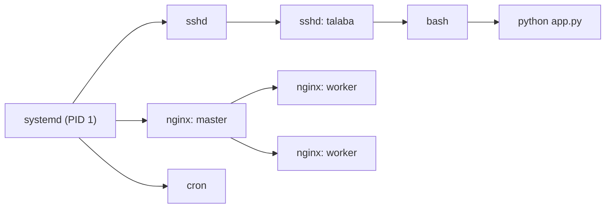
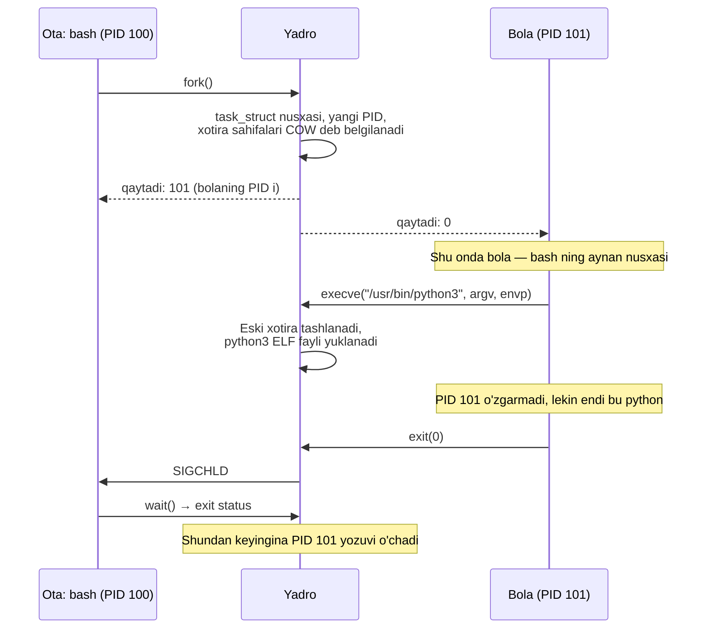
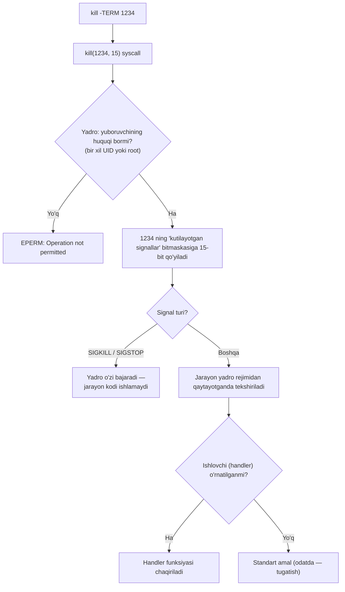
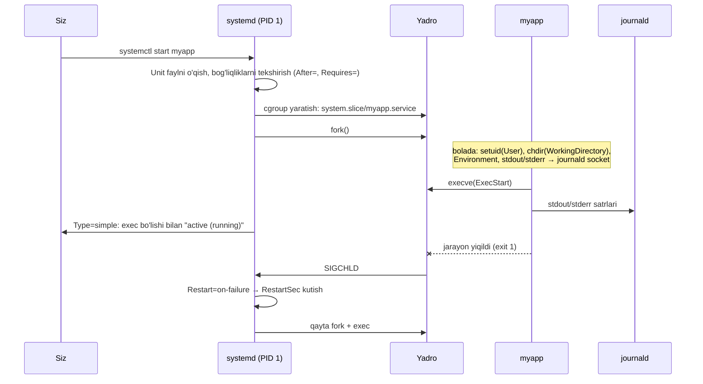
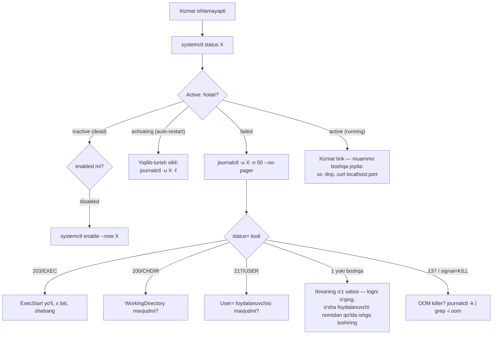

<!-- @section: why -->

## Muammo: "ilova o'z-o'zidan o'chib qoldi"

Dushanba ertalab. Juma kuni siz serverda ilovani `python app.py &` bilan ishga tushirib ketgansiz. Bugun sayt ishlamayapti. Savollar yog'iladi:

- Ilova qachon va **nega** o'chdi? Uni kim o'ldirdi?
- Nega o'zi qayta ishga tushmadi?
- Loglari qayerda? (Ekranga chiqardi — ekran esa yopilgan.)
- Server qayta yuklanganda nega ko'tarilmadi?

Bu savollarning hammasi bitta mavzuga borib taqaladi: **jarayon nima va uning hayotini kim boshqaradi**.

Ikkinchi klassik vaziyat: deploy qildingiz, ilova `Permission denied` bilan yiqildi. Kimdir maslahat beradi: "`chmod -R 777` qil, ishlab ketadi". Ishlab ketadi — va ikki oydan keyin server buzib kirilganida, hujumchi veb-ilova orqali istalgan faylni o'zgartira olgani ma'lum bo'ladi.

## Yechim: operatsion tizim modeli

Linux bu muammolarni uchta mexanizm bilan hal qiladi:

| Muammo | Mexanizm | Bu darsda |
|---|---|---|
| Dasturni ishga tushirish, kuzatish, to'xtatish | **Jarayonlar va signallar** | fork/exec, PID, SIGTERM/SIGKILL |
| Xizmat doim ishlab tursin, yiqilsa qayta tursin, loglari saqlansin | **systemd** | unit fayllar, journalctl |
| Kim nimaga tegishi mumkin | **Ruxsatlar modeli** | rwx, umask, SUID/SGID/sticky |
| Takroriy ishlarni avtomatlashtirish | **bash skriptlar va cron** | set -euo pipefail, crontab |

> **Analogiya.** Server — korxona. Jarayonlar — ishchilar. `systemd` — sex boshlig'i: kim qachon ishga kelishini, kim kasal bo'lsa o'rniga kim chiqishini biladi va hamma voqeani jurnalga yozadi. Ruxsatlar — propusk tizimi: har bir ishchi faqat o'z xonasiga kira oladi.

## Nega bu keyingi mavzular uchun hal qiluvchi

- **Docker konteyner — bu jarayon.** `docker stop` — bu `SIGTERM`, 10 soniyadan keyin `SIGKILL`. Signallarni tushunmasangiz, "nega konteyner 10 soniya to'xtaydi" degan savolga javob topa olmaysiz.
- **Kubernetes Pod ning `OOMKilled`, `exit code 137`** holatlari — jarayon va signal tushunchalari.
- **Konteynerda `USER`**, Kubernetes dagi `runAsNonRoot`, volume ruxsatlari — shu darsdagi rwx modeli.
- **CI/CD pipeline** ning har bir qadami — bash skript; u `exit code` bilan muvaffaqiyat yoki xatoni bildiradi.

<!-- @section: theory -->

## Jarayon (process) nima

**Dastur** — diskdagi fayl. **Jarayon** — o'sha dasturning xotiraga yuklangan, ishlab turgan nusxasi. Bitta dasturdan bir necha jarayon ishga tushishi mumkin (masalan, nginx ning bir necha worker i).

Yadro har bir jarayon uchun quyidagilarni saqlaydi:

| Atribut | Ma'nosi |
|---|---|
| **PID** | Process ID — yagona raqam |
| **PPID** | Parent PID — ota jarayon raqami |
| UID / GID | Jarayon qaysi foydalanuvchi nomidan ishlayapti |
| Xotira xaritasi | Kod, ma'lumot, stek, heap |
| Ochiq fayl deskriptorlari | 0, 1, 2 va boshqalar |
| Joriy katalog, muhit o'zgaruvchilari | `cwd`, `environ` |
| Holat | Ishlamoqda, uxlamoqda, to'xtatilgan, zombie |

Jarayonlar **daraxt** hosil qiladi. Ildizida **PID 1** turadi — yadro ishga tushirgan birinchi jarayon. Zamonaviy Linux da bu `systemd`.



Bu daraxtdan muhim xulosa: `python app.py` ning otasi — `bash`, uning otasi — SSH sessiya. SSH uzilganda sessiya jarayonlari `SIGHUP` oladi va ilova **o'ladi**. Kirish qismidagi sirning javobi shu.

## Jarayon holatlari

| Belgi | Holat | Ma'nosi |
|---|---|---|
| `R` | Running / Runnable | CPU da ishlamoqda yoki navbatda |
| `S` | Sleeping | Hodisani kutmoqda (tarmoq, taymer) — uzilishi mumkin |
| `D` | Uninterruptible sleep | Disk I/O kutmoqda — signal ham uzmaydi |
| `T` | Stopped | `SIGSTOP` yoki Ctrl+Z bilan to'xtatilgan |
| `Z` | Zombie | Tugagan, lekin otasi natijasini o'qimagan |

**Zombie** — "o'lik, lekin dafn etilmagan" jarayon. U CPU ham, xotira ham ishlatmaydi — faqat jarayonlar jadvalida bitta yozuv egallaydi. Uni `kill -9` bilan yo'qotib bo'lmaydi (u allaqachon o'lgan). Yagona yo'l — otasi `wait()` chaqirishi yoki otaning o'zi tugashi.

**Orphan** (yetim) — otasi o'zidan oldin tugagan jarayon. Uni PID 1 "asrab oladi" va tugaganda natijasini o'qiydi.

## Signallar

**Signal** — jarayonga yuboriladigan asinxron xabarnoma. Jarayon signalni **ushlashi** (o'z ishlovchisini ishga tushirishi), **e'tiborsiz qoldirishi** yoki **standart amal**ga bo'ysunishi mumkin.

| Signal | № | Standart amal | Ushlash mumkinmi | Qachon |
|---|---|---|---|---|
| `SIGHUP` | 1 | To'xtatish | Ha | Terminal yopildi; daemon lar uchun — "konfiguratsiyani qayta o'qi" |
| `SIGINT` | 2 | To'xtatish | Ha | Ctrl+C |
| `SIGKILL` | 9 | **Darhol o'ldirish** | **Yo'q** | Oxirgi chora |
| `SIGTERM` | 15 | To'xtatish | Ha | "Iltimos, ishingni tugatib chiq" — `kill` ning standart signali |
| `SIGSTOP` | 19 | Muzlatish | **Yo'q** | Pauza |
| `SIGCONT` | 18 | Davom ettirish | Ha | Pauzadan chiqarish |
| `SIGCHLD` | 17 | E'tiborsiz | Ha | Bola jarayon tugadi |

**SIGTERM va SIGKILL farqi — eng muhim tushuncha:**

- `SIGTERM` — jarayonga yetib boradi. Yaxshi yozilgan ilova uni ushlab, ochiq so'rovlarni tugatadi, bazaga ulanishni yopadi, vaqtinchalik fayllarni tozalaydi — bu **graceful shutdown** (ohista to'xtash).
- `SIGKILL` — jarayonga umuman **yetib bormaydi**. Yadro uni shunchaki rejalashtirishdan olib tashlaydi. Yarim yozilgan fayllar, uzilgan tranzaksiyalar, qulflangan resurslar qolishi mumkin.

Shuning uchun tartib doim: avval `kill PID` (SIGTERM), kutish, faqat javob bo'lmasa — `kill -9 PID`.

## systemd

**systemd** — init tizimi va xizmatlar menejeri. U boshqaradigan har bir obyekt **unit** deb ataladi:

| Unit turi | Vazifasi |
|---|---|
| `.service` | Xizmat (daemon) |
| `.timer` | Jadval bo'yicha ishga tushirish (cron muqobili) |
| `.socket` | Socket faollashtirish |
| `.target` | Unit lar guruhi (masalan `multi-user.target`) |
| `.mount` | Fayl tizimini ulash |

systemd nima beradi: xizmatni **fonda** ishlatish, yiqilsa **qayta ishga tushirish**, yuklanishda **avtomatik ko'tarish**, bog'liqliklar **tartibi**, stdout/stderr ni **journal** ga yig'ish, cgroup orqali **resurslarni cheklash**.

## Ruxsatlar modeli

Har bir fayl va katalogda uchta narsa bor: **egasi** (user), **guruhi** (group) va **ruxsat bitlari**.

```text
-rwxr-x---  1  deploy  www-data  4096  app.sh
│└┬┘└┬┘└┬┘     └──┬──┘ └───┬───┘
│ │  │  │      egasi     guruhi
│ │  │  └── boshqalar (o): ---
│ │  └───── guruh (g):     r-x
│ └──────── egasi (u):     rwx
└────────── tur: - fayl, d katalog, l symlink
```

**Bitlarning ma'nosi fayl va katalog uchun farq qiladi:**

| Bit | Faylda | Katalogda |
|---|---|---|
| `r` (4) | Mazmunini o'qish | Ichidagi nomlar ro'yxatini ko'rish (`ls`) |
| `w` (2) | Mazmunini o'zgartirish | Ichida fayl **yaratish, o'chirish, nomini o'zgartirish** |
| `x` (1) | Dastur sifatida ishga tushirish | Katalog **ichidan o'tish** (`cd`, ichidagi fayllarga murojaat) |

Ikki nozik nuqta:

1. **Faylni o'chirish huquqi faylning o'zida emas, katalogning `w` bitida.** `r--r--r--` fayl ham, agar katalogga yozish huquqingiz bo'lsa, o'chiriladi.
2. **Katalogda `x` bo'lmasa**, ichidagi faylga — hatto u `777` bo'lsa ham — yeta olmaysiz. Yo'ldagi **har bir** katalogda `x` kerak.

**Tekshirish tartibi:** yadro avval "bu egasimi?" deb qaraydi — ha bo'lsa faqat `u` bitlari ishlatiladi; aks holda "guruhidami?" — `g` bitlari; aks holda `o`. Faqat **bitta** to'plam qo'llanadi. Shuning uchun `---rwxrwx` faylni egasi o'qiy olmaydi, garchi "boshqalar" o'qiy olsa ham.

**Sakkizlik yozuv:** har uchlik — bitta raqam (r=4, w=2, x=1 yig'indisi). `rwxr-x---` = 7 5 0 = `750`.

| Rejim | Ma'nosi | Qayerda |
|---|---|---|
| `644` | Egasi yozadi, hamma o'qiydi | Oddiy fayllar, konfiguratsiya |
| `600` | Faqat egasi | Maxfiy kalitlar, `.env` |
| `755` | Egasi to'liq, qolganlar o'qiydi va o'tadi | Kataloglar, skriptlar |
| `750` | Guruhgacha | Ilova kataloglari |
| `700` | Faqat egasi | `~/.ssh` |

## umask

**umask** — yangi yaratilgan fayllardan qaysi bitlar **olib tashlanishini** belgilovchi niqob. Bu ayirish emas, bitli amal: `natija = asos AND NOT umask`.

- Fayllar uchun asos — `666` (x hech qachon avtomatik berilmaydi)
- Kataloglar uchun asos — `777`

| umask | Yangi fayl | Yangi katalog |
|---|---|---|
| `022` (standart) | `644` | `755` |
| `027` | `640` | `750` |
| `077` | `600` | `700` |

## Maxsus bitlar

| Bit | Sakkizlik | Faylda | Katalogda | Misol |
|---|---|---|---|---|
| **SUID** | 4000 | Dastur **fayl egasi** huquqi bilan ishlaydi | — | `/usr/bin/passwd` (`-rwsr-xr-x`) |
| **SGID** | 2000 | Dastur fayl guruhi huquqi bilan ishlaydi | Yangi fayllar **katalog guruhini** meros oladi | Umumiy jamoa katalogi |
| **Sticky** | 1000 | — | Faylni faqat **egasi** o'chira oladi | `/tmp` (`drwxrwxrwt`) |

`passwd` misoli: oddiy foydalanuvchi parolini o'zgartirishi uchun `/etc/shadow` ga yozish kerak, bu fayl esa faqat root niki. SUID tufayli `passwd` dasturi root huquqi bilan ishlaydi — lekin u faqat **o'z** parolingizni o'zgartirishga ruxsat beradigan qilib yozilgan.

> ⚠️ **Ehtiyot bo'l.** SUID root dastur — hujumchi uchun eng shirin nishon. Hech qachon skript yoki o'zingiz yozgan dasturga SUID qo'ymang. Tizimdagi SUID fayllarni topish: `find / -perm -4000 -type f 2>/dev/null`.

## Atamalar lug'ati

| Atama | Ma'nosi | Misol |
|---|---|---|
| PID / PPID | Jarayon / ota jarayon raqami | `ps -o pid,ppid,cmd` |
| fork / exec | Nusxa yaratish / dasturni almashtirish | Har bir buyruq shunday tug'iladi |
| daemon | Fondagi xizmat jarayoni | `sshd`, `nginx` |
| zombie | Tugagan, natijasi o'qilmagan jarayon | `ps` da `Z` |
| signal | Asinxron xabarnoma | `kill -TERM 1234` |
| graceful shutdown | Ishni tugatib, ohista to'xtash | SIGTERM ni ushlash |
| unit | systemd boshqaradigan obyekt | `nginx.service` |
| umask | Yangi fayllar uchun niqob | `umask 027` |
| SUID / SGID / sticky | Maxsus ruxsat bitlari | `chmod 2775 shared/` |

<!-- @section: internals -->

## fork() va exec(): jarayon qanday tug'iladi

Linux da yangi jarayon yaratishning yagona yo'li — mavjudini **klonlash**. Bu ikki bosqichda bo'ladi:



**Nega ikki bosqich?** `fork` va `exec` orasida bola jarayon o'z muhitini sozlashi mumkin: fayl deskriptorlarini qayta ulash (redirect va pipe shu yerda yasaladi), foydalanuvchini o'zgartirish, cgroup ga kirish. Dastur esa bulardan bexabar ishga tushadi.

**Copy-on-write (COW).** `fork` xotirani haqiqatan nusxalamaydi — bu juda qimmat bo'lardi. Ota va bola bir xil fizik sahifalarga ishora qiladi; sahifalar "faqat o'qish" deb belgilanadi. Kimdir yozmoqchi bo'lsagina yadro o'sha **bitta sahifa**ning nusxasini yaratadi.

**Zombie qayerdan chiqadi.** Diagrammaning oxiriga qarang: bola `exit` qilgandan keyin uning exit status i yadroda saqlanib turadi — ota `wait()` bilan o'qib olguncha. Ota buni qilmasa, yozuv abadiy qoladi: bu — zombie.

O'zingiz ko'ring:

```bash
echo $$                 # joriy shell ning PID i
ps -o pid,ppid,stat,cmd --forest -g $(ps -o sid= -p $$)
#   PID  PPID STAT CMD
#  4500  4499 Ss   -bash
#  4612  4500 R+    \_ ps -o pid,ppid,stat,cmd --forest ...

ls -l /proc/$$/fd       # shell ning ochiq deskriptorlari
cat /proc/$$/status | grep -E 'Name|State|PPid|Uid|VmRSS'
```

## Signal qanday yetkaziladi



Bundan kelib chiqadigan amaliy faktlar:

- `D` holatidagi (uzilmaydigan uyqu, masalan osilib qolgan NFS) jarayon signalni **ko'rmaydi** — hatto `SIGKILL` ham I/O qaytguncha kutadi.
- **PID 1 maxsus:** yadro unga ishlovchisi **o'rnatilmagan** signallarni yetkazmaydi. Konteynerda ilovangiz PID 1 bo'lsa va SIGTERM ishlovchisi bo'lmasa — `docker stop` ishlamaydi, 10 soniyadan keyin SIGKILL keladi. Bu Docker darsida yana uchraydi.
- Signal bilan o'lgan jarayonning exit kodi = `128 + signal raqami`: SIGKILL → **137**, SIGTERM → **143**, SIGSEGV → 139. Kubernetes dagi `exit code 137` — aynan shu.

## systemd xizmatni qanday ishga tushiradi



Asosiy g'oya: xizmat **systemd ning bolasi**. Shuning uchun systemd uning tugaganini darhol biladi (`SIGCHLD`) va qayta ishga tushira oladi. Xizmat SSH sessiyaga bog'lanmagan — siz chiqib ketsangiz ham ishlayveradi.

**cgroup ning roli.** Xizmat tug'dirgan barcha bola jarayonlar bitta cgroup da. `systemctl stop` shu cgroup dagi **hammasini** to'xtatadi — "qochib ketgan" bola jarayonlar qolmaydi.

**`Type=` nima uchun muhim** — systemd "xizmat tayyor" deb qachon hisoblashini belgilaydi:

| Type | "Tayyor" deb hisoblanadi | Qachon ishlatiladi |
|---|---|---|
| `simple` (standart) | `exec` bo'lishi bilan | Fonga o'tmaydigan zamonaviy ilovalar |
| `exec` | Binar muvaffaqiyatli ishga tushgach | `simple` ning aniqroq varianti |
| `forking` | Asosiy jarayon tugab, bolasi qolgach | Eski uslubdagi, o'zi fonga o'tadigan daemon lar (`PIDFile=` kerak) |
| `notify` | Ilova `sd_notify("READY=1")` yuborgach | Tayyorligini aniq xabar qiladigan ilovalar |
| `oneshot` | Jarayon tugagach | Bir martalik vazifalar (timer bilan) |

Klassik xato: fonga o'tmaydigan ilovaga `Type=forking` qo'yish → systemd "fork" ni kutib, 90 soniyadan keyin timeout bilan o'ldiradi.

## Ruxsat tekshiruvi yadroda

Fayl ochilganda (`open()` syscall) yadro yo'lning **har bir komponenti** uchun tekshiruv o'tkazadi:

```text
open("/srv/app/config/db.yml", O_RDONLY)   jarayon: uid=1001(deploy) gid=1001

/            → x kerak   drwxr-xr-x root root      → "boshqalar": r-x ✓
/srv         → x kerak   drwxr-xr-x root root      → ✓
/srv/app     → x kerak   drwxr-x--- app  app       → deploy egasi ham, guruhda ham emas
                                                     → "boshqalar": --- ✗  EACCES
```

Faylning o'zi `644` bo'lsa ham natija — `Permission denied`. Bunday holatni bir buyruq bilan tashxislash:

```bash
namei -l /srv/app/config/db.yml
# f: /srv/app/config/db.yml
# drwxr-xr-x root root /
# drwxr-xr-x root root srv
# drwxr-x--- app  app  app        ← mana muammo
# drwxr-xr-x app  app  config
# -rw-r--r-- app  app  db.yml
```

`root` (UID 0) uchun bu tekshiruvlar o'tkazib yuboriladi (aniqrog'i, `CAP_DAC_OVERRIDE` capability si bor).

<!-- @section: commands -->

## Jarayonlarni ko'rish

```bash
ps aux --sort=-%mem | head -5
```

```text
USER       PID %CPU %MEM    VSZ   RSS TTY   STAT START   TIME COMMAND
postgres  1423  0.3 12.1 412932 98312 ?     Ss   Noy09   1:12 postgres: checkpointer
deploy    3920  1.2  8.4 301224 68120 ?     Sl   09:01   0:45 /usr/bin/python3 /opt/myapp/app.py
```

```tahlil
{"command":"ps aux --sort=-%mem","parts":[{"t":"ps","d":"Jarayonlar suratini (snapshot) ko'rsatadi — top dan farqli, bir marta"},{"t":"a","d":"Barcha foydalanuvchilarning terminalga bog'langan jarayonlari"},{"t":"u","d":"Foydalanuvchiga yo'naltirilgan format: USER, %CPU, %MEM, START..."},{"t":"x","d":"Terminalga bog'lanmaganlarni ham (daemon lar). Busiz xizmatlar ko'rinmaydi"},{"t":"--sort=-%mem","d":"Xotira bo'yicha saralash; minus — kamayish tartibida"}]}
```

Ustunlar: `VSZ` — virtual xotira (band qilingan manzil maydoni, ko'pincha chalg'ituvchi katta); **`RSS`** — haqiqatan fizik xotirada turgan qism (kilobaytda) — amalda shunga qarang; `STAT` — holat (`S` uxlamoqda, `R` ishlamoqda, `Z` zombie; `s` — sessiya yetakchisi, `l` — ko'p oqimli).

| Buyruq | Vazifasi |
|---|---|
| `ps -ef --forest` | Daraxt ko'rinishida, PPID bilan |
| `pgrep -a nginx` | Nom bo'yicha PID va buyruq satri |
| `pstree -p` | Jarayonlar daraxti |
| `top` / `htop` | Jonli ko'rinish. `top` da: `M` — xotira, `P` — CPU bo'yicha, `1` — har yadro, `k` — kill |
| `ls -l /proc/PID/cwd /proc/PID/exe` | Jarayon qaysi katalogda va qaysi binardan ishlayapti |
| `cat /proc/PID/environ \| tr '\0' '\n'` | Jarayonning muhit o'zgaruvchilari |

## Signal yuborish

```bash
kill 3920            # SIGTERM (15) — ohista
kill -HUP 800        # konfiguratsiyani qayta o'qish (nginx master)
kill -9 3920         # SIGKILL — faqat SIGTERM yordam bermasa
pkill -f 'app.py'    # buyruq satri bo'yicha
kill -l              # barcha signallar ro'yxati
```

> ⚠️ **Ehtiyot bo'l: `kill -9`**
> Ma'lumotlar bazasi, navbat brokeri yoki fayl yozayotgan jarayonga `-9` yuborish ma'lumot buzilishiga olib kelishi mumkin. Avval SIGTERM, 10–30 soniya kuting.

Fon va old rejim: `buyruq &` — fonda; `jobs` — ro'yxat; `fg %1` — oldinga; Ctrl+Z — to'xtatish (`SIGTSTP`), `bg` — fonda davom ettirish. Terminal yopilganda o'lmasligi uchun `nohup buyruq &` yoki `tmux` — lekin **xizmatlar uchun to'g'ri yechim systemd**.

## systemd unit fayli — qator-qator

Fayl: `/etc/systemd/system/myapp.service`

```ini
[Unit]
Description=Mening veb-ilovam
After=network-online.target postgresql.service
Wants=network-online.target

[Service]
Type=simple
User=deploy
Group=deploy
WorkingDirectory=/opt/myapp
EnvironmentFile=/etc/myapp/env
ExecStart=/opt/myapp/venv/bin/gunicorn app:app --bind 127.0.0.1:8000
ExecReload=/bin/kill -HUP $MAINPID
Restart=on-failure
RestartSec=5
TimeoutStopSec=30
NoNewPrivileges=true
ProtectSystem=strict
ReadWritePaths=/var/lib/myapp

[Install]
WantedBy=multi-user.target
```

| Qator | Nima qiladi | O'chirilsa / xato bo'lsa |
|---|---|---|
| `Description=` | `systemctl status` da ko'rinadigan nom | Faqat qulaylik |
| `After=` | **Tartib**: shu unit lardan keyin ishga tushir | Ilova tarmoq yoki DB tayyor bo'lmasdan boshlanadi |
| `Wants=` | **Bog'liqlik**: shularni ham ishga tushir (yumshoq) | `After` faqat tartib beradi, ishga tushirmaydi! Ikkalasi kerak |
| `Type=simple` | Jarayon fonga o'tmaydi | Noto'g'ri tur → timeout |
| `User=` / `Group=` | Kim nomidan ishlaydi | Ko'rsatilmasa — **root**. Hech qachon veb-ilovani root bilan ishlatmang |
| `WorkingDirectory=` | Joriy katalog | Katalog yo'q bo'lsa: `status=200/CHDIR` |
| `EnvironmentFile=` | `KEY=value` fayli (ruxsati 600) | Sirlar unit faylda ochiq yotmaydi |
| `ExecStart=` | Ishga tushirish buyrug'i — **absolyut yo'l shart** | Nisbiy yo'l → unit yuklanmaydi; fayl yo'q → `status=203/EXEC` |
| `ExecReload=` | `systemctl reload` nima qilishi | Reload ishlamaydi |
| `Restart=on-failure` | Nolga teng bo'lmagan kod yoki signal bilan tugasa — qayta ishga tushir | Yiqilgan ilova yotib qoladi |
| `RestartSec=5` | Qayta urinishlar orasidagi pauza | Standart 100 ms — yiqilib-turish sikli CPU ni yeydi |
| `TimeoutStopSec=30` | SIGTERM dan keyin SIGKILL gacha kutish | Standart 90 s |
| `NoNewPrivileges=true` | SUID orqali huquq oshirishni taqiqlaydi | Xavfsizlik zaiflashadi |
| `ProtectSystem=strict` | Butun fayl tizimi faqat o'qish uchun | — |
| `ReadWritePaths=` | Yuqoridagidan istisno | Ilova yoza olmaydi: `Read-only file system` |
| `WantedBy=multi-user.target` | `enable` qilinganda qaysi target ga ulanadi | `enable` ishlamaydi → qayta yuklanganda ko'tarilmaydi |

Boshqarish:

```bash
sudo systemctl daemon-reload          # unit fayl o'zgargandan keyin MAJBURIY
sudo systemctl enable --now myapp     # avtomatik yuklash + hozir ishga tushirish
systemctl status myapp                # holat va oxirgi log satrlari
sudo systemctl restart myapp          # to'xtatib, qayta ishga tushirish
sudo systemctl reload myapp           # to'xtatmasdan konfiguratsiyani qayta o'qitish
systemctl is-active myapp; systemctl is-enabled myapp
systemctl cat myapp                   # amaldagi unit fayl (drop-in lar bilan)
systemd-analyze verify /etc/systemd/system/myapp.service   # sintaksis tekshiruvi
```

`start` va `enable` — **mustaqil** tushunchalar: `start` — hozir ishga tushir; `enable` — yuklanishda ishga tushir. Eng ko'p uchraydigan xato: `start` qilib, `enable` ni unutish.

## journalctl

```bash
journalctl -u myapp -f --since "10 min ago" -p warning
```

```tahlil
{"command":"journalctl -u myapp -f --since \"10 min ago\" -p warning","parts":[{"t":"journalctl","d":"systemd jurnali (journald) dan loglarni o'qiydi"},{"t":"-u myapp","d":"Faqat shu unit ning loglari. Bir nechta -u berish mumkin"},{"t":"-f","d":"Follow: yangi satrlarni jonli ko'rsatadi (tail -f kabi)"},{"t":"--since \"10 min ago\"","d":"Vaqt filtri. Shuningdek: today, yesterday, '2026-11-10 09:00'"},{"t":"-p warning","d":"Ustuvorlik: warning va undan jiddiylari (err, crit, alert, emerg)"}]}
```

| Bayroq | Vazifasi |
|---|---|
| `-e` | Oxiriga o'tish |
| `-x` | Xatolarga tushuntirish qo'shish |
| `-b` | Faqat joriy yuklanishdan beri; `-b -1` — oldingi yuklanish |
| `-n 100` | Oxirgi 100 satr |
| `-k` | Yadro xabarlari (`dmesg`) — OOM killer shu yerda |
| `-o json-pretty` | Barcha maydonlar bilan |
| `--disk-usage`, `--vacuum-size=500M` | Jurnal hajmi va tozalash |

## Ruxsatlarni boshqarish

```bash
chmod 750 /opt/myapp               # sakkizlik
chmod u+x,g-w,o= deploy.sh         # belgili: u/g/o/a, + - =, r/w/x
chmod -R g+rX /srv/shared          # X: faqat kataloglarga (va allaqachon x bo'lgan fayllarga) x beradi
chown deploy:www-data /opt/myapp   # egasi:guruhi
chown -R deploy: /opt/myapp        # ikki nuqtadan keyin bo'sh — foydalanuvchining asosiy guruhi
```

```tahlil
{"command":"chmod -R g+rX /srv/shared","parts":[{"t":"chmod","d":"Ruxsat bitlarini o'zgartiradi. Faqat fayl egasi yoki root bajara oladi"},{"t":"-R","d":"Rekursiv — ichidagi hamma narsaga"},{"t":"g+rX","d":"Guruhga (g) qo'sh (+): r — o'qish; katta X — faqat KATALOGLARga 'o'tish' huquqi. Kichik x bo'lganida barcha oddiy fayllar ham bajariluvchi bo'lib qolardi"},{"t":"/srv/shared","d":"Nishon"}]}
```

Umumiy jamoa katalogi (SGID + sticky):

```bash
sudo mkdir /srv/shared
sudo chown root:devs /srv/shared
sudo chmod 3770 /srv/shared     # 2000 (SGID) + 1000 (sticky) + 770
ls -ld /srv/shared
# drwxrws--T 2 root devs 4096 ... /srv/shared
```

## Bash skript skeleti

```bash
#!/usr/bin/env bash
set -euo pipefail
IFS=$'\n\t'

readonly THRESHOLD="${1:-85}"            # birinchi argument, bo'lmasa 85
readonly LOG=/var/log/disk-check.log

log() { printf '%s %s\n' "$(date '+%F %T')" "$*" | tee -a "$LOG"; }
cleanup() { rm -f "${tmp:-}"; }
trap cleanup EXIT
trap 'log "XATO: $LINENO-qatorda"' ERR

tmp=$(mktemp)
df --output=pcent,target -x tmpfs -x devtmpfs | tail -n +2 > "$tmp"

while read -r pct mount; do
  pct=${pct%\%}                           # oxiridagi % ni olib tashlash
  if (( pct >= THRESHOLD )); then
    log "OGOHLANTIRISH: $mount ${pct}% to'lgan"
  fi
done < "$tmp"
```

| Qator | Nega |
|---|---|
| `#!/usr/bin/env bash` | Shebang: yadroga qaysi interpretator kerakligini aytadi. `env` — bash qayerda bo'lsa ham topadi |
| `set -e` | Xato bo'lsa to'xta |
| `set -u` | Aniqlanmagan o'zgaruvchi — xato (`rm -rf "$DIR/"` falokatidan saqlaydi) |
| `set -o pipefail` | Pipe ichidagi xato ham hisobga olinadi |
| `IFS=$'\n\t'` | So'zlarni faqat yangi satr va tab bo'yicha bo'l (bo'sh joy bo'yicha emas) |
| `${1:-85}` | Standart qiymat |
| `trap cleanup EXIT` | Skript qanday tugasa ham (xato, Ctrl+C) tozalash bajariladi |
| `(( ... ))` | Arifmetik taqqoslash |
| `done < "$tmp"` | Pipe o'rniga yo'naltirish — sikl subshell da ishlamaydi |

## cron

```bash
crontab -e          # joriy foydalanuvchi jadvalini tahrirlash
crontab -l          # ko'rish
```

```text
# m   h   dom mon dow   buyruq
PATH=/usr/local/sbin:/usr/local/bin:/usr/sbin:/usr/bin:/sbin:/bin
MAILTO=""
*/5   *   *   *   *     /opt/scripts/disk-check.sh 80 >> /var/log/disk-check.cron.log 2>&1
0     3   *   *   *     flock -n /run/backup.lock /opt/scripts/backup.sh >> /var/log/backup.log 2>&1
```

| Maydon | Qiymatlar | Maxsus yozuv |
|---|---|---|
| Daqiqa | 0–59 | `*/5` — har 5 daqiqada |
| Soat | 0–23 | `9-18` — oraliq |
| Oy kuni | 1–31 | `1,15` — ro'yxat |
| Oy | 1–12 | |
| Hafta kuni | 0–7 (0 va 7 — yakshanba) | `1-5` — ish kunlari |

`flock -n fayl buyruq` — oldingi nusxa hali ishlayotgan bo'lsa, yangisini ishga tushirmaydi.

Zamonaviy muqobil — **systemd timer**: loglar journal da, `Persistent=true` bilan o'tkazib yuborilgan ishga tushishlar bajariladi, bog'liqliklar va resurs cheklovlari ishlaydi. Ko'rish: `systemctl list-timers`.

<!-- @section: lab -->

## Lab 1. Ilovani systemd xizmatiga aylantirish

**Maqsad:** unit fayl yozish, avtomatik qayta ishga tushishni va loglarni sinash.

**Muhit:** Ubuntu 22.04/24.04 VM (sudo huquqi bilan).

**Qadamlar:**

1. Tizim foydalanuvchisi va ilova katalogini yarating:

   ```bash
   sudo useradd --system --home /opt/hello --shell /usr/sbin/nologin hello
   sudo mkdir -p /opt/hello && sudo chown hello: /opt/hello
   ```

2. `/opt/hello/app.py` — 8000-portda javob beradigan va `SIGTERM` ni ohista qayta ishlaydigan kichik HTTP server yozing (Python standart kutubxonasi yetarli).

3. `/etc/systemd/system/hello.service` unit faylini yozing: `User=hello`, `Restart=on-failure`, `RestartSec=3`.

4. Ishga tushiring va avtomatik yuklashga qo'shing. `curl localhost:8000` bilan tekshiring.

5. Jarayonni `kill -9` bilan o'ldiring. 3 soniyadan keyin nima bo'ladi?

6. `sudo systemctl stop hello` qiling. Endi qayta ishga tushdimi? Nega yo'q?

**Tekshirish:**

```bash
systemctl is-active hello && systemctl is-enabled hello     # active / enabled
systemctl show hello -p NRestarts                           # 5-qadamdan keyin: NRestarts=1
journalctl -u hello -n 20 --no-pager
```

<details><summary>💡 Yechimni ko'rsatish</summary>

`/opt/hello/app.py`:

```python
import signal, sys
from http.server import BaseHTTPRequestHandler, HTTPServer

class H(BaseHTTPRequestHandler):
    def do_GET(self):
        self.send_response(200); self.end_headers()
        self.wfile.write(b"Salom, systemd!\n")

srv = HTTPServer(("127.0.0.1", 8000), H)

def stop(signum, frame):
    print("SIGTERM olindi, ohista to'xtayapman", flush=True)
    sys.exit(0)

signal.signal(signal.SIGTERM, stop)
print("8000-portda tinglayapman", flush=True)
srv.serve_forever()
```

`/etc/systemd/system/hello.service`:

```ini
[Unit]
Description=Salom xizmati
After=network.target

[Service]
User=hello
WorkingDirectory=/opt/hello
ExecStart=/usr/bin/python3 /opt/hello/app.py
Restart=on-failure
RestartSec=3

[Install]
WantedBy=multi-user.target
```

```bash
sudo systemctl daemon-reload
sudo systemctl enable --now hello
curl localhost:8000
sudo kill -9 "$(systemctl show hello -p MainPID --value)"
sleep 4; systemctl status hello --no-pager
```

5-qadamda: SIGKILL — "muvaffaqiyatsiz tugash", `Restart=on-failure` ishlaydi. 6-qadamda: `systemctl stop` — ataylab to'xtatish; SIGTERM ni ilova ushlab, 0 kod bilan chiqdi — bu "failure" emas, qayta ishga tushirilmaydi. `Restart=always` bo'lsa ham `systemctl stop` dan keyin qayta turmaydi — systemd ataylab to'xtatishni farqlaydi.

</details>

## Lab 2. Umumiy jamoa katalogi

**Maqsad:** SGID va sticky bitni amalda qo'llash.

**Talab:** `/srv/loyiha` katalogi; `devs` guruhi a'zolari (`ali`, `vali`) unda fayl yarata va bir-birining faylini **o'qiy va o'zgartira** olsin, lekin bir-birining faylini **o'chira olmasin**; begonalar umuman kira olmasin.

**Tekshirish:**

```bash
sudo -u ali  touch /srv/loyiha/a.txt
ls -l /srv/loyiha/a.txt            # guruh: devs (ali emas!)
sudo -u vali sh -c 'echo x >> /srv/loyiha/a.txt'   # ishlaydi
sudo -u vali rm /srv/loyiha/a.txt  # rm: cannot remove: Operation not permitted
sudo -u nobody ls /srv/loyiha      # Permission denied
```

<details><summary>💡 Yechimni ko'rsatish</summary>

```bash
sudo groupadd devs
sudo useradd -m -G devs ali
sudo useradd -m -G devs vali

sudo mkdir /srv/loyiha
sudo chown root:devs /srv/loyiha
sudo chmod 3770 /srv/loyiha        # SGID(2) + sticky(1) + rwxrwx---
```

Yana bir tafsilot: yangi fayl `664` bo'lishi uchun foydalanuvchilarning umask i `002` bo'lishi kerak (standart `022` da guruhga yozish berilmaydi). Buni `/etc/profile.d/` orqali yoki — aniqroq yechim — standart ACL bilan hal qiling:

```bash
sudo setfacl -d -m g:devs:rwX /srv/loyiha
```

</details>

## Lab 3. Sandbox da: jarayon va xizmat

Ilovadagi **Linux terminal sandbox** ni oching va 9- va 10-topshiriqlarni bajaring: CPU ni band qilgan jarayonni topib to'xtating; ishlamayotgan `myapp` xizmatining sababini `systemctl status` va `journalctl -u myapp` orqali aniqlab, tuzating.

## Qo'shimcha chaqiriq

Lab 1 dagi xizmat uchun cron o'rniga **systemd timer** yozing: har 5 daqiqada `curl -fsS localhost:8000` bajarsin va natija journal ga tushsin. Ishora: `hello-check.service` (`Type=oneshot`) + `hello-check.timer` (`OnCalendar=*:0/5`).

<!-- @section: breakfix -->

## 1. Xizmat ishga tushmayapti: status=203/EXEC

```text
● report.service - Hisobot generatori
     Active: failed (Result: exit-code)
    Process: 5121 ExecStart=/opt/report/run.sh (code=exited, status=203/EXEC)
report.service: Failed at step EXEC spawning /opt/report/run.sh: Exec format error
```

`run.sh` ning mazmuni va ruxsatlari:

```text
$ ls -l /opt/report/run.sh
-rwxr-xr-x 1 report report 61 Noy 10 09:00 /opt/report/run.sh
```

```breakfix
{"title":"Exec format error","lang":"shell","broken":"cd /opt/report\nexec python3 generate.py --out /var/lib/report/","hints":["Fayl bajariluvchi (x bor), lekin yadro uni QANDAY bajarishni bilmayapti.","Yadro faylning birinchi ikki baytiga qaraydi.","Birinchi satrda shebang (#!) yo'q."],"solution":"#!/usr/bin/env bash\ncd /opt/report\nexec python3 generate.py --out /var/lib/report/","explain":"execve() faylning boshidagi \"#!\" belgisini ko'rsa, ko'rsatilgan interpretatorni ishga tushiradi. Shebang bo'lmasa — yadro uchun bu noma'lum formatdagi fayl: 'Exec format error'. Terminalda qo'lda ishlagani aldamchi: u yerda shell o'zi skriptni talqin qiladi, systemd esa to'g'ridan-to'g'ri execve chaqiradi."}
```

## 2. Cron vazifa qo'lda ishlaydi, cron da ishlamaydi

Skript terminalda muammosiz ishlaydi. Cron dan esa logga faqat shu tushadi:

```text
/opt/scripts/db-backup.sh: line 4: pg_dump: command not found
```

```breakfix
{"title":"cron muhiti","lang":"shell","broken":"#!/usr/bin/env bash\nset -euo pipefail\nBACKUP_DIR=/var/backups/db\npg_dump -Fc myapp > \"$BACKUP_DIR/myapp-$(date +%F).dump\"\nfind \"$BACKUP_DIR\" -name '*.dump' -mtime +14 -delete","hints":["Terminalda `which pg_dump` nima ko'rsatadi? Cron da PATH qanday?","Cron ning standart PATH i juda qisqa: /usr/bin:/bin. Sizning .bashrc ingiz o'qilmaydi.","Skript boshida PATH ni aniq belgilang yoki pg_dump ga to'liq yo'l yozing."],"solution":"#!/usr/bin/env bash\nset -euo pipefail\nexport PATH=/usr/local/sbin:/usr/local/bin:/usr/sbin:/usr/bin:/sbin:/bin:/usr/lib/postgresql/16/bin\nBACKUP_DIR=/var/backups/db\npg_dump -Fc myapp > \"$BACKUP_DIR/myapp-$(date +%F).dump\"\nfind \"$BACKUP_DIR\" -name '*.dump' -mtime +14 -delete","explain":"Cron interaktiv shell emas: ~/.bashrc va ~/.profile o'qilmaydi, PATH minimal. Skript o'z muhitini o'zi sozlashi kerak. Diagnostika uchun crontab ga vaqtincha `* * * * * env > /tmp/cron-env.txt` qo'shib, farqni ko'ring."}
```

## 3. "Permission denied", garchi fayl 644 bo'lsa ham

nginx statik fayllarni bera olmayapti:

```text
[error] open() "/home/deploy/site/public/index.html" failed (13: Permission denied)
```

```text
$ namei -l /home/deploy/site/public/index.html
drwxr-xr-x root   root   /
drwxr-xr-x root   root   home
drwxr-x--- deploy deploy deploy
drwxr-xr-x deploy deploy site
drwxr-xr-x deploy deploy public
-rw-r--r-- deploy deploy index.html
```

```breakfix
{"title":"Yo'ldagi katalog","lang":"shell","broken":"# Kimdir shunday \"tuzatmoqchi\" bo'ldi:\nsudo chmod -R 777 /home/deploy/site","hints":["nginx www-data foydalanuvchisi sifatida ishlaydi. namei chiqishida qaysi katalogdan www-data o'ta olmaydi?","/home/deploy — drwxr-x---: 'boshqalar' uchun x yo'q. Ichidagi narsalar qanday ruxsatda bo'lishidan qat'i nazar, yo'l shu yerda uziladi.","Eng toza yechim: saytni uy katalogidan /var/www ga ko'chirish. 777 hech qachon yechim emas."],"solution":"# Saytni to'g'ri joyga ko'chirish va aniq egalik berish:\nsudo mkdir -p /var/www/site\nsudo cp -a /home/deploy/site/public/. /var/www/site/\nsudo chown -R deploy:www-data /var/www/site\nsudo chmod -R u=rwX,g=rX,o= /var/www/site","explain":"Faylga yetish uchun yo'ldagi HAR BIR katalogda x (o'tish) huquqi kerak. Ubuntu da uy kataloglari 750 — www-data /home/deploy dan o'ta olmaydi. chmod -R 777 muammoni hal qilmaydi (to'siq yuqoriroqda) va xavfsizlikni buzadi. To'g'ri yechim: fayllarni /var/www ga joylash, egasi — deploy, guruhi — www-data, ruxsat 750/640."}
```

<!-- @section: errors -->

## Xizmat ishlamayotganda: tizimli yondashuv



Eng kuchli usul — xizmatni **aynan o'sha muhitda qo'lda** ishga tushirish:

```bash
sudo -u deploy -s /bin/bash -c 'cd /opt/myapp && /opt/myapp/venv/bin/gunicorn app:app'
```

## Xatolar jadvali

| Xato xabari / simptom | Sabab | Qanday tekshiriladi | Yechim |
|---|---|---|---|
| `status=203/EXEC` | Binar topilmadi, `x` yo'q yoki shebang yo'q/noto'g'ri | `ls -l`, `head -1`, `file` | Yo'lni, ruxsatni, shebang ni tuzatish |
| `status=200/CHDIR` | `WorkingDirectory` mavjud emas yoki kirib bo'lmaydi | `namei -l katalog` | Katalog yaratish / ruxsat berish |
| `status=217/USER` | `User=` dagi foydalanuvchi yo'q | `id foydalanuvchi` | `useradd --system` |
| `Start request repeated too quickly` | 10 soniyada 5 marta yiqildi (`StartLimitBurst`) | `journalctl -u X` | Asl sababni tuzatish; `systemctl reset-failed X` |
| `Unit X.service not found` | Fayl noto'g'ri joyda yoki `daemon-reload` qilinmagan | `systemctl cat X` | `/etc/systemd/system/`, `daemon-reload` |
| `Warning: The unit file changed on disk` | `daemon-reload` unutilgan | — | `sudo systemctl daemon-reload` |
| `Job for X failed because a timeout was exceeded` | `Type=forking`/`notify` noto'g'ri — systemd tayyorlik signalini kutmoqda | Unit dagi `Type=` | `Type=simple` yoki ilovani moslash |
| `Main process exited, code=killed, status=9/KILL` | OOM killer yoki kimdir `kill -9` qilgan | `journalctl -k \| grep -i 'out of memory'` | Xotira oqishini tuzatish, `MemoryMax=` |
| `bash: ./x.sh: Permission denied` | `x` biti yo'q **yoki** fayl tizimi `noexec` bilan ulangan | `ls -l`; `findmnt -T ./x.sh` | `chmod +x`; boshqa joyga ko'chirish |
| `Operation not permitted` (`rm` da) | Sticky bit li katalog va siz egasi emassiz; yoki `chattr +i` | `ls -ld katalog`; `lsattr fayl` | Egasi o'chirsin; `chattr -i` |
| `Text file busy` | Ishlab turgan binar ustidan yozishga urinish | — | Avval yangi faylni yonida yaratib, `mv` qilish |
| `kill: (1234) - Operation not permitted` | Boshqa foydalanuvchining jarayoni | `ps -o user= -p 1234` | `sudo kill` |
| Jarayon `kill -9` ga ham javob bermaydi | `Z` (zombie) yoki `D` (I/O kutmoqda) holatida | `ps -o stat,ppid -p PID` | Zombie: otasini qayta ishga tushirish; `D`: I/O muammosini hal qilish |
| `fork: retry: Resource temporarily unavailable` | Jarayonlar soni chegarasi (`ulimit -u`, `pids.max`) | `ulimit -u`; `ps -eLf \| wc -l` | Chegarani oshirish, "fork bomba" ni topish |
| `Too many open files` | Ochiq deskriptorlar chegarasi | `cat /proc/PID/limits`; `ls /proc/PID/fd \| wc -l` | Unit da `LimitNOFILE=65535` |
| Cron vazifa umuman ishlamayapti | Sintaksis; fayl oxirida yangi satr yo'q; `/etc/cron.d` da foydalanuvchi ustuni tushib qolgan | `grep CRON /var/log/syslog` | Formatni tuzatish |

## Debug uchun asosiy buyruqlar

```bash
systemctl status X; journalctl -u X -e          # birinchi ikki buyruq — doim
systemctl --failed                              # barcha yiqilgan unit lar
systemctl show X -p MainPID,NRestarts,ExecMainStatus,Result
journalctl -k -b | grep -iE 'oom|killed process'
namei -l /to/liq/yo/l                           # yo'l bo'ylab ruxsatlar
sudo -u FOYDALANUVCHI test -r FAYL && echo o'qiydi || echo o'qiy olmaydi
strace -f -p PID -e trace=file,network          # jarayon hozir nima qilyapti
lsof -p PID                                     # ochiq fayllar va socketlar
```

<!-- @section: production -->

## Xavfsizlik

**1. Har bir xizmatga — alohida, huquqsiz foydalanuvchi.**

```bash
sudo useradd --system --no-create-home --shell /usr/sbin/nologin myapp
```

Xizmat buzib kirilsa, hujumchi faqat shu foydalanuvchi yeta oladigan narsalarga yetadi.

**2. systemd ning "qum qutisi" imkoniyatlaridan foydalaning.**

```ini
[Service]
NoNewPrivileges=true
ProtectSystem=strict
ProtectHome=true
PrivateTmp=true
ReadWritePaths=/var/lib/myapp
CapabilityBoundingSet=
```

Baholash: `systemd-analyze security myapp` — 0 (xavfsiz) dan 10 (ochiq) gacha ball beradi.

**3. Sirlar unit faylda emas.** `EnvironmentFile=/etc/myapp/env` (egasi root, ruxsati `600`) yoki `LoadCredential=`. Unit fayllarni hamma o'qiy oladi.

**4. 1024 dan kichik portni root siz ochish.** Ilovani root qilib ishga tushirmang — unga faqat kerakli capability ni bering:

```ini
AmbientCapabilities=CAP_NET_BIND_SERVICE
```

**5. SUID fayllarni kuzatib boring.**

```bash
find / -xdev -perm -4000 -type f 2>/dev/null   # ro'yxatni saqlang va davriy solishtiring
```

## Ishonchlilik

| Sozlama | Tavsiya | Nega |
|---|---|---|
| `Restart=` | `on-failure` | `always` konfiguratsiya xatosini yashirib, cheksiz sikl beradi |
| `RestartSec=` | 3–10 s | Yiqilib-turish sikli tizimni bo'g'masin |
| `StartLimitIntervalSec=` / `StartLimitBurst=` | 60 / 5 | Tuzalmaydigan xatoda to'xtab, alert bersin |
| `TimeoutStopSec=` | Ilovaning eng uzun so'rovidan biroz ko'p | Ohista to'xtashga vaqt qolsin |
| `MemoryMax=` | Aniq qiymat | Bitta oqayotgan xizmat butun serverni yiqitmasin |
| `LimitNOFILE=` | 65535 | Standart 1024 yuklama ostida tugaydi |
| `After=` + `Wants=network-online.target` | Tarmoqqa bog'liq xizmatlar uchun | Yuklanishda poyga holati bo'lmasin |

**Ilovangiz SIGTERM ni ushlashi shart.** Bu deploy paytida so'rovlar uzilmasligining asosi — keyinchalik Docker va Kubernetes da ham aynan shu signal keladi.

## Performance

- `nice -n 10 buyruq` — CPU ustuvorligini pasaytirish (zaxira, hisobot kabi fon ishlari uchun); `ionice -c3` — disk uchun.
- Unit da `CPUQuota=50%`, `IOWeight=` — cgroup orqali qat'iy cheklov.
- Ko'p sonli `Z` jarayonlar — ota jarayondagi xato belgisi; PID lar tugashiga olib kelishi mumkin.

## Kuzatuv

- journald hajmini cheklang (`/etc/systemd/journald.conf`): `SystemMaxUse=1G`.
- Ilova loglarini **stdout ga** yozing — fayl va rotatsiya bilan o'zi shug'ullanmasin. journald yig'adi, keyin Loki/ELK ga uzatiladi.
- Cron vazifalar "jim yiqilmasin": chiqishni logga yo'naltiring va muvaffaqiyatli tugaganda "yurak urishi" (heartbeat) yuboring — signal kelmasa alert.

## Production ga chiqishdan oldingi tekshiruv ro'yxati

- [ ] Xizmat root sifatida ishlamaydi (`systemctl show X -p User`)
- [ ] `enable` qilingan — qayta yuklanishdan keyin ko'tariladi (sinab ko'rilgan!)
- [ ] `Restart=on-failure` va oqilona `RestartSec`
- [ ] Ilova SIGTERM ni ushlaydi va 30 soniya ichida to'xtaydi
- [ ] Sirlar `EnvironmentFile` da, ruxsati `600`
- [ ] Loglar journal ga tushadi, journal hajmi cheklangan
- [ ] `MemoryMax` va `LimitNOFILE` belgilangan
- [ ] Ilova kataloglarida `777` yo'q: `find /opt/myapp -perm -o+w`
- [ ] Cron vazifalarda `flock`, log va to'liq `PATH`

## Anti-pattern lar

| Anti-pattern | Nima uchun yomon | To'g'risi |
|---|---|---|
| `nohup ./app &` yoki `screen` da xizmat | Yiqilsa turmaydi, reboot dan keyin yo'q, log yo'q | systemd unit |
| `chmod -R 777` | Hamma hamma narsani o'zgartira oladi | Aniq egalik + `750`/`640` |
| `kill -9` odat sifatida | Ma'lumot buzilishi | SIGTERM → kutish → SIGKILL |
| Xizmat `User=root` | Zaiflik = butun server | Alohida tizim foydalanuvchisi |
| `Restart=always` + `RestartSec=0` | CPU ni yeydigan cheksiz sikl | `on-failure`, 5 s, start limit |
| `@reboot` cron bilan xizmat ko'tarish | Kuzatuv ham, qayta ishga tushirish ham yo'q | systemd unit |
| Skriptda `sudo` | Parol so'raydi, cron da osiladi | Skriptni kerakli foydalanuvchi nomidan ishga tushirish |

<!-- @section: interview -->

### 1. SIGTERM va SIGKILL farqi nima? Nega `kill -9` oxirgi chora?

🟢 Junior

**Namunaviy javob.** SIGTERM (15) — jarayonga yetkaziladigan "iltimos, to'xta" xabari. Jarayon uni ushlab, ochiq so'rovlarni tugatishi, tranzaksiyalarni yakunlashi, fayllarni yopishi mumkin. SIGKILL (9) ni jarayon ushlay olmaydi — yadro uni darhol yo'q qiladi, hech qanday tozalash bo'lmaydi. Natijada yarim yozilgan fayllar, bo'shatilmagan qulflar, yo'qolgan so'rovlar qolishi mumkin. Shuning uchun tartib: SIGTERM, bir necha soniya kutish, faqat keyin SIGKILL. `docker stop` va Kubernetes ham aynan shunday ishlaydi.

**Intervyuer nimani kutadi:** graceful shutdown tushunchasini; real oqibatlarni.

**Qo'shimcha savol:** SIGKILL bilan o'lgan jarayonning exit kodi nechaga teng? (137 = 128 + 9.)

### 2. Zombie jarayon nima va uni qanday yo'qotasiz?

🟢 Junior

**Namunaviy javob.** Zombie — tugagan, lekin ota jarayoni hali `wait()` bilan exit kodini o'qimagan jarayon. U resurs ishlatmaydi, faqat jarayonlar jadvalida yozuv egallaydi. `kill -9` yordam bermaydi — u allaqachon o'lgan. Yechim: ota jarayonni `wait` qilishga majburlash (ba'zan `SIGCHLD` yuborish yordam beradi) yoki otani qayta ishga tushirish — shunda zombie PID 1 ga o'tadi va u darhol "yig'ishtirib oladi". Ko'p zombie — ota dasturda xato borligining belgisi.

**Qo'shimcha savol:** Konteynerlarda nega `tini` yoki `--init` ishlatiladi? (PID 1 zombie larni yig'ishi va signallarni uzatishi uchun.)

### 3. Katalogdagi `x` biti nimani anglatadi?

🟢 Junior

**Namunaviy javob.** Katalogda `x` — "ichidan o'tish" huquqi: `cd` qilish va ichidagi fayllarga nomi bo'yicha murojaat qilish. `r` esa faqat nomlar ro'yxatini ko'rishga ruxsat beradi. Shuning uchun `r--` katalogda `ls` nomlarni ko'rsatadi, lekin fayllarni ocha olmaysiz; `--x` katalogda `ls` ishlamaydi, lekin nomini bilsangiz faylni o'qiy olasiz. Faylga yetish uchun yo'ldagi har bir katalogda `x` bo'lishi kerak.

**Qo'shimcha savol:** Faylni o'chirish huquqi nimaga bog'liq? (Katalogning `w` + `x` bitlariga.)

### 4. umask 027 bo'lsa, yangi fayl va katalog qanday ruxsat oladi?

🟢 Junior

**Namunaviy javob.** Fayl: `666 AND NOT 027` = `640` (`rw-r-----`). Katalog: `777 AND NOT 027` = `750` (`rwxr-x---`). Ya'ni guruhdan yozish, boshqalardan hammasi olib tashlanadi. Bu ayirish emas, bitli niqob — masalan umask `033` da fayl `633` emas, `644` bo'ladi.

### 5. systemd da `Type=simple` va `Type=forking` farqi nima?

🟡 Middle

**Namunaviy javob.** Bu systemd xizmatni qachon "ishga tushdi" deb hisoblashini belgilaydi. `simple` — `ExecStart` dagi jarayon asosiy jarayon, u fonga o'tmaydi; systemd `exec` bo'lishi bilan xizmatni faol deb hisoblaydi. `forking` — eski uslubdagi daemon lar uchun: jarayon o'zidan bola tug'dirib, o'zi chiqib ketadi; systemd ota tugashini kutadi va bolani `PIDFile` orqali kuzatadi. Zamonaviy ilovalar (gunicorn, node, Go binarlar) fonga o'tmasligi kerak — `simple` yoki `exec`. Tayyorlikni aniq bildirish kerak bo'lsa — `notify`.

**Intervyuer nimani kutadi:** noto'g'ri `Type` oqibatini (timeout bilan o'ldirilish).

**Qo'shimcha savol:** `After=` va `Requires=` farqi? (Tartib va bog'liqlik — alohida tushunchalar.)

### 6. Xizmat qayta yuklanishdan keyin ko'tarilmadi. Sabablarini sanang.

🟡 Middle

**Namunaviy javob.** Birinchi tekshiradiganim — `systemctl is-enabled`: ehtimol `start` qilingan, `enable` unutilgan. Ikkinchisi — unit da `[Install]` bo'limi va `WantedBy` bormi. Uchinchisi — yuklanish tartibi: xizmat tarmoq, disk yoki ma'lumotlar bazasi tayyor bo'lmasdan boshlanib yiqilgan bo'lishi mumkin; `journalctl -b -u X` ko'rsatadi. Yechim: `After=network-online.target` + `Wants=`, `Restart=on-failure`. To'rtinchisi — `/etc/fstab` dagi ulanmagan hajm: `WorkingDirectory` mavjud emas. Va xulosa: yangi xizmatni production ga berishdan oldin serverni bir marta qayta yuklab sinash kerak.

### 7. SUID bit nima? Xavfi nimada?

🟡 Middle

**Namunaviy javob.** SUID o'rnatilgan dastur uni ishga tushirgan foydalanuvchi emas, **fayl egasi** huquqi bilan ishlaydi. Misol — `/usr/bin/passwd`: egasi root, shu sababli oddiy foydalanuvchi `/etc/shadow` ni o'zgartira oladi. Xavf: agar SUID root dasturda zaiflik bo'lsa yoki u ixtiyoriy buyruq bajarishga imkon bersa (masalan `find`, `vim` ga SUID qo'yilsa), har qanday foydalanuvchi root bo'lib oladi. Shuning uchun SUID fayllar ro'yxatini kuzatish, keraksizlaridan bitni olib tashlash, bo'limlarni `nosuid` bilan ulash va xizmatlarda `NoNewPrivileges=true` qo'yish kerak. Linux skriptlarda SUID ni umuman e'tiborga olmaydi.

### 8. Cron vazifa qo'lda ishlaydi, cron da ishlamaydi. Qanday tashxis qo'yasiz?

🟡 Middle

**Namunaviy javob.** Asosiy farq — muhit. Cron interaktiv shell emas: `.bashrc` o'qilmaydi, `PATH` juda qisqa, joriy katalog — uy katalogi, terminal yo'q. Qadamlar: (1) `grep CRON /var/log/syslog` — cron umuman ishga tushirdimi; (2) chiqishni logga yo'naltirish `>> log 2>&1` — xatoni ko'rish; (3) `env` ni cron dan faylga chiqarib, terminaldagisi bilan solishtirish. Odatiy sabablar: `command not found` (PATH), nisbiy yo'llar, `%` belgisi crontab da maxsus (ekranlash kerak), parol so'raydigan `sudo`.

### 9. `fork()` dan keyin xotira nusxalanadimi? Copy-on-write ni tushuntiring.

🔴 Senior

**Namunaviy javob.** Yo'q. `fork` faqat sahifa jadvallarini nusxalaydi; ota va bola bir xil fizik sahifalarga ishora qiladi, sahifalar faqat-o'qish deb belgilanadi. Kimdir yozishga uringanda page fault yuz beradi va yadro faqat o'sha sahifaning nusxasini yaratadi. Shu tufayli 10 GB li jarayon ham millisekundlarda fork bo'ladi. Amaliy oqibatlar: Redis `BGSAVE` paytida fork qiladi — agar yozuvlar ko'p bo'lsa, sahifalar ommaviy nusxalanib, xotira iste'moli ikki baravargacha oshishi mumkin; gunicorn `--preload` bilan ilovani master da yuklab, worker larga COW orqali ulashadi — xotira tejaladi.

**Intervyuer nimani kutadi:** mexanizmni va real tizimlardagi oqibatini.

### 10. Server sekinlashdi, load average yuqori, lekin CPU bo'sh. Nima bo'lyapti?

🔴 Senior

**Namunaviy javob.** Linux da load average faqat CPU navbatini emas, `D` holatidagi (uzilmaydigan uyqu — odatda disk yoki tarmoq I/O kutayotgan) jarayonlarni ham sanaydi. Yuqori load + past CPU = I/O muammosi. Tekshiraman: `top` da `wa` (iowait) foizi; `vmstat 1` da `b` ustuni (bloklangan jarayonlar); `iostat -x 1` da `%util` va `await`; `ps -eo stat,pid,cmd | grep '^D'` — aynan qaysi jarayonlar. Sabablar: sekin yoki nosoz disk, osilib qolgan NFS, swap ga tushish (`si/so` ustunlari), bitta jarayonning og'ir yozuvi. Zamonaviy yadrolarda `/proc/pressure/io` (PSI) aniqroq ko'rsatkich beradi.

**Intervyuer nimani kutadi:** load average ning aniq ta'rifini; vositalar zanjirini.

<!-- @section: cheatsheet -->

## Jarayonlar

| Buyruq | Nima qiladi |
|---|---|
| `ps aux --sort=-%mem \| head` | Xotira bo'yicha top |
| `ps -ef --forest` | Daraxt |
| `pgrep -a nom` / `pkill nom` | Nom bo'yicha topish / signal |
| `kill PID` → `kill -9 PID` | Ohista → majburan |
| `kill -HUP PID` | Konfiguratsiyani qayta o'qitish |
| `top` → `M`, `P`, `1`, `k` | Jonli monitoring |

**Exit kodlar:** `0` OK · `1` umumiy xato · `126` bajarib bo'lmaydi · `127` topilmadi · `137` SIGKILL (OOM?) · `143` SIGTERM

## systemd

| Buyruq | Nima qiladi |
|---|---|
| `systemctl status X` | Holat + oxirgi loglar |
| `systemctl enable --now X` | Avtoyuklash + ishga tushirish |
| `systemctl restart / reload X` | Qayta ishga tushirish / qayta o'qitish |
| `systemctl daemon-reload` | Unit o'zgargach — **majburiy** |
| `systemctl --failed` | Yiqilganlar |
| `journalctl -u X -f` | Jonli log |
| `journalctl -u X --since "1 hour ago" -p err` | Filtr |
| `journalctl -k \| grep -i oom` | OOM killer |

**Minimal unit:**

```ini
[Unit]
Description=...
After=network-online.target
Wants=network-online.target
[Service]
User=myapp
WorkingDirectory=/opt/myapp
ExecStart=/absolyut/yo'l
Restart=on-failure
RestartSec=5
[Install]
WantedBy=multi-user.target
```

**status kodlari:** `203/EXEC` — binar/shebang · `200/CHDIR` — katalog · `217/USER` — foydalanuvchi

## Ruxsatlar

`r=4 w=2 x=1` · `u g o` · `644` fayl · `755` katalog · `600` sir · `700` ~/.ssh

| Buyruq | Nima qiladi |
|---|---|
| `chmod 750 f` / `chmod u+x f` | Sakkizlik / belgili |
| `chmod -R u=rwX,g=rX,o= d` | X — faqat kataloglarga x |
| `chown -R user:group d` | Egalik |
| `namei -l /yo'l` | Yo'l bo'ylab ruxsatlar |
| `umask 027` | Yangi fayl 640, katalog 750 |

**Maxsus:** SUID `4xxx` (`s` egada) · SGID `2xxx` (katalogda — guruh merosi) · sticky `1xxx` (`t`, faqat egasi o'chiradi)

## Bash va cron

```bash
#!/usr/bin/env bash
set -euo pipefail
trap 'rm -f "$tmp"' EXIT
```

```text
# m h dom mon dow
*/5 * * * *  flock -n /run/x.lock /opt/x.sh >> /var/log/x.log 2>&1
```

## Esda tut

1. Xizmat = systemd unit. `nohup` va `screen` — xizmat uchun emas.
2. `start` ≠ `enable`. Qayta yuklab sinang.
3. Avval SIGTERM, keyin SIGKILL.
4. Yo'ldagi **har bir** katalogda `x` kerak — `namei -l`.
5. `777` — hech qachon yechim emas.
6. Cron da muhit bo'sh: to'liq yo'llar va log.
7. Unit o'zgardi → `daemon-reload`.
