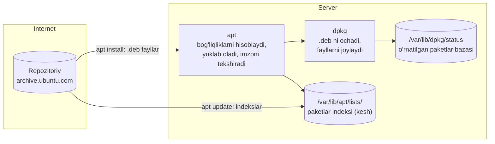
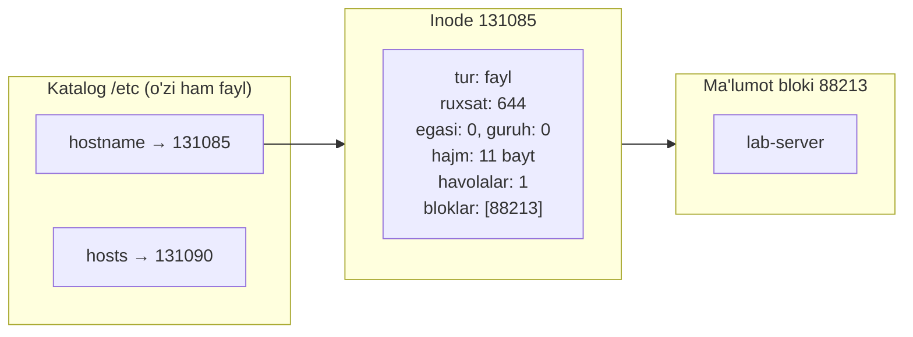
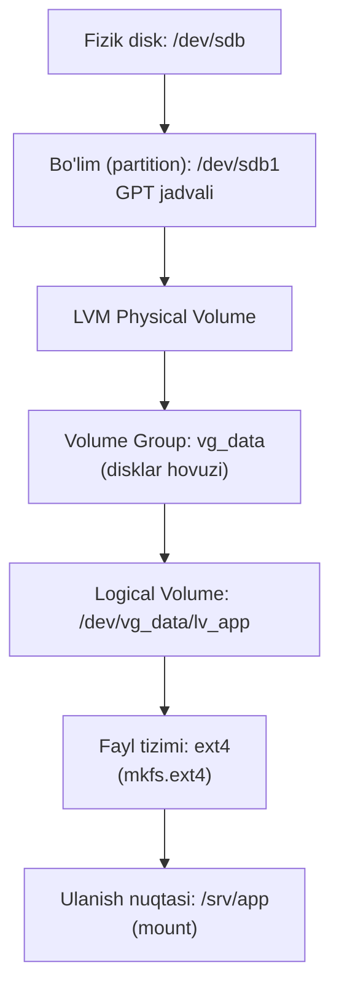
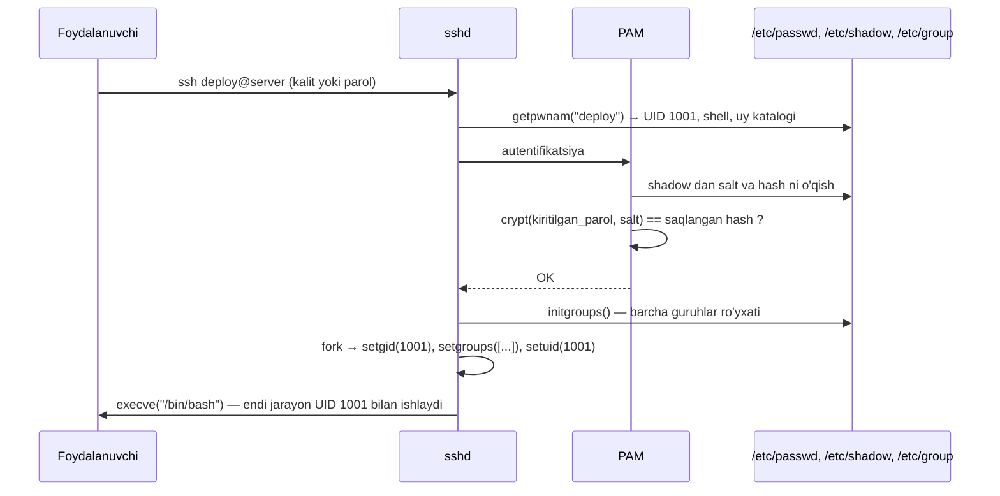
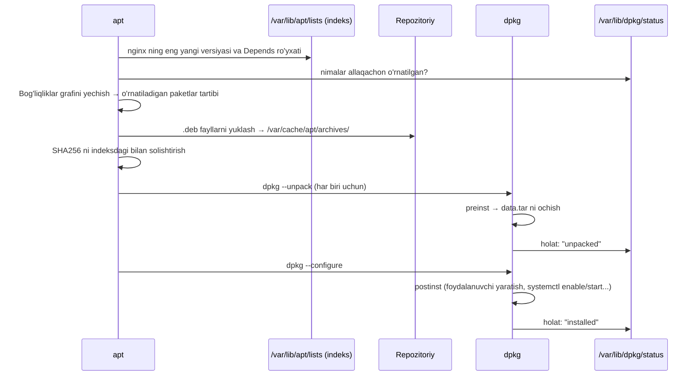
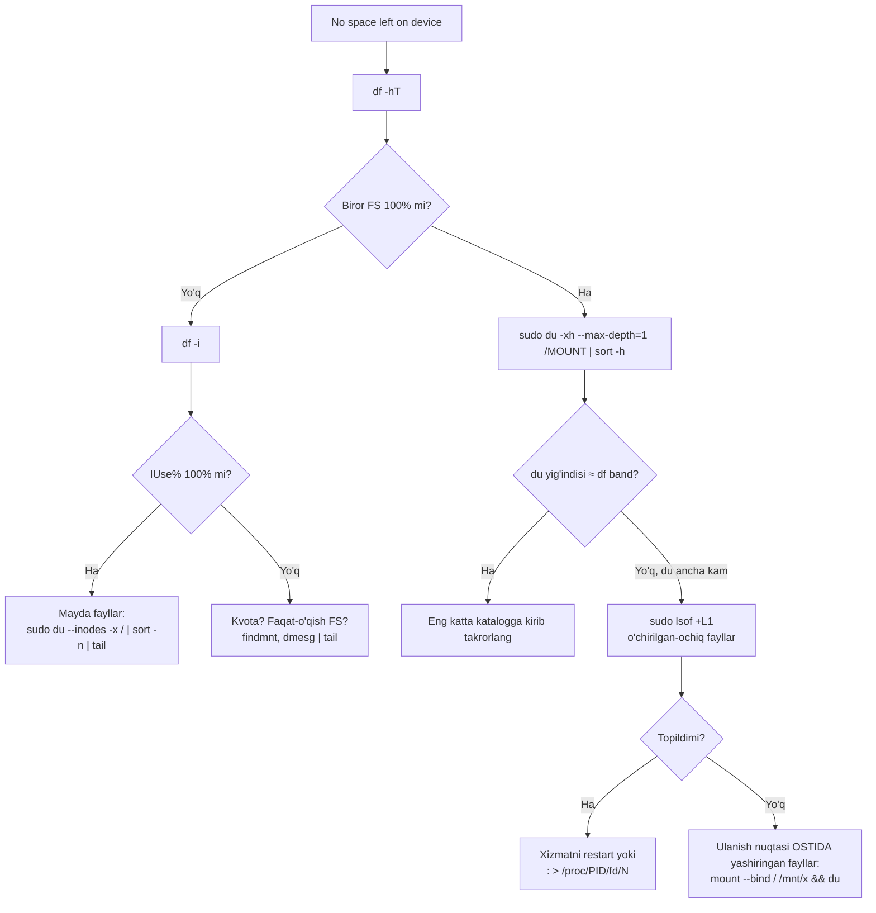

<!-- @section: why -->

## Uch xil "server ishlamay qoldi"

**Birinchi voqea.** Jamoaga yangi dasturchi keldi. Unga serverga kirish kerak. Eng oson yo'l — root parolini aytish. Olti oydan keyin kimdir production bazasini o'chirib yubordi. Kim? Loglarda faqat `root`. Besh kishi shu parolni biladi.

**Ikkinchi voqea.** `apt upgrade` paytida SSH uzildi. Qayta kirganda: `E: dpkg was interrupted, you must manually run 'sudo dpkg --configure -a'`. Hech narsa o'rnatilmaydi, hech narsa o'chirilmaydi.

**Uchinchi voqea.** Ilova `No space left on device` bilan yiqildi. `df -h` — diskda 40% bo'sh joy bor. Qanday qilib?

Uchala voqea ham bitta savolga borib taqaladi: **Linux foydalanuvchilar, dasturlar va disklarni ichkarida qanday tashkil qiladi?**

## Yechimlar

| Muammo | Mexanizm | Bu darsda |
|---|---|---|
| Kim nima qilgani noma'lum, hamma root | Shaxsiy hisoblar + `sudo` | `/etc/passwd`, `/etc/shadow`, `sudoers` |
| Dasturlarni qo'lda kompilyatsiya qilish, bog'liqliklar do'zaxi | Paket menejeri | `dpkg` va `apt` ichki tuzilishi |
| Disk to'ldi, kengaytirib bo'lmaydi | Inode, fayl tizimlari, LVM | `ext4`/`xfs`, `mount`, `fstab`, LVM |

> **Analogiya.** Paket menejeri — do'kon ilovasi: katalog (repozitoriy) bor, har mahsulotning tarkibi (bog'liqliklar) yozilgan, imzo bilan qalbaki emasligi tekshiriladi. `dpkg` — omborchi: qutini ochib joy-joyiga qo'yadi. `apt` — xaridor yordamchisi: nima kerakligini hisoblab, do'kondan olib keladi va omborchiga beradi.

## DevOps uchun nega muhim

- **Dockerfile** dagi `RUN apt-get update && apt-get install -y ...` — shu darsdagi apt. Nega ular bitta `RUN` da bo'lishi kerakligini apt indekslari qanday ishlashini bilgan odam tushunadi.
- **Konteynerdagi `USER 10001`** — UID tushunchasi; volume dagi "Permission denied" — xost va konteynerdagi UID lar mos kelmasligi.
- **Kubernetes PersistentVolume** — blok qurilma + fayl tizimi + mount. `kubelet` aynan `mkfs` va `mount` ni bajaradi.
- **"Disk to'ldi"** — production dagi eng ko'p uchraydigan incident lardan biri. Uni 2 daqiqada tashxislash — DevOps ning asosiy ko'nikmasi.

<!-- @section: theory -->

## Foydalanuvchilar va guruhlar

Yadro uchun foydalanuvchi — bu **son**: UID (User ID). Nomlar faqat odamlar uchun; ular `/etc/passwd` faylida UID ga bog'lanadi.

| UID oralig'i | Kim |
|---|---|
| `0` | **root** — yadro tekshiruvlaridan ozod |
| `1`–`999` | Tizim hisoblari (xizmatlar uchun: `www-data`, `postgres`) — odatda kirish imkonisiz |
| `1000`+ | Oddiy foydalanuvchilar |

### /etc/passwd — 7 maydon

```text
deploy:x:1001:1001:Deploy User:/home/deploy:/bin/bash
  │    │  │    │       │           │           └ 7. kirish qobig'i (shell)
  │    │  │    │       │           └ 6. uy katalogi
  │    │  │    │       └ 5. izoh (GECOS)
  │    │  │    └ 4. asosiy guruh GID i
  │    │  └ 3. UID
  │    └ 2. "x" — parol /etc/shadow da
  └ 1. login nomi
```

Bu faylni **hamma o'qiy oladi** (`644`) — chunki `ls -l` kabi dasturlar UID ni nomga aylantirishi kerak. Shuning uchun parol hash lari bu yerda emas.

Shell maydonida `/usr/sbin/nologin` tursa — bu hisob bilan interaktiv kirib bo'lmaydi. Xizmat hisoblari shunday bo'lishi kerak.

### /etc/shadow — parollar

```text
deploy:$y$j9T$Qm3x...$7hK2...:19700:0:99999:7:::
         │  │     │       │      │    │   │   └ ogohlantirish (kun)
         │  │     │       │      │    │   └ maksimal amal qilish muddati
         │  │     │       │      │    └ minimal muddat
         │  │     │       │      └ oxirgi o'zgartirilgan sana (1970 dan beri kunlar)
         │  │     │       └ hash
         │  │     └ salt (tuz)
         │  └ parametrlar
         └ algoritm: $y$ yescrypt, $6$ SHA-512, $1$ MD5 (eskirgan)
```

Ruxsati `640 root:shadow` — oddiy foydalanuvchi o'qiy olmaydi.

**Salt nega kerak?** Salt — har bir parolga qo'shiladigan tasodifiy qator. U siz ikki foydalanuvchining bir xil paroli bir xil hash berardi va hujumchi oldindan hisoblangan jadvallardan ("rainbow table") foydalana olardi.

Ikkinchi maydondagi maxsus qiymatlar: `!` yoki `*` — parol bilan kirish **o'chirilgan** (SSH kalit bilan kirish mumkin); `!` hash oldida — hisob qulflangan (`passwd -l`).

### Guruhlar

Har foydalanuvchining bitta **asosiy** guruhi (`/etc/passwd` da) va istalgancha **qo'shimcha** guruhlari (`/etc/group` da) bor. Yangi fayl asosiy guruhga tegishli bo'ladi; ruxsat tekshiruvida esa barcha guruhlar hisobga olinadi.

Muhim tafsilot: guruh a'zoligi **kirish paytida** o'qiladi. Foydalanuvchini guruhga qo'shsangiz, u qayta kirmaguncha yangi guruh kuchga kirmaydi (`docker` guruhiga qo'shgandan keyin "permission denied" — shu sababdan).

## sudo

`sudo` — buyruqni boshqa (odatda root) foydalanuvchi nomidan bajarish, **o'z parolingiz** bilan. root parolini hech kimga berish shart emas.

| | `su -` | `sudo` |
|---|---|---|
| Qaysi parol | root niki (hamma biladi) | o'ziniki |
| Kim nima qilgani | noma'lum | har buyruq logda: kim, qachon, nima |
| Cheklash | hammasi yoki hech narsa | aniq buyruqlar ro'yxati |
| Huquqni olib qo'yish | root parolini almashtirib, hammaga qayta tarqatish | bir qatorni o'chirish |

Bu — **eng kam huquq tamoyili** (least privilege): har kimga faqat ishi uchun zarur huquq.

## Paket boshqaruvi: dpkg va apt



| | `dpkg` | `apt` |
|---|---|---|
| Daraja | Quyi | Yuqori |
| Nima bilan ishlaydi | Bitta `.deb` fayl | Repozitoriylar |
| Bog'liqliklar | Faqat tekshiradi — yo'q bo'lsa xato beradi | O'zi hisoblab, o'rnatadi |
| Tarmoq | Yo'q | Ha |

**`apt update` va `apt upgrade` — butunlay boshqa narsalar:**

- `apt update` — hech narsani o'rnatmaydi. Faqat repozitoriylardan **mavjud paketlar ro'yxatini** (indeksni) yangilaydi.
- `apt upgrade` — indeksga qarab, o'rnatilgan paketlarni yangi versiyasiga ko'taradi. Hech narsani o'chirmaydi.
- `apt full-upgrade` — bog'liqliklar talab qilsa, paketlarni **o'chirishi** ham mumkin.

Shu sababli `apt update` siz `apt install` eski indeks bilan ishlaydi va serverda allaqachon yo'q versiyani so'rab, `404 Not Found` oladi.

**Ishonch zanjiri.** Repozitoriydagi `InRelease` fayli GPG bilan imzolangan va unda barcha indeks fayllarining hash lari bor; indekslarda esa har bir `.deb` ning hash i. Shunday qilib bitta imzo butun repozitoriyni himoyalaydi. Imzo kaliti tizimda bo'lmasa — `NO_PUBKEY` xatosi.

## Inode va fayl tizimi

Fayl tizimi diskni ikki xil maydonga bo'ladi:

- **Inode jadvali** — har bir fayl uchun metama'lumot: tur, ruxsatlar, egasi, hajmi, vaqtlar, ma'lumot bloklari manzillari. **Fayl nomi bu yerda yo'q.**
- **Ma'lumot bloklari** — fayllarning mazmuni (odatda 4 KiB li bloklar).

Fayl nomi **katalogda** saqlanadi: katalog — `nom → inode raqami` jadvali.



**Inode lar soni cheklangan.** ext4 da ular fayl tizimi yaratilganda (`mkfs`) belgilanadi va keyin o'zgarmaydi. Shuning uchun **disk ikki xil yo'l bilan to'ladi**: bloklar tugaydi (`df -h` 100%) yoki inode lar tugaydi (`df -i` 100%). Ikkinchi holda joy bor, lekin yangi fayl yaratib bo'lmaydi — kirish qismidagi uchinchi voqeaning javobi. Odatiy aybdor: millionlab mayda fayllar (sessiya fayllari, kesh, pochta navbati).

### ext4 va xfs

| | ext4 | xfs |
|---|---|---|
| Standart | Ubuntu, Debian | RHEL, Rocky, Alma |
| Kattalashtirish | Onlayn | Onlayn |
| **Kichraytirish** | Mumkin (oflayn) | **Mumkin emas** |
| Inode lar | Yaratilganda qat'iy | Dinamik ajratiladi |
| Kuchli tomoni | Universal, sinovdan o'tgan | Juda katta fayllar, parallel yozuv |

Ikkalasi ham **journaling** fayl tizimi: o'zgarish avval jurnalga yoziladi, keyin asosiy joyga. Elektr o'chib qolsa, jurnal qayta o'ynaladi — fayl tizimi yaxlit qoladi (lekin oxirgi soniyalardagi ma'lumot yo'qolishi mumkin).

## Blok qurilmadan katalogga: qatlamlar



**mount** (ulash) — fayl tizimini yagona katalog daraxtining biror nuqtasiga bog'lash. Ulanguncha `/srv/app` — oddiy bo'sh katalog; ulangandan keyin unga yozilgan narsa boshqa diskka tushadi.

**/etc/fstab** — yuklanishda nima qayerga ulanishi yozilgan jadval.

**LVM** (Logical Volume Manager) — disklar va fayl tizimlari orasidagi moslashuvchan qatlam:

| LVM siz | LVM bilan |
|---|---|
| Bo'lim hajmi qat'iy | Mantiqiy hajmni onlayn kengaytirish |
| Fayl tizimi bitta diskdan katta bo'lolmaydi | Bir necha diskni bitta hovuzga birlashtirish |
| Zaxira uchun xizmatni to'xtatish kerak | Snapshot (lahzalik surat) |

## Atamalar lug'ati

| Atama | Ma'nosi | Misol |
|---|---|---|
| UID / GID | Foydalanuvchi / guruh raqami | `id deploy` |
| salt | Hash dan oldin parolga qo'shiladigan tasodifiy qator | `$y$j9T$<salt>$<hash>` |
| least privilege | Faqat zarur huquqni berish tamoyili | cheklangan sudo qoidasi |
| repository | Paketlar va indekslar serveri | `archive.ubuntu.com` |
| inode | Fayl metama'lumoti tuzilmasi | `ls -i`, `df -i` |
| journaling | O'zgarishni avval jurnalga yozish | ext4, xfs |
| mount point | Fayl tizimi ulangan katalog | `/srv/app` |
| PV / VG / LV | LVM ning fizik hajmi / guruhi / mantiqiy hajmi | `pvs`, `vgs`, `lvs` |
| UUID | Fayl tizimining o'zgarmas identifikatori | `blkid` |

<!-- @section: internals -->

## Login paytida nima sodir bo'ladi



Kalit nuqtalar:

- Parol **hech qayerda saqlanmaydi** — faqat hash. Tekshirish: kiritilgan parolni o'sha salt bilan hash lab, natijani solishtirish.
- `setuid()` dan keyin ortga yo'l yo'q: jarayon root huquqini abadiy tashlaydi. Tartib muhim — avval guruhlar, keyin UID (aksincha bo'lsa, guruhlarni o'zgartirishga huquq qolmaydi).
- Guruhlar ro'yxati shu onda jarayonga "muhrlanadi". Keyin `/etc/group` o'zgarsa ham, ishlab turgan sessiya eski ro'yxat bilan qoladi.

O'zingiz ko'ring:

```bash
id                          # uid=1000(talaba) gid=1000(talaba) groups=1000(talaba),27(sudo)
getent passwd deploy        # /etc/passwd va boshqa manbalardan (LDAP) so'rash
grep '^Groups' /proc/$$/status   # joriy jarayonga muhrlangan guruhlar
sudo chage -l deploy        # parol muddati
```

## sudo ichida

`sudo` — bu **SUID root** dastur: `-rwsr-xr-x root root /usr/bin/sudo`. Uni kim ishga tushirsa ham, u root huquqi bilan boshlanadi va keyin o'zi qaror qiladi:

1. Chaqiruvchining haqiqiy UID sini aniqlaydi.
2. `/etc/sudoers` va `/etc/sudoers.d/*` ni o'qib, mos qoidani qidiradi.
3. Kerak bo'lsa parol so'raydi (PAM orqali) va vaqt belgisini saqlaydi (standart 15 daqiqa).
4. Buyruqni `/var/log/auth.log` ga (journal ga) yozadi.
5. Muhitni tozalaydi (`env_reset`), `secure_path` ni o'rnatadi va buyruqni ishga tushiradi.

`secure_path` — `sudo` ostida `PATH` almashtirilishi sababi: "o'zimda ishlaydi, sudo bilan `command not found`".

## .deb paket ichida nima bor

`.deb` — oddiy `ar` arxivi, ichida uchta a'zo:

```bash
ar t nginx_1.24.0-2ubuntu7_amd64.deb
# debian-binary        ← format versiyasi: "2.0"
# control.tar.zst      ← metama'lumot va skriptlar
# data.tar.zst         ← fayllarning o'zi (/ dan boshlab)
```

`control.tar` ichida: `control` (nom, versiya, **Depends**), `md5sums`, `conffiles` (qaysi fayllar konfiguratsiya — yangilanishda ustidan yozilmaydi) va **maintainer skriptlar**: `preinst`, `postinst`, `prerm`, `postrm`.

`apt install nginx` bajarilganda:



Ikki bosqich (**unpack** → **configure**) — "dpkg was interrupted" xatosining kaliti. Agar jarayon ular orasida uzilsa, paket `status` faylida "unpacked" yoki "half-configured" bo'lib qoladi. `dpkg --configure -a` barcha shunday paketlar uchun ikkinchi bosqichni yakunlaydi.

Qulf fayllari (`/var/lib/dpkg/lock-frontend`) bir vaqtda ikki `apt` ishlashiga yo'l qo'ymaydi — "Could not get lock" xabari shundan.

```bash
dpkg -l | grep nginx               # o'rnatilgan paketlar (ii — to'liq o'rnatilgan)
dpkg -L nginx-common               # paket qaysi fayllarni o'rnatgan
dpkg -S /usr/sbin/nginx            # bu fayl qaysi paketga tegishli
apt-cache policy nginx             # qaysi versiya qaysi repozitoriydan
apt-cache depends nginx            # bog'liqliklar
cat /var/lib/dpkg/info/nginx-common.postinst   # o'rnatishda nima bajarilgan
```

## Faylni yozish va o'chirish: inode darajasida

`echo salom > /srv/app/a.txt`:

1. Yadro `/srv/app` katalogining inode ini topadi, `w+x` ni tekshiradi.
2. Inode bitmap dan bo'sh inode ajratadi (bo'sh yo'q bo'lsa — **ENOSPC**, garchi bloklar bo'sh bo'lsa ham).
3. Blok bitmap dan ma'lumot bloki ajratadi.
4. Bu o'zgarishlar **jurnalga** yoziladi (tranzaksiya).
5. Katalog jadvaliga `a.txt → inode N` yozuvi qo'shiladi.
6. Ma'lumot avval **page cache** ga (xotiraga) tushadi; diskka fonda yoziladi (`sync` yoki ~30 soniyada).

`rm a.txt`:

1. Katalogdan yozuv o'chiriladi.
2. Inode dagi havolalar hisoblagichi 1 ga kamayadi.
3. Hisoblagich 0 **va** faylni ochiq ushlab turgan jarayon yo'q bo'lsagina inode va bloklar bo'shatiladi.

Uchinchi band — "`rm` qildim, joy bo'shamadi" ning sababi: `df` (fayl tizimi nuqtai nazari: bloklar band) va `du` (katalog daraxtini aylanadi: fayl nomi yo'q — ko'rinmaydi) turli natija beradi.

```bash
sudo lsof +L1
# COMMAND  PID  USER  FD  TYPE  SIZE/OFF  NLINK  NAME
# java    3811  app   4w  REG   21474836480   0  /var/log/app/debug.log (deleted)
```

## mount va fstab

`mount /dev/vg_data/lv_app /srv/app` — yadro superblock ni o'qib fayl tizimi turini aniqlaydi va uni VFS (Virtual File System) daraxtining `/srv/app` nuqtasiga bog'laydi. Shu ondan `/srv/app` ning avvalgi mazmuni (agar bo'lsa) **yashirinadi** — o'chmaydi, shunchaki ko'rinmaydi.

Yuklanishda systemd `/etc/fstab` ning har bir satridan `.mount` unit yaratadi. Agar biror satr ulanmasa va `nofail` ko'rsatilmagan bo'lsa — systemd `local-fs.target` ga yeta olmaydi va tizimni **emergency mode** ga tushiradi. SSH ham ko'tarilmaydi. Bitta noto'g'ri satr — va serverga faqat konsol orqali kirish mumkin.

`/dev/sdb1` kabi nomlar barqaror emas: disk qo'shilsa yoki tartib o'zgarsa, kechagi `sdb` bugun `sdc` bo'lishi mumkin. **UUID** fayl tizimining o'zida yozilgan va o'zgarmaydi — `fstab` da doim UUID ishlating.

<!-- @section: commands -->

## Foydalanuvchilarni boshqarish

```bash
sudo useradd -m -s /bin/bash -G sudo,docker -c "Jasur Karimov" jasur
```

```tahlil
{"command":"useradd -m -s /bin/bash -G sudo,docker -c \"Jasur Karimov\" jasur","parts":[{"t":"useradd","d":"Yangi foydalanuvchi yaratadi (quyi darajali vosita; adduser — interaktiv qobig'i)"},{"t":"-m","d":"Uy katalogini (/home/jasur) yaratadi va /etc/skel dan nusxalaydi. Busiz uy katalogi bo'lmaydi"},{"t":"-s /bin/bash","d":"Kirish qobig'i. Ko'rsatilmasa Ubuntu da /bin/sh — tarix va Tab ishlamaydi"},{"t":"-G sudo,docker","d":"QO'SHIMCHA guruhlar. Asosiy guruh (jasur) avtomatik yaratiladi"},{"t":"-c \"Jasur Karimov\"","d":"Izoh maydoni (GECOS)"},{"t":"jasur","d":"Login nomi"}]}
```

| Buyruq | Vazifasi |
|---|---|
| `sudo passwd jasur` | Parol o'rnatish |
| `sudo usermod -aG docker jasur` | Guruhga **qo'shish** |
| `sudo usermod -L jasur` / `-U` | Hisobni qulflash / ochish |
| `sudo userdel -r jasur` | O'chirish (`-r` — uy katalogi bilan) |
| `sudo chage -M 90 jasur` | Parol muddati — 90 kun |
| `id jasur`, `groups jasur` | UID, guruhlar |
| `last`, `lastb`, `who`, `w` | Kirishlar tarixi, muvaffaqiyatsiz urinishlar, hozir kim bor |

> ⚠️ **Ehtiyot bo'l: `usermod -G` (`-a` siz)**
> `usermod -G docker jasur` foydalanuvchini **barcha boshqa qo'shimcha guruhlardan chiqarib**, faqat `docker` da qoldiradi. Agar u `sudo` guruhida bo'lgan bo'lsa — sudo huquqini yo'qotadi. Doim `-aG` (append).

Xizmat uchun tizim hisobi:

```bash
sudo useradd --system --no-create-home --shell /usr/sbin/nologin myapp
```

## sudoers

Faqat `visudo` orqali tahrirlang — u saqlashdan oldin sintaksisni tekshiradi. Sintaksis xatosi bo'lgan `sudoers` — **hech kim sudo qila olmaydi**.

```bash
sudo visudo -f /etc/sudoers.d/deploy
```

```text
deploy ALL=(root) NOPASSWD: /usr/bin/systemctl restart myapp, /usr/bin/systemctl status myapp
%devs  ALL=(ALL:ALL) ALL
```

| Qism | Ma'nosi |
|---|---|
| `deploy` | Kim (foydalanuvchi). `%devs` — guruh |
| `ALL=` | Qaysi xostlarda (bitta faylni ko'p serverga tarqatganda) |
| `(root)` | Kim nomidan. `(ALL:ALL)` — istalgan foydalanuvchi va guruh |
| `NOPASSWD:` | Parol so'ralmaydi — avtomatlashtirish uchun |
| `/usr/bin/systemctl restart myapp` | Aynan shu buyruq, aynan shu argumentlar bilan. **Absolyut yo'l shart** |

> ⚠️ **Ehtiyot bo'l.** `deploy ALL=(ALL) NOPASSWD: ALL` — bu parolsiz root. Shuningdek `vim`, `less`, `find`, `tar`, `docker` kabi buyruqlarga sudo berish — amalda to'liq root berish (ular ichidan shell ochish mumkin).

Tekshirish: `sudo -l -U deploy` — foydalanuvchiga nimalar ruxsat etilgan.

## apt

```bash
sudo apt update && sudo apt install -y --no-install-recommends nginx
```

```tahlil
{"command":"apt update && apt install -y --no-install-recommends nginx","parts":[{"t":"apt update","d":"Repozitoriylardan paketlar INDEKSINI yangilaydi. Hech narsa o'rnatmaydi"},{"t":"&&","d":"Faqat update muvaffaqiyatli bo'lsa davom et"},{"t":"apt install","d":"Paketni va bog'liqliklarini o'rnatadi"},{"t":"-y","d":"Barcha savollarga 'ha'. Skript va Dockerfile da shart — aks holda so'rovda osilib qoladi"},{"t":"--no-install-recommends","d":"'Tavsiya etilgan' qo'shimcha paketlarsiz — kamroq paket, kichikroq image, kichikroq hujum yuzasi"},{"t":"nginx","d":"Paket nomi. Aniq versiya: nginx=1.24.0-2ubuntu7"}]}
```

| Buyruq | Vazifasi |
|---|---|
| `apt list --upgradable` | Nimalar yangilanadi |
| `sudo apt upgrade` | Yangilash (hech narsani o'chirmaydi) |
| `sudo apt full-upgrade` | Yangilash (kerak bo'lsa o'chiradi) |
| `sudo apt remove nginx` | O'chirish, konfiguratsiya **qoladi** |
| `sudo apt purge nginx` | Konfiguratsiya bilan o'chirish |
| `sudo apt autoremove` | Endi kerak bo'lmagan bog'liqliklar |
| `apt search`, `apt show nginx` | Qidirish, ma'lumot |
| `sudo apt-mark hold postgresql-16` | Versiyani "muzlatish" — upgrade tegmaydi |
| `apt-cache policy nginx` | Nomzod versiya va manba |

Tashqi repozitoriy qo'shish (zamonaviy usul — kalit alohida faylda, `signed-by` bilan):

```bash
sudo install -m 0755 -d /etc/apt/keyrings
curl -fsSL https://download.docker.com/linux/ubuntu/gpg | sudo gpg --dearmor -o /etc/apt/keyrings/docker.gpg
echo "deb [arch=amd64 signed-by=/etc/apt/keyrings/docker.gpg] https://download.docker.com/linux/ubuntu noble stable" \
  | sudo tee /etc/apt/sources.list.d/docker.list
sudo apt update
```

`apt-key add` **eskirgan**: u kalitni barcha repozitoriylar uchun ishonchli qilib qo'yardi. `signed-by` kalitni faqat bitta repozitoriyga bog'laydi.

## Disklar bilan ishlash

```bash
lsblk -f
```

```text
NAME                FSTYPE      LABEL UUID                                   MOUNTPOINTS
sda
├─sda1              vfat              7C1A-33BF                              /boot/efi
└─sda2              ext4              3f2a11bc-...                           /
sdb
└─sdb1              LVM2_member       kX9d2P-...
  └─vg_data-lv_app  ext4              9c1d77e0-4a5b-4f0e-9d3c-2b1a6e8f7c55   /srv/app
```

| Buyruq | Vazifasi |
|---|---|
| `lsblk -f` | Blok qurilmalar daraxti, FS turi, UUID, ulanish nuqtasi |
| `blkid /dev/sdb1` | UUID va tur |
| `df -hT` | Fayl tizimlari: hajm, band, tur |
| `df -i` | **Inode** lar bandligi |
| `du -xsh /var/* \| sort -h` | Kataloglar hajmi (`-x` — boshqa FS ga o'tmaydi) |
| `findmnt /srv/app` | Shu nuqtaga nima va qanday opsiyalar bilan ulangan |
| `sudo ncdu -x /` | Interaktiv "nima joy yeyapti" |

### Yangi disk: LVM → fayl tizimi → fstab

```bash
sudo pvcreate /dev/sdb                      # 1. diskni LVM uchun belgilash
sudo vgcreate vg_data /dev/sdb              # 2. hovuz yaratish
sudo lvcreate -n lv_app -L 20G vg_data      # 3. 20 GiB mantiqiy hajm
sudo mkfs.ext4 /dev/vg_data/lv_app          # 4. fayl tizimi
sudo mkdir -p /srv/app
sudo mount /dev/vg_data/lv_app /srv/app     # 5. ulash
```

> ⚠️ **Ehtiyot bo'l: `mkfs`**
> `mkfs` qurilmadagi mavjud fayl tizimini yo'q qiladi. Ishga tushirishdan oldin `lsblk -f` bilan qurilma nomini ikki marta tekshiring.

Onlayn kengaytirish (xizmatni to'xtatmasdan):

```bash
sudo lvextend -r -L +10G /dev/vg_data/lv_app
```

```tahlil
{"command":"lvextend -r -L +10G /dev/vg_data/lv_app","parts":[{"t":"lvextend","d":"Mantiqiy hajmni kattalashtiradi"},{"t":"-r","d":"--resizefs: hajmdan keyin FAYL TIZIMINI ham kengaytiradi (resize2fs / xfs_growfs). Busiz LV kattalashadi, lekin df eski hajmni ko'rsataveradi"},{"t":"-L +10G","d":"Plyus — QO'SHISH. '+' siz -L 10G 'jami 10G qil' degani. Bo'sh joyning hammasi: -l +100%FREE"},{"t":"/dev/vg_data/lv_app","d":"Qaysi mantiqiy hajm"}]}
```

Holatni ko'rish: `sudo pvs`, `sudo vgs` (VFree — hovuzdagi bo'sh joy), `sudo lvs`.

### /etc/fstab — qator tahlili

```text
UUID=9c1d77e0-4a5b-4f0e-9d3c-2b1a6e8f7c55  /srv/app  ext4  defaults,nofail,noatime  0  2
```

| № | Maydon | Qiymat | Ma'nosi |
|---|---|---|---|
| 1 | Nima | `UUID=...` | Qurilma. `/dev/sdb1` emas — nom o'zgarishi mumkin |
| 2 | Qayerga | `/srv/app` | Ulanish nuqtasi (katalog mavjud bo'lishi shart) |
| 3 | Tur | `ext4` | Fayl tizimi turi |
| 4 | Opsiyalar | `defaults,nofail,noatime` | `nofail` — ulanmasa ham yuklanish **davom etadi**; `noatime` — har o'qishda vaqt yozilmaydi (tezroq) |
| 5 | dump | `0` | Eskirgan, doim 0 |
| 6 | fsck tartibi | `2` | `1` — ildiz, `2` — qolganlar, `0` — tekshirilmaydi |

Faylni saqlagandan keyin **qayta yuklamasdan** tekshirish:

```bash
sudo findmnt --verify        # sintaksis va mantiqiy xatolar
sudo umount /srv/app && sudo mount -a && findmnt /srv/app
```

> ⚠️ **Ehtiyot bo'l: fstab**
> `mount -a` xato bersa — serverni qayta yuklamang. Xatoli `fstab` bilan qayta yuklangan server emergency mode ga tushadi.

<!-- @section: lab -->

## Lab 1. Cheklangan huquqli deploy foydalanuvchisi

**Maqsad:** eng kam huquq tamoyilini amalda qo'llash.

**Muhit:** Ubuntu 22.04/24.04 VM.

**Qadamlar:**

1. `deploy` foydalanuvchisini uy katalogi va bash bilan yarating.
2. Unga faqat **ikki** buyruqqa parolsiz sudo bering: `systemctl restart nginx` va `systemctl status nginx`.
3. `deploy` nomidan sinang.

**Tekshirish:**

```bash
sudo -l -U deploy
sudo -u deploy sudo -n systemctl restart nginx && echo "✓ ruxsat bor"
sudo -u deploy sudo -n systemctl stop nginx    || echo "✓ taqiqlangan"
sudo -u deploy sudo -n cat /etc/shadow         || echo "✓ taqiqlangan"
sudo grep 'deploy.*COMMAND' /var/log/auth.log | tail -3
```

<details><summary>💡 Yechimni ko'rsatish</summary>

```bash
sudo apt update && sudo apt install -y nginx
sudo useradd -m -s /bin/bash deploy

echo 'deploy ALL=(root) NOPASSWD: /usr/bin/systemctl restart nginx, /usr/bin/systemctl status nginx' \
  | sudo tee /etc/sudoers.d/deploy
sudo chmod 440 /etc/sudoers.d/deploy
sudo visudo -c                      # barcha sudoers fayllarini tekshirish
```

E'tibor bering: `systemctl restart nginx.service` (kengaytma bilan) qoidaga **mos kelmaydi** — argumentlar aynan solishtiriladi. Auth logda har bir urinish — ruxsat etilgani ham, rad etilgani ham — yozilgan.

</details>

## Lab 2. Yangi disk: LVM dan fstab gacha

**Maqsad:** diskni qo'shish, LVM bilan sozlash, doimiy ulash va onlayn kengaytirish.

**Muhit:** VM ga ikkinchi virtual disk qo'shing (5 GB yetarli). Disk bo'lmasa — fayldan loop qurilma yasang: `sudo truncate -s 2G /disk.img && sudo losetup -fP --show /disk.img` (natijada `/dev/loopN`).

**Qadamlar:**

1. `lsblk` bilan yangi diskni toping.
2. PV → VG (`vg_lab`) → LV (`lv_data`, 1G) → ext4 → `/mnt/data` ga ulang.
3. UUID orqali `fstab` ga yozing (`nofail` bilan) va `mount -a` bilan tekshiring.
4. Ichiga fayl yozing. LV ni **ulangan holda** 500M ga kengaytiring.
5. Fayl joyidaligini va hajm o'zgarganini tekshiring.

**Tekshirish:**

```bash
findmnt /mnt/data && df -h /mnt/data      # ~1.5G
sudo findmnt --verify
cat /mnt/data/test.txt
```

<details><summary>💡 Yechimni ko'rsatish</summary>

```bash
DEV=/dev/sdb                                  # yoki /dev/loopN
sudo pvcreate "$DEV"
sudo vgcreate vg_lab "$DEV"
sudo lvcreate -n lv_data -L 1G vg_lab
sudo mkfs.ext4 /dev/vg_lab/lv_data
sudo mkdir -p /mnt/data

UUID=$(sudo blkid -s UUID -o value /dev/vg_lab/lv_data)
echo "UUID=$UUID  /mnt/data  ext4  defaults,nofail  0  2" | sudo tee -a /etc/fstab
sudo findmnt --verify && sudo mount -a

echo "muhim ma'lumot" | sudo tee /mnt/data/test.txt
sudo lvextend -r -L +500M /dev/vg_lab/lv_data
df -h /mnt/data
```

</details>

## Lab 3. Inode larni tugatish

**Maqsad:** "joy bor, lekin yozib bo'lmaydi" holatini o'z qo'lingiz bilan yaratish.

**Qadamlar:**

1. Kichik fayl tizimi yarating — ataylab kam inode bilan:

   ```bash
   sudo lvcreate -n lv_tiny -L 100M vg_lab
   sudo mkfs.ext4 -N 1000 /dev/vg_lab/lv_tiny
   sudo mkdir -p /mnt/tiny && sudo mount /dev/vg_lab/lv_tiny /mnt/tiny
   ```

2. Mayda fayllar yarating: `sudo bash -c 'for i in $(seq 1 2000); do touch /mnt/tiny/f$i || break; done'`
3. `df -h /mnt/tiny` va `df -i /mnt/tiny` ni solishtiring. Xato xabari qanday?
4. Aybdor katalogni topish usulini o'ylab ko'ring.

<details><summary>💡 Yechimni ko'rsatish</summary>

```text
touch: cannot touch '/mnt/tiny/f990': No space left on device

$ df -h /mnt/tiny      → Use% 1%      (joy bor!)
$ df -i /mnt/tiny      → IUse% 100%   (inode tugagan)
```

Qaysi katalogda eng ko'p fayl borligini topish:

```bash
sudo find /mnt/tiny -xdev -type f | cut -d/ -f1-4 | sort | uniq -c | sort -rn | head
# yoki: sudo du --inodes -x /mnt/tiny | sort -n | tail
```

Tozalash: `sudo umount /mnt/tiny && sudo lvremove -y vg_lab/lv_tiny`.

</details>

## Qo'shimcha chaqiriq

LVM snapshot yarating (`lvcreate -s -n snap -L 200M vg_lab/lv_data`), asl hajmdagi faylni o'chiring, so'ng snapshot ni alohida katalogga faqat-o'qish rejimida ulab, faylni qaytarib oling.

<!-- @section: breakfix -->

## 1. Server emergency mode ga tushdi

Yangi disk qo'shilgandan keyin server qayta yuklandi va endi SSH ishlamaydi. Konsolda:

```text
[ TIME ] Timed out waiting for device /dev/sdc1.
[DEPEND] Dependency failed for /data.
[DEPEND] Dependency failed for Local File Systems.
You are in emergency mode. Give root password for maintenance
```

`lsblk` ko'rsatishicha disk hozir `/dev/sdb1` deb nomlangan.

```breakfix
{"title":"fstab: qurilma nomi","lang":"ini","broken":"# /etc/fstab\nUUID=3f2a11bc-7d4e-4b1a-9a0c-5e6f7a8b9c0d  /      ext4  defaults  0  1\n/dev/sdc1                                  /data  ext4  defaults  0  2","hints":["Qurilma nomlari (sdb, sdc) yuklanishlar orasida o'zgarishi mumkin.","Ikki narsani tuzatish kerak: nomning barqarorligi va 'ulanmasa nima bo'lishi'.","UUID ishlating (blkid ko'rsatadi) va nofail opsiyasini qo'shing."],"solution":"# /etc/fstab\nUUID=3f2a11bc-7d4e-4b1a-9a0c-5e6f7a8b9c0d  /      ext4  defaults  0  1\nUUID=9c1d77e0-4a5b-4f0e-9d3c-2b1a6e8f7c55  /data  ext4  defaults,nofail  0  2","explain":"Yadro disklarni topilish tartibida nomlaydi — /dev/sdc1 bugun /dev/sdb1 bo'lishi mumkin. UUID fayl tizimining o'zida yozilgan. nofail bo'lmasa, ulanmagan har qanday fstab satri yuklanishni to'xtatadi. Tiklash: emergency shell da 'mount -o remount,rw /' → fstab ni tuzatish → reboot."}
```

## 2. Foydalanuvchi sudo huquqini yo'qotdi

Administrator Jasurni `docker` guruhiga qo'shdi. Shundan keyin Jasur `sudo` ishlata olmay qoldi:

```text
jasur is not in the sudoers file. This incident will be reported.
```

```breakfix
{"title":"usermod -G","lang":"shell","broken":"# Administrator bajargan buyruq:\nsudo usermod -G docker jasur","hints":["Buyruqdan oldin: groups jasur → jasur sudo. Keyin: jasur docker. sudo qayerga ketdi?","-G qo'shimcha guruhlar ro'yxatini to'liq ALMASHTIRADI.","Qo'shish uchun -a (append) kerak. Endi sudo guruhini ham qaytarish lozim."],"solution":"# Guruhlarni tiklash va to'g'ri qo'shish:\nsudo usermod -aG sudo,docker jasur","explain":"usermod -G ro'yxat — 'qo'shimcha guruhlar AYNAN shular bo'lsin' degani. -a bilan esa mavjudlariga qo'shiladi. O'zgarish foydalanuvchi qayta kirgandan keyin kuchga kiradi (guruhlar login paytida jarayonga muhrlanadi). Xavfsizroq muqobil: gpasswd -a jasur docker."}
```

## 3. Disk "to'la", lekin fayllar topilmayapti

Monitoring: `/` 100% to'lgan. Siz katta log faylini o'chirdingiz, lekin joy bo'shamadi.

```text
$ df -h /
/dev/sda2   40G   40G     0 100% /
$ sudo du -xsh /
17G     /
$ sudo lsof +L1
java  3811 app  4w REG 8,2 24696061952 0 131402 /var/log/app/debug.log (deleted)
```

```breakfix
{"title":"O'chirilgan, lekin ochiq fayl","lang":"shell","broken":"# Qilingan ish:\nsudo rm /var/log/app/debug.log\n# df hali ham 100%","hints":["df 40G band deydi, du 17G ko'radi. Farq — 23G — qayerda? lsof chiqishiga qarang.","Fayl nomi o'chgan, lekin PID 3811 uni hali ochiq ushlab turibdi (fd 4) — bloklar bo'shamaydi.","Xizmatni qayta ishga tushirmasdan: jarayonning fd si orqali faylni nol uzunlikka qisqartiring."],"solution":"# Xizmatni to'xtatmasdan joy bo'shatish:\nsudo sh -c ': > /proc/3811/fd/4'\n\n# Kelajak uchun: rm o'rniga\n# sudo truncate -s 0 /var/log/app/debug.log\n# va logrotate sozlash","explain":"rm faqat katalogdagi nomni o'chiradi; inode va bloklar oxirgi ochiq deskriptor yopilguncha band qoladi. /proc/PID/fd/N — o'sha ochiq faylga 'eshik': unga bo'sh yozish faylni qisqartiradi va joy darhol bo'shaydi. Muqobil: xizmatni qayta ishga tushirish. To'g'ri amaliyot: ishlab turgan logni rm qilmaslik — truncate yoki logrotate (copytruncate / postrotate bilan)."}
```

<!-- @section: errors -->

## "Disk to'ldi": 2 daqiqalik tashxis



Odatiy "joy yeyuvchilar": `/var/log` (rotatsiyasiz loglar), `/var/lib/docker` (eski image va volume lar — `docker system df`), `/var/cache/apt`, `journald` (`journalctl --disk-usage`), yadro eski versiyalari (`/boot`), `core` dump lar.

## Xatolar jadvali

| Xato xabari / simptom | Sabab | Qanday tekshiriladi | Yechim |
|---|---|---|---|
| `E: Could not get lock /var/lib/dpkg/lock-frontend` | Boshqa apt/dpkg ishlayapti (ko'pincha `unattended-upgrades`) | `ps aux \| grep -E 'apt\|dpkg'` | **Kuting.** Qulf faylini o'chirmang — baza buzilishi mumkin |
| `E: dpkg was interrupted, you must manually run 'sudo dpkg --configure -a'` | O'rnatish o'rtasida uzilgan | — | `sudo dpkg --configure -a`, so'ng `sudo apt -f install` |
| `E: Unable to locate package X` | Indeks eski; nom xato; repozitoriy (universe) yoqilmagan | `apt-cache search X` | `sudo apt update`; nomni tekshirish |
| `404 Not Found` (`apt install` da) | Indeks eskirgan — serverda bu versiya endi yo'q | — | `sudo apt update` |
| `NO_PUBKEY ABCD1234...` | Repozitoriy imzo kaliti yo'q | `apt update` chiqishi | Kalitni `/etc/apt/keyrings/` ga qo'yib, `signed-by` ko'rsatish |
| `The following packages have unmet dependencies` | Versiyalar ziddiyati; aralash repozitoriylar | `apt-cache policy paket` | `sudo apt -f install`; ziddiyatli repozitoriyni olib tashlash |
| `X is not in the sudoers file` | sudo guruhida emas / qoida yo'q | `id X`; `sudo -l -U X` | `usermod -aG sudo X` (root yoki konsol orqali) |
| `sudo: unable to resolve host srv1` | `/etc/hostname` dagi nom `/etc/hosts` da yo'q | `cat /etc/hostname /etc/hosts` | `127.0.1.1 srv1` qo'shish |
| `>>> /etc/sudoers: syntax error` — sudo ishlamaydi | `visudo` siz tahrirlangan | — | `pkexec visudo` yoki recovery rejim |
| `No space left on device`, `df -h` da joy bor | Inode lar tugagan | `df -i` | Mayda fayllarni tozalash |
| `df` 100%, `du` kam | O'chirilgan-ochiq fayl | `lsof +L1` | Restart yoki `/proc/PID/fd/N` ni qisqartirish |
| `mount: wrong fs type, bad option, bad superblock` | Fayl tizimi yo'q/boshqa turda; yordamchi paket yo'q (`nfs-common`) | `lsblk -f`; `dmesg \| tail` | To'g'ri tur; `mkfs`; paket o'rnatish |
| `umount: target is busy` | Kimdir shu katalogda turibdi yoki fayl ochiq | `lsof +f -- /mnt/x`; `fuser -vm /mnt/x` | Jarayonni to'xtatish; oxirgi chora `umount -l` |
| Emergency mode yuklanishda | `fstab` da ulanmaydigan satr | Konsolda `journalctl -xb` | `mount -o remount,rw /`; fstab ni tuzatish |
| `lvextend` dan keyin `df` o'zgarmadi | Fayl tizimi kengaytirilmagan (`-r` unutilgan) | `lvs` vs `df -h` | `resize2fs /dev/vg/lv` yoki `xfs_growfs /mount` |
| `Read-only file system` | Yadro FS xatosini topib, himoya uchun ro qilib qo'ygan | `dmesg \| grep -iE 'ext4\|xfs\|I/O error'` | Disk sog'lig'ini tekshirish; `fsck` (ulanmagan holda) |
| `usermod: user X is currently used by process N` | Foydalanuvchi tizimga kirgan | `pgrep -u X` | Sessiyalarini yopish |

## Debug uchun asosiy buyruqlar

```bash
df -hT; df -i                                   # bloklar va inode lar
sudo du -xh --max-depth=1 /var | sort -h | tail
sudo lsof +L1                                   # o'chirilgan-ochiq fayllar
lsblk -f; findmnt; sudo findmnt --verify
sudo pvs; sudo vgs; sudo lvs
dmesg -T | tail -30                             # disk va FS xatolari
sudo dpkg --audit                               # buzilgan paket holatlari
apt-cache policy PAKET
sudo -l -U FOYDALANUVCHI; sudo visudo -c
sudo grep -E 'sudo|COMMAND' /var/log/auth.log | tail
```

<!-- @section: production -->

## Xavfsizlik

**1. Umumiy hisob yo'q, root bilan kirish yo'q.** Har kishiga — shaxsiy hisob, SSH kalit, `sudo`. `/etc/ssh/sshd_config`:

```text
PermitRootLogin no
PasswordAuthentication no
```

**2. sudoers qoidalari tor bo'lsin.** Guruhlar orqali boshqaring (`%devs`), fayllarni `/etc/sudoers.d/` da saqlang, konfiguratsiya boshqaruvi (Ansible) bilan tarqating. Davriy audit: `sudo grep -rE 'NOPASSWD|ALL' /etc/sudoers /etc/sudoers.d/`.

**3. Xavfsizlik yangilanishlari avtomatik.**

```bash
sudo apt install -y unattended-upgrades
sudo dpkg-reconfigure -plow unattended-upgrades
```

Sukut bo'yicha faqat `-security` repozitoriysi — bu xavfsiz tanlov.

**4. Ishdan ketgan xodim.** Hisobni darhol qulflang (`usermod -L -e 1 user`), SSH kalitlarini olib tashlang, uning nomidagi cron va jarayonlarni tekshiring (`crontab -l -u user`, `pgrep -u user`). Hisobni o'chirishdan oldin fayllari egaligini hal qiling — aks holda "egasiz" fayllar qoladi va yangi foydalanuvchi o'sha UID ni olsa, ularga ega bo'lib qoladi.

**5. Ulash opsiyalari bilan qattiqlashtirish.** Foydalanuvchi yoza oladigan bo'limlar uchun: `nodev,nosuid,noexec` (`/tmp`, `/var/tmp`, yuklamalar katalogi).

## Ishonchlilik

| Amaliyot | Nega |
|---|---|
| `/var`, `/var/log`, ma'lumotlar — alohida LV larda | Loglar to'lsa ham tizim (`/`) ishlaydi |
| VG da 10–20% bo'sh joy qoldiring | Shoshilinch kengaytirish va snapshot uchun |
| `fstab` da UUID + `nofail` (ildizdan boshqa hammasiga) | Bitta disk nosozligi yuklanishni to'xtatmasin |
| Muhim paketlarni `apt-mark hold` | DB yoki yadro kutilmaganda yangilanmasin |
| Aniq versiyalarni qotirish (`pkg=1.2.3`) | Barcha serverlar bir xil bo'lsin |
| `logrotate` har bir ilova logi uchun | Disk to'lishining 1-raqamli sababi |

**ext4 da root zaxirasi.** Sukut bo'yicha bloklarning 5% i root uchun band — disk "to'lganda" ham root kirib tozalay olsin. Faqat ma'lumot saqlanadigan katta hajmlarda buni kamaytirish mumkin: `sudo tune2fs -m 1 /dev/vg/lv`.

## Performance

- `noatime` — har o'qishda inode ga vaqt yozilmaydi; yozuv yuklamasini sezilarli kamaytiradi.
- Ma'lumotlar bazasi uchun — alohida disk/LV; iloji bo'lsa WAL/jurnal ham alohida.
- `iostat -x 1` da `%util` ≈ 100% va `await` yuqori — disk to'yingan.
- LVM snapshot uzoq tursa, har yozuv ikki marta bajariladi (COW) — zaxira tugashi bilan o'chiring.

## Kuzatuv: nimaga alert qo'yiladi

| Metrika | Chegara |
|---|---|
| Fayl tizimi bandligi | > 80% ogohlantirish, > 90% kritik |
| Inode bandligi | > 80% |
| "Disk N soatda to'ladi" (chiziqli prognoz) | < 24 soat |
| Faqat-o'qish rejimiga o'tgan FS | darhol |
| Kutilayotgan xavfsizlik yangilanishlari | > 0, 7 kundan ortiq |
| `sudo` rad etilgan urinishlar | keskin o'sish |

## Production ga chiqishdan oldingi tekshiruv ro'yxati

- [ ] root bilan SSH o'chirilgan; parol bilan kirish o'chirilgan
- [ ] Har bir odamda shaxsiy hisob; umumiy hisoblar yo'q
- [ ] `sudo visudo -c` xatosiz; `NOPASSWD: ALL` yo'q
- [ ] Xizmat hisoblarida shell — `nologin`
- [ ] `unattended-upgrades` yoqilgan
- [ ] `sudo findmnt --verify` xatosiz; ildizdan boshqa satrlarda `nofail`
- [ ] Server qayta yuklab sinalgan — barcha hajmlar ulanadi
- [ ] Disk va inode bandligiga alert bor
- [ ] `logrotate` sozlangan va sinalgan (`logrotate -d`)
- [ ] VG da zaxira bo'sh joy bor

## Anti-pattern lar

| Anti-pattern | Nima uchun yomon | To'g'risi |
|---|---|---|
| Hamma root paroli bilan ishlaydi | Audit yo'q, olib qo'yib bo'lmaydi | Shaxsiy hisob + sudo |
| `rm /var/lib/dpkg/lock*` | Parallel yozuv paket bazasini buzadi | Jarayon tugashini kutish |
| `curl ... \| sudo apt-key add -` | Eskirgan; kalit hamma repo uchun ishonchli bo'ladi | `/etc/apt/keyrings` + `signed-by` |
| `fstab` da `/dev/sdX` | Nomlar o'zgaradi | `UUID=` |
| Ishlab turgan logni `rm` qilish | Joy bo'shamaydi | `truncate -s 0` / logrotate |
| Butun disk — bitta `/` | Log to'lsa tizim to'xtaydi | LVM, alohida hajmlar |
| Dockerfile da `RUN apt-get update` alohida qatlamda | Eski indeks keshlanadi → 404 | `update && install` bitta `RUN` da |
| `chmod 777 /etc/sudoers.d/x` | sudo bunday faylni rad etadi | `440 root:root` |

<!-- @section: interview -->

### 1. `/etc/passwd` va `/etc/shadow` nega ajratilgan?

🟢 Junior

**Namunaviy javob.** `/etc/passwd` ni hamma o'qiy olishi kerak — dasturlar UID ni nomga aylantirish uchun undan foydalanadi (`ls -l`, `ps`). Dastlab parol hash lari ham shu yerda edi, ya'ni har qanday foydalanuvchi ularni olib, oflayn rejimda tanlash hujumini o'tkaza olardi. Shuning uchun hash lar faqat root (va `shadow` guruhi) o'qiy oladigan `/etc/shadow` ga ko'chirilgan; `passwd` da parol o'rnida `x` turadi. `shadow` da qo'shimcha ravishda parol muddati haqidagi ma'lumot ham saqlanadi.

**Qo'shimcha savol:** Shadow dagi `$y$`, `$6$` nimani bildiradi? Salt nima uchun kerak?

### 2. `apt update` va `apt upgrade` farqi nima?

🟢 Junior

**Namunaviy javob.** `apt update` hech narsani o'rnatmaydi — u repozitoriylardan paketlar indeksini yuklab, mahalliy keshni (`/var/lib/apt/lists`) yangilaydi. `apt upgrade` shu indeksga qarab o'rnatilgan paketlarni yangilaydi, lekin hech narsani o'chirmaydi va yangi bog'liqlik uchun mavjud paketni olib tashlamaydi. `full-upgrade` esa kerak bo'lsa o'chiradi ham. `update` siz `install` eski indeks bilan ishlab, 404 berishi mumkin — shu sababli Dockerfile da ular bitta `RUN` da yoziladi.

### 3. inode nima? Fayl nomi qayerda saqlanadi?

🟢 Junior

**Namunaviy javob.** Inode — faylning metama'lumotlari saqlanadigan tuzilma: tur, ruxsatlar, egasi, hajmi, vaqt belgilari, havolalar soni va ma'lumot bloklari manzillari. Fayl nomi inode da yo'q — u katalogda: katalog `nom → inode raqami` juftliklari jadvalidir. Shuning uchun bitta inode ga bir necha nom (hard link) bo'lishi mumkin va `mv` bir fayl tizimi ichida ma'lumotni ko'chirmaydi. Inode lar soni cheklangan: tugasa, bo'sh joy bo'lsa ham fayl yaratib bo'lmaydi — `df -i` bilan tekshiriladi.

### 4. `df` va `du` nega turli natija ko'rsatishi mumkin?

🟡 Middle

**Namunaviy javob.** `df` fayl tizimining superblock idan band bloklar sonini oladi; `du` katalog daraxtini aylanib, ko'rgan fayllari hajmini qo'shadi. Farq sabablari: (1) eng ko'p — o'chirilgan, lekin jarayon hali ochiq ushlab turgan fayllar: nomi yo'q (`du` ko'rmaydi), bloklari band (`df` ko'radi) — `lsof +L1`; (2) ulanish nuqtasi ostida yashiringan fayllar — katalogga ma'lumot yozilgan, keyin ustiga boshqa FS ulangan; (3) ext4 dagi root uchun 5% zaxira; (4) `du` ni root siz ishga tushirish — o'qib bo'lmaydigan kataloglar hisobga kirmaydi.

**Intervyuer nimani kutadi:** birinchi sababni va uni xizmatni to'xtatmasdan hal qilishni.

### 5. `usermod -G docker user` nima qiladi va nega xavfli?

🟡 Middle

**Namunaviy javob.** `-G` qo'shimcha guruhlar ro'yxatini to'liq almashtiradi: foydalanuvchi faqat `docker` da qoladi va masalan `sudo` dan chiqib ketadi. To'g'risi — `-aG`. Ikkinchi jihat: `docker` guruhiga qo'shishning o'zi — amalda root berish, chunki Docker socket orqali xostning istalgan katalogini konteynerga ulab, root sifatida o'qish-yozish mumkin (`docker run -v /:/host ...`). Uchinchisi: a'zolik qayta kirgandan keyin kuchga kiradi.

### 6. LVM ning afzalliklari va kamchiliklari?

🟡 Middle

**Namunaviy javob.** Afzalliklari: mantiqiy hajmlarni onlayn kengaytirish; bir necha diskni bitta hovuzga birlashtirish; snapshot — izchil zaxira uchun; ma'lumotni disklar orasida onlayn ko'chirish (`pvmove`). Kamchiliklari: qo'shimcha murakkablik qatlami; bitta VG dagi disklardan biri ishdan chiqsa (RAID siz) butun VG xavf ostida; snapshot yozuv tezligini pasaytiradi; xfs ni kichraytirib bo'lmaydi. Bulutda disklar o'zi onlayn kengaygani uchun LVM kamroq kerak, lekin fizik serverlarda deyarli standart.

### 7. Noto'g'ri `fstab` bilan server yuklanmay qoldi. Qanday tiklaysiz va qanday oldini olasiz?

🟡 Middle

**Namunaviy javob.** systemd ulanmagan satr sababli emergency mode ga tushadi. Konsol (IPMI/bulut konsoli) orqali root sifatida kiraman, ildiz odatda faqat-o'qish — `mount -o remount,rw /`, so'ng `fstab` dagi xatoli satrni tuzataman yoki izohga olaman, `systemctl daemon-reload`, `mount -a` bilan tekshirib, qayta yuklayman. Konsol bo'lmasa — diskni boshqa VM ga ulab tuzatish. Oldini olish: UUID ishlatish; ildizdan boshqa hamma satrga `nofail`; har o'zgarishdan keyin `findmnt --verify` va `mount -a`; va production ga berishdan oldin bir marta qayta yuklab sinash.

### 8. `apt upgrade` o'rtasida SSH uzildi. Nima qilasiz?

🟡 Middle

**Namunaviy javob.** Avval tekshiraman — jarayon hali ishlayaptimi (`ps aux | grep -E 'apt|dpkg'`): SSH uzilishi uni o'ldirgan bo'lishi mumkin. Tirik bo'lsa — kutaman. O'lgan bo'lsa, paketlar "unpacked/half-configured" holatda qolgan: `sudo dpkg --configure -a` ikkinchi bosqichni yakunlaydi, keyin `sudo apt -f install` buzilgan bog'liqliklarni tuzatadi, `sudo dpkg --audit` qoldiq muammolarni ko'rsatadi. Qulf fayllarini qo'lda o'chirmayman. Saboq: uzoq amallarni doim `tmux` ichida bajarish.

### 9. Paketning haqiqiyligi qanday kafolatlanadi?

🔴 Senior

**Namunaviy javob.** Ishonch zanjiri orqali. Repozitoriy egasi `InRelease` faylini GPG maxfiy kaliti bilan imzolaydi; unda barcha indeks fayllarining (`Packages`) SHA256 hash lari bor. `Packages` da esa har bir `.deb` ning hash i. `apt update` imzoni tizimdagi ochiq kalit bilan tekshiradi; `apt install` yuklangan `.deb` hash ini indeksdagi bilan solishtiradi. Shunday qilib bitta imzo butun repozitoriyni qamraydi va ko'zgu (mirror) serverga ishonish shart emas — hatto HTTP orqali ham paketni o'zgartirib bo'lmaydi. Zaif nuqta — kalitlar: `apt-key` barcha kalitlarni global ishonchli qilardi, ya'ni har qanday uchinchi tomon repozitoriysi rasmiy paketlarni ham "almashtira" olardi. `signed-by` har kalitni o'z repozitoriysiga bog'laydi.

**Intervyuer nimani kutadi:** zanjirni; `apt-key` nega eskirganini; supply-chain xavfini tushunishni.

### 10. Konteynerda yozilgan fayllar xostda "noma'lum" foydalanuvchiga tegishli. Nega?

🔴 Senior

**Namunaviy javob.** Chunki yadro va fayl tizimi faqat **raqamli UID** ni biladi; nomlar har bir muhitning o'z `/etc/passwd` faylidan olinadi. Konteynerdagi `app` (UID 10001) yozgan fayl diskda 10001 raqami bilan saqlanadi; xostda bu raqamga mos yozuv bo'lmasa, `ls -l` shunchaki sonni ko'rsatadi. Teskari muammo ham bor: xostdagi katalog UID 1000 ga tegishli, konteynerdagi jarayon 10001 — "Permission denied". Yechimlar: konteynerni xostdagi UID bilan ishga tushirish (`--user $(id -u):$(id -g)`), volume egaligini moslash, Kubernetes da `fsGroup`, yoki user namespace remapping. Xulosa: konteynerlar orasida va xost bilan umumiy saqlash joyi bo'lsa, UID/GID larni ongli rejalashtirish kerak.

<!-- @section: cheatsheet -->

## Foydalanuvchilar

| Buyruq | Nima qiladi |
|---|---|
| `useradd -m -s /bin/bash -G sudo U` | Yaratish |
| `useradd --system --shell /usr/sbin/nologin S` | Xizmat hisobi |
| `usermod -aG guruh U` | Guruhga qo'shish (**-a shart!**) |
| `usermod -L U` / `passwd -l U` | Qulflash |
| `id U`, `groups U`, `getent passwd U` | Ma'lumot |
| `visudo -f /etc/sudoers.d/x` | sudo qoidasi |
| `sudo -l -U U` | Nimaga ruxsati bor |

`/etc/passwd`: `nom:x:UID:GID:izoh:uy:shell` · `/etc/shadow`: hash lar (`640`)

```text
deploy ALL=(root) NOPASSWD: /usr/bin/systemctl restart myapp
```

## Paketlar

| Buyruq | Nima qiladi |
|---|---|
| `apt update` | Indeksni yangilash |
| `apt install -y --no-install-recommends P` | O'rnatish |
| `apt upgrade` / `full-upgrade` | Yangilash |
| `apt purge P && apt autoremove` | To'liq o'chirish |
| `apt-mark hold P` | Versiyani muzlatish |
| `apt-cache policy P` | Versiya va manba |
| `dpkg -l`, `dpkg -L P`, `dpkg -S /fayl` | Ro'yxat, paket fayllari, fayl egasi |
| `dpkg --configure -a && apt -f install` | Uzilgan o'rnatishni tuzatish |

## Disklar

| Buyruq | Nima qiladi |
|---|---|
| `lsblk -f` | Qurilmalar, FS, UUID |
| `df -hT` / `df -i` | Bloklar / **inode** lar |
| `du -xh --max-depth=1 D \| sort -h` | Nima joy yeyapti |
| `lsof +L1` | O'chirilgan-ochiq fayllar |
| `findmnt --verify`, `mount -a` | fstab ni tekshirish |

**LVM:** `pvcreate D` → `vgcreate VG D` → `lvcreate -n LV -L 20G VG` → `mkfs.ext4` → `mount`

**Kengaytirish:** `lvextend -r -L +10G /dev/VG/LV` (**-r** — FS ni ham)

**fstab:** `UUID=…  /mount  ext4  defaults,nofail,noatime  0  2`

## Esda tut

1. `usermod -aG` — hech qachon `-a` siz.
2. `sudoers` — faqat `visudo`.
3. `apt update` — install emas; Dockerfile da `update && install` birga.
4. Disk ikki yo'l bilan to'ladi: `df -h` **va** `df -i`.
5. `df` ≠ `du` → `lsof +L1`.
6. `fstab`: UUID + `nofail` + `mount -a` bilan sinov.
7. `lvextend` da `-r`.
8. dpkg qulfini o'chirmang — kuting.
