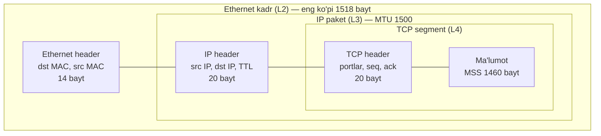
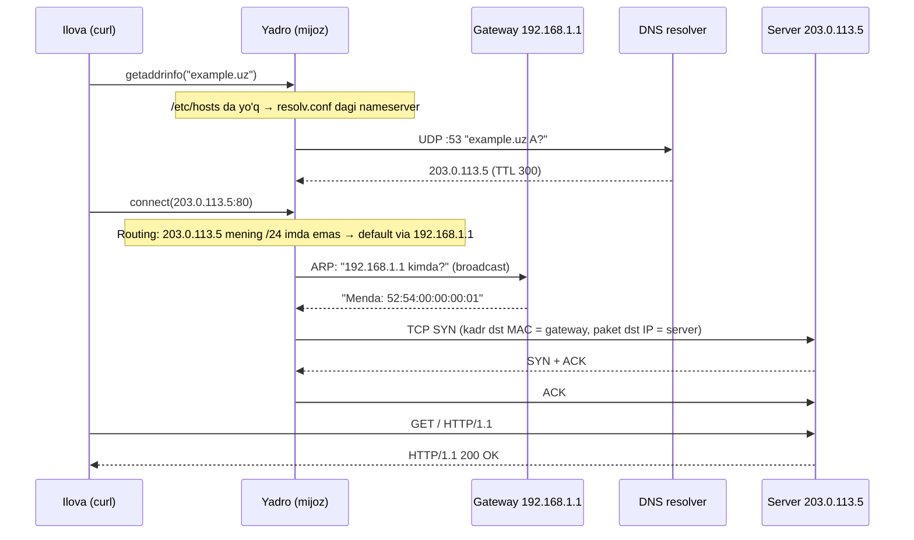
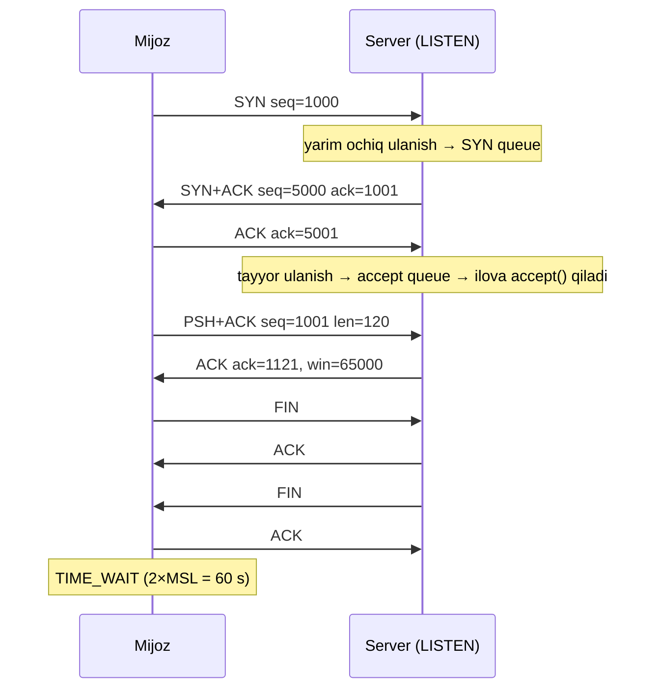
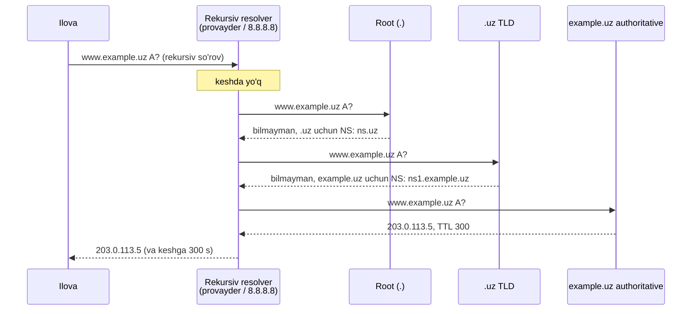
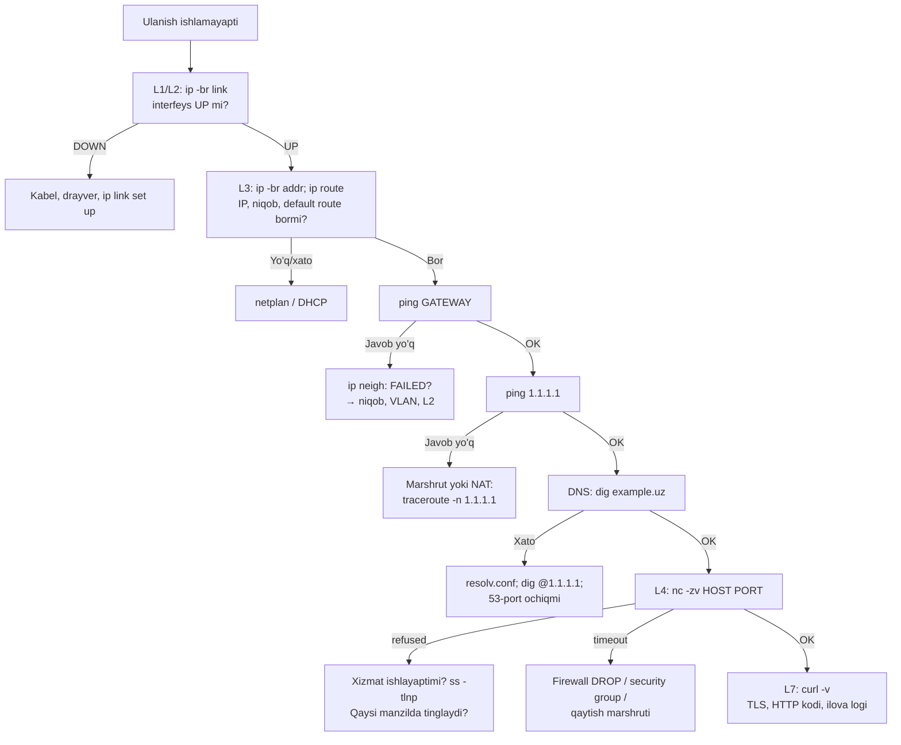

<!-- @section: why -->

## Muammo: "ping ishlamayapti" — va shu bilan tamom

Ikki server bir xil switchga ulangan. Biridan ikkinchisiga `ping` ketmaydi. Tarmoqni tushunmaydigan muhandis tasodifiy harakatlar qiladi: qayta yuklaydi, firewall ni o'chiradi, kabelni almashtiradi. Tushunadigan muhandis esa **pastdan yuqoriga** uchta savol beradi:

1. Kabel va interfeys ko'tarilganmi? (`ip link`)
2. IP manzil va niqob to'g'rimi — ikkalasi **bitta tarmoqda**mi? (`ip addr`)
3. Qo'shnining MAC manzili topilyaptimi? (`ip neigh`)

Va 30 soniyada javob topadi: birida niqob `/24`, ikkinchisida `/25` — ular bir-birini "boshqa tarmoq" deb hisoblayapti.

DevOps muhandisining kundalik muammolarining yarmidan ko'pi — tarmoq muammosi niqobi ostida keladi: "ilova bazaga ulana olmayapti", "Pod servisni topa olmayapti", "sertifikat olinmayapti", "deploy osilib qoldi".

## Yechim: qatlamli model

Tarmoq juda murakkab — shuning uchun u **qatlamlarga** bo'lingan. Har bir qatlam bitta vazifani hal qiladi va faqat qo'shni qatlamlar bilan gaplashadi:

| Savol | Qatlam | Javob beradigan narsa |
|---|---|---|
| Signal sim orqali qanday o'tadi? | Fizik (L1) | Kabel, optika, radio |
| Shu simdagi qaysi qurilmaga? | Kanal (L2) | MAC manzil, switch |
| Dunyoning qaysi tarmog'idagi qaysi xostga? | Tarmoq (L3) | IP manzil, router |
| O'sha xostdagi qaysi dasturga? Ishonchli yetdimi? | Transport (L4) | Port, TCP/UDP |
| Dastur nima demoqchi? | Ilova (L7) | HTTP, DNS, SSH |

> **Analogiya — pochta.** Xat (ma'lumot) konvertga solinadi va unga xonadon raqami yoziladi (port). Konvert shahar va ko'cha manzili yozilgan paketga solinadi (IP). Paket aniq bir pochta mashinasiga yuklanadi (MAC — faqat keyingi bekatgacha amal qiladi). Har bekatda mashina almashadi, lekin paketdagi manzil o'zgarmaydi.

Bu modelning amaliy qudrati: **nosozlikni qatlam bo'yicha lokalizatsiya qilish**. `ping IP` ishlaydi, `curl` ishlamaydi → L3 sog'lom, muammo L4 yoki L7 da.

## Nega keyingi mavzular shunga tayanadi

- **Docker**: har konteyner — o'z tarmoq namespace i, `veth` juftlik, bridge (L2), NAT (L3/L4).
- **Kubernetes**: Pod CIDR, Service CIDR, `10.244.0.0/16` — subnetting; CoreDNS — DNS; kube-proxy — L4.
- **Bulut**: VPC, subnet, security group — hammasi CIDR da yoziladi.
- **Private infra**: VLAN, VXLAN, pfSense — L2/L3 ni chuqur bilishni talab qiladi.

<!-- @section: theory -->

## OSI va TCP/IP modellari

**OSI** — 7 qatlamli nazariy model; **TCP/IP** — internetda amalda ishlatiladigan 4 qatlamli model. Suhbatda "L2", "L3", "L4", "L7" deyilganda OSI raqamlari nazarda tutiladi.

| OSI | Nomi | TCP/IP | Ma'lumot birligi (PDU) | Manzil | Misollar |
|---|---|---|---|---|---|
| 7 | Application | Application | Ma'lumot | URL, domen | HTTP, DNS, SSH |
| 6 | Presentation | ↑ | ↑ | | TLS, JSON |
| 5 | Session | ↑ | ↑ | | |
| 4 | Transport | Transport | **Segment** (TCP) / datagram (UDP) | **Port** | TCP, UDP |
| 3 | Network | Internet | **Paket** | **IP** | IPv4, IPv6, ICMP |
| 2 | Data Link | Link | **Kadr** (frame) | **MAC** | Ethernet, ARP, VLAN |
| 1 | Physical | ↑ | Bitlar | | Kabel, Wi-Fi |

**Inkapsulyatsiya** — yuqori qatlam ma'lumoti quyi qatlamning "foydali yuki"ga aylanadi: har qatlam o'z sarlavhasini (header) qo'shadi.



- **MTU** (Maximum Transmission Unit) — bitta kadr ko'tara oladigan eng katta IP paket; Ethernet da 1500 bayt.
- **MSS** (Maximum Segment Size) — bitta TCP segmentdagi ma'lumot: 1500 − 20 (IP) − 20 (TCP) = 1460.

Ilovadagi **OSI, TCP va TLS animatsiyasi** vositasida buni qadamma-qadam ko'ring.

## L2: MAC, switch va ARP

**MAC manzil** — tarmoq kartasining 48 bitli manzili: `52:54:00:a1:b2:c3`. U faqat **bitta segment** (broadcast domen) ichida ahamiyatga ega.

**Switch** kadrlarni MAC bo'yicha uzatadi. U har kelgan kadrning **manba** MAC ini "shu portda yashaydi" deb eslab qoladi (MAC learning). Manzil noma'lum bo'lsa — kadrni hamma portga yuboradi (flooding).

**ARP** (Address Resolution Protocol) — "bu IP kimniki?" savoliga MAC bilan javob oluvchi protokol. Chunki ilova IP ni biladi, lekin kadrni yuborish uchun MAC kerak.

**Eng muhim qoida:** xost paketni yuborishdan oldin tekshiradi — manzil **mening tarmog'imdami**?

- Ha → ARP bilan **manzilning o'zining** MAC ini topadi, to'g'ridan-to'g'ri yuboradi.
- Yo'q → ARP bilan **gateway ning** MAC ini topadi, kadrni unga yuboradi (IP manzil esa oxirgi manzilligicha qoladi).

"Mening tarmog'imdami" savoliga javobni **subnet niqobi** beradi.

## IPv4 manzillash

IPv4 manzil — 32 bit, to'rt oktet: `192.168.10.77`. Har bir manzil ikki qismdan iborat: **tarmoq qismi** va **host qismi**. Chegarani **prefiks** (`/26`) yoki **niqob** (`255.255.255.192`) belgilaydi.

### Maxsus oraliqlar

| Oraliq | Nomi | Izoh |
|---|---|---|
| `10.0.0.0/8` | Private (RFC 1918) | 16 mln manzil |
| `172.16.0.0/12` | Private | `172.16.0.0` – `172.31.255.255` |
| `192.168.0.0/16` | Private | Uy va ofis tarmoqlari |
| `127.0.0.0/8` | Loopback | Xostning o'zi |
| `169.254.0.0/16` | Link-local | DHCP javob bermaganda (APIPA) |
| `100.64.0.0/10` | CGNAT | Provayder ichki NAT i |

**Private** manzillar internetda marshrutlanmaydi — tashqariga chiqish uchun NAT kerak (keyingi dars).

### Subnetting — bit darajasida

`192.168.10.77/26` ni tahlil qilamiz. `/26` — birinchi 26 bit tarmoq, qolgan 6 bit host.

```text
IP:        11000000.10101000.00001010.01|001101    192.168.10.77
Niqob:     11111111.11111111.11111111.11|000000    255.255.255.192
           └──────── tarmoq (26 bit) ───┘└host(6)┘
AND:       11000000.10101000.00001010.01|000000    192.168.10.64   ← tarmoq manzili
Broadcast: 11000000.10101000.00001010.01|111111    192.168.10.127  ← host bitlari hammasi 1
```

- **Tarmoq manzili** = IP AND niqob (host bitlari 0)
- **Broadcast** = host bitlari hammasi 1
- **Hostlar soni** = 2^(host bitlari) − 2 = 2^6 − 2 = **62** (tarmoq va broadcast manzillari hostga berilmaydi)
- **Hostlar oralig'i**: `.65` – `.126`

**Tez usul — "blok o'lchami".** `256 − niqobning qiziq okteti` = `256 − 192` = **64**. Tarmoqlar har 64 da boshlanadi: `.0`, `.64`, `.128`, `.192`. `.77` qaysi oraliqda? `.64`–`.127` da.

| Prefiks | Niqob | Manzillar | Hostlar | Qayerda |
|---|---|---|---|---|
| `/8` | 255.0.0.0 | 16 777 216 | 16 777 214 | Katta private tarmoq |
| `/16` | 255.255.0.0 | 65 536 | 65 534 | VPC, K8s Pod CIDR |
| `/24` | 255.255.255.0 | 256 | 254 | Oddiy LAN |
| `/26` | 255.255.255.192 | 64 | 62 | |
| `/28` | 255.255.255.240 | 16 | 14 | Kichik segment |
| `/30` | 255.255.255.252 | 4 | 2 | Routerlararo ulanish |
| `/31` | 255.255.255.254 | 2 | 2 | Nuqta-nuqta (RFC 3021) |
| `/32` | 255.255.255.255 | 1 | 1 | Bitta xost |

### VLSM

**VLSM** (Variable Length Subnet Mask) — bitta blokni **turli o'lchamdagi** subnetlarga bo'lish. Qoida: **eng katta ehtiyojdan boshlang**. Misol — `10.20.0.0/22` (1024 manzil) ni 200, 100, 50 va 2 hostli segmentlarga:

| Segment | Kerak | Eng kichik mos blok | Subnet |
|---|---|---|---|
| A | 200 | 256 (`/24`, 254 host) | `10.20.0.0/24` |
| B | 100 | 128 (`/25`, 126 host) | `10.20.1.0/25` |
| C | 50 | 64 (`/26`, 62 host) | `10.20.1.128/26` |
| D | 2 | 4 (`/30`, 2 host) | `10.20.1.192/30` |

Ilovadagi **Subnet kalkulyator → VLSM** bilan o'z variantlaringizni sinang.

## IPv6 qisqacha

128 bit, 8 ta guruh × 16 bit, hex: `2001:0db8:0000:0000:0000:0000:0000:0001` → `2001:db8::1` (boshlang'ich nollar tashlanadi; nol guruhlar ketma-ketligi **bir marta** `::` bilan almashtiriladi).

| Tur | Prefiks | IPv4 dagi analogi |
|---|---|---|
| Global Unicast (GUA) | `2000::/3` | Public |
| Unique Local (ULA) | `fc00::/7` | Private |
| Link-local | `fe80::/10` | Faqat segment ichida; har interfeysda **majburiy** |
| Multicast | `ff00::/8` | Broadcast o'rnida |
| Loopback | `::1` | `127.0.0.1` |

IPv6 da broadcast va ARP yo'q — ular o'rnida multicast va **NDP** (Neighbor Discovery). Odatiy LAN prefiksi — `/64`; xost manzilni o'zi yasay oladi (**SLAAC**).

## L4: TCP va UDP

**Port** — 16 bitli son (0–65535): xostdagi qaysi dasturga. **Socket** = IP + port. Ulanish to'rtlik bilan aniqlanadi: `(src IP, src port, dst IP, dst port)`.

| Oraliq | Nomi | Misol |
|---|---|---|
| 0–1023 | Well-known (ochish uchun root/capability kerak) | 22 SSH, 53 DNS, 80, 443 |
| 1024–49151 | Registered | 5432 PostgreSQL, 6379 Redis, 6443 K8s API |
| 32768–60999 | Ephemeral (Linux) | Mijozning vaqtinchalik manba portlari |

| | TCP | UDP |
|---|---|---|
| Ulanish | O'rnatiladi (3-way handshake) | Yo'q |
| Yetkazish kafolati | Ha: tasdiq (ACK) va qayta yuborish | Yo'q |
| Tartib | Saqlanadi (seq raqamlari) | Kafolatlanmaydi |
| Oqim/tiqilinch boshqaruvi | Ha | Yo'q |
| Sarlavha | 20+ bayt | 8 bayt |
| Qachon | HTTP, SSH, bazalar | DNS, VoIP, QUIC, WireGuard |

## DNS

**DNS** — nomlarni manzillarga aylantiruvchi **taqsimlangan, ierarxik** baza.

| Yozuv | Vazifasi | Misol |
|---|---|---|
| `A` / `AAAA` | Nom → IPv4 / IPv6 | `example.uz. 300 IN A 203.0.113.5` |
| `CNAME` | Taxallus → boshqa nom | `www → example.uz.` |
| `MX` | Pochta serveri | |
| `TXT` | Ixtiyoriy matn | SPF, ACME DNS-01 challenge |
| `NS` | Zona uchun mas'ul serverlar | |
| `PTR` | IP → nom (teskari) | |
| `SRV` | Xizmat manzili va porti | Kubernetes, etcd discovery |

**TTL** — javobni keshda saqlash muddati (soniya). "DNS ni o'zgartirdim, lekin eskisi ko'rinyapti" — bu TTL.

## Atamalar lug'ati

| Atama | Ma'nosi | Misol |
|---|---|---|
| inkapsulyatsiya | Har qatlam o'z sarlavhasini qo'shishi | data → segment → paket → kadr |
| MAC | L2 manzil, 48 bit | `ip link` |
| ARP | IP → MAC | `ip neigh` |
| CIDR | Prefiksli yozuv | `10.0.0.0/16` |
| broadcast | Segmentdagi hammaga | `192.168.1.255` |
| gateway | Boshqa tarmoqqa chiqish routeri | `default via 192.168.1.1` |
| MTU / MSS | Eng katta paket / TCP ma'lumoti | 1500 / 1460 |
| socket | IP:port | `10.0.0.5:5432` |
| handshake | Ulanish o'rnatish almashinuvi | SYN, SYN-ACK, ACK |
| resolver | DNS so'rovini yechib beruvchi | `127.0.0.53`, `8.8.8.8` |

<!-- @section: internals -->

## Bitta `curl` ichida nima sodir bo'ladi

`curl http://example.uz/` — mijoz `192.168.1.10/24`, gateway `192.168.1.1`.



Har bosqichni o'zingiz kuzatishingiz mumkin:

```bash
getent hosts example.uz              # nom yechish (ilova ko'radigan natija)
ip route get 203.0.113.5             # yadro qaysi yo'lni tanlaydi
# 203.0.113.5 via 192.168.1.1 dev eth0 src 192.168.1.10
ip neigh show                        # ARP kesh
# 192.168.1.1 dev eth0 lladdr 52:54:00:00:00:01 REACHABLE
sudo tcpdump -ni eth0 'host 203.0.113.5 and tcp port 80' -c 6
```

## ARP mexanizmi

1. Yadro ARP keshga qaraydi (`ip neigh`). Yozuv bor va yangi (`REACHABLE`) — ishlatadi.
2. Yo'q bo'lsa — **ARP so'rov**: kadr `ff:ff:ff:ff:ff:ff` (broadcast) ga, "Who has 192.168.1.1? Tell 192.168.1.10".
3. Segmentdagi **hamma** oladi; faqat egasi **unicast** javob beradi.
4. Javob keshga yoziladi; bir muddatdan keyin `STALE` holatiga o'tadi va qayta tekshiriladi.

Oqibatlari: ARP routerdan o'tmaydi (broadcast domen chegarasi); ARP da autentifikatsiya yo'q — segmentdagi istalgan qurilma "bu IP meniki" deya oladi (ARP spoofing); **gratuitous ARP** — "men shu IP dagi yangi egaman" e'loni — Keepalived/VRRP da virtual IP ko'chganda ishlatiladi. Yozuv `FAILED` holatida bo'lsa — qo'shni javob bermayapti: L2 muammosi yoki IP noto'g'ri.

## TCP: handshake, ishonchlilik, yopilish



**Nega uch qadam?** Ikkala tomon ham o'zining boshlang'ich **seq** raqamini e'lon qilishi va qarshi tomonnikini tasdiqlashi kerak. Ikki qadam bilan server mijoz uning seq ini olganini bilmay qolardi.

**Ishonchlilik mexanizmlari:**

| Mexanizm | Qanday ishlaydi |
|---|---|
| Tasdiq (ACK) | `ack=N` — "N−1 gacha hammasini oldim, N ni kutaman" |
| Qayta yuborish | ACK kelmasa — RTO (taymer) dan keyin; 3 ta takroriy ACK — darhol (fast retransmit) |
| Sliding window | Qabul qiluvchi `win` da buferida qancha joy borligini aytadi — yuboruvchi undan oshirmaydi (flow control) |
| Congestion control | Yuboruvchi tarmoq sig'imini "paypaslaydi": sekin boshlaydi, yo'qotishda sekinlashadi (CUBIC, BBR) |

**Javob turiga qarab tashxis** — eng foydali amaliy bilim:

| SYN ga javob | Ma'nosi | Mijozda xato |
|---|---|---|
| `SYN+ACK` | Port ochiq | ulanadi |
| `RST` | Xost tirik, lekin portda **hech kim tinglamayapti** | `Connection refused` — darhol |
| Javob yo'q | Paket yo'lda yo'qoldi: **firewall DROP**, noto'g'ri marshrut, xost o'chiq | `Connection timed out` — uzoq kutishdan keyin |
| ICMP unreachable | Router yo'l topa olmadi | `No route to host` |

`refused` va `timed out` farqi — tashxisning yarmi.

**TIME_WAIT.** Ulanishni birinchi yopgan tomon 60 soniya shu holatda turadi — kechikkan paketlar shu port juftligidagi yangi ulanishga aralashmasligi uchun. Yuqori yuklamada mijoz tomonda ephemeral portlar tugashi mumkin — yechim: keep-alive va ulanishlar puli.

## DNS yechish zanjiri



Ilova **rekursiv** so'rov yuboradi ("javobni topib ber"); resolver esa **iterativ** ravishda ierarxiya bo'ylab yuradi. Butun zanjirni ko'rish: `dig +trace www.example.uz`.

Linux xostida nom yechish tartibi `/etc/nsswitch.conf` da: `hosts: files dns` — avval `/etc/hosts`, keyin DNS. Ubuntu da `/etc/resolv.conf` odatda `127.0.0.53` ga ishora qiladi — bu mahalliy `systemd-resolved`; haqiqiy yuqori serverlarni `resolvectl status` ko'rsatadi.

`resolv.conf` dagi `search` va `ndots` — Kubernetes da juda muhim: nomda nuqtalar soni `ndots` dan kam bo'lsa, avval `search` domenlari qo'shib sinab ko'riladi.

DNS asosan **UDP 53**; javob katta bo'lsa yoki zona uzatishda — TCP 53. Firewall da faqat UDP ni ochish — klassik xato.

<!-- @section: commands -->

## Interfeys va manzillar: `ip`

`ifconfig`, `route`, `arp`, `netstat` — **eskirgan** (net-tools). Zamonaviy vositalar — `ip` (iproute2) va `ss`.

```bash
ip -br addr
```

```text
lo        UNKNOWN  127.0.0.1/8 ::1/128
eth0      UP       192.168.1.10/24 fe80::5054:ff:fea1:b2c3/64
docker0   DOWN     172.17.0.1/16
```

```tahlil
{"command":"ip -br addr","parts":[{"t":"ip","d":"iproute2 ning asosiy vositasi: interfeys, manzil, marshrut, qo'shnilar"},{"t":"-br","d":"brief — har interfeys bitta satrda. -c qo'shilsa rangli. Busiz to'liq, ko'p satrli chiqish"},{"t":"addr","d":"Obyekt: IP manzillar. Qisqartma: a. Boshqa obyektlar: link (L2), route, neigh (ARP)"}]}
```

| Buyruq | Vazifasi | Eski muqobili |
|---|---|---|
| `ip -br link` | Interfeyslar holati (UP/DOWN), MAC, MTU | `ifconfig` |
| `ip addr add 10.0.0.5/24 dev eth0` | Manzil qo'shish (**vaqtinchalik** — reboot gacha) | `ifconfig eth0 ...` |
| `ip route` | Routing jadvali | `route -n` |
| `ip route get 8.8.8.8` | Shu manzilga qaysi yo'l tanlanadi | — |
| `ip neigh` | ARP / NDP kesh | `arp -n` |
| `ip -s link show eth0` | Statistika: xatolar, tashlangan paketlar | |

Doimiy sozlama Ubuntu da — **netplan** (`/etc/netplan/*.yaml`):

```yaml
network:
  version: 2
  ethernets:
    eth0:
      addresses: [192.168.1.10/24]
      routes:
        - to: default
          via: 192.168.1.1
      nameservers:
        addresses: [1.1.1.1, 8.8.8.8]
```

> ⚠️ **Ehtiyot bo'l.** Masofaviy serverda tarmoqni o'zgartirganda `sudo netplan apply` emas, `sudo netplan try` ishlating: 120 soniya ichida tasdiqlamasangiz, o'zgarish avtomatik qaytariladi.

## Ochiq portlar: `ss`

```bash
sudo ss -tulpn
```

```text
Netid State  Recv-Q Send-Q Local Address:Port  Peer Address:Port Process
tcp   LISTEN 0      511          0.0.0.0:80         0.0.0.0:*     users:(("nginx",pid=800,fd=6))
tcp   LISTEN 0      244        127.0.0.1:5432       0.0.0.0:*     users:(("postgres",pid=1423,fd=5))
udp   UNCONN 0      0      127.0.0.53%lo:53         0.0.0.0:*     users:(("systemd-resolve",pid=612,fd=13))
```

```tahlil
{"command":"ss -tulpn","parts":[{"t":"ss","d":"Socket statistics — netstat ning zamonaviy, tezroq o'rinbosari"},{"t":"-t","d":"TCP socketlar"},{"t":"-u","d":"UDP socketlar"},{"t":"-l","d":"Faqat tinglayotgan (LISTEN). Busiz o'rnatilgan ulanishlar ko'rsatiladi"},{"t":"-p","d":"Qaysi jarayon (nom va PID). Boshqalarning jarayonlari uchun sudo kerak"},{"t":"-n","d":"Raqamli: port va IP nomga aylantirilmaydi (tez, DNS so'rovisiz)"}]}
```

**`Local Address` ustunini o'qish — juda muhim:**

- `0.0.0.0:80` — **barcha** interfeyslarda tinglaydi (tashqaridan yetib boradi)
- `127.0.0.1:5432` — **faqat** shu mashinaning o'zidan. "Boshqa serverdan PostgreSQL ga ulana olmayapman → Connection refused" ning birinchi sababi shu.

## Bog'lanishni tekshirish

| Buyruq | Qaysi qatlam | Nimani isbotlaydi |
|---|---|---|
| `ping -c 3 IP` | L3 (ICMP) | Xost tirik va marshrut ikki tomonga ishlaydi. Javob yo'qligi — isbot **emas** (ICMP bloklangan bo'lishi mumkin) |
| `traceroute -n IP` / `mtr -n IP` | L3 | Yo'ldagi routerlar; qayerda uzilishi |
| `nc -zv IP 5432` | L4 | TCP port ochiqmi |
| `curl -v http://IP:PORT/` | L7 | Ilova javob beryaptimi |
| `dig example.uz` | DNS | Nom yechilyaptimi |

```bash
nc -zv -w 3 10.0.0.5 5432
# Connection to 10.0.0.5 5432 port [tcp/postgresql] succeeded!
```

```tahlil
{"command":"nc -zv -w 3 10.0.0.5 5432","parts":[{"t":"nc","d":"netcat — TCP/UDP uchun 'shveytsar pichog'i'"},{"t":"-z","d":"Zero-I/O: faqat ulanishni tekshiradi, ma'lumot yubormaydi"},{"t":"-v","d":"Natijani batafsil chiqaradi (succeeded / refused / timed out)"},{"t":"-w 3","d":"3 soniya kutadi. Busiz DROP qilingan portda juda uzoq osilib turadi"},{"t":"10.0.0.5 5432","d":"Manzil va port"}]}
```

## DNS: `dig`

```bash
dig +short example.uz A
# 203.0.113.5
dig @1.1.1.1 example.uz MX +noall +answer
dig +trace example.uz
dig -x 203.0.113.5 +short
```

```tahlil
{"command":"dig @1.1.1.1 example.uz MX +noall +answer","parts":[{"t":"dig","d":"DNS so'rov vositasi (dnsutils paketi)"},{"t":"@1.1.1.1","d":"Qaysi serverdan so'rash. Ko'rsatilmasa — resolv.conf dagi. Turli serverlarni solishtirish — tashxisning asosiy usuli"},{"t":"example.uz","d":"So'ralayotgan nom"},{"t":"MX","d":"Yozuv turi. Ko'rsatilmasa A"},{"t":"+noall +answer","d":"Faqat javob bo'limini chiqar. To'liq chiqishda: status (NOERROR / NXDOMAIN / SERVFAIL), TTL, javob bergan server"}]}
```

`dig` to'g'ridan-to'g'ri DNS ga so'rov yuboradi va `/etc/hosts` ni **o'qimaydi**. Ilova ko'radigan natijani bilish uchun — `getent hosts nom`.

## Paketlarni ushlash: `tcpdump`

```bash
sudo tcpdump -ni eth0 'tcp port 443 and host 203.0.113.5' -c 10
```

```text
09:12:01.100 IP 192.168.1.10.51234 > 203.0.113.5.443: Flags [S], seq 1000, win 64240, options [mss 1460], length 0
09:12:01.118 IP 203.0.113.5.443 > 192.168.1.10.51234: Flags [S.], seq 5000, ack 1001, win 65160, length 0
09:12:01.118 IP 192.168.1.10.51234 > 203.0.113.5.443: Flags [.], ack 1, win 502, length 0
```

```tahlil
{"command":"tcpdump -ni eth0 'tcp port 443 and host 203.0.113.5' -c 10","parts":[{"t":"tcpdump","d":"Interfeysdan o'tayotgan paketlarni ushlaydi (root kerak)"},{"t":"-n","d":"Nomlarga aylantirmaydi — aks holda har IP uchun DNS so'rov yuborib, chiqishni sekinlatadi va ifloslaydi"},{"t":"-i eth0","d":"Qaysi interfeys. 'any' — hammasi"},{"t":"'tcp port 443 and host 203.0.113.5'","d":"BPF filtr: yadro darajasida saralaydi. Qo'shtirnoq shart — qavs va 'and' ni shell buzmasligi uchun"},{"t":"-c 10","d":"10 ta paketdan keyin to'xtaydi"}]}
```

Bayroqlar: `[S]` SYN · `[S.]` SYN+ACK · `[.]` ACK · `[P.]` ma'lumot · `[F.]` FIN · `[R]` RST. Faqat `[S]` ko'rinib, javob bo'lmasa — yo'lda DROP. `-w fayl.pcap` — Wireshark uchun saqlash; `-A` — mazmunni ASCII da ko'rsatish.

<!-- @section: lab -->

## Lab 1. Subnetting: qog'oz va kalkulyator

**Maqsad:** istalgan CIDR ni 30 soniyada hisoblashni o'rganish.

**Qadamlar:**

1. Qog'ozda hisoblang — tarmoq manzili, broadcast, hostlar oralig'i va soni:
   - `172.16.45.200/20`
   - `10.10.10.130/27`
   - `192.168.5.99/30`
2. Javoblarni ilovadagi **Subnet kalkulyator** bilan tekshiring; bit-xaritada tarmoq/host chegarasiga qarang.
3. **Mashq** yorlig'ida ketma-ket 5 ta to'g'ri javob bering.
4. VLSM: `10.50.0.0/22` ni to'rt bo'limga bo'ling — 400, 120, 60 va 10 host. Avval qog'ozda, keyin VLSM yorlig'ida tekshiring.

<details><summary>💡 Yechimni ko'rsatish</summary>

| CIDR | Blok | Tarmoq | Broadcast | Hostlar |
|---|---|---|---|---|
| `172.16.45.200/20` | 3-oktetda 16 | `172.16.32.0` | `172.16.47.255` | 4094 |
| `10.10.10.130/27` | 4-oktetda 32 | `10.10.10.128` | `10.10.10.159` | 30 |
| `192.168.5.99/30` | 4-oktetda 4 | `192.168.5.96` | `192.168.5.99` | 2 (`.97`, `.98`) |

Uchinchisida tuzoq: `.99` — bu **broadcast** manzil, uni xostga berib bo'lmaydi.

VLSM (`10.50.0.0/22`): 400 → `/23` `10.50.0.0/23` (510 host); 120 → `/25` `10.50.2.0/25`; 60 → `/26` `10.50.2.128/26`; 10 → `/28` `10.50.2.192/28`.

</details>

## Lab 2. Handshake ni ushlash

**Maqsad:** TCP 3-way handshake ni o'z ko'zingiz bilan ko'rish; `refused` va `timeout` farqini his qilish.

**Muhit:** Ubuntu VM, `tcpdump` va `curl`.

**Qadamlar:**

1. Bir terminalda: `sudo tcpdump -ni any 'tcp port 8000' -c 12`
2. Ikkinchisida server: `python3 -m http.server 8000`
3. Uchinchisida: `curl -s localhost:8000 > /dev/null`
4. tcpdump chiqishida SYN, SYN+ACK, ACK, so'rov, javob va FIN larni toping.
5. Serverni to'xtating va `curl` ni takrorlang. Endi SYN ga qanday javob keldi?
6. Marshrutlanmaydigan manzilga: `curl -m 5 http://10.255.255.1:8000` — tcpdump da nima ko'rinadi?

<details><summary>💡 Yechimni ko'rsatish</summary>

4-qadam: `[S]` → `[S.]` → `[.]` → `[P.]` (GET) → `[.]` → `[P.]` (200 OK) → `[F.]` …

5-qadam: SYN ga `[R.]` (RST) keladi — `curl: (7) Failed to connect ... Connection refused`, **darhol**. Xost bor, portda hech kim yo'q.

6-qadam: bir necha `[S]` — qayta urinishlar (1 s, 2 s, 4 s oraliq bilan), javob yo'q. `curl: (28) Connection timed out`. Paket hech qayerga yetmadi yoki jimgina tashlandi.

</details>

## Lab 3. DNS izidan

1. `dig +trace www.wikipedia.org` — root, TLD va authoritative bosqichlarini toping.
2. `dig www.wikipedia.org` ni ikki marta ketma-ket bajaring: TTL qiymati qanday o'zgardi? Nega?
3. `/etc/hosts` ga `127.0.0.1 test.lokal` qo'shing. `getent hosts test.lokal` va `dig test.lokal +short` ni solishtiring.

<details><summary>💡 Yechimni ko'rsatish</summary>

2: ikkinchi so'rovda TTL kamaygan — javob resolver keshidan keldi va "qolgan umri"ni ko'rsatmoqda.

3: `getent` — `127.0.0.1` (nsswitch bo'yicha avval `files`); `dig` — bo'sh (u faqat DNS ga murojaat qiladi). Ilovalar `getent` kabi ishlaydi.

</details>

## Qo'shimcha chaqiriq

Ikki network namespace yarating (`ip netns add`), ularni `veth` juftlik bilan ulang, biriga `/24`, ikkinchisiga xuddi shu manzillar oralig'idan `/25` niqob bering. Qaysi yo'nalishda `ping` ishlaydi, qaysinisida yo'q? `ip neigh` ni kuzating va sababini tushuntiring.

<!-- @section: breakfix -->

## 1. Bir switchdagi ikki server bir-birini ko'rmayapti

`srv-a` (192.168.10.20) dan `srv-b` (192.168.10.200) ga ping: `Destination Host Unreachable`. Ikkalasi bitta switchda, kabel va interfeyslar `UP`. `srv-a` ning netplan fayli:

```breakfix
{"title":"Niqob mos emas","lang":"yaml","broken":"network:\n  version: 2\n  ethernets:\n    eth0:\n      addresses: [192.168.10.20/25]\n      routes:\n        - to: default\n          via: 192.168.10.1\n      nameservers:\n        addresses: [1.1.1.1]","hints":["srv-a o'zini qaysi tarmoqda deb hisoblaydi? /25 da blok o'lchami — 128.","192.168.10.20/25 → tarmoq 192.168.10.0–127. srv-b (.200) bu oraliqda emas — srv-a uni 'begona tarmoq' deb gateway orqali yubormoqchi bo'ladi.","Butun segment /24. Niqobni to'g'rilang."],"solution":"network:\n  version: 2\n  ethernets:\n    eth0:\n      addresses: [192.168.10.20/24]\n      routes:\n        - to: default\n          via: 192.168.10.1\n      nameservers:\n        addresses: [1.1.1.1]","explain":"/25 niqob bilan srv-a faqat .0–.127 ni 'o'z tarmog'i' deb biladi. .200 uchun u ARP bilan srv-b ni emas, gateway ni qidiradi. Niqob — xostning 'kim qo'shni, kim uzoqda' degan qarori; segmentdagi barcha xostlarda bir xil bo'lishi shart."}
```

## 2. IP bilan ishlaydi, nom bilan ishlamaydi

```text
$ curl https://api.example.uz
curl: (6) Could not resolve host: api.example.uz
$ curl -k https://203.0.113.5 -H 'Host: api.example.uz'
{"status":"ok"}
$ dig @1.1.1.1 api.example.uz +short
203.0.113.5
```

Server statik sozlangan; `/etc/resolv.conf` qo'lda yozilgan:

```breakfix
{"title":"resolv.conf","lang":"ini","broken":"# /etc/resolv.conf\nnameserver 10.0.0.254\nsearch internal\noptions timeout:2 attempts:1","hints":["Tarmoq ishlayapti (IP bilan curl o'tdi), tashqi DNS ham javob beryapti (dig @1.1.1.1). Demak muammo — server QAYSI DNS dan so'rayotganida.","10.0.0.254 — eski ichki DNS; u endi javob bermaydi. dig @10.0.0.254 example.uz bilan tekshiring.","Ishlaydigan nameserver yozing — ishonchlilik uchun ikkita."],"solution":"# /etc/resolv.conf\nnameserver 1.1.1.1\nnameserver 8.8.8.8\nsearch internal\noptions timeout:2 attempts:2","explain":"'Could not resolve host' — tarmoq emas, DNS muammosi. Yagona nameserver ishdan chiqqan edi. Zaxira server va bir necha urinish qo'ying. Eslatma: systemd-resolved ishlatadigan tizimda bu fayl avtomatik boshqariladi — sozlamani netplan (nameservers:) orqali bering."}
```

## 3. PostgreSQL ga boshqa serverdan ulanib bo'lmayapti

`app` serveridan: `psql -h 10.0.0.5` → `Connection refused`. Bazaning o'zida esa `psql -h localhost` ishlaydi.

```text
db$ sudo ss -tlnp | grep 5432
tcp LISTEN 0 244 127.0.0.1:5432 0.0.0.0:* users:(("postgres",pid=1423))
```

```breakfix
{"title":"Qaysi manzilda tinglayapti?","lang":"ini","broken":"# /etc/postgresql/16/main/postgresql.conf\nlisten_addresses = 'localhost'\nport = 5432\nmax_connections = 100","hints":["'refused' — paket yetib bordi, lekin o'sha manzil:portda hech kim tinglamayapti. ss chiqishidagi Local Address ga qarang.","127.0.0.1:5432 — faqat loopback. 10.0.0.5:5432 da tinglovchi yo'q.","listen_addresses ga serverning ichki IP sini qo'shing. '*' ham ishlaydi, lekin aniq manzil xavfsizroq."],"solution":"# /etc/postgresql/16/main/postgresql.conf\nlisten_addresses = 'localhost,10.0.0.5'\nport = 5432\nmax_connections = 100","explain":"Xizmat faqat 127.0.0.1 ga bog'langan edi. Tuzatgandan keyin restart kerak. Keyingi to'siq — pg_hba.conf: mijoz tarmog'i uchun yozuv bo'lmasa 'no pg_hba.conf entry for host' xatosi chiqadi (bu endi 'refused' emas — demak tarmoq qismi hal bo'ldi). Firewall da 5432 ni faqat ilova serverlari uchun oching."}
```

<!-- @section: errors -->

## Metodika: pastdan yuqoriga



Har qadam oldingisiga tayanadi — o'rtadan boshlamang. Va doim **ikkala tomondan** tekshiring: so'rov yetib bordimi (serverda `tcpdump`) va javob qaytdimi.

## Xatolar jadvali

| Xato xabari / simptom | Sabab | Qanday tekshiriladi | Yechim |
|---|---|---|---|
| `Network is unreachable` | Manzilga marshrut yo'q (default route yo'q) | `ip route` | Gateway qo'shish |
| `Destination Host Unreachable` (o'z IP ngizdan) | ARP javobsiz: qo'shni yo'q yoki niqob xato | `ip neigh` → `FAILED` | IP/niqob/VLAN ni tekshirish |
| `No route to host` | Router ICMP unreachable qaytardi yoki firewall `REJECT` | `traceroute -n` | Marshrut / firewall qoidasi |
| `Connection refused` | Portda tinglovchi yo'q; xizmat faqat `127.0.0.1` da | `ss -tlnp` (serverda) | Xizmatni ishga tushirish; bind manzili |
| `Connection timed out` | Paket DROP qilinmoqda yoki xost yo'q | Serverda `tcpdump`: SYN kelyaptimi? | Firewall / security group; marshrut |
| `Could not resolve host` / `Temporary failure in name resolution` | DNS serverga yetib bo'lmayapti | `dig @1.1.1.1 nom`; `resolvectl status` | Nameserver; UDP/TCP 53 |
| `NXDOMAIN` | Bunday nom mavjud emas | `dig nom` → status | Yozuvni yaratish; imloni tekshirish |
| `SERVFAIL` | Authoritative server javob bermadi; DNSSEC xatosi | `dig +trace` | Zona NS larini tuzatish |
| DNS o'zgartirildi, eski IP ko'rinmoqda | Kesh (TTL) | `dig` dagi TTL; `dig @ns1.zona` | Kutish; o'zgartirishdan oldin TTL ni kamaytirish |
| `ping` ishlaydi, `curl` — yo'q | L3 sog'lom; L4/L7 da to'siq | `nc -zv` | Port / firewall / xizmat |
| Kichik so'rovlar o'tadi, kattalari osiladi | MTU muammosi: tunnel (VPN, VXLAN) sarlavhasi + ICMP "fragmentation needed" bloklangan | `ping -M do -s 1472 IP` | Interfeys MTU sini kamaytirish; MSS clamping |
| `Address already in use` | Portni boshqa jarayon band qilgan | `ss -tlnp \| grep :PORT` | Jarayonni to'xtatish / boshqa port |
| `Cannot assign requested address` | Ilova xostda yo'q IP ga bind qilmoqchi; yoki ephemeral portlar tugagan | `ip addr`; `ss -s` | To'g'ri IP; keep-alive, portlar oralig'ini kengaytirish |
| Aloqa vaqti-vaqti bilan uziladi | IP ziddiyati: ikki xostda bir xil manzil | `arping -D -I eth0 IP`; `ip neigh` da MAC almashib turadi | Takroriy IP ni yo'qotish |
| `ssh: connect to host X port 22: Connection timed out` | Firewall; noto'g'ri IP; security group | `nc -zv X 22` | Qoidani ochish |

## Debug uchun asosiy buyruqlar

```bash
ip -br link; ip -br addr; ip route; ip neigh
ip route get MANZIL
ping -c 3 GATEWAY; ping -c 3 1.1.1.1
mtr -n -c 20 MANZIL                    # har hop dagi yo'qotish va kechikish
dig NOM; dig @1.1.1.1 NOM; getent hosts NOM
nc -zv -w 3 HOST PORT
sudo ss -tulpn
curl -v --connect-timeout 5 URL        # DNS → TCP → TLS → HTTP bosqichlari ko'rinadi
sudo tcpdump -ni any 'host X and port Y'
```

<!-- @section: production -->

## Xavfsizlik

**1. Faqat kerakli manzilda tinglang.** Ma'lumotlar bazasi, Redis, ichki API — `0.0.0.0` da emas, ichki interfeys yoki `127.0.0.1` da. Davriy audit:

```bash
sudo ss -tlnp | grep -v -E '127\.0\.0\.1|\[::1\]'    # tashqariga ochiq hamma narsa
```

**2. Tarmoqni segmentlang.** Veb, ilova va baza qatlamlari — alohida subnetlarda; ular orasida faqat kerakli portlar ochiq. Bitta tekis `/16` da hamma hammaga yeta oladi.

**3. Private manzillarni to'g'ri tanlang.** `192.168.0.0/24` va `192.168.1.0/24` — har ikkinchi uy routeri shu. VPN orqali ulanganda ziddiyat bo'ladi. Infratuzilma uchun `10.x.y.0/24` dan kam uchraydiganini tanlang.

**4. DNS — hujum vektori ham.** Ichki nomlarni tashqi resolverlarga oshkor qilmang; chiquvchi DNS ni faqat o'z resolverlaringizga ruxsat bering.

## IP rejalashtirish

Manzillar rejasi — eng qimmat "keyin tuzatamiz". Kesishgan tarmoqlarni keyin birlashtirish (VPN, peering) juda og'riqli.

| Qoida | Nega |
|---|---|
| Hujjatlashtiring: har subnet — maqsad, VLAN, gateway | "Bu `/24` kimniki?" degan savol bo'lmasin |
| Muhitlar kesishmasin (dev `10.10.0.0/16`, prod `10.20.0.0/16`) | Kelajakda ularni ulash mumkin bo'lsin |
| Zaxira bilan oling | `/24` tugasa, kengaytirish — qayta manzillash demak |
| Kubernetes Pod va Service CIDR lari xost tarmoqlari bilan **kesishmasin** | Aks holda Pod lar o'sha tarmoqdagi xostlarga yeta olmaydi |
| Docker ning standart `172.17.0.0/16` iga e'tibor bering | Korporativ tarmoq bilan kesishsa — `daemon.json` da `default-address-pools` |

## Ishonchlilik va performance

- **DNS — yagona nosozlik nuqtasi.** Kamida ikkita nameserver; `options timeout:2 attempts:2 rotate`.
- **TTL strategiyasi:** barqaror yozuvlar — 1 soat+; ko'chirish rejalashtirilsa — bir kun oldin 60–300 s ga tushiring.
- **Keep-alive va ulanishlar puli:** har so'rovga yangi TCP + TLS handshake — qimmat; va ephemeral portlarni tugatadi.
- **MTU:** overlay tarmoqlarda (VXLAN, WireGuard) ichki MTU ni kamaytiring (1450, 1420) — aks holda fragmentatsiya yoki "qora tuynuk".
- **Backlog:** yuqori yuklamali serverlarda `net.core.somaxconn` va ilovaning `listen backlog` qiymatini oshiring.

## Kuzatuv

| Nimani o'lchash | Nega |
|---|---|
| TCP retransmit ulushi (`nstat TcpRetransSegs`) | Paket yo'qotish belgisi |
| Interfeys xatolari va drop lar (`ip -s link`) | Fizik muammo yoki to'lgan bufer |
| DNS so'rov kechikishi va xatolar | "Hamma narsa sekin" ning yashirin sababi |
| `TIME_WAIT` va ochiq socketlar soni (`ss -s`) | Port tugashi arafasi |
| Tashqaridan "qora quti" tekshiruvi (blackbox exporter) | Foydalanuvchi ko'rgan holat |

## Production ga chiqishdan oldingi tekshiruv ro'yxati

- [ ] IP reja hujjatlashtirilgan; tarmoqlar kesishmaydi
- [ ] Har bir xizmat faqat kerakli interfeysda tinglaydi (`ss -tlnp` tekshirilgan)
- [ ] Kamida ikkita DNS server sozlangan
- [ ] Tarmoq sozlamasi doimiy (netplan da) — reboot dan keyin saqlanadi
- [ ] Kritik yozuvlar uchun TTL ongli tanlangan
- [ ] Overlay/VPN da MTU tekshirilgan (`ping -M do -s ...`)
- [ ] Vaqt sinxronlangan (`timedatectl`) — TLS va loglar uchun
- [ ] Tashqi tekshiruv va DNS monitoringi bor

## Anti-pattern lar

| Anti-pattern | Nima uchun yomon | To'g'risi |
|---|---|---|
| Hamma narsa bitta `/16` da | Segmentatsiya yo'q, broadcast ko'p | Vazifa bo'yicha subnetlar |
| Baza `0.0.0.0:5432` da, firewall "bor-ku" | Bitta noto'g'ri qoida — baza internetda | Ichki IP ga bind + firewall |
| Kodda IP manzillar | Server ko'chsa — qayta deploy | DNS nomlari |
| "ping ishlamaydi — server o'chiq" | ICMP bloklangan bo'lishi mumkin | `nc -zv` bilan portni tekshirish |
| Muammoda birinchi navbatda firewall ni o'chirish | Sabab noma'lum qoladi, himoya yo'qoladi | Qatlamma-qatlam tashxis |
| `/etc/hosts` orqali "vaqtinchalik" yechim | Unutiladi, serverlar har xil bo'lib qoladi | DNS yozuvi |

<!-- @section: interview -->

### 1. Brauzerga `https://example.uz` yozganingizda nima sodir bo'ladi?

🟡 Middle

**Namunaviy javob.** (1) **DNS**: brauzer va OS keshi, `/etc/hosts`, keyin rekursiv resolver; u root → TLD → authoritative zanjiri orqali A yozuvni topadi. (2) **Marshrut**: manzil mahalliy tarmoqda emas — paket default gateway ga yuboriladi; uning MAC i ARP bilan topiladi. (3) **TCP**: 443-portga 3-way handshake. (4) **TLS**: ClientHello (SNI bilan), server sertifikati, kalit almashinuvi; brauzer sertifikat zanjirini va domen mosligini tekshiradi. (5) **HTTP**: `GET /` so'rovi; yo'lda yuk taqsimlagich va reverse proxy bo'lishi mumkin; server javob qaytaradi. (6) Brauzer HTML ni tahlil qilib, qo'shimcha resurslar uchun yangi so'rovlar yuboradi.

**Intervyuer nimani kutadi:** qatlamlar bo'yicha tizimli hikoyani; so'ralgan joyda chuqurlasha olishni.

**Qo'shimcha savol:** Shu zanjirning har bosqichini qaysi buyruq bilan tekshirasiz?

### 2. TCP va UDP farqi. Har biriga misol.

🟢 Junior

**Namunaviy javob.** TCP — ulanishga asoslangan va ishonchli: handshake, tasdiqlar, qayta yuborish, tartibni saqlash, oqim va tiqilinch boshqaruvi. Narxi — kechikish va qo'shimcha yuk. UDP — ulanishsiz: datagramma yuboriladi, kafolat yo'q, lekin tez va sodda. TCP: HTTP, SSH, bazalar — har bayt muhim. UDP: DNS (bitta so'rov-javob), VoIP va video (kechikkan paket keraksiz), QUIC/HTTP/3 va WireGuard (ishonchlilikni o'zi ustiga quradi).

### 3. `192.168.1.130/26` — tarmoq manzili, broadcast va hostlar soni?

🟢 Junior

**Namunaviy javob.** `/26` — niqob `255.255.255.192`, blok o'lchami 64. Tarmoqlar: `.0`, `.64`, `.128`, `.192`. `.130` — `.128` blokida. Tarmoq `192.168.1.128`, broadcast `192.168.1.191`, hostlar `.129`–`.190`, soni 2^6 − 2 = 62.

**Qo'shimcha savol:** `/31` va `/32` qayerda ishlatiladi?

### 4. ARP nima uchun kerak?

🟢 Junior

**Namunaviy javob.** Ilova IP manzilni biladi, lekin Ethernet kadrni yuborish uchun qabul qiluvchining MAC manzili kerak. ARP broadcast so'rov yuboradi: "bu IP kimda?" — egasi o'z MAC i bilan javob beradi; natija keshlanadi. Agar manzil boshqa tarmoqda bo'lsa, ARP manzilning o'zi uchun emas, gateway uchun bajariladi. ARP faqat bitta broadcast domen ichida ishlaydi. IPv6 da uning o'rnida NDP.

### 5. `Connection refused` va `Connection timed out` farqi nima?

🟡 Middle

**Namunaviy javob.** `refused` — SYN ga RST keldi: xost tirik va yetib bordim, lekin o'sha port/manzilda hech kim tinglamayapti (xizmat o'chiq yoki faqat `127.0.0.1` ga bog'langan), yoki firewall `REJECT` qildi. Xato darhol chiqadi. `timed out` — SYN ga umuman javob yo'q: firewall `DROP` qilyapti, marshrut yo'q, xost o'chiq yoki javob boshqa yo'ldan ketib yo'qolyapti. Shunga qarab birinchi holatda xizmatni (`ss -tlnp`), ikkinchisida tarmoq yo'lini va firewall ni tekshiraman.

**Intervyuer nimani kutadi:** RST va DROP mexanizmini; keyingi qadamlarni.

### 6. Private va public IP farqi. Private manzilli server internetga qanday chiqadi?

🟢 Junior

**Namunaviy javob.** Private oraliqlar (RFC 1918: `10/8`, `172.16/12`, `192.168/16`) internetda marshrutlanmaydi — ularni istalgan tashkilot ichkarida qayta-qayta ishlatishi mumkin. Tashqariga chiqish uchun chegaradagi router **NAT** qiladi: chiquvchi paketning manba manzilini o'zining public IP siga almashtiradi va moslikni jadvalda saqlaydi; javob kelganda teskari almashtiradi.

### 7. DNS qanday ishlaydi? Rekursiv va iterativ so'rov farqi?

🟡 Middle

**Namunaviy javob.** Mijoz rekursiv resolverga "javobni topib ber" deydi. Resolver keshda topmasa, iterativ yuradi: root serverdan TLD serverlar manzilini, TLD dan zona authoritative serverini, undan esa yakuniy yozuvni oladi. Har javob TTL muddatiga keshlanadi. Rekursiv so'rov — "to'liq javob ber"; iterativ — "bilganingni ayt, keyingisini o'zim so'rayman".

**Qo'shimcha savol:** Negativ javoblar (NXDOMAIN) keshlanadimi? (Ha — SOA dagi minimum TTL bo'yicha.)

### 8. TCP 3-way handshake ni tushuntiring. Nega ikki qadam yetmaydi?

🟡 Middle

**Namunaviy javob.** Mijoz SYN (o'z boshlang'ich seq raqami bilan) yuboradi; server SYN+ACK (mijoz seq ini tasdiqlab, o'zinikini e'lon qilib) qaytaradi; mijoz ACK bilan server seq ini tasdiqlaydi. Uchinchi qadam bo'lmasa server o'z seq raqami yetib borganini bilmaydi, va kechikib kelgan eski SYN lar "arvoh" ulanishlar ochardi. Server tomonda yarim ochiq ulanishlar SYN queue da, tayyorlari accept queue da turadi — SYN flood hujumi birinchisini to'ldiradi; himoya — SYN cookies.

### 9. Foydalanuvchilar "kichik sahifalar ochiladi, katta fayllar osilib qoladi" deyapti. VPN orqali ishlaydi. Taxminingiz?

🔴 Senior

**Namunaviy javob.** Klassik MTU / Path MTU Discovery muammosi. Tunnel o'z sarlavhasini qo'shadi, samarali MTU 1500 dan kam bo'ladi. Kichik paketlar sig'adi; to'liq o'lchamli segmentlar esa yo'q. Oddiy holatda router "fragmentation needed" ICMP xabarini qaytaradi va yuboruvchi o'lchamni kamaytiradi — lekin yo'lda ICMP bloklangan bo'lsa, xabar yetib kelmaydi va katta paketlar jimgina yo'qoladi (PMTUD black hole). Tekshirish: `ping -M do -s 1472 manzil` va o'lchamni kamaytirib, o'tadigan chegarani topish. Yechim: tunnel interfeysi MTU sini to'g'ri qo'yish, routerda MSS clamping (`TCPMSS --clamp-mss-to-pmtu`), ICMP type 3 code 4 ga ruxsat berish.

**Intervyuer nimani kutadi:** simptomdan mexanizmga o'tishni; tekshirish usulini.

### 10. Yuqori yuklamali servisda "Cannot assign requested address" xatolari paydo bo'ldi. Nima bo'lyapti?

🔴 Senior

**Namunaviy javob.** Ephemeral portlar tugagan. Chiquvchi har TCP ulanish `(src IP, src port, dst IP, dst port)` to'rtligi bilan aniqlanadi; bitta manzil:portga qarab ulanishlar soni mahalliy portlar oralig'i (standart ~28 ming) bilan cheklangan. Yopilgan ulanishlar 60 soniya `TIME_WAIT` da turadi — sekundiga 500+ qisqa ulanish ochilsa, portlar tugaydi. Tekshiraman: `ss -s`, `ss -tan state time-wait | wc -l`. Yechim tartibi: (1) asosiysi — ulanishlarni qayta ishlatish: HTTP keep-alive, connection pool; (2) `net.ipv4.ip_local_port_range` ni kengaytirish; (3) `net.ipv4.tcp_tw_reuse=1`; (4) bir nechta manba IP yoki backend manzillar. NAT gateway da ham xuddi shu chegara bor.

<!-- @section: cheatsheet -->

## Qatlamlar

| L | Nomi | Birlik | Manzil | Qurilma | Tekshirish |
|---|---|---|---|---|---|
| 7 | Ilova | ma'lumot | URL | proxy | `curl -v` |
| 4 | Transport | segment | port | L4 LB | `nc -zv`, `ss` |
| 3 | Tarmoq | paket | IP | router | `ping`, `ip route` |
| 2 | Kanal | kadr | MAC | switch | `ip link`, `ip neigh` |

## Subnetting

| Prefiks | Niqob | Blok | Hostlar |
|---|---|---|---|
| /24 | .0 | 256 | 254 |
| /25 | .128 | 128 | 126 |
| /26 | .192 | 64 | 62 |
| /27 | .224 | 32 | 30 |
| /28 | .240 | 16 | 14 |
| /29 | .248 | 8 | 6 |
| /30 | .252 | 4 | 2 |

Hostlar = 2^(32 − prefiks) − 2 · Blok = 256 − niqob okteti · Tarmoq = blokka karrali eng yaqin kichik son

**Private:** `10.0.0.0/8` · `172.16.0.0/12` · `192.168.0.0/16`

## Buyruqlar

| Buyruq | Nima qiladi |
|---|---|
| `ip -br a` / `ip -br l` | Manzillar / interfeyslar |
| `ip r`; `ip route get X` | Marshrutlar; X ga yo'l |
| `ip neigh` | ARP kesh |
| `ss -tulpn` | Tinglayotgan portlar va jarayonlar |
| `ping -c 3 X` | L3 |
| `mtr -n X` | Yo'l va yo'qotish |
| `nc -zv -w 3 X PORT` | L4: port ochiqmi |
| `dig +short NOM`; `dig @1.1.1.1 NOM` | DNS |
| `dig +trace NOM` | To'liq zanjir |
| `getent hosts NOM` | Ilova ko'radigan natija |
| `curl -v URL` | L7, bosqichma-bosqich |
| `tcpdump -ni eth0 'host X and port Y'` | Paketlar |

## Tashxis

| Simptom | Ma'nosi |
|---|---|
| `refused` (darhol) | Portda tinglovchi yo'q / `127.0.0.1` ga bog'langan |
| `timed out` | DROP / marshrut / xost yo'q |
| `Could not resolve` | DNS |
| ping ✓, curl ✗ | L4/L7 |
| Kichik ✓, katta ✗ | MTU |

**tcpdump bayroqlari:** `[S]` SYN · `[S.]` SYN+ACK · `[.]` ACK · `[P.]` ma'lumot · `[F.]` FIN · `[R]` RST

## Esda tut

1. Pastdan yuqoriga: link → IP → route → DNS → port → ilova.
2. Niqob "kim qo'shni" ni hal qiladi; segmentda hamma bir xil niqobda.
3. IP oxirigacha o'zgarmaydi; MAC har hop da almashadi.
4. `0.0.0.0` — hammaga; `127.0.0.1` — faqat o'ziga.
5. `refused` ≠ `timed out`.
6. `dig` `/etc/hosts` ni ko'rmaydi — `getent` ko'radi.
7. `ifconfig`/`netstat` eskirgan → `ip`/`ss`.
