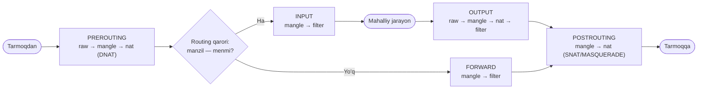
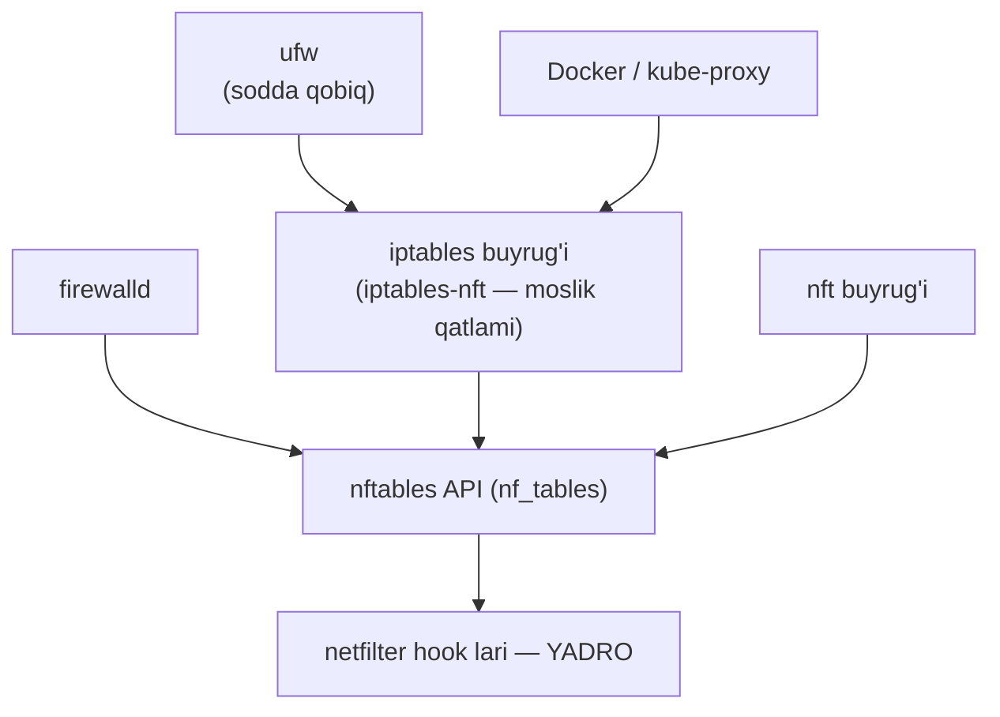
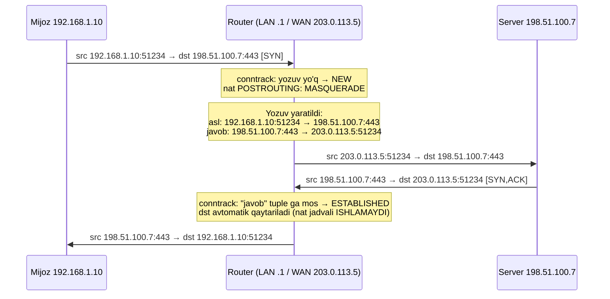
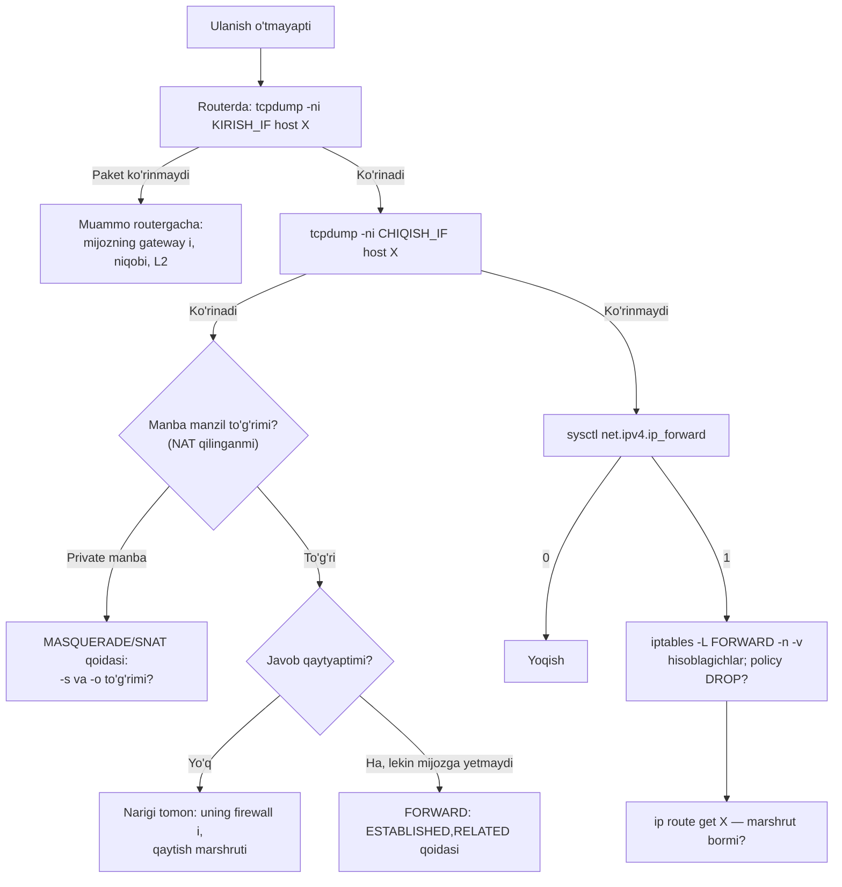

<!-- @section: why -->

## Uchta savol, bitta dars

**Birinchi.** Ofisda 50 ta kompyuter bor, provayder esa bitta public IP bergan. Qanday qilib hammasi bir vaqtda internetga chiqadi?

**Ikkinchi.** Veb-server ichki tarmoqda (`192.168.1.20`), unga internetdan kirish kerak. Private manzilga tashqaridan qanday yetib boriladi?

**Uchinchi.** Yangi serverni internetga ulaganingizdan 3 daqiqa o'tib `auth.log` da yuzlab `Failed password for root` paydo bo'ladi. Skanerlar butun IPv4 maydonini bir soatdan kamroq vaqtda aylanib chiqadi. Serveringizdagi PostgreSQL, Redis, Docker API — ular kimga ochiq?

Javoblar:

| Savol | Mexanizm |
|---|---|
| Paket qaysi yo'ldan ketadi? | **Routing** — marshrutlash jadvali |
| Private manzillar internet bilan qanday gaplashadi? | **NAT** — manzilni almashtirish (SNAT, DNAT) |
| Kimga nimaga ruxsat? | **Firewall** — paketlarni filtrlash |

Linux da bu uchala vazifani **yadroning o'zi** bajaradi: marshrutlash — yadro routing jadvali, NAT va filtr — **netfilter** freymvorki. `iptables`, `nftables`, `ufw` — shunchaki netfilter ga qoida yozuvchi vositalar.

## Nega bu "eski mavzu" emas

Chunki zamonaviy infratuzilma aynan shu mexanizmlar ustiga qurilgan:

- **Docker** `-p 8080:80` — bu `iptables` dagi DNAT qoidasi. Konteynerning internetga chiqishi — MASQUERADE.
- **Kubernetes Service** — kube-proxy yozgan yuzlab DNAT qoidalari. ClusterIP hech qaysi interfeysda yo'q — u faqat netfilter jadvalida "yashaydi".
- **Bulutdagi security group, NAT gateway** — xuddi shu tushunchalar, faqat boshqa interfeys bilan.
- **"ufw yoqilgan, lekin Docker porti baribir ochiq"** — bu sirni faqat zanjirlar tartibini bilgan odam yecha oladi.

> **Analogiya.** Router — chorraha: har mashina (paket) uchun yo'l ko'rsatkichlariga (routing jadvali) qarab yo'nalish tanlanadi. NAT — mehmonxona qabulxonasi: mehmonlar tashqariga mehmonxona manzili bilan xat yuboradi, javob kelganda qabulxona daftarga (conntrack) qarab kimning xonasiga berishni biladi. Firewall — qo'riqchi: ro'yxatda borlarni o'tkazadi.

<!-- @section: theory -->

## Routing: paket qayerga boradi

Har bir xostda — hatto oddiy noutbukda ham — **routing jadvali** bor. Paket yuborishdan oldin yadro unga qaraydi.

```text
$ ip route
default via 192.168.1.1 dev eth0 proto dhcp metric 100
10.8.0.0/24 dev wg0 proto kernel scope link src 10.8.0.2
172.17.0.0/16 dev docker0 proto kernel scope link src 172.17.0.1
192.168.1.0/24 dev eth0 proto kernel scope link src 192.168.1.10
```

| Yozuv turi | Misol | Ma'nosi |
|---|---|---|
| **Connected** (ulangan) | `192.168.1.0/24 dev eth0 scope link` | Bu tarmoq to'g'ridan-to'g'ri shu interfeysda — gateway kerak emas. Interfeysga IP berilganda avtomatik paydo bo'ladi |
| **Static** | `10.20.0.0/16 via 192.168.1.254` | Bu tarmoqqa shu router orqali boriladi |
| **Default** | `default via 192.168.1.1` | Boshqa hech narsa mos kelmasa — shu yerga (`0.0.0.0/0`) |

### Longest prefix match

Manzilga bir nechta yozuv mos kelsa, **eng uzun prefiksli** (eng aniq) yozuv yutadi. Jadvaldagi tartib ahamiyatsiz.

| Manzil | Mos yozuvlar | G'olib | Nega |
|---|---|---|---|
| `192.168.1.50` | `default` (/0), `192.168.1.0/24` | `192.168.1.0/24` → eth0 | /24 > /0 |
| `172.17.0.5` | `default`, `172.17.0.0/16` | `172.17.0.0/16` → docker0 | /16 > /0 |
| `8.8.8.8` | `default` | default → 192.168.1.1 | yagona mos |
| `10.8.0.7` | `default`, `10.8.0.0/24` | `10.8.0.0/24` → wg0 | VPN shunday ishlaydi |

Prefikslar teng bo'lsa — **metric** kichigi tanlanadi.

VPN aynan shu qoidaga tayanadi: u `0.0.0.0/1` va `128.0.0.0/1` yozuvlarini qo'shadi — ular `/0` dan aniqroq, shuning uchun default route ni o'chirmasdan butun trafikni tunnelga buradi.

### Host va router farqi

Oddiy xost o'ziga tegishli bo'lmagan paketni **tashlab yuboradi**. Router esa uni boshqa interfeysdan uzatadi. Linux da bu farq — bitta yadro parametri:

```bash
sysctl net.ipv4.ip_forward     # 0 — xost, 1 — router
```

Docker va Kubernetes o'rnatilganda bu parametr avtomatik `1` qilinadi — chunki konteyner xosti aslida **router**.

## NAT: manzilni almashtirish

**NAT** (Network Address Translation) — paket sarlavhasidagi IP va/yoki portni yo'lda o'zgartirish.

| Tur | Nimani o'zgartiradi | Qachon | Qayerda bajariladi |
|---|---|---|---|
| **SNAT** | **Manba** manzilini | Ichkaridan tashqariga chiqish | POSTROUTING |
| **MASQUERADE** | Manba manzilini — chiquvchi interfeysning **joriy** IP siga | SNAT ning dinamik IP uchun varianti | POSTROUTING |
| **DNAT** | **Manzil** (qabul qiluvchi) ni | Tashqaridan ichkariga (port forwarding) | PREROUTING |

**SNAT va MASQUERADE farqi:**

```bash
# SNAT — tashqi IP qat'iy ma'lum bo'lsa (tezroq: manzil har paketda qidirilmaydi)
iptables -t nat -A POSTROUTING -s 192.168.1.0/24 -o eth1 -j SNAT --to-source 203.0.113.5

# MASQUERADE — tashqi IP o'zgaruvchan bo'lsa (DHCP, PPPoE); interfeys tushsa, ulanishlar ham tozalanadi
iptables -t nat -A POSTROUTING -s 192.168.1.0/24 -o eth1 -j MASQUERADE
```

Amalda uy/ofis NAT i — **PAT** (Port Address Translation): bitta public IP ortida ko'p xost, ular **manba portlari** bilan farqlanadi. Ikki ichki xost bir xil manba portni tanlasa, router birining portini almashtiradi.

Ilovadagi **Routing / NAT simulyatori** da paketning har bir hook dan o'tishini va sarlavhalar qanday o'zgarishini qadamma-qadam ko'ring.

## Firewall: stateless va stateful

| | Stateless | Stateful |
|---|---|---|
| Qaror asosi | Faqat joriy paket sarlavhasi | Paket + **ulanish holati** |
| Javob trafigi | Alohida qoida kerak (va u juda keng bo'ladi) | Avtomatik: "mavjud ulanishga tegishli" |
| Linux da | `conntrack` siz qoidalar | `-m conntrack --ctstate` |

**Nega stateful kerak?** Server tashqariga `apt update` qilmoqchi. Chiquvchi so'rovga ruxsat berish oson. Lekin javob paketlari **kiruvchi** — ularning manzil porti tasodifiy (ephemeral). Stateless firewall da "32768–60999 portlarga hamma kira oladi" deb yozishga to'g'ri kelardi. Stateful firewall esa: "bu paket men boshlagan ulanishning javobi" ekanini biladi.

### conntrack holatlari

| Holat | Ma'nosi |
|---|---|
| `NEW` | Yangi ulanishning birinchi paketi (masalan TCP SYN) |
| `ESTABLISHED` | Ikkala yo'nalishda paket ko'rilgan ulanish |
| `RELATED` | Mavjud ulanishga bog'liq yangi ulanish (ICMP xato xabarlari, FTP data kanali) |
| `INVALID` | Hech qaysi ulanishga tegishli emas yoki buzilgan — tashlash kerak |

## netfilter: jadvallar va zanjirlar

**netfilter** — yadrodagi paket yo'lining besh nuqtasiga qo'yilgan "ilgak"lar (hook). Har ilgakda **zanjir** (chain) — qoidalar ro'yxati. Qoidalar vazifasiga ko'ra **jadvallar**ga guruhlanadi.

| Zanjir | Qachon ishlaydi |
|---|---|
| `PREROUTING` | Paket interfeysga kirgan zahoti — routing qaroridan **oldin** |
| `INPUT` | Paket **shu xostning o'ziga** mo'ljallangan |
| `FORWARD` | Paket xost **orqali o'tib ketmoqda** (router rejimi) |
| `OUTPUT` | Paketni **shu xostdagi jarayon** yaratgan |
| `POSTROUTING` | Paket interfeysdan chiqish arafasida — routing qaroridan **keyin** |

| Jadval | Vazifasi | Qaysi zanjirlarda |
|---|---|---|
| `filter` | Ruxsat / taqiq (standart jadval) | INPUT, FORWARD, OUTPUT |
| `nat` | Manzil almashtirish — faqat ulanishning **birinchi** paketi uchun | PREROUTING, OUTPUT, POSTROUTING |
| `mangle` | Paketni o'zgartirish (TTL, belgi qo'yish) | hammasi |
| `raw` | conntrack dan oldin; kuzatuvdan chiqarish | PREROUTING, OUTPUT |



Uch xil yo'l:

- **Xostga kiruvchi:** PREROUTING → INPUT → jarayon
- **Xostdan chiquvchi:** jarayon → OUTPUT → POSTROUTING
- **Tranzit (router, Docker, K8s):** PREROUTING → **FORWARD** → POSTROUTING — `INPUT` ga umuman **tegmaydi**

Uchinchi band — "ufw va Docker" sirining kaliti: `ufw` asosan `INPUT` ni boshqaradi, konteynerga boradigan trafik esa `FORWARD` orqali o'tadi.

### Qoida, target va siyosat

Qoidalar zanjirda **yuqoridan pastga** tekshiriladi; **birinchi mos kelgani** qo'llanadi va (yakunlovchi target bo'lsa) tekshiruv to'xtaydi.

| Target | Amal |
|---|---|
| `ACCEPT` | O'tkazish |
| `DROP` | Jimgina tashlash — yuboruvchi timeout kutadi |
| `REJECT` | Rad etib, xabar qaytarish (ICMP / TCP RST) — yuboruvchi darhol biladi |
| `LOG` | Jurnalga yozib, **davom etish** |
| `DNAT`, `SNAT`, `MASQUERADE` | Manzil almashtirish |

Hech bir qoida mos kelmasa — zanjirning **siyosati** (policy) qo'llanadi. Xavfsiz yondashuv: `INPUT` va `FORWARD` uchun siyosat `DROP`, faqat kerakli narsalarga ruxsat ("default deny").

## iptables, nftables, ufw — kim kim



| Vosita | Nima |
|---|---|
| **netfilter** | Yadrodagi mexanizm |
| **iptables** | Klassik buyruq. Ubuntu 22.04+/Debian 11+ da aslida `iptables-nft` — sintaksis eski, ichkarida nftables |
| **nftables** (`nft`) | Zamonaviy voris: yagona sintaksis (IPv4/IPv6), to'plamlar (set), atomar yuklash, tezroq |
| **ufw** | Ubuntu ning sodda qobig'i — oddiy server uchun yetarli |

Qaysi backend ishlatilayotganini bilish: `iptables --version` → `iptables v1.8.x (nf_tables)`.

## Atamalar lug'ati

| Atama | Ma'nosi | Misol |
|---|---|---|
| routing table | Manzil → keyingi hop jadvali | `ip route` |
| longest prefix match | Eng aniq yozuv yutadi | /24 > /16 > /0 |
| next hop | Paket uzatiladigan keyingi router | `via 192.168.1.1` |
| ip_forward | Tranzit paketlarni uzatishga ruxsat | `sysctl net.ipv4.ip_forward` |
| conntrack | Ulanishlar holati jadvali | `conntrack -L` |
| SNAT / DNAT | Manba / manzil almashtirish | POSTROUTING / PREROUTING |
| chain | Qoidalar zanjiri | INPUT, FORWARD |
| policy | Zanjirning standart qarori | `-P INPUT DROP` |
| hairpin NAT | Ichkaridan o'z public IP ga murojaat | |

<!-- @section: internals -->

## Yadro paketni qanday yo'naltiradi

Paket `eth0` ga keldi. Yadro ichidagi yo'l:

1. Drayver kadrni qabul qiladi, dst MAC meniki ekanini tekshiradi, Ethernet sarlavhasini olib tashlaydi.
2. **PREROUTING** ilgagi: `raw` → conntrack qidiruvi (bu paket qaysi ulanishga tegishli?) → `mangle` → `nat` (faqat ulanish `NEW` bo'lsa).
3. **Routing qarori** (FIB qidiruvi): dst IP mening manzillarimdan birimi?
   - Ha → **INPUT** → socket ga topshiriladi.
   - Yo'q va `ip_forward=0` → paket **jimgina tashlanadi**.
   - Yo'q va `ip_forward=1` → routing jadvalidan chiqish interfeysi va next hop topiladi, TTL 1 ga kamaytiriladi (0 bo'lsa — ICMP "time exceeded") → **FORWARD**.
4. **POSTROUTING**: `mangle` → `nat` (SNAT/MASQUERADE).
5. Next hop ning MAC i ARP keshdan olinadi, yangi Ethernet sarlavha quriladi, kadr chiqariladi.

O'zingiz ko'ring:

```bash
ip route get 8.8.8.8 from 192.168.1.50 iif eth0
# 8.8.8.8 from 192.168.1.50 via 203.0.113.1 dev eth1     ← tranzit paket uchun qaror

sudo iptables -t nat -L -n -v --line-numbers            # pkts/bytes ustunlari: qoida ishlayaptimi
nstat -az | grep -i -E 'forw|InNoRoute|InAddrErrors'    # yadro hisoblagichlari
```

## conntrack: NAT ning xotirasi

NAT faqat chiquvchi paketni o'zgartirish bilan tugamaydi — **javobni teskari o'girish** ham kerak. Buning uchun yadro har ulanish uchun yozuv saqlaydi: asl yo'nalish va kutilayotgan javob yo'nalishi.



Uch muhim xulosa:

1. **`nat` jadvali qoidalari faqat `NEW` paket uchun bajariladi.** Ulanishning qolgan barcha paketlari — ikkala yo'nalishda — conntrack yozuvi bo'yicha avtomatik o'zgartiriladi. Shuning uchun NAT qoidasini o'zgartirganingizda mavjud ulanishlarga ta'sir qilmaydi (`conntrack -D` bilan tozalash kerak bo'lishi mumkin).
2. **Javob o'sha routerdan qaytishi shart.** Boshqa yo'ldan qaytsa, teskari almashtirish bo'lmaydi va mijoz paketni tanimaydi (asimmetrik marshrut muammosi).
3. **Jadval cheklangan.** To'lsa — yangi ulanishlar tashlanadi:

```bash
sudo conntrack -L | head -3
# tcp 6 431999 ESTABLISHED src=192.168.1.10 dst=198.51.100.7 sport=51234 dport=443 \
#     src=198.51.100.7 dst=203.0.113.5 sport=443 dport=51234 [ASSURED] mark=0 use=1
sysctl net.netfilter.nf_conntrack_count net.netfilter.nf_conntrack_max
dmesg | grep conntrack
# nf_conntrack: table full, dropping packet     ← yuqori yuklamali NAT/K8s node da klassik
```

## DNAT nega PREROUTING da

Port forwarding: `203.0.113.5:8080` → `192.168.1.20:80`.

- DNAT **routing qaroridan oldin** bajarilishi kerak. Chunki asl dst (`203.0.113.5`) — routerning o'z manzili: DNAT siz yadro paketni `INPUT` ga yuborardi. DNAT dan keyin dst `192.168.1.20` bo'ladi → routing "bu menga emas" deydi → `FORWARD`.
- Shuning uchun **FORWARD dagi ruxsat qoidasi DNAT dan keyingi manzil va portga** yoziladi: `-d 192.168.1.20 --dport 80` (8080 emas!).
- SNAT esa **routing qaroridan keyin** (POSTROUTING) — chunki qaysi interfeysdan chiqishi ma'lum bo'lgandagina to'g'ri manba manzilini tanlash mumkin.

**Hairpin NAT muammosi.** Ichki mijoz (`192.168.1.10`) public manzil orqali (`203.0.113.5:8080`) ichki serverga murojaat qilsa: DNAT ishlaydi, paket serverga boradi — manba `192.168.1.10`. Server javobni **to'g'ridan-to'g'ri** mijozga yuboradi (ular bitta segmentda), routerni chetlab. Mijoz esa javobni `203.0.113.5` dan kutgan edi — `192.168.1.20` dan kelgan paketni tashlaydi. Yechim: shu trafik uchun qo'shimcha SNAT (javob router orqali qaytsin) yoki ichki DNS da nomni ichki IP ga yo'naltirish (split-horizon).

## Docker qoidalarni qanday quradi

`docker run -p 8080:80 nginx` dan keyin:

```bash
sudo iptables -t nat -S | grep -E 'DOCKER|MASQ'
# -A PREROUTING -m addrtype --dst-type LOCAL -j DOCKER
# -A POSTROUTING -s 172.17.0.0/16 ! -o docker0 -j MASQUERADE
# -A DOCKER ! -i docker0 -p tcp -m tcp --dport 8080 -j DNAT --to-destination 172.17.0.2:80

sudo iptables -S FORWARD
# -P FORWARD DROP
# -A FORWARD -j DOCKER-USER
# -A FORWARD -j DOCKER-FORWARD   (versiyaga qarab nomlar farq qilishi mumkin)
# ...
```

O'qiymiz:

- **Kiruvchi:** PREROUTING → `DOCKER` zanjiri → `--dport 8080` → **DNAT** `172.17.0.2:80` → routing: "bu menga emas, docker0 ga" → **FORWARD** → konteyner.
- **Chiquvchi:** konteyner → FORWARD → POSTROUTING → manba `172.17.0.0/16`, chiqish `docker0` emas → **MASQUERADE**.
- Docker `FORWARD` siyosatini `DROP` qiladi va o'z ruxsat qoidalarini qo'shadi.

Endi `ufw deny 8080` nega ishlamasligini ko'ramiz: `ufw` qoidasi `INPUT` zanjirida; konteynerga boradigan paket esa DNAT dan keyin `FORWARD` orqali o'tadi va `INPUT` ni umuman ko'rmaydi. O'z cheklovlaringizni `DOCKER-USER` zanjiriga yozing — Docker unga tegmaydi va u Docker qoidalaridan oldin tekshiriladi. Eng oson himoya esa: `-p 127.0.0.1:8080:80`.

<!-- @section: commands -->

## Marshrutlar

```bash
sudo ip route add 10.20.0.0/16 via 192.168.1.254 dev eth0
```

```tahlil
{"command":"ip route add 10.20.0.0/16 via 192.168.1.254 dev eth0","parts":[{"t":"ip route add","d":"Routing jadvaliga yozuv qo'shadi. Vaqtinchalik — reboot dan keyin yo'qoladi (doimiysi netplan da)"},{"t":"10.20.0.0/16","d":"Manzil tarmog'i. 'default' — 0.0.0.0/0"},{"t":"via 192.168.1.254","d":"Next hop — keyingi router. U mening ulangan tarmoqlarimdan birida bo'lishi SHART, aks holda 'Nexthop has invalid gateway'"},{"t":"dev eth0","d":"Chiqish interfeysi. Odatda via dan avtomatik aniqlanadi"}]}
```

| Buyruq | Vazifasi |
|---|---|
| `ip route` | Jadvalni ko'rish |
| `ip route get 10.20.5.5` | Shu manzil uchun qaror (longest prefix match natijasi) |
| `ip route del 10.20.0.0/16` | O'chirish |
| `ip route replace default via X` | Almashtirish (yo'q bo'lsa qo'shadi) |

Routerga aylantirish:

```bash
sudo sysctl -w net.ipv4.ip_forward=1                                  # darhol, reboot gacha
echo 'net.ipv4.ip_forward = 1' | sudo tee /etc/sysctl.d/99-router.conf  # doimiy
sudo sysctl --system
```

## iptables qoidasi anatomiyasi

```bash
sudo iptables -A INPUT -i eth0 -p tcp -s 10.0.0.0/8 --dport 22 -m conntrack --ctstate NEW -j ACCEPT
```

```tahlil
{"command":"iptables -A INPUT -i eth0 -p tcp -s 10.0.0.0/8 --dport 22 -m conntrack --ctstate NEW -j ACCEPT","parts":[{"t":"iptables","d":"netfilter ga qoida yozadi. -t ko'rsatilmasa — filter jadvali"},{"t":"-A INPUT","d":"Append: INPUT zanjirining OXIRIGA qo'shadi. -I INPUT 1 — boshiga. Tartib hal qiluvchi: birinchi mos kelgan qoida yutadi"},{"t":"-i eth0","d":"Kiruvchi interfeys. Chiquvchi uchun -o (faqat OUTPUT/FORWARD/POSTROUTING da)"},{"t":"-p tcp","d":"Protokol. --dport ishlashi uchun shart"},{"t":"-s 10.0.0.0/8","d":"Manba manzil/tarmoq. Manzil uchun -d. Ko'rsatilmasa — istalgan"},{"t":"--dport 22","d":"Manzil porti. Oraliq: 8000:8100; bir nechta: -m multiport --dports 80,443"},{"t":"-m conntrack --ctstate NEW","d":"conntrack moduli: faqat yangi ulanishning birinchi paketi"},{"t":"-j ACCEPT","d":"Jump — nima qilish: ACCEPT, DROP, REJECT, LOG yoki boshqa zanjir"}]}
```

| Amal | Buyruq |
|---|---|
| Ko'rish (hisoblagichlar bilan) | `iptables -L -n -v --line-numbers` |
| Qoidalarni buyruq ko'rinishida | `iptables -S` |
| NAT jadvali | `iptables -t nat -L -n -v` |
| Raqam bo'yicha o'chirish | `iptables -D INPUT 3` |
| Zanjir siyosati | `iptables -P INPUT DROP` |
| Hammasini saqlash / tiklash | `iptables-save > f` / `iptables-restore < f` |

`-n` — nomlarga aylantirmaslik (aks holda har IP uchun DNS so'rovi — sekin); `-v` — paket hisoblagichlari: **qoida ishlayaptimi yoki yo'qmi** — shu ustundan ko'rinadi.

## Minimal stateful firewall

```bash
# 1. Loopback — mahalliy jarayonlar o'zaro gaplashadi
iptables -A INPUT -i lo -j ACCEPT
# 2. Mavjud ulanishlarning davomi — eng ko'p ishlaydigan qoida, shuning uchun tepada
iptables -A INPUT -m conntrack --ctstate ESTABLISHED,RELATED -j ACCEPT
# 3. Buzilgan paketlar
iptables -A INPUT -m conntrack --ctstate INVALID -j DROP
# 4. ICMP (ping va — muhimi — MTU aniqlash xabarlari)
iptables -A INPUT -p icmp -j ACCEPT
# 5. Xizmatlar
iptables -A INPUT -p tcp --dport 22 -s 10.8.0.0/24 -j ACCEPT      # SSH faqat VPN dan
iptables -A INPUT -p tcp -m multiport --dports 80,443 -j ACCEPT
# 6. ENG OXIRIDA — siyosat
iptables -P INPUT DROP
iptables -P FORWARD DROP
```

| Qator | O'chirilsa nima bo'ladi |
|---|---|
| 1 (`lo`) | `localhost` ga ulanadigan hamma narsa buziladi (ilova ↔ baza) |
| 2 (`ESTABLISHED,RELATED`) | Server tashqariga so'rov yubora oladi, lekin **javobni ololmaydi**: `apt`, DNS, `curl` ishlamaydi |
| 4 (ICMP) | Ping ishlamaydi; yomoni — "fragmentation needed" xabarlari yo'qoladi → MTU muammolari |
| 6 (siyosat) | Qoidalar bor, lekin qolgan hamma narsa ham ochiq |

> ⚠️ **Ehtiyot bo'l: o'zingizni qulflab qo'ymang**
> Masofaviy serverda `iptables -P INPUT DROP` ni SSH ga ruxsat berishdan **oldin** bajarsangiz — sessiya uziladi va qayta kira olmaysiz. Xavfsizlik chorasi: avval "tirik qolish" taymerini qo'ying —
> `echo 'iptables -P INPUT ACCEPT; iptables -F' | sudo at now + 5 minutes` — hammasi joyida bo'lsa, vazifani bekor qilasiz (`atrm`). Yoki `iptables-apply` dan foydalaning.
> Shuningdek `iptables -F` siyosatni o'zgartirmaydi: siyosat `DROP` bo'lsa, `-F` dan keyin **hamma narsa** bloklanadi.

## NAT qoidalari

```bash
# Ichki tarmoqni internetga chiqarish
sudo iptables -t nat -A POSTROUTING -s 192.168.1.0/24 -o eth1 -j MASQUERADE
sudo iptables -A FORWARD -i eth0 -o eth1 -j ACCEPT
sudo iptables -A FORWARD -m conntrack --ctstate ESTABLISHED,RELATED -j ACCEPT
```

```tahlil
{"command":"iptables -t nat -A POSTROUTING -s 192.168.1.0/24 -o eth1 -j MASQUERADE","parts":[{"t":"iptables -t nat","d":"nat jadvali. Ko'rsatilmasa filter ishlatiladi va MASQUERADE target i topilmaydi"},{"t":"-A POSTROUTING","d":"Routing qaroridan keyin, paket chiqish arafasida — manba almashtirish faqat shu yerda"},{"t":"-s 192.168.1.0/24","d":"Faqat ichki tarmoqdan kelgan paketlar. Busiz xostning o'z trafigi ham, VPN trafigi ham NAT qilinadi"},{"t":"-o eth1","d":"Faqat tashqi interfeysdan chiqayotganlar. Busiz ichki tarmoqlararo trafik ham NAT qilinib, manba manzillar yo'qoladi"},{"t":"-j MASQUERADE","d":"Manbani eth1 ning joriy IP siga almashtiradi. Statik IP da: -j SNAT --to-source X (biroz tezroq)"}]}
```

```bash
# Port forwarding: tashqi 8080 → ichki 192.168.1.20:80
sudo iptables -t nat -A PREROUTING -i eth1 -p tcp --dport 8080 -j DNAT --to-destination 192.168.1.20:80
sudo iptables -A FORWARD -p tcp -d 192.168.1.20 --dport 80 -m conntrack --ctstate NEW -j ACCEPT
```

Ikkinchi qatorga e'tibor bering: `--dport 80` — DNAT dan **keyingi** port.

## nftables

Xuddi shu firewall — `nft` sintaksisida (`/etc/nftables.conf`):

```text
#!/usr/sbin/nft -f
flush ruleset

table inet filter {
  chain input {
    type filter hook input priority filter; policy drop;

    iif "lo" accept
    ct state established,related accept
    ct state invalid drop
    meta l4proto { icmp, ipv6-icmp } accept
    ip saddr 10.8.0.0/24 tcp dport 22 accept
    tcp dport { 80, 443 } accept
  }
  chain forward {
    type filter hook forward priority filter; policy drop;
  }
}

table ip nat {
  chain postrouting {
    type nat hook postrouting priority srcnat;
    ip saddr 192.168.1.0/24 oifname "eth1" masquerade
  }
}
```

| Element | Ma'nosi |
|---|---|
| `flush ruleset` | Avvalgi hamma qoidani tozalaydi — fayl **atomar** yuklanadi: yo hammasi, yo hech narsa |
| `table inet filter` | `inet` — IPv4 va IPv6 uchun bitta jadval (iptables da ikkita alohida buyruq edi) |
| `type filter hook input priority filter; policy drop;` | Zanjirni netfilter ilgagiga bog'lash va siyosat. nftables da tayyor zanjirlar yo'q — o'zingiz e'lon qilasiz |
| `ct state established,related accept` | `-m conntrack --ctstate` ning ekvivalenti |
| `tcp dport { 80, 443 }` | Anonim to'plam — `multiport` kerak emas |

```bash
sudo nft -c -f /etc/nftables.conf    # sintaksisni yuklamasdan tekshirish
sudo nft -f /etc/nftables.conf       # qo'llash
sudo nft list ruleset                # amaldagi qoidalar
sudo systemctl enable --now nftables # yuklanishda tiklash
```

## ufw

```bash
sudo ufw default deny incoming
sudo ufw default allow outgoing
sudo ufw allow from 10.8.0.0/24 to any port 22 proto tcp
sudo ufw allow 80,443/tcp
sudo ufw limit 22/tcp            # 30 soniyada 6+ urinish → vaqtincha blok
sudo ufw enable
sudo ufw status verbose
```

> ⚠️ **Ehtiyot bo'l.** `ufw enable` dan **oldin** SSH ga ruxsat bering. `ufw` va qo'lda yozilgan `iptables` qoidalarini aralashtirmang — bittasini tanlang.

## Qoidalarni saqlash

`iptables` qoidalari xotirada — reboot dan keyin yo'qoladi.

| Usul | Qanday |
|---|---|
| iptables | `sudo apt install iptables-persistent` → `sudo netfilter-persistent save` (`/etc/iptables/rules.v4`) |
| nftables | `/etc/nftables.conf` + `systemctl enable nftables` |
| ufw | O'zi saqlaydi (`/etc/ufw/`) |

<!-- @section: lab -->

## Lab 1. Linux router: ichki tarmoqni internetga chiqarish

**Maqsad:** `ip_forward` + MASQUERADE + FORWARD qoidalarini o'z qo'lingiz bilan yig'ish.

**Muhit:** bitta Ubuntu VM yetarli — "ichki mijoz"ni network namespace bilan yasaymiz (haqiqiy tarmoqqa xavfsiz).

**Tayyorgarlik** — mijoz namespace va uni xostga ulovchi `veth` juftlik:

```bash
sudo ip netns add mijoz
sudo ip link add veth-r type veth peer name veth-m
sudo ip link set veth-m netns mijoz
sudo ip addr add 192.168.50.1/24 dev veth-r && sudo ip link set veth-r up
sudo ip netns exec mijoz ip addr add 192.168.50.10/24 dev veth-m
sudo ip netns exec mijoz ip link set veth-m up
sudo ip netns exec mijoz ip link set lo up
sudo ip netns exec mijoz ip route add default via 192.168.50.1
```

**Qadamlar:**

1. Mijozdan gateway ga ping: `sudo ip netns exec mijoz ping -c 2 192.168.50.1` — ishlashi kerak.
2. Mijozdan internetga: `sudo ip netns exec mijoz ping -c 2 1.1.1.1` — ishlamaydi. Nega? Uchta sabab bo'lishi mumkin — har birini tekshiring.
3. Xostni routerga aylantiring va NAT qo'shing (tashqi interfeys nomini `ip route get 1.1.1.1` dan oling).
4. Qayta sinang. `conntrack -L` da yozuvni toping.

**Tekshirish:**

```bash
sudo ip netns exec mijoz ping -c 2 1.1.1.1                 # 0% packet loss
sudo iptables -t nat -L POSTROUTING -n -v | grep MASQ       # pkts > 0
sudo conntrack -L -s 192.168.50.10 2>/dev/null | head -2
```

<details><summary>💡 Yechimni ko'rsatish</summary>

```bash
WAN=$(ip route get 1.1.1.1 | grep -oP 'dev \K\S+')

sudo sysctl -w net.ipv4.ip_forward=1
sudo iptables -t nat -A POSTROUTING -s 192.168.50.0/24 -o "$WAN" -j MASQUERADE
sudo iptables -A FORWARD -i veth-r -o "$WAN" -j ACCEPT
sudo iptables -A FORWARD -i "$WAN" -o veth-r -m conntrack --ctstate ESTABLISHED,RELATED -j ACCEPT
```

Uch sabab: (1) `ip_forward=0` — yadro tranzit paketni tashlaydi; (2) MASQUERADE yo'q — paket private manba bilan chiqib ketadi, javob qaytmaydi; (3) `FORWARD` siyosati `DROP` (Docker o'rnatilgan xostlarda shunday).

Tozalash: `sudo ip netns del mijoz` va qo'shilgan qoidalarni `-D` bilan o'chirish.

</details>

## Lab 2. Port forwarding (DNAT)

**Maqsad:** xostning 8080-portini namespace ichidagi veb-serverning 80-portiga yo'naltirish.

**Qadamlar:**

1. Mijoz namespace ida server ishga tushiring: `sudo ip netns exec mijoz python3 -m http.server 80 &`
2. DNAT qoidasi va unga mos FORWARD ruxsatini yozing.
3. Boshqa mashinadan (yoki xostning tashqi IP si orqali) `curl http://XOST_IP:8080` qiling.
4. `iptables -t nat -L PREROUTING -n -v` da hisoblagich o'sganini ko'ring.

<details><summary>💡 Yechimni ko'rsatish</summary>

```bash
sudo iptables -t nat -A PREROUTING -i "$WAN" -p tcp --dport 8080 -j DNAT --to-destination 192.168.50.10:80
sudo iptables -A FORWARD -p tcp -d 192.168.50.10 --dport 80 -m conntrack --ctstate NEW -j ACCEPT
```

Xostning **o'zidan** `curl localhost:8080` ishlamaydi: mahalliy jarayon yaratgan paket PREROUTING dan o'tmaydi — u OUTPUT zanjiridan chiqadi. Buning uchun `-t nat -A OUTPUT` da alohida qoida kerak. Docker ham aynan shunday ikkita qoida yozadi.

</details>

## Lab 3. Simulyatorda nosozliklar

Ilovadagi **Routing / NAT simulyatori** ni oching. Har bir kalitni navbat bilan o'chirib (`ip_forward`, `FORWARD ACCEPT`, `MASQUERADE`, `DNAT qoidasi`), paket aynan qayerda to'xtashini va mijoz qanday xato ko'rishini (timeout yoki refused) yozib oling. Bu jadval sizning shaxsiy tashxis qo'llanmangiz bo'ladi.

## Qo'shimcha chaqiriq

Lab 1 dagi qoidalarni `nftables` sintaksisida qayta yozing (`/etc/nftables.conf`), `nft -c -f` bilan tekshiring. So'ng ICMP ni soniyasiga 5 paketgacha cheklang (`limit rate 5/second`).

<!-- @section: breakfix -->

## 1. NAT sozlangan, internet yo'q

Ichki tarmoqdagi kompyuterlar gateway ga ping qila oladi, lekin internetga chiqa olmaydi. Routerda `tcpdump -i eth1` hech narsa ko'rsatmaydi — paketlar tashqi interfeysgacha yetib bormayapti.

```breakfix
{"title":"Router sozlamasi","lang":"shell","broken":"#!/bin/bash\n# router-setup.sh — eth0: LAN (192.168.1.1/24), eth1: WAN\n\niptables -t nat -A POSTROUTING -s 192.168.1.0/24 -o eth1 -j MASQUERADE\niptables -A FORWARD -i eth0 -o eth1 -j ACCEPT\niptables -A FORWARD -m conntrack --ctstate ESTABLISHED,RELATED -j ACCEPT","hints":["Qoidalar to'g'ri. Lekin paketlar FORWARD zanjirigacha yetib boryaptimi? iptables -L FORWARD -v da hisoblagichlar 0.","Yadro o'ziga tegishli bo'lmagan paketni qachon uzatadi?","net.ipv4.ip_forward yoqilmagan."],"solution":"#!/bin/bash\n# router-setup.sh — eth0: LAN (192.168.1.1/24), eth1: WAN\n\nsysctl -w net.ipv4.ip_forward=1\n\niptables -t nat -A POSTROUTING -s 192.168.1.0/24 -o eth1 -j MASQUERADE\niptables -A FORWARD -i eth0 -o eth1 -j ACCEPT\niptables -A FORWARD -m conntrack --ctstate ESTABLISHED,RELATED -j ACCEPT","explain":"ip_forward=0 bo'lsa, yadro routing qarorida 'bu menga emas' degan paketni FORWARD ga yubormasdan jimgina tashlaydi — log ham, xato ham yo'q. Doimiy qilish uchun /etc/sysctl.d/ ga yozing."}
```

## 2. DNAT bor, lekin tashqaridan ulanib bo'lmayapti

`curl http://203.0.113.5:8080` — timeout. `iptables -t nat -L PREROUTING -v` da DNAT qoidasining hisoblagichi **o'smoqda** — demak paketlar kelyapti va manzil almashtirilmoqda.

```breakfix
{"title":"Port forwarding","lang":"shell","broken":"iptables -P FORWARD DROP\n\niptables -t nat -A PREROUTING -i eth1 -p tcp --dport 8080 -j DNAT --to-destination 192.168.1.20:80\n\niptables -A FORWARD -i eth1 -p tcp --dport 8080 -j ACCEPT\niptables -A FORWARD -m conntrack --ctstate ESTABLISHED,RELATED -j ACCEPT","hints":["DNAT ishlayapti. Keyingi bekat — FORWARD. Paket u yerga yetganda uning manzil porti nechaga teng?","PREROUTING FORWARD dan oldin bajariladi: FORWARD paketni DNAT dan KEYINGI holatida ko'radi.","FORWARD qoidasida --dport 80 va -d 192.168.1.20 bo'lishi kerak."],"solution":"iptables -P FORWARD DROP\n\niptables -t nat -A PREROUTING -i eth1 -p tcp --dport 8080 -j DNAT --to-destination 192.168.1.20:80\n\niptables -A FORWARD -i eth1 -p tcp -d 192.168.1.20 --dport 80 -j ACCEPT\niptables -A FORWARD -m conntrack --ctstate ESTABLISHED,RELATED -j ACCEPT","explain":"Zanjirlar tartibi: PREROUTING (DNAT: 8080 → 192.168.1.20:80) → routing → FORWARD. FORWARD ga yetganda paketning dport i allaqachon 80. '--dport 8080' qoidasi hech qachon mos kelmaydi va paket siyosat bo'yicha DROP bo'ladi."}
```

## 3. Firewall yoqilgach hech narsa yuklanmayapti

Yangi qoidalardan keyin SSH ishlaydi, sayt ochiladi, lekin serverning o'zidan `apt update` va `curl` osilib qoladi, `ping 1.1.1.1` — 100% yo'qotish.

```breakfix
{"title":"Javoblar qayerda?","lang":"shell","broken":"iptables -F INPUT\niptables -A INPUT -i lo -j ACCEPT\niptables -A INPUT -p tcp --dport 22 -j ACCEPT\niptables -A INPUT -p tcp -m multiport --dports 80,443 -j ACCEPT\niptables -P INPUT DROP\niptables -P OUTPUT ACCEPT","hints":["Chiquvchi trafik ruxsat etilgan (OUTPUT ACCEPT). Lekin javob paketlari qaysi zanjirdan o'tadi?","apt ning so'roviga javob serverga KIRUVCHI paket bo'lib keladi — tasodifiy yuqori portga. INPUT da unga mos qoida bormi?","conntrack: ESTABLISHED,RELATED ga ruxsat bering — va uni ro'yxatning yuqorisiga qo'ying."],"solution":"iptables -F INPUT\niptables -A INPUT -i lo -j ACCEPT\niptables -A INPUT -m conntrack --ctstate ESTABLISHED,RELATED -j ACCEPT\niptables -A INPUT -p icmp -j ACCEPT\niptables -A INPUT -p tcp --dport 22 -j ACCEPT\niptables -A INPUT -p tcp -m multiport --dports 80,443 -j ACCEPT\niptables -P INPUT DROP\niptables -P OUTPUT ACCEPT","explain":"Bu stateless firewall edi: server so'rov yubora oladi, lekin javob paketlari (ephemeral portga keladi) INPUT siyosati bilan tashlanadi. ESTABLISHED,RELATED qoidasi 'men boshlagan ulanishlarning javobi'ni o'tkazadi — stateful firewall ning yuragi. ICMP qoidasi ping javoblari va MTU xabarlari uchun."}
```

<!-- @section: errors -->

## Metodika: paket qayerda yo'qolyapti

Asosiy g'oya — **paketni yo'l bo'ylab kuzatish**: har bir nuqtada "bu yerga yetib keldimi?" deb so'rash.



**Hisoblagichlar — eng yaxshi do'stingiz.** `iptables -L -n -v` dagi `pkts` ustuni qoida necha marta mos kelganini ko'rsatadi. `iptables -Z` bilan nollang, sinov o'tkazing, qayta qarang.

Paketni netfilter ichida kuzatish (nftables):

```bash
sudo nft add table inet trace
sudo nft add chain inet trace pre '{ type filter hook prerouting priority -350; }'
sudo nft add rule inet trace pre ip saddr 192.168.1.10 meta nftrace set 1
sudo nft monitor trace        # har bir zanjir va qaror ko'rinadi
sudo nft delete table inet trace
```

## Xatolar jadvali

| Xato xabari / simptom | Sabab | Qanday tekshiriladi | Yechim |
|---|---|---|---|
| Ichki mijozlar gateway ga yetadi, internetga yo'q | `ip_forward=0` | `sysctl net.ipv4.ip_forward` | `sysctl -w ...=1` + `/etc/sysctl.d/` |
| Paket chiqadi, javob qaytmaydi | SNAT/MASQUERADE yo'q — private manba bilan ketmoqda | `tcpdump -ni WAN` da manba manzil | `-t nat -A POSTROUTING ... -j MASQUERADE` |
| DNAT hisoblagichi o'sadi, ulanish yo'q | FORWARD da ruxsat yo'q yoki DNAT dan **oldingi** portga yozilgan | `iptables -L FORWARD -n -v` | `-d ICHKI_IP --dport ICHKI_PORT` |
| Port forwarding tashqaridan ishlaydi, ichkaridan yo'q | Hairpin NAT | Ichki mijozda `tcpdump` | Hairpin uchun SNAT yoki split-horizon DNS |
| Firewall dan keyin server tashqariga chiqa olmaydi | `ESTABLISHED,RELATED` qoidasi yo'q | `iptables -S INPUT` | Qoidani yuqoriga qo'shish |
| `iptables -F` dan keyin SSH uzildi | Siyosat `DROP` — `-F` uni o'zgartirmaydi | Konsol orqali | `-P INPUT ACCEPT` → keyin `-F` |
| `nf_conntrack: table full, dropping packet` | conntrack jadvali to'lgan | `sysctl net.netfilter.nf_conntrack_count` | `nf_conntrack_max` ni oshirish; qisqa timeout lar |
| `iptables: No chain/target/match by that name` | Noto'g'ri jadval (`-t nat` unutilgan) yoki modul yuklanmagan | — | `-t nat`; `modprobe` |
| `RTNETLINK answers: File exists` | Bunday marshrut allaqachon bor | `ip route` | `ip route replace` |
| `Error: Nexthop has invalid gateway` | `via` manzili ulangan tarmoqlarning hech birida emas | `ip addr` | To'g'ri gateway / avval interfeysga IP |
| `ufw deny` qilingan port Docker da ochiq | Konteyner trafigi `FORWARD` dan o'tadi, `ufw` — `INPUT` da | `iptables -S FORWARD` | `-p 127.0.0.1:P:P`; `DOCKER-USER` zanjiri |
| Reboot dan keyin qoidalar yo'q | Saqlanmagan | — | `netfilter-persistent save` / `nftables.service` |
| Qoida bor, lekin ishlamaydi | Undan **oldin** boshqa qoida mos kelmoqda | `--line-numbers`, hisoblagichlar | `-I ZANJIR N` bilan to'g'ri joyga |
| `traceroute` bir joyda `* * *` | O'sha router ICMP javob bermaydi (bu har doim ham nosozlik emas) | `mtr` — keyingi hop lar javob beryaptimi | Oxirgi hop javob bersa — muammo yo'q |
| VPN ulangach ichki resurslar ishlamay qoldi | Marshrutlar kesishdi (bir xil prefiks, ikki yo'l) | `ip route get X` | Aniqroq prefiks; kesishmaydigan manzillar rejasi |

## Debug uchun asosiy buyruqlar

```bash
ip route; ip route get MANZIL
sysctl net.ipv4.ip_forward
sudo iptables -S; sudo iptables -t nat -S            # barcha qoidalar buyruq ko'rinishida
sudo iptables -L -n -v --line-numbers                # hisoblagichlar
sudo iptables -Z                                     # hisoblagichlarni nollash
sudo nft list ruleset
sudo conntrack -L | grep MANZIL; sudo conntrack -S   # ulanishlar; drop/insert_failed statistikasi
sudo tcpdump -ni any 'host X and port Y'             # ikkala interfeysda ham ko'ring
sudo ufw status verbose; sudo ufw show raw
```

<!-- @section: production -->

## Xavfsizlik

**1. Default deny — yagona to'g'ri boshlanish nuqtasi.** `INPUT` va `FORWARD` siyosati `DROP`; har bir ochiq port — ongli qaror va hujjatlashtirilgan sabab.

**2. Boshqaruv portlari internetga ochiq bo'lmasin.** SSH — faqat VPN/bastion tarmog'idan. Ma'lumotlar bazasi, Redis, etcd, Docker API (`2375`), kubelet (`10250`) — hech qachon `0.0.0.0/0` ga.

**3. Chiquvchi trafikni ham cheklang (egress filtering).** Buzib kirilgan server birinchi navbatda tashqariga "uyiga qo'ng'iroq qiladi". Imkon bo'lsa: faqat kerakli manzillar (paket ko'zgulari, API lar), DNS — faqat o'z resolverlaringizga.

**4. `DROP` yoki `REJECT`?** Tashqi dunyo uchun `DROP` (skanerga ma'lumot bermaydi, uni sekinlatadi). Ichki tarmoq uchun `REJECT` — ilovalar darhol xato oladi, timeout kutmaydi; tashxis osonlashadi.

**5. Docker xostida firewall.** Port publish qilishda doim interfeysni ko'rsating: `-p 127.0.0.1:5432:5432`. Umumiy cheklovlar — `DOCKER-USER` zanjirida:

```bash
iptables -I DOCKER-USER -i eth0 ! -s 10.0.0.0/8 -j DROP
```

**6. IPv6 ni unutmang.** `iptables` faqat IPv4 ni boshqaradi — `ip6tables` alohida. Server IPv6 manzilga ega bo'lsa va faqat IPv4 qoidalari yozilgan bo'lsa — u IPv6 orqali to'liq ochiq. nftables `inet` jadvali ikkalasini birga qamraydi.

**7. Brute-force dan himoya:** `ufw limit 22/tcp` yoki `fail2ban`; lekin asosiy himoya — parol bilan kirishni o'chirish.

## Ishonchlilik

| Amaliyot | Nega |
|---|---|
| Qoidalar — fayl sifatida Git da; Ansible bilan tarqatiladi | Qo'lda terilgan qoidalar takrorlanmaydi va hujjatsiz |
| Atomar yuklash (`nft -f`, `iptables-restore`) | Yarim qo'llangan qoidalar holati bo'lmaydi |
| O'zgarishdan oldin "avtomatik qaytarish" taymeri | O'zingizni qulflab qo'ymaslik |
| Reboot dan keyin sinov | Saqlash sozlangani isboti |
| Konsolga (IPMI, bulut konsoli) kirish yo'li tayyor | Xato bo'lsa tiklash uchun |

## Performance

- **Qoidalar tartibi:** eng ko'p mos keladigan qoida (`ESTABLISHED,RELATED`) — eng tepada. iptables chiziqli tekshiradi.
- **Yuzlab IP uchun** — har biriga alohida qoida emas, **to'plam**: `ipset` (iptables) yoki nftables `set` — qidiruv O(1).
- **conntrack sozlamalari** yuqori yuklamali NAT/K8s node lari uchun:

```text
net.netfilter.nf_conntrack_max = 1048576
net.netfilter.nf_conntrack_tcp_timeout_established = 86400    # standart 5 kun — juda ko'p
net.netfilter.nf_conntrack_tcp_timeout_time_wait = 30
```

- Statik tashqi IP da `MASQUERADE` o'rniga `SNAT`.
- conntrack kerak bo'lmagan juda yuqori trafik uchun `raw` jadvalida `NOTRACK`.

## Kuzatuv

| Metrika | Chegara / maqsad |
|---|---|
| `nf_conntrack_count / nf_conntrack_max` | > 80% — alert |
| `conntrack -S` dagi `drop`, `insert_failed` | o'sish — alert |
| Tashlangan paketlar logi (tezlik cheklangan) | `-j LOG --log-prefix "FW-DROP: " -m limit --limit 5/min` |
| Tashqi port skaneri (rejali `nmap`) | Kutilmagan ochiq port — darhol alert |

## Production ga chiqishdan oldingi tekshiruv ro'yxati

- [ ] `INPUT` va `FORWARD` siyosati — `DROP`
- [ ] `lo`, `ESTABLISHED,RELATED`, ICMP qoidalari bor
- [ ] SSH faqat ishonchli tarmoqdan
- [ ] IPv6 qoidalari ham yozilgan (yoki IPv6 o'chirilgan)
- [ ] Tashqaridan `nmap` bilan tekshirilgan — faqat kutilgan portlar ochiq
- [ ] Qoidalar saqlangan; reboot dan keyin tiklanishi sinalgan
- [ ] `ip_forward` — faqat kerak bo'lgan xostlarda
- [ ] Docker portlari interfeysga bog'langan yoki `DOCKER-USER` da cheklangan
- [ ] conntrack to'lishiga alert bor
- [ ] Qoidalar Git da; har bir ochiq portning egasi va sababi yozilgan

## Anti-pattern lar

| Anti-pattern | Nima uchun yomon | To'g'risi |
|---|---|---|
| "Ishlamayapti — firewall ni o'chir" | Sabab topilmaydi, himoya yo'qoladi | Hisoblagichlar va `tcpdump` bilan tashxis |
| `-j ACCEPT` qoidalari, siyosat `ACCEPT` | Firewall — bezak | Siyosat `DROP` |
| `-s 0.0.0.0/0 --dport 5432 -j ACCEPT` "vaqtincha" | Vaqtinchalik narsa — eng doimiysi | Aniq manba; VPN |
| Qoidalarni faqat terminalda terish | Reboot → yo'q; kim, nega — noma'lum | Fayl + Git + avtomatlashtirish |
| `ufw` + qo'lda `iptables` + Docker — aralash | Kim qaysi qoidani yozgani tushunarsiz | Bitta vosita; Docker uchun `DOCKER-USER` |
| ICMP ni to'liq bloklash | PMTUD buziladi — "sirli" osilishlar | Hech bo'lmasa type 3 va 11 ga ruxsat |
| Ikki qatlam NAT (double NAT) | Port forwarding va VoIP azobi | Bitta chegarada NAT |

<!-- @section: interview -->

### 1. Paket iptables zanjirlaridan qanday tartibda o'tadi?

🟡 Middle

**Namunaviy javob.** Uchta yo'l bor. Xostga mo'ljallangan paket: PREROUTING → routing qarori → INPUT → mahalliy jarayon. Xostdan chiqayotgan: OUTPUT → POSTROUTING. Tranzit (xost — router): PREROUTING → routing qarori → FORWARD → POSTROUTING — INPUT va OUTPUT ga umuman tegmaydi. Har zanjir ichida jadvallar tartibi: raw → (conntrack) → mangle → nat → filter. DNAT PREROUTING da — routing qaroridan oldin, chunki manzil o'zgarishi marshrutga ta'sir qiladi; SNAT POSTROUTING da — chiqish interfeysi ma'lum bo'lgach.

**Intervyuer nimani kutadi:** tranzit trafik INPUT dan o'tmasligini; DNAT/SNAT joylashuvining sababini.

**Qo'shimcha savol:** Docker konteyneriga kelgan paket qaysi zanjirlardan o'tadi?

### 2. SNAT va MASQUERADE farqi nima?

🟢 Junior

**Namunaviy javob.** Ikkalasi ham manba manzilini almashtiradi va POSTROUTING da ishlaydi. SNAT da yangi manzil qoidada aniq yozilgan — statik public IP uchun. MASQUERADE manzilni chiquvchi interfeysdan har safar o'zi aniqlaydi — dinamik IP uchun qulay; interfeys tushganda u bilan bog'liq conntrack yozuvlarini ham tozalaydi. Statik IP da SNAT biroz samaraliroq.

### 3. Stateful va stateless firewall farqi?

🟢 Junior

**Namunaviy javob.** Stateless har paketni alohida, faqat sarlavhasiga qarab baholaydi — javob trafigiga ruxsat berish uchun keng port oraliqlarini ochishga to'g'ri keladi. Stateful ulanishlarni kuzatadi (Linux da conntrack): paket yangi ulanishni boshlayaptimi yoki mavjudining davomimi — biladi. Shuning uchun bitta `ESTABLISHED,RELATED → ACCEPT` qoidasi barcha javob trafigini qamraydi, yangi ulanishlar esa aniq qoidalar bilan cheklanadi. Narxi — holat jadvali uchun xotira va uning to'lib qolish xavfi.

### 4. Longest prefix match nima?

🟢 Junior

**Namunaviy javob.** Manzilga routing jadvalidagi bir nechta yozuv mos kelsa, tarmoq qismi eng uzun (prefiksi eng katta) yozuv tanlanadi — u eng aniq. Masalan `10.1.2.3` uchun `10.0.0.0/8`, `10.1.0.0/16` va `default` bor bo'lsa, `/16` yutadi. Jadvaldagi tartib ahamiyatsiz. Prefikslar teng bo'lsa — metric. VPN lar shundan foydalanadi: default dan aniqroq marshrutlar qo'shib, trafikni tunnelga buradi.

### 5. `ufw` yoqilgan, lekin Docker publish qilgan port tashqaridan ochiq. Nega?

🟡 Middle

**Namunaviy javob.** Docker `-p` uchun nat PREROUTING ga DNAT qoidasi yozadi: paketning manzili konteyner IP siga o'zgaradi. Shundan keyin routing uni "tranzit" deb biladi va paket **FORWARD** zanjiridan o'tadi, u yerda Docker o'zining ACCEPT qoidalarini qo'ygan. `ufw` qoidalari esa asosan **INPUT** da — paket ularni ko'rmaydi. Yechimlar: portni faqat loopback ga bog'lash (`-p 127.0.0.1:8080:80`) va oldiga reverse proxy qo'yish; yoki cheklovni `DOCKER-USER` zanjiriga yozish — u FORWARD da Docker qoidalaridan oldin tekshiriladi va Docker uni o'zgartirmaydi.

**Intervyuer nimani kutadi:** zanjirlar mantiqini — "Docker da bug bor" degan javobni emas.

### 6. conntrack jadvali to'lsa nima bo'ladi? Qanday aniqlaysiz va hal qilasiz?

🟡 Middle

**Namunaviy javob.** Yangi ulanishlar uchun yozuv yaratib bo'lmaydi — ularning paketlari tashlanadi; mavjud ulanishlar ishlayveradi. Tashqi ko'rinishi: tasodifiy timeout lar, ayniqsa yuklama cho'qqisida. `dmesg` da `nf_conntrack: table full, dropping packet`; `sysctl net.netfilter.nf_conntrack_count` va `_max` ni solishtiraman; `conntrack -S` da `drop`. Yechim: `nf_conntrack_max` ni (va unga mos hash jadvalini) oshirish; timeout larni qisqartirish — `established` uchun standart 5 kun juda ko'p; ilovada keep-alive bilan ulanishlar sonini kamaytirish; kuzatuv shart bo'lmagan trafikni `NOTRACK` qilish.

### 7. Linux serverni routerga aylantirish uchun nima kerak?

🟡 Middle

**Namunaviy javob.** Uch narsa. (1) `net.ipv4.ip_forward=1` — aks holda yadro tranzit paketlarni tashlaydi. (2) FORWARD zanjirida ruxsat: ichkaridan tashqariga yangi ulanishlar va qaytishda `ESTABLISHED,RELATED`. (3) Ichki tarmoq private bo'lsa — POSTROUTING da MASQUERADE/SNAT, aks holda javoblar qaytmaydi. Qo'shimcha: mijozlarda default gateway shu router bo'lishi, sozlamalar doimiy saqlanishi (sysctl.d, persistent qoidalar).

### 8. DROP va REJECT farqi. Qachon qaysi biri?

🟢 Junior

**Namunaviy javob.** DROP paketni jimgina tashlaydi — yuboruvchi qayta urinib, oxiri timeout oladi. REJECT xabar qaytaradi (ICMP port unreachable yoki TCP RST) — yuboruvchi darhol "refused" oladi. Internetga qaragan tomonda DROP: skanerlarni sekinlatadi va xost haqida kamroq ma'lumot beradi. Ichki tarmoqda REJECT: ilovalar tez xato oladi, timeout larda osilib turmaydi, tashxis oson.

### 9. Port forwarding tashqaridan ishlaydi, ichki tarmoqdan public IP orqali ishlamaydi. Sabab?

🔴 Senior

**Namunaviy javob.** Bu hairpin NAT muammosi. Ichki mijoz public IP ga yuboradi; router DNAT qiladi va paketni ichki serverga uzatadi — manba manzil hali mijozning ichki IP si. Server javobni marshrutiga ko'ra to'g'ridan-to'g'ri mijozga yuboradi (ular bitta L2 segmentda) — routerni chetlab. Mijoz esa ulanishni public IP bilan ochgan: boshqa manbadan kelgan SYN-ACK ni tanimaydi va RST yuboradi. Yechimlar: (a) shu holat uchun routerda qo'shimcha SNAT — ichki tarmoqdan ichki serverga DNAT qilingan trafik manbasi router IP siga almashtiriladi, javob router orqali qaytadi; (b) split-horizon DNS — ichkarida nom ichki IP ga yechiladi. Ikkinchisi toza, lekin ikki DNS ko'rinishini yuritishni talab qiladi.

**Intervyuer nimani kutadi:** asimmetrik yo'lni mexanizm darajasida tushuntirishni.

### 10. iptables va nftables farqi. Nega ko'chish kerak?

🔴 Senior

**Namunaviy javob.** Ikkalasi ham netfilter ilgaklaridan foydalanadi. iptables: har protokol uchun alohida vosita (`iptables`, `ip6tables`, `arptables`, `ebtables`), qoidalar chiziqli ro'yxat, har o'zgarishda butun jadval yadroga qayta yuklanadi — minglab qoidada (Kubernetes) bu sekin; tayyor zanjirlar qat'iy. nftables: yagona `nft` va yagona sintaksis, `inet` oilasi IPv4+IPv6 ni birga qamraydi, o'rnatilgan to'plam va xaritalar (set, map, verdict map) — O(1) qidiruv, atomar tranzaksion yangilash, zanjirlarni o'zingiz yaratasiz, yadroda umumiy virtual mashina. Zamonaviy distributivlarda `iptables` buyrug'i aslida `iptables-nft` — eski sintaksisni nftables ga tarjima qiladi; shuning uchun ikkala vositani bir tizimda aralashtirish chalkashlik keltiradi (`iptables-legacy` va `-nft` qoidalari bir-birini ko'rmaydi). kube-proxy da ham nftables rejimi paydo bo'lgan.

<!-- @section: cheatsheet -->

## Paket yo'li

```text
Kiruvchi:  PREROUTING → [routing] → INPUT → jarayon
Chiquvchi: jarayon → OUTPUT → POSTROUTING
Tranzit:   PREROUTING → [routing] → FORWARD → POSTROUTING
```

**DNAT** — PREROUTING (routing dan oldin) · **SNAT/MASQUERADE** — POSTROUTING (keyin)

## Routing

| Buyruq | Nima qiladi |
|---|---|
| `ip route` | Jadval |
| `ip route get X` | X uchun qaror |
| `ip route add NET via GW` | Statik marshrut |
| `sysctl -w net.ipv4.ip_forward=1` | Router rejimi |

Eng uzun prefiks yutadi: `/32` > `/24` > `/16` > `default`

## iptables

| Buyruq | Nima qiladi |
|---|---|
| `iptables -S` / `-t nat -S` | Qoidalar buyruq ko'rinishida |
| `iptables -L -n -v --line-numbers` | Hisoblagichlar bilan |
| `-A ZANJIR` / `-I ZANJIR N` | Oxiriga / N-o'ringa |
| `-D ZANJIR N` | O'chirish |
| `-P INPUT DROP` | Siyosat |
| `iptables-save` / `iptables-restore` | Saqlash / atomar tiklash |

**Mos kelish:** `-i/-o` interfeys · `-s/-d` manzil · `-p tcp --dport N` · `-m multiport --dports a,b` · `-m conntrack --ctstate ...`

**Minimal firewall skeleti:**

```bash
iptables -A INPUT -i lo -j ACCEPT
iptables -A INPUT -m conntrack --ctstate ESTABLISHED,RELATED -j ACCEPT
iptables -A INPUT -p icmp -j ACCEPT
iptables -A INPUT -p tcp --dport 22 -s ISHONCHLI/NN -j ACCEPT
iptables -P INPUT DROP
```

**NAT:**

```bash
iptables -t nat -A POSTROUTING -s ICHKI/NN -o WAN -j MASQUERADE
iptables -t nat -A PREROUTING -i WAN -p tcp --dport 8080 -j DNAT --to-destination 192.168.1.20:80
iptables -A FORWARD -d 192.168.1.20 -p tcp --dport 80 -j ACCEPT      # DNAT dan KEYINGI port!
```

## nftables / ufw

`nft list ruleset` · `nft -c -f fayl` (tekshirish) · `nft -f fayl` (atomar yuklash)

`ufw default deny incoming` · `ufw allow from NET to any port 22 proto tcp` · `ufw status verbose`

## conntrack

`conntrack -L` · `conntrack -S` · holatlar: `NEW` `ESTABLISHED` `RELATED` `INVALID`

## Esda tut

1. Tranzit trafik `INPUT` dan **o'tmaydi** — `FORWARD`.
2. `nat` qoidalari faqat ulanishning birinchi paketi uchun; qolgani — conntrack.
3. `ESTABLISHED,RELATED` — birinchi qoidalardan.
4. Avval SSH ga ruxsat, keyin `-P INPUT DROP`.
5. `-F` siyosatni o'zgartirmaydi.
6. FORWARD qoidasi DNAT dan keyingi manzil/portga yoziladi.
7. Hisoblagich 0 — qoida ishlamayapti.
8. Qoidalar saqlanmasa — reboot dan keyin yo'q.
9. IPv6 ni unutmang.
