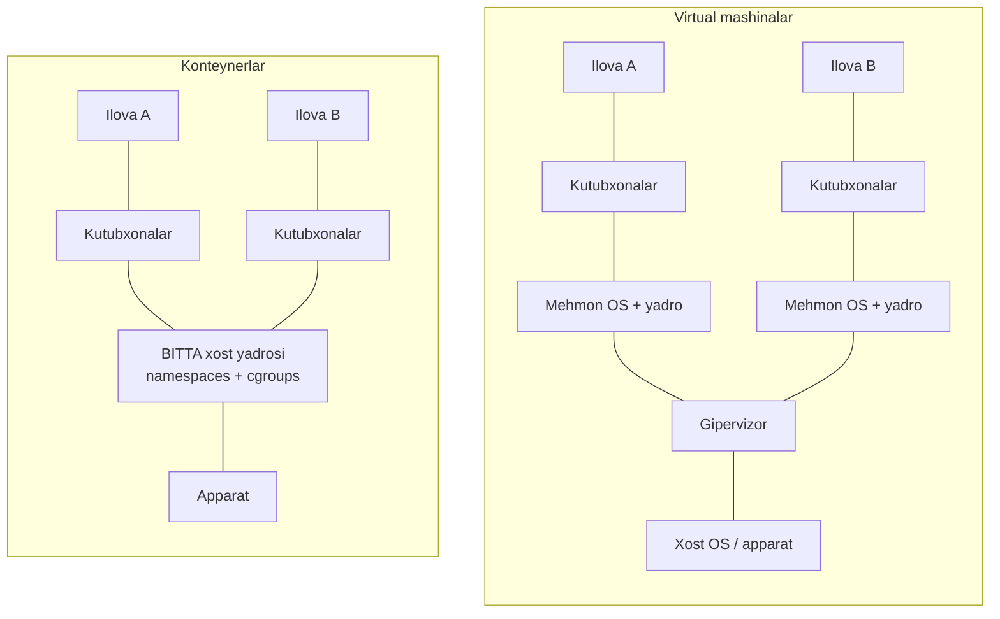
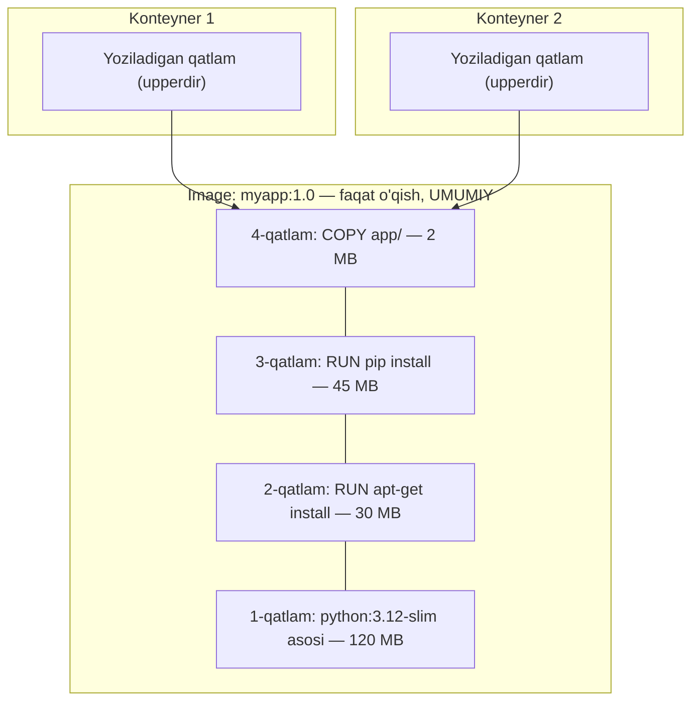
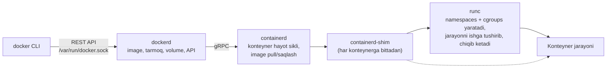
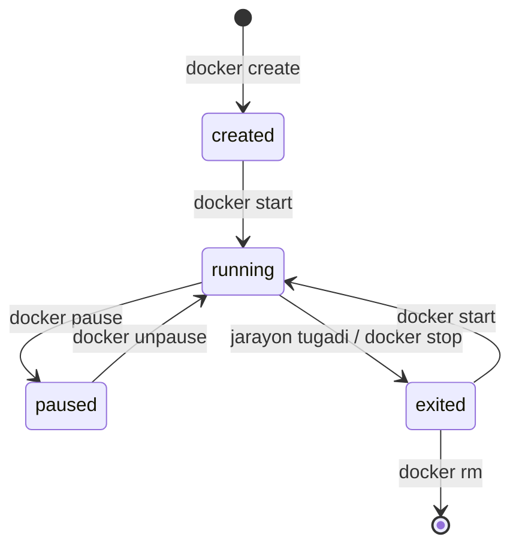
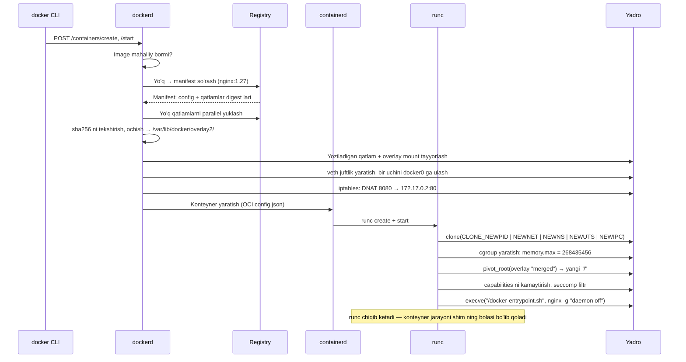
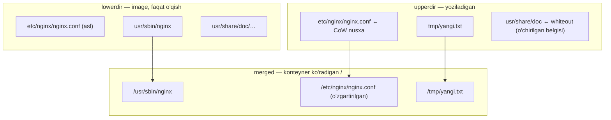
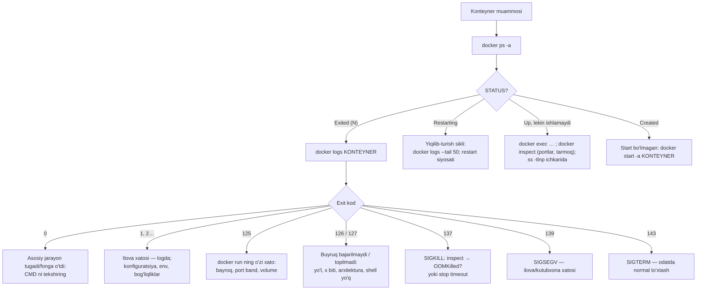

<!-- @section: why -->

## Muammo: "Mening kompyuterimda ishlaydi"

Dasturchi ilovani yozdi: Python 3.12, `libpq` ning aniq versiyasi, o'nlab kutubxona. O'z noutbukida hammasi ishlaydi. Serverda esa Python 3.10, boshqa `libpq`, yana bir ilova o'sha kutubxonaning eski versiyasini talab qiladi. Deploy — uch kunlik azob, va har yangi serverda qaytadan.

Bu muammoning nomi bor: **muhit farqi** (environment drift). Ilova faqat koddan iborat emas — u kod + interpretator + tizim kutubxonalari + konfiguratsiya + fayl tizimi tuzilishi.

## Birinchi yechim: virtual mashinalar

Har ilovaga — alohida VM. Muhit to'liq izolyatsiya qilingan va ko'chiriladigan. Lekin narxi baland:

| | VM |
|---|---|
| Har birida | To'liq operatsion tizim: o'z yadrosi, init, xizmatlar |
| Hajmi | Gigabaytlar |
| Ishga tushishi | Daqiqa atrofida |
| Bitta serverda | O'nlab |
| Ortiqcha yuk | Gipervizor + mehmon yadro uchun xotira va CPU |

## Ikkinchi yechim: konteynerlar

G'oya: **yadroni baham ko'rish, qolgan hamma narsani ajratish.** Ilova o'z fayl tizimi, o'z jarayonlar ro'yxati, o'z tarmog'ini ko'radi — lekin bularning hammasi xost yadrosi ustida ishlaydigan **oddiy jarayon**.



| | VM | Konteyner |
|---|---|---|
| Izolyatsiya | Apparat darajasida (kuchli) | Yadro darajasida (yadro umumiy) |
| Hajmi | GB | MB |
| Ishga tushishi | ~daqiqa | ~soniyaning ulushi |
| Zichlik | o'nlab | yuzlab-minglab |
| Boshqa OS yadrosi | Mumkin | Mumkin emas (Linux konteyner → Linux yadro) |

> **Analogiya.** VM — alohida uy: o'z poydevori, o'z kommunikatsiyalari. Konteyner — ko'p qavatli uydagi kvartira: devorlar, eshik va hisoblagichlar o'ziniki, lekin poydevor va quvurlar umumiy.

## Docker aslida nima qildi

Konteyner texnologiyalari (chroot — 1979, cgroups — 2007, LXC — 2008) Docker dan oldin ham bor edi. Docker (2013) uchta narsani qo'shdi va shu bilan sanoatni o'zgartirdi:

1. **Image** — ilova va butun muhitini **bitta ko'chiriladigan, o'zgarmas artefakt**ga qadoqlash formati.
2. **Registry** — image larni tarqatish (`docker push` / `docker pull`).
3. **Sodda interfeys** — `docker run` bitta buyruq.

"Mening kompyuterimda ishlaydi" muammosining yechimi: endi siz serverga **kodni emas, kompyuteringizdagi muhitning o'zini** yuborasiz.

## Bu darsning asosiy g'oyasi

**Konteyner — bu sehr emas, virtual mashina ham emas. Bu — yadroning uchta mexanizmi bilan o'ralgan oddiy Linux jarayoni:**

| Mexanizm | Savol | Javob |
|---|---|---|
| **Namespaces** | Jarayon nimani **ko'radi**? | O'z PID lari, tarmog'i, fayl tizimi |
| **Cgroups** | Jarayon qancha **ishlata oladi**? | CPU, xotira, jarayonlar soni chegarasi |
| **Union FS (overlayfs)** | Fayl tizimi qayerdan? | Faqat-o'qish qatlamlari + yoziladigan qatlam |

Buni tushungan odam uchun `OOMKilled`, "konteyner darhol o'chdi", "ma'lumot yo'qoldi", "docker stop sekin" kabi vaziyatlar sir emas — oddiy mantiqiy natija.

<!-- @section: theory -->

## Asosiy tushunchalar

| Tushuncha | Ta'rif | Analogiya |
|---|---|---|
| **Image** | Faqat o'qiladigan shablon: fayl tizimi qatlamlari + metama'lumot (qaysi buyruq, qaysi muhit) | Sinf (class); dastur o'rnatish diski |
| **Container** | Image dan ishga tushirilgan jarayon + uning yoziladigan qatlami | Obyekt (instance); ishlab turgan dastur |
| **Registry** | Image lar ombori | Paketlar repozitoriysi |
| **Volume** | Konteyner hayotidan mustaqil saqlanadigan ma'lumot | Tashqi disk |

Bitta image dan istalgancha konteyner ishga tushadi; ularning har biri o'z yoziladigan qatlamiga ega, image esa o'zgarmaydi.

## Namespaces: jarayon nimani ko'radi

**Namespace** — yadro resurslarining ma'lum turini jarayonlar guruhi uchun **alohida ko'rinishga** ajratuvchi mexanizm. Namespace ichidagi jarayon o'zini tizimda yolg'iz deb o'ylaydi.

| Namespace | Nimani ajratadi | Konteyner ichida natija |
|---|---|---|
| **pid** | Jarayonlar raqamlari | Ilova — PID 1; xost jarayonlari ko'rinmaydi |
| **net** | Tarmoq steki: interfeyslar, IP, marshrutlar, iptables, portlar | O'z `eth0`, o'z `localhost`; 80-port har konteynerda bo'sh |
| **mnt** | Ulanish nuqtalari (fayl tizimi ko'rinishi) | O'z `/` — image dan |
| **uts** | Hostname | O'z nomi (konteyner ID) |
| **ipc** | Jarayonlararo aloqa (shared memory, semaforlar) | Boshqa konteynerlar xotirasiga ulanib bo'lmaydi |
| **user** | UID/GID xaritasi | Konteynerdagi root (0) xostda oddiy foydalanuvchi bo'lishi mumkin (sukut bo'yicha Docker da **o'chiq**) |
| **cgroup** | cgroup ierarxiyasi ko'rinishi | O'z cgroup ini ildiz deb ko'radi |

Muhim: `time` (soat) va **yadro** — umumiy. `uname -r` konteynerda xost yadrosi versiyasini ko'rsatadi.

**Sukut bo'yicha user namespace o'chiq** — demak konteynerdagi root **xostda ham UID 0**. Uni faqat boshqa namespace lar, capabilities va seccomp ushlab turadi. Shu sababli konteynerni root sifatida ishlatmaslik — birinchi xavfsizlik qoidasi.

## Cgroups: jarayon qancha ishlata oladi

**Cgroups** (control groups) — jarayonlar guruhining resurs iste'molini **cheklash, hisoblash va ustuvorlashtirish**. Namespaces ko'rinishni cheklaydi, lekin konteyner baribir butun xost xotirasini yeb qo'yishi mumkin — buni cgroups to'xtatadi.

Zamonaviy tizimlar (Ubuntu 22.04+) — **cgroup v2**: yagona ierarxiya `/sys/fs/cgroup` da.

| Resurs | cgroup v2 fayli | `docker run` bayrog'i | Chegaradan oshsa |
|---|---|---|---|
| Xotira | `memory.max` | `--memory=512m` | **OOM killer** jarayonni o'ldiradi (exit 137) |
| CPU | `cpu.max` | `--cpus=1.5` | **Throttling** — sekinlashtiriladi, o'ldirilmaydi |
| CPU ulushi | `cpu.weight` | `--cpu-shares` | Faqat raqobat paytida ta'sir qiladi |
| Jarayonlar soni | `pids.max` | `--pids-limit=200` | `fork` xato beradi |

Asosiy farq: **xotira — siqilmaydigan resurs** (yetmasa — o'lim), **CPU — siqiladigan** (yetmasa — sekinlik). Bu farq Kubernetes dagi `requests/limits` da yana uchraydi.

## Union FS: fayl tizimi qatlamlardan yig'iladi

Har bir konteynerga 200 MB li Ubuntu ni nusxalash — isrof. Yechim — **qatlamlar**: image faqat o'qiladigan qatlamlar to'plami; har qatlam — oldingisiga nisbatan **farq** (qo'shilgan, o'zgargan, o'chirilgan fayllar).



- Bir xil asosga ega 10 ta image asos qatlamni diskda **bir marta** saqlaydi va tarmoqdan **bir marta** yuklaydi.
- 100 ta konteyner bitta image qatlamlarini baham ko'radi; har biriga faqat yupqa yoziladigan qatlam qo'shiladi.

**Copy-on-write (CoW):** konteyner image dagi faylni o'zgartirmoqchi bo'lsa, fayl avval yoziladigan qatlamga **to'liq nusxalanadi**, keyin o'zgartiriladi. Pastki qatlam tegilmaydi. Faylni "o'chirish" — yuqori qatlamda maxsus belgi (**whiteout**) yaratish; pastdagi fayl joyida qoladi, shunchaki ko'rinmaydi.

Bundan uch muhim oqibat:

1. **Konteyner o'chirilsa (`docker rm`), yoziladigan qatlam ham yo'qoladi.** Doimiy ma'lumot — faqat volume da.
2. **Qatlamda o'chirilgan fayl image hajmini kamaytirmaydi** — u pastki qatlamda turibdi. (`RUN apt-get install ...` va keyingi `RUN rm -rf ...` — befoyda; ular bitta `RUN` da bo'lishi kerak.)
3. Yoziladigan qatlamga intensiv yozish **sekin** (CoW narxi) — bazalar va loglar uchun volume.

## Image: nomi, tegi va digest i

```text
registry.example.uz:5000/jamoa/myapp:1.4.2@sha256:9b7c...
└──────── registry ────┘ └─ repo ──┘ └tag┘ └── digest ──┘
```

- Registry ko'rsatilmasa — Docker Hub (`docker.io`); `nginx` aslida `docker.io/library/nginx:latest`.
- **Tag** — o'zgaruvchan ko'rsatkich (Git dagi branch kabi): bugungi `nginx:1.27` ertaga boshqa image ga ishora qilishi mumkin.
- **Digest** — mazmunning SHA-256 hash i: o'zgarmas va tekshiriladigan. `image@sha256:...` — aynan o'sha baytlar.
- `latest` — maxsus ma'no yo'q: teg ko'rsatilmaganda ishlatiladigan standart nom, xolos. U "eng yangi" degani emas.

## Ma'lumotni saqlash: uch usul

| Tur | Yozuv | Ma'lumot qayerda | Qachon |
|---|---|---|---|
| **Named volume** | `-v pgdata:/var/lib/postgresql/data` | Docker boshqaradi: `/var/lib/docker/volumes/pgdata/_data` | Bazalar, doimiy holat — **standart tanlov** |
| **Bind mount** | `-v /srv/conf/nginx.conf:/etc/nginx/nginx.conf:ro` | Xostdagi aniq yo'l | Konfiguratsiya; ishlab chiqishda kodni ulash |
| **tmpfs** | `--tmpfs /tmp:size=64m` | Xotirada | Vaqtinchalik, maxfiy, diskka tushmasligi kerak bo'lgan ma'lumot |

Named volume ning bind mount dan farqlari: Docker o'zi yaratadi va egalikni sozlaydi; bo'sh volume birinchi ulanishda image dagi katalog mazmuni bilan **to'ldiriladi**; xost yo'llariga bog'liq emas.

## Docker arxitekturasi



| Komponent | Vazifasi |
|---|---|
| `docker` CLI | Buyruqlarni API so'rovlariga aylantiradi |
| `dockerd` | Daemon: API, build, tarmoqlar, volume lar |
| `containerd` | Yuqori darajali runtime. Kubernetes uni to'g'ridan-to'g'ri (Docker siz) ishlatadi |
| `containerd-shim` | Konteynerning "otasi": stdio ni ushlab turadi, exit kodni saqlaydi. Shu tufayli `dockerd` qayta ishga tushsa ham konteynerlar tirik qoladi |
| `runc` | OCI spetsifikatsiyasi bo'yicha konteynerni yaratadi |

**OCI** (Open Container Initiative) standartlari — image formati va runtime spetsifikatsiyasi — tufayli Docker da yig'ilgan image containerd, CRI-O, Podman da ham ishlaydi.

`/var/run/docker.sock` ga kirish = **xostda root bo'lish** (istalgan katalogni ulab, privileged konteyner ishga tushirish mumkin). Shuning uchun `docker` guruhiga qo'shish — root berish bilan teng.

## Konteyner hayot sikli



**Asosiy qoida: konteyner o'zining asosiy jarayoni (PID 1) tirik ekan yashaydi.** Jarayon tugadi — konteyner to'xtadi. "Konteyner darhol o'chib qolyapti" degan shikoyatning 90% i shu: asosiy jarayon fonga o'tib ketdi yoki ishini tugatdi.

## Atamalar lug'ati

| Atama | Ma'nosi | Misol |
|---|---|---|
| image | O'zgarmas shablon (qatlamlar + config) | `nginx:1.27-alpine` |
| container | Image dan ishga tushgan izolyatsiyalangan jarayon | `docker run` |
| layer | Fayl tizimi farqlari to'plami | `docker history` |
| namespace | Resurs ko'rinishini ajratish | `lsns` |
| cgroup | Resurslarni cheklash | `--memory`, `--cpus` |
| overlayfs | Qatlamlarni birlashtiruvchi FS | `overlay2` drayveri |
| copy-on-write | O'zgartirishda nusxalash | |
| digest | Mazmun hash i | `sha256:9b7c…` |
| OCI | Konteyner standartlari | image-spec, runtime-spec |
| registry | Image ombori | Docker Hub, Harbor |

<!-- @section: internals -->

## `docker run` ichida nima sodir bo'ladi

`docker run -d --name web -p 8080:80 --memory 256m nginx:1.27`



Natija — xostda **oddiy jarayon**. Buni isbotlash oson:

```bash
docker run -d --name web nginx:1.27
docker inspect -f '{{.State.Pid}}' web          # masalan 48211 — XOSTDAGI PID
ps -o pid,ppid,user,cmd -p 48211
#   PID  PPID USER  CMD
# 48211 48190 root  nginx: master process nginx -g daemon off;
ps -o cmd -p 48190                              # otasi: containerd-shim-runc-v2 ...

docker exec web ps -o pid,cmd                   # ICHKARIDAN: xuddi shu jarayon — PID 1
```

Bitta jarayon, ikki xil raqam: xostda 48211, o'z PID namespace ida — 1.

## Namespace larni qo'l bilan ushlash

Har jarayonning namespace lari — `/proc/PID/ns/` dagi havolalar:

```bash
sudo ls -l /proc/48211/ns/
# net -> 'net:[4026532841]'    pid -> 'pid:[4026532839]'    mnt -> 'mnt:[4026532836]' ...
sudo ls -l /proc/1/ns/net
# net -> 'net:[4026531840]'    ← boshqa raqam: xost va konteyner turli net namespace da

sudo lsns -p 48211                                   # jarayonning barcha namespace lari
sudo nsenter -t 48211 -n ip addr                     # konteynerning NET namespace iga "kirish"
```

`nsenter -n` — debug uchun oltin vosita: konteyner image ida `ip`, `tcpdump`, `curl` bo'lmasa ham, **xostdagi** vositalarni konteynerning tarmoq namespace ida ishlatasiz.

Dockersiz "konteyner" — 1 daqiqada:

```bash
sudo unshare --pid --fork --mount-proc --uts --net bash
# Endi yangi namespace lardamiz:
ps aux          # faqat bash va ps — PID 1 va 2
hostname sinov  # xostning nomi o'zgarmaydi
ip link         # faqat lo (DOWN) — tarmoq bo'sh
exit
```

Docker shuning ustiga fayl tizimi (image), tarmoq (veth + bridge) va cheklovlarni (cgroups) qo'shadi — bor-yo'g'i shu.

## overlayfs: qatlamlar diskda qanday yotadi

```bash
docker inspect -f '{{json .GraphDriver.Data}}' web | python3 -m json.tool
```

```text
{
  "LowerDir":  "/var/lib/docker/overlay2/a1b2…-init/diff:/var/lib/docker/overlay2/9f8e…/diff:/var/lib/docker/overlay2/3c4d…/diff",
  "UpperDir":  "/var/lib/docker/overlay2/a1b2…/diff",
  "WorkDir":   "/var/lib/docker/overlay2/a1b2…/work",
  "MergedDir": "/var/lib/docker/overlay2/a1b2…/merged"
}
```

| Katalog | Roli |
|---|---|
| `LowerDir` | Image qatlamlari (faqat o'qish), `:` bilan ajratilgan — chapdagisi eng yuqori |
| `UpperDir` | Konteynerning yoziladigan qatlami — barcha o'zgarishlar shu yerda |
| `WorkDir` | overlayfs ning ichki ishchi katalogi (atomar amallar uchun) |
| `MergedDir` | Birlashtirilgan ko'rinish — konteynerning `/` si |

Yadro uchun bu bitta `mount` chaqiruvi: `mount -t overlay overlay -o lowerdir=...,upperdir=...,workdir=... merged`.



Fayl qidiruvi **yuqoridan pastga**: avval `upperdir`, topilmasa — `lowerdir` qatlamlari tartib bilan. O'zingiz ko'ring:

```bash
docker exec web sh -c 'echo salom > /tmp/yangi.txt; rm /docker-entrypoint.sh'
UP=$(docker inspect -f '{{.GraphDriver.Data.UpperDir}}' web)
sudo ls -la "$UP" "$UP/tmp"
# tmp/yangi.txt                      ← yangi fayl
# c--------- 0, 0 docker-entrypoint.sh   ← whiteout: "character device 0,0"
docker diff web        # A /tmp/yangi.txt   D /docker-entrypoint.sh   C /run ...
```

## cgroups: chegara qayerda yozilgan

```bash
CID=$(docker inspect -f '{{.Id}}' web)
cat /sys/fs/cgroup/system.slice/docker-$CID.scope/memory.max        # 268435456
cat /sys/fs/cgroup/system.slice/docker-$CID.scope/memory.current    # hozirgi iste'mol
cat /sys/fs/cgroup/system.slice/docker-$CID.scope/memory.events     # oom_kill 0
cat /sys/fs/cgroup/system.slice/docker-$CID.scope/cpu.max           # "150000 100000" = 1.5 CPU
cat /sys/fs/cgroup/system.slice/docker-$CID.scope/cgroup.procs      # shu cgroup dagi PID lar
```

`cpu.max` formati — `kvota davr` (mikrosekund): har 100 ms davrda 150 ms CPU vaqti. Kvota tugasa, jarayon davr oxirigacha **to'xtatib qo'yiladi** — bu throttling; `cpu.stat` dagi `nr_throttled` hisoblagichi uni ko'rsatadi.

Xotira chegarasiga yetilganda: yadro avval keshni bo'shatishga urinadi; yetmasa — cgroup ichida **OOM killer** ishga tushadi va jarayonni `SIGKILL` bilan o'ldiradi. Konteyner `Exited (137)` holatiga o'tadi, `docker inspect` da `"OOMKilled": true`.

Tuzoq: konteyner ichidagi `free -m` yoki `nproc` **xostning** resurslarini ko'rsatadi (`/proc/meminfo` namespace langan emas). Eski dasturlar shunga qarab xotira yoki oqimlar sonini hisoblab, limitdan oshib ketadi. Zamonaviy JVM, Go, Node cgroup chegaralarini o'qiy oladi.

## Image pull: content-addressable saqlash

`docker pull nginx:1.27`:

1. Registry dan **manifest** olinadi — JSON: config blob va qatlamlar ro'yxati, har biri `sha256` digest va hajm bilan. (Ko'p arxitekturali image da avval **manifest list** — `amd64`, `arm64` uchun alohida manifestlar.)
2. Har qatlam uchun: "bu digest menda bormi?" — bo'lsa `Already exists`; bo'lmasa yuklanadi (parallel).
3. Yuklangan blob ning hash i hisoblanib, digest bilan solishtiriladi — mos kelmasa rad etiladi.
4. Qatlam ochilib `overlay2/` ga joylanadi.

Mazmun o'z hash i bilan nomlangani uchun: bir xil qatlam hech qachon ikki marta saqlanmaydi; yo'lda o'zgartirilgan qatlam darhol aniqlanadi.

## Konteyner qanday to'xtaydi

`docker stop web`:

1. Docker konteynerning **PID 1** iga `SIGTERM` yuboradi (image da `STOPSIGNAL` bilan o'zgartirish mumkin).
2. **10 soniya** kutadi (`-t` bilan o'zgartiriladi).
3. Jarayon hali tirik bo'lsa — `SIGKILL`.

Bu yerda Linux darsidagi PID 1 xususiyati ishlaydi: **yadro PID 1 ga ishlovchisi o'rnatilmagan signallarni yetkazmaydi.** Ilovangiz PID 1 bo'lsa va `SIGTERM` ni ushlamasa — hech narsa bo'lmaydi, 10 soniyadan keyin majburan o'ldiriladi. Xuddi shunday, agar PID 1 — shell (`sh -c "..."`) bo'lsa: shell signalni bola jarayonga **uzatmaydi**.

Yana bir PID 1 vazifasi — **zombie larni yig'ish**. Oddiy ilova buni qilmaydi. Yechim: `docker run --init` — PID 1 sifatida mitti `tini` ishga tushadi: signallarni uzatadi va zombie larni yig'adi.

<!-- @section: commands -->

## docker run — asosiy buyruq

```bash
docker run -d --name web -p 8080:80 -v webdata:/usr/share/nginx/html:ro \
  --memory 256m --cpus 0.5 --restart unless-stopped nginx:1.27-alpine
```

```tahlil
{"command":"docker run -d --name web -p 8080:80 -v webdata:/usr/share/nginx/html:ro --memory 256m --cpus 0.5 --restart unless-stopped nginx:1.27-alpine","parts":[{"t":"docker run","d":"create + start: image dan yangi konteyner yaratib ishga tushiradi. Image mahalliy bo'lmasa — avval pull qiladi"},{"t":"-d","d":"Detached: fonda ishlaydi, terminalga konteyner ID sini chiqaradi. Busiz terminal konteynerning stdout iga bog'lanib qoladi"},{"t":"--name web","d":"Nom. Berilmasa tasodifiy (masalan 'eager_turing'). Nom yagona bo'lishi shart"},{"t":"-p 8080:80","d":"XOST:KONTEYNER. Xostning 8080-porti → konteynerning 80-porti (iptables DNAT). Busiz portga faqat Docker tarmog'i ichidan yetiladi. DIQQAT: barcha interfeyslarda ochiladi; faqat mahalliy uchun -p 127.0.0.1:8080:80"},{"t":"-v webdata:/usr/share/nginx/html:ro","d":"Named volume 'webdata' ni shu yo'lga ulaydi; :ro — faqat o'qish. Chap tomon '/' bilan boshlansa — bind mount (xost yo'li)"},{"t":"--memory 256m","d":"cgroup memory.max. Oshsa — OOM killer (exit 137). Busiz konteyner butun xost xotirasini ishlatishi mumkin"},{"t":"--cpus 0.5","d":"cgroup cpu.max: yarim yadro. Oshsa — throttling (sekinlashadi, o'lmaydi)"},{"t":"--restart unless-stopped","d":"Jarayon tugasa yoki Docker/xost qayta ishga tushsa — konteynerni qayta ko'taradi; qo'lda 'docker stop' qilingan bo'lsa — yo'q. Boshqalar: no (standart), on-failure[:N], always"},{"t":"nginx:1.27-alpine","d":"Image:teg. Teg ko'rsatilmasa — :latest. Undan keyin yozilgan hamma narsa — konteyner ichidagi buyruq (CMD ni almashtiradi)"}]}
```

Boshqa muhim bayroqlar:

| Bayroq | Vazifasi |
|---|---|
| `-it` | Interaktiv terminal (`-i` stdin ochiq, `-t` psevdo-TTY) — `docker run -it ubuntu bash` |
| `--rm` | Tugagach konteynerni avtomatik o'chirish — bir martalik ishlar uchun |
| `-e KEY=val`, `--env-file f` | Muhit o'zgaruvchilari |
| `--network NOM` | Tarmoq (keyingi darsda) |
| `-u 1000:1000` | Qaysi UID:GID bilan ishlashi |
| `--read-only` | Ildiz FS faqat o'qish uchun (yozish — faqat volume/tmpfs ga) |
| `--init` | PID 1 sifatida `tini` |
| `--cap-drop ALL --cap-add NET_BIND_SERVICE` | Capability larni cheklash |
| `--pids-limit 200` | Jarayonlar soni chegarasi |

> ⚠️ **Ehtiyot bo'l: `--privileged`**
> `--privileged` barcha capability larni beradi, qurilmalarga kirishni ochadi, seccomp va AppArmor ni o'chiradi — konteyner amalda xostda root. Xuddi shunday xavfli: `-v /:/host`, `-v /var/run/docker.sock:/var/run/docker.sock`, `--pid=host`, `--net=host`. Faqat nima qilayotganingizni aniq bilsangiz.

## Kuzatish va debug

| Buyruq | Vazifasi |
|---|---|
| `docker ps` | Ishlab turganlar. `-a` — to'xtaganlarni ham; `-q` — faqat ID; `-s` — yoziladigan qatlam hajmi |
| `docker logs -f --tail 100 web` | Loglar (PID 1 ning stdout/stderr i). `--since 10m`, `-t` — vaqt belgisi |
| `docker exec -it web sh` | Ishlab turgan konteynerda **qo'shimcha** jarayon ishga tushirish |
| `docker inspect web` | To'liq JSON: holat, tarmoq, mount lar, sozlamalar |
| `docker stats --no-stream` | CPU, xotira (limitga nisbatan), tarmoq, disk I/O |
| `docker top web` | Konteyner jarayonlari (xost PID lari bilan) |
| `docker diff web` | Yoziladigan qatlamdagi o'zgarishlar: `A` qo'shilgan, `C` o'zgargan, `D` o'chirilgan |
| `docker cp web:/etc/nginx/nginx.conf .` | Fayl nusxalash (ikkala yo'nalishda) |
| `docker events` | Daemon hodisalari oqimi (die, oom, start…) |

`docker inspect` dan aniq maydonni olish — Go shabloni:

```bash
docker inspect -f '{{.State.Status}} exit={{.State.ExitCode}} oom={{.State.OOMKilled}}' web
docker inspect -f '{{range .NetworkSettings.Networks}}{{.IPAddress}}{{end}}' web
docker inspect -f '{{json .Mounts}}' web | python3 -m json.tool
```

```tahlil
{"command":"docker exec -it web sh","parts":[{"t":"docker exec","d":"ISHLAB TURGAN konteynerning namespace lariga yangi jarayon qo'shadi. To'xtagan konteynerda ishlamaydi"},{"t":"-i","d":"stdin ni ochiq ushlab turadi — buyruq kiritish uchun"},{"t":"-t","d":"Psevdo-terminal ajratadi — prompt, ranglar, Ctrl+C to'g'ri ishlashi uchun"},{"t":"web","d":"Konteyner nomi yoki ID si (boshidagi bir necha belgi yetarli)"},{"t":"sh","d":"Ishga tushiriladigan buyruq. alpine va distroless image larda bash yo'q — sh ishlating. Image da umuman shell bo'lmasa: docker debug yoki nsenter"}]}
```

## Hayot sikli

| Buyruq | Vazifasi |
|---|---|
| `docker stop web` | SIGTERM → 10 s → SIGKILL. `-t 30` — kutish vaqti |
| `docker kill -s HUP web` | Ixtiyoriy signal (standart — SIGKILL) |
| `docker start web` | To'xtagan konteynerni qayta ishga tushirish (yoziladigan qatlam **saqlangan**) |
| `docker restart web` | stop + start |
| `docker rm web` | O'chirish — yoziladigan qatlam **yo'qoladi**. `-f` — ishlab turganini ham; `-v` — anonim volume lari bilan |

## Image lar

| Buyruq | Vazifasi |
|---|---|
| `docker pull nginx:1.27` | Yuklash |
| `docker images` | Mahalliy image lar. `--digests` — digest bilan |
| `docker history nginx:1.27` | Qatlamlar: har biri qaysi instruksiyadan va qancha hajm |
| `docker image inspect nginx:1.27` | Config: `Cmd`, `Entrypoint`, `Env`, `User`, qatlam digest lari |
| `docker tag nginx:1.27 reg.example.uz/web:1.27` | Yangi nom (ko'rsatkich) — nusxa emas |
| `docker push reg.example.uz/web:1.27` | Registry ga yuborish |
| `docker rmi IMAGE` | O'chirish (ishlatayotgan konteyner bo'lmasa) |
| `docker save -o x.tar IMAGE` / `docker load -i x.tar` | Fayl orqali ko'chirish (internetsiz muhit uchun) |

## Volume lar

```bash
docker volume create pgdata
docker run -d --name db -e POSTGRES_PASSWORD_FILE=/run/secrets/pg \
  -v pgdata:/var/lib/postgresql/data postgres:16.4
docker volume ls
docker volume inspect pgdata        # Mountpoint: /var/lib/docker/volumes/pgdata/_data
```

Uzun, aniqroq sintaksis — `--mount` (xato yozilsa darhol aytadi):

```bash
docker run -d --mount type=bind,source=/srv/conf/nginx.conf,target=/etc/nginx/nginx.conf,readonly nginx:1.27
```

`-v /yoq/yo'l:/data` — xostda yo'l bo'lmasa, Docker uni **root egaligida bo'sh katalog** qilib yaratadi (fayl ulamoqchi bo'lgan bo'lsangiz — kutilmagan natija). `--mount type=bind` esa xato beradi.

Volume ni zaxiralash — vaqtinchalik konteyner orqali:

```bash
docker run --rm -v pgdata:/data:ro -v "$PWD":/backup alpine \
  tar czf /backup/pgdata-$(date +%F).tar.gz -C /data .
```

## Tozalash

```bash
docker system df                 # nima qancha joy egallayapti
docker container prune           # to'xtagan konteynerlar
docker image prune               # "osilgan" (tegsiz) image lar;  -a — ishlatilmayotgan hammasi
docker builder prune             # build keshi
```

> ⚠️ **Ehtiyot bo'l: `docker system prune -a --volumes`**
> Bu buyruq to'xtagan konteynerlar, ishlatilmayotgan image lar, tarmoqlar **va volume larni** o'chiradi. Hozir to'xtab turgan baza konteynerining volume i — "ishlatilmayotgan" hisoblanadi. `docker volume prune` ham xuddi shunday. Production da avval `docker volume ls` va zaxira.

<!-- @section: lab -->

## Lab 1. Konteyner — bu jarayon

**Maqsad:** namespace va cgroup larni "qo'l bilan ushlab ko'rish".

**Muhit:** Docker Engine 27+ o'rnatilgan Ubuntu VM.

**Qadamlar:**

1. `docker run -d --name lab1 --memory 128m nginx:1.27-alpine`
2. Konteyner asosiy jarayonining **xostdagi** PID ini toping. Uni xostda `ps` bilan ko'ring; otasi kim?
3. O'sha jarayon konteyner ichida qaysi PID ga ega?
4. Xost va konteyner jarayonining `net` namespace identifikatorlarini solishtiring.
5. `nsenter` bilan konteynerning tarmoq namespace iga kirib, `ip addr` bajaring (image da `ip` bo'lmasa ham).
6. cgroup fayllaridan xotira chegarasini va joriy iste'molni o'qing.

**Tekshirish:** 6-qadamda `memory.max` = `134217728`.

<details><summary>💡 Yechimni ko'rsatish</summary>

```bash
PID=$(docker inspect -f '{{.State.Pid}}' lab1); echo $PID
ps -o pid,ppid,user,cmd -p $PID
ps -o cmd= -p $(ps -o ppid= -p $PID)          # containerd-shim-runc-v2 …
docker exec lab1 ps -o pid,comm                # 1 nginx

sudo readlink /proc/1/ns/net /proc/$PID/ns/net # ikki xil identifikator
sudo nsenter -t $PID -n ip -br addr            # lo va eth0@ifN 172.17.0.x/16

CG=/sys/fs/cgroup/system.slice/docker-$(docker inspect -f '{{.Id}}' lab1).scope
cat $CG/memory.max $CG/memory.current $CG/pids.current
```

</details>

## Lab 2. OOM killer ni chaqirish

**Maqsad:** xotira chegarasi qanday ishlashini ko'rish va `OOMKilled` ni tashxislash.

**Qadamlar:**

1. 64 MB chegara bilan, 200 MB xotira band qilishga urinadigan konteyner ishga tushiring:

   ```bash
   docker run --name oom --memory 64m --memory-swap 64m python:3.12-alpine \
     python -c "x = bytearray(200 * 1024 * 1024); print('tirik qoldim')"
   ```

2. Exit kod nima? `docker inspect` da `OOMKilled` maydoni?
3. Xost yadro logida iz toping.
4. Chegarani 300m ga oshirib takrorlang.

<details><summary>💡 Yechimni ko'rsatish</summary>

```bash
echo $?                                                     # 137 = 128 + 9 (SIGKILL)
docker inspect -f 'exit={{.State.ExitCode}} oom={{.State.OOMKilled}}' oom   # exit=137 oom=true
sudo dmesg -T | grep -iE 'oom|killed process' | tail -3
# Memory cgroup out of memory: Killed process 51234 (python) total-vm:… anon-rss:…
docker rm oom
```

`--memory-swap` ni `--memory` ga teng qilish — swap ishlatishni taqiqlaydi; aks holda jarayon swap ga "qochib", o'lmasdan juda sekin ishlashi mumkin.

</details>

## Lab 3. Ma'lumot qayerda yashaydi

**Maqsad:** yoziladigan qatlam va volume farqini his qilish.

**Qadamlar:**

1. Volumesiz PostgreSQL ishga tushiring, jadval yarating, konteynerni **o'chirib** qayta yarating. Jadval bormi?
2. Xuddi shuni `pgdata` named volume bilan takrorlang.
3. `docker diff` va `UpperDir` orqali birinchi holatda ma'lumot qayerga yozilganini toping.

<details><summary>💡 Yechimni ko'rsatish</summary>

```bash
# 1 — volumesiz (aslida postgres image anonim volume e'lon qiladi; -v bilan rm uni ham o'chiradi)
docker run -d --name db -e POSTGRES_PASSWORD=sinov postgres:16.4 && sleep 6
docker exec db psql -U postgres -c 'CREATE TABLE t(x int); INSERT INTO t VALUES (42);'
docker rm -f -v db
docker run -d --name db -e POSTGRES_PASSWORD=sinov postgres:16.4 && sleep 6
docker exec db psql -U postgres -c 'SELECT * FROM t;'      # ERROR: relation "t" does not exist
docker rm -f -v db

# 2 — named volume bilan
docker volume create pgdata
docker run -d --name db -e POSTGRES_PASSWORD=sinov -v pgdata:/var/lib/postgresql/data postgres:16.4 && sleep 6
docker exec db psql -U postgres -c 'CREATE TABLE t(x int); INSERT INTO t VALUES (42);'
docker rm -f db
docker run -d --name db -e POSTGRES_PASSWORD=sinov -v pgdata:/var/lib/postgresql/data postgres:16.4 && sleep 4
docker exec db psql -U postgres -c 'SELECT * FROM t;'      # 42
```

Saboq: konteyner — bir martalik; ma'lumot — volume da. Konteynerni istalgan payt o'chirib, yangi image versiyasidan qayta yaratish mumkin bo'lishi kerak.

</details>

## Qo'shimcha chaqiriq

Dockersiz konteyner yasang: `docker export` bilan alpine fayl tizimini katalogga chiqaring, `unshare --pid --fork --mount --uts --net` va `chroot` (yoki `pivot_root`) bilan uning ichida shell ishga tushiring. Ichkarida `ps`, `hostname`, `ip link` nimani ko'rsatadi? So'ng `/sys/fs/cgroup` da qo'lda cgroup yaratib, shell PID ini unga yozing va `memory.max` qo'ying.

<!-- @section: breakfix -->

## 1. Konteyner darhol o'chib qolyapti

```text
$ docker run -d --name app myapp:1.0
3f2a...
$ docker ps -a
CONTAINER ID  IMAGE      COMMAND                 STATUS
3f2a…         myapp:1.0  "/bin/sh -c 'service…"  Exited (0) 2 seconds ago
$ docker logs app
 * Starting nginx nginx    [ OK ]
```

```breakfix
{"title":"Exited (0)","lang":"dockerfile","broken":"FROM ubuntu:24.04\nRUN apt-get update && apt-get install -y --no-install-recommends nginx \\\n    && rm -rf /var/lib/apt/lists/*\nEXPOSE 80\nCMD service nginx start","hints":["Exit kod 0 — xato emas: asosiy jarayon ishini 'muvaffaqiyatli tugatdi'. Konteynerning asosiy jarayoni nima edi?","'service nginx start' nginx ni FONGA yuborib, o'zi chiqib ketadi. PID 1 tugadi — konteyner to'xtadi.","Jarayon old rejimda (foreground) qolishi kerak: nginx -g 'daemon off;' — exec form da."],"solution":"FROM ubuntu:24.04\nRUN apt-get update && apt-get install -y --no-install-recommends nginx \\\n    && rm -rf /var/lib/apt/lists/*\nEXPOSE 80\nCMD [\"nginx\", \"-g\", \"daemon off;\"]","explain":"Konteyner PID 1 tirik ekan yashaydi. 'service ... start' daemon ni fonga o'tkazib, 0 kod bilan tugaydi — Docker uchun bu 'ish bitdi'. Konteynerda xizmat fonga o'tmasligi kerak: 'daemon off;'. Exec form (JSON massiv) esa nginx ni to'g'ridan-to'g'ri PID 1 qiladi — SIGTERM unga yetib boradi."}
```

## 2. Yangilanishdan keyin baza bo'm-bo'sh

Jamoa PostgreSQL ni yangi minor versiyaga o'tkazdi: eski konteynerni o'chirib, yangisini ishga tushirdi. Barcha ma'lumot yo'qoldi.

```breakfix
{"title":"Ma'lumot qayerda edi?","lang":"shell","broken":"#!/bin/bash\n# deploy-db.sh\ndocker rm -f -v db 2>/dev/null\ndocker run -d --name db \\\n  -e POSTGRES_PASSWORD_FILE=/run/secrets/pg \\\n  -v /srv/secrets/pg:/run/secrets/pg:ro \\\n  -p 127.0.0.1:5432:5432 \\\n  postgres:16.4","hints":["PostgreSQL ma'lumotni /var/lib/postgresql/data ga yozadi. Bu yo'l qayerga ulangan?","Hech qayerga — image anonim volume yaratadi, 'docker rm -v' esa uni konteyner bilan birga o'chiradi.","Named volume qo'shing va -v bayrog'ini rm dan olib tashlang."],"solution":"#!/bin/bash\n# deploy-db.sh\ndocker rm -f db 2>/dev/null\ndocker run -d --name db \\\n  -e POSTGRES_PASSWORD_FILE=/run/secrets/pg \\\n  -v /srv/secrets/pg:/run/secrets/pg:ro \\\n  -v pgdata:/var/lib/postgresql/data \\\n  -p 127.0.0.1:5432:5432 \\\n  postgres:16.4","explain":"Aniq nomlangan volume bo'lmasa, ma'lumot konteynerga bog'langan anonim volume da (yoki yoziladigan qatlamda) yashaydi va 'docker rm -v' bilan yo'qoladi. Named volume konteyner hayot siklidan mustaqil. Va zaxira: volume — zaxira nusxa emas."}
```

## 3. `docker stop` har safar 10 soniya kutadi

Deploy sekin: har bir konteyner aynan 10 soniyada to'xtaydi; `docker ps -a` da `Exited (137)`. Ilova ichida SIGTERM ishlovchisi **bor** va u qo'lda sinalganda ishlaydi.

```breakfix
{"title":"Signal yetib bormayapti","lang":"dockerfile","broken":"FROM python:3.12-slim\nWORKDIR /app\nCOPY requirements.txt .\nRUN pip install --no-cache-dir -r requirements.txt\nCOPY . .\nUSER 10001\nCMD python server.py --port 8000","hints":["docker exec CONTAINER ps -o pid,cmd — PID 1 kim?","Shell form CMD: PID 1 — '/bin/sh -c python server.py ...', python esa uning bolasi (PID 7). SIGTERM sh ga boradi, u uzatmaydi.","Exec form ishlating — JSON massiv: python to'g'ridan-to'g'ri PID 1 bo'ladi."],"solution":"FROM python:3.12-slim\nWORKDIR /app\nCOPY requirements.txt .\nRUN pip install --no-cache-dir -r requirements.txt\nCOPY . .\nUSER 10001\nCMD [\"python\", \"server.py\", \"--port\", \"8000\"]","explain":"Shell form da Docker buyruqni '/bin/sh -c' ga o'raydi: PID 1 — shell. U SIGTERM ni bola jarayonga uzatmaydi va o'zi ham reaksiya qilmaydi (PID 1 ga ishlovchisiz signal yetkazilmaydi). 10 soniyadan keyin SIGKILL — exit 137, ochiq so'rovlar uziladi. Exec form da ilova o'zi PID 1 va signalni oladi. Muqobil: skript ichida 'exec python ...' yoki 'docker run --init'."}
```

<!-- @section: errors -->

## Metodika: konteyner ishlamayapti



Konteyner darhol o'lsa va ichiga kirib bo'lmasa — entrypoint ni almashtirib ishga tushiring:

```bash
docker run --rm -it --entrypoint sh myapp:1.0      # image ichini ko'rish, buyruqni qo'lda sinash
```

## Xatolar jadvali

| Xato xabari / simptom | Sabab | Qanday tekshiriladi | Yechim |
|---|---|---|---|
| `Cannot connect to the Docker daemon at unix:///var/run/docker.sock` | Daemon ishlamayapti yoki socketga huquq yo'q | `systemctl status docker`; `ls -l /var/run/docker.sock`; `id` | `systemctl start docker`; `usermod -aG docker U` + qayta kirish |
| `permission denied while trying to connect to the Docker daemon socket` | Foydalanuvchi `docker` guruhida emas | `groups` | Guruhga qo'shish (bu root berish ekanini unutmang) |
| `Exited (0)` darhol | PID 1 tugadi / fonga o'tdi | `docker logs`; `docker inspect -f '{{.Config.Cmd}}'` | Jarayonni foreground da ishlatish |
| `Exited (137)`, `OOMKilled: true` | Xotira chegarasidan oshdi | `docker inspect -f '{{.State.OOMKilled}}'`; `dmesg` | Chegarani oshirish / oqishni tuzatish |
| `Exited (137)`, `OOMKilled: false`, stop dan keyin | SIGTERM ushlanmadi → 10 s → SIGKILL | `docker exec … ps` — PID 1 kim? | Exec form CMD; signal ishlovchisi; `--init` |
| `exec /app/start.sh: no such file or directory` (fayl bor!) | Shebang dagi interpretator yo'q (alpine da `bash`); CRLF satr oxirlari | `docker run --entrypoint sh … -c 'head -1 /app/start.sh \| cat -A'` | `#!/bin/sh`; `dos2unix` |
| `exec format error` | Boshqa arxitektura image i (arm64 ↔ amd64); shebang yo'q | `docker image inspect -f '{{.Architecture}}'`; `uname -m` | `--platform linux/amd64`; ko'p arxitekturali build |
| `executable file not found in $PATH` | CMD dagi dastur image da yo'q | `docker run --entrypoint sh …` | To'g'ri yo'l / o'rnatish |
| `Bind for 0.0.0.0:8080 failed: port is already allocated` | Xost porti band | `ss -tlnp \| grep 8080`; `docker ps` | Boshqa port / egasini to'xtatish |
| `Conflict. The container name "/web" is already in use` | Shu nomli (ehtimol to'xtagan) konteyner bor | `docker ps -a` | `docker rm web` yoki `--rm` |
| `pull access denied … repository does not exist or may require 'docker login'` | Nom xato yoki private repo | Nomni tekshirish | `docker login`; to'g'ri nom |
| `toomanyrequests: You have reached your pull rate limit` | Docker Hub anonim limiti | — | `docker login`; ko'zgu/proxy cache (Harbor) |
| `manifest unknown` / `manifest for X not found` | Bunday teg yo'q | Registry da teglar ro'yxati | To'g'ri teg |
| `no space left on device` | `/var/lib/docker` to'lgan | `docker system df`; `df -h /var/lib/docker` | `docker image prune -a`; `builder prune`; log rotatsiyasi |
| Konteynerda `Permission denied` (volume ga yozishda) | Konteyner UID i ≠ katalog egasi | `docker exec … id`; `ls -ln` xostda | `chown` kerakli UID ga; `--user` |
| Konteyner ichida xizmat ishlaydi, tashqaridan — yo'q | Ilova `127.0.0.1` da tinglaydi (konteynerning o'z loopback i) | `docker exec … ss -tlnp` | Ilovani `0.0.0.0` ga bind qilish |
| Xost diski to'lmoqda: `…-json.log` fayllari gigabaytlab | Log rotatsiyasi yo'q (json-file drayveri cheksiz) | `du -sh /var/lib/docker/containers/*/*-json.log` | `daemon.json`: `log-opts max-size`, `max-file` |

## Debug uchun asosiy buyruqlar

```bash
docker ps -a --format 'table {{.Names}}\t{{.Status}}\t{{.Image}}'
docker logs --tail 100 -t KONTEYNER
docker inspect -f '{{.State.Status}} exit={{.State.ExitCode}} oom={{.State.OOMKilled}} err={{.State.Error}}' K
docker events --since 30m --filter container=K
docker exec -it K sh
docker run --rm -it --entrypoint sh IMAGE
sudo nsenter -t "$(docker inspect -f '{{.State.Pid}}' K)" -n ss -tlnp     # xost vositalari, konteyner tarmog'i
docker stats --no-stream; docker system df -v
journalctl -u docker --since "1 hour ago"
```

<!-- @section: production -->

## Xavfsizlik

Konteyner — xavfsizlik chegarasi **emas**, agar siz uni shunday qilmasangiz. Sukut bo'yicha: jarayon root, ko'p capability lar ochiq, fayl tizimi yoziladigan.

| Chora | Qanday | Nega |
|---|---|---|
| Root emas | Image da `USER 10001`; yoki `--user` | Konteynerdan chiqib ketish zaifligida hujumchi xostda root bo'lmaydi |
| Capability larni tashlash | `--cap-drop ALL` + faqat keraklisi | Ko'p ilovaga hech biri kerak emas |
| Huquq oshirishni taqiqlash | `--security-opt no-new-privileges` | SUID orqali root bo'lib bo'lmaydi |
| Faqat-o'qish FS | `--read-only --tmpfs /tmp` | Hujumchi fayl joylay olmaydi; ilova "holatsiz" ekanligi isbotlanadi |
| Resurs chegaralari | `--memory`, `--cpus`, `--pids-limit` | Bitta konteyner xostni yiqitmasin (fork bomba, oqish) |
| Portni bog'lash | `-p 127.0.0.1:5432:5432` | `-p 5432:5432` — butun internetga (firewall ni chetlab!) |
| `docker.sock` ni ulamaslik | — | Bu — xostda root |
| Image ni skanerlash | `docker scout cves`, Trivy | Asos image dagi ma'lum zaifliklar |
| Ishonchli asos, aniq versiya | `python:3.12.7-slim-bookworm`; yaxshisi digest | `latest` — nima kelishi noma'lum |
| Sirlar | Fayl sifatida ulash (`/run/secrets`), `-e` da emas | Env o'zgaruvchilar `docker inspect` va `/proc/PID/environ` da ko'rinadi |

Mustahkamlangan ishga tushirish namunasi:

```bash
docker run -d --name api \
  --user 10001:10001 --read-only --tmpfs /tmp:size=32m \
  --cap-drop ALL --security-opt no-new-privileges \
  --memory 512m --memory-swap 512m --cpus 1 --pids-limit 200 \
  --restart unless-stopped \
  -p 127.0.0.1:8000:8000 \
  registry.example.uz/api:1.4.2
```

Daemon darajasida — `/etc/docker/daemon.json`:

```json
{
  "log-driver": "json-file",
  "log-opts": { "max-size": "10m", "max-file": "5" },
  "live-restore": true,
  "userns-remap": "default",
  "no-new-privileges": true,
  "default-address-pools": [{ "base": "10.200.0.0/16", "size": 24 }]
}
```

| Kalit | Ma'nosi |
|---|---|
| `log-opts` | Har konteyner logi eng ko'pi 5 × 10 MB. **Busiz loglar diskni to'ldiradi** |
| `live-restore` | `dockerd` qayta ishga tushganda konteynerlar ishlayveradi |
| `userns-remap` | Konteynerdagi root xostda huquqsiz UID ga aylantiriladi (volume egaligini murakkablashtiradi — sinab ko'ring) |
| `default-address-pools` | Tarmoqlar uchun manzillar — korporativ tarmoq bilan kesishmasin |

## Ishonchlilik

- **Konteyner — bir martalik.** Uni istalgan payt o'chirib, qayta yaratish mumkin bo'lishi kerak. Holat — volume yoki tashqi xizmatda. Konteyner ichida "qo'lda tuzatish" (`docker exec` + tahrirlash) — keyingi qayta yaratishda yo'qoladi.
- **Loglar — stdout/stderr ga.** Fayl ichiga yozilgan loglar yoziladigan qatlamni shishiradi va `docker logs` da ko'rinmaydi.
- **`--restart unless-stopped`** — xost qayta yuklanganda ko'tarilishi uchun. Lekin cheksiz yiqilish siklini kuzating (`RestartCount`).
- **Graceful shutdown:** ilova SIGTERM ni ushlasin; `--stop-timeout` eng uzun so'rovdan katta bo'lsin.
- **Healthcheck** (keyingi dars) — "jarayon tirik" ≠ "ilova ishlayapti".
- **Volume zaxirasi** — rejali va tiklanishi sinalgan.

## Performance

- Yoziladigan qatlamga intensiv yozmang — volume ishlating (CoW narxi yo'q).
- Image kichik bo'lsin — pull tez, hujum yuzasi kichik (`-slim`, `-alpine`, distroless).
- CPU limiti juda past bo'lsa — throttling: `docker stats` da CPU "kam", lekin kechikish yuqori. `cpu.stat` → `nr_throttled`.
- Ko'p konteynerli xostda `json-file` log drayveri va juda "gapdon" ilova — disk I/O manbai.

## Kuzatuv

| Nimani | Qanday |
|---|---|
| Konteyner resurslari | cAdvisor → Prometheus; `docker stats` |
| OOM hodisalari | `docker events --filter event=oom`; `container_oom_events_total` |
| Qayta ishga tushishlar | `docker inspect -f '{{.RestartCount}}'` |
| Disk: image, volume, loglar | `docker system df`; `/var/lib/docker` bandligiga alert |
| Daemon sog'lig'i | `journalctl -u docker`; `/_ping` endpoint |

## Production ga chiqishdan oldingi tekshiruv ro'yxati

- [ ] Image tegi aniq versiya (yoki digest) — `latest` emas
- [ ] Jarayon root emas: `docker exec K id` → uid ≠ 0
- [ ] `--memory` va `--pids-limit` belgilangan
- [ ] Barcha doimiy ma'lumot named volume da; `docker rm` + qayta yaratish sinalgan
- [ ] Publish qilingan portlar ongli: ichki xizmatlar `127.0.0.1` ga bog'langan
- [ ] Log rotatsiyasi `daemon.json` da
- [ ] `docker stop` 10 soniyadan tez tugaydi (SIGTERM ishlaydi)
- [ ] `--restart` siyosati qo'yilgan; xost qayta yuklab sinalgan
- [ ] `--privileged`, `docker.sock`, `--net=host` ishlatilmagan (yoki asosli)
- [ ] Image zaifliklarga skanerlangan
- [ ] Volume zaxirasi va tiklash sinovi bor

## Anti-pattern lar

| Anti-pattern | Nima uchun yomon | To'g'risi |
|---|---|---|
| Konteynerni VM kabi ishlatish (ichida SSH, cron, supervisor, bir necha xizmat) | Bitta jarayon tamoyili buziladi; log va signal chalkashadi | Bitta konteyner — bitta vazifa |
| `docker exec` bilan production da "tuzatish" | O'zgarish keyingi deploy da yo'qoladi | Image ni qayta yig'ish |
| `docker commit` bilan image yasash | Takrorlanmaydi, tarixi yo'q | Dockerfile |
| Ma'lumot yoziladigan qatlamda | `docker rm` → yo'q | Volume |
| `:latest` production da | Qaysi versiya ishlayotgani noma'lum; rollback imkonsiz | Aniq teg / digest |
| `-p 5432:5432` baza uchun | Firewall ni chetlab internetga ochiladi | `127.0.0.1:` yoki umuman publish qilmaslik |
| Sirlar image ichida yoki `-e` da | `docker history` / `inspect` da ko'rinadi | Runtime da fayl sifatida ulash |
| Limitlarsiz konteynerlar | Bittasi hammasini yiqitadi | `--memory`, `--cpus`, `--pids-limit` |

<!-- @section: interview -->

### 1. Konteyner va virtual mashina farqi nima?

🟢 Junior

**Namunaviy javob.** VM apparatni virtuallashtiradi: gipervizor ustida har VM o'zining to'liq operatsion tizimi va yadrosini ishga tushiradi. Konteyner esa operatsion tizimni virtuallashtiradi: u xost yadrosida ishlaydigan oddiy jarayon, faqat namespaces orqali o'z ko'rinishiga (PID lar, tarmoq, fayl tizimi) va cgroups orqali resurs chegaralariga ega. Shuning uchun konteyner megabaytlar o'lchamida, soniyaning ulushida ishga tushadi va bitta xostga yuzlab sig'adi. Narxi — izolyatsiya kuchsizroq: yadro umumiy, yadro zaifligi barcha konteynerlarga ta'sir qiladi; Linux konteyner faqat Linux yadrosida ishlaydi. Amalda ular birga ishlatiladi: VM lar — ijarachilar orasidagi qattiq chegara, konteynerlar — ilovalarni qadoqlash.

**Intervyuer nimani kutadi:** "yengilroq" dan chuqurroq — yadro umumiyligi va uning oqibatlarini.

**Qo'shimcha savol:** Kuchliroq izolyatsiya kerak bo'lsa nima qilasiz? (gVisor, Kata Containers, Firecracker.)

### 2. Namespaces va cgroups nima uchun kerak?

🟢 Junior

**Namunaviy javob.** Ular ikki xil savolga javob beradi. Namespaces — jarayon nimani **ko'radi**: pid (o'z jarayonlar daraxti), net (o'z interfeyslar, portlar, marshrutlar), mnt (o'z fayl tizimi), uts (hostname), ipc, user (UID xaritasi). Cgroups — jarayon qancha **ishlata oladi**: xotira (oshsa OOM kill), CPU (oshsa throttling), jarayonlar soni, I/O. Namespaces siz konteynerlar bir-birini ko'rardi; cgroups siz bittasi butun xostni yeb qo'yardi. Docker ularni ixtiro qilmagan — faqat qulay qadoqlagan.

### 3. Image qatlami nima? Copy-on-write qanday ishlaydi?

🟡 Middle

**Namunaviy javob.** Image — faqat o'qiladigan qatlamlar to'plami; har qatlam Dockerfile ning bitta instruksiyasi yaratgan fayl tizimi farqlari. Qatlamlar mazmun hash i bilan nomlanadi, shuning uchun bir xil qatlam image lar orasida baham ko'riladi — diskda ham, tarmoqda ham. Konteyner ishga tushganda overlayfs bu qatlamlarni (`lowerdir`) va ustiga yupqa yoziladigan qatlamni (`upperdir`) bitta ko'rinishga (`merged`) birlashtiradi. Konteyner image dagi faylni o'zgartirmoqchi bo'lsa, fayl avval butunlay yuqori qatlamga nusxalanadi, keyin o'zgaradi — copy-on-write. O'chirish — whiteout belgisi. Oqibatlari: konteyner o'chsa yoziladigan qatlam yo'qoladi; pastki qatlamda turgan faylni keyingi qatlamda o'chirish image ni kichraytirmaydi; katta faylni tez-tez o'zgartirish sekin — bunday ma'lumot volume da bo'lishi kerak.

### 4. Volume va bind mount farqi nima?

🟢 Junior

**Namunaviy javob.** Ikkalasi ham ma'lumotni konteyner yoziladigan qatlamidan tashqarida saqlaydi. Named volume ni Docker boshqaradi (`/var/lib/docker/volumes/`): nom bilan murojaat qilinadi, xost kataloglari tuzilishiga bog'liq emas, bo'sh volume image dagi mazmun bilan to'ldiriladi, drayverlar orqali tarmoq saqlash joyi bo'lishi mumkin. Bind mount — xostning aniq yo'li: konfiguratsiya faylini berish yoki ishlab chiqishda kodni ulash uchun qulay, lekin xostga bog'lab qo'yadi va ruxsat/UID muammolarini keltiradi. Bazalar uchun — named volume; konfiguratsiya uchun — faqat-o'qish bind mount; vaqtinchalik maxfiy ma'lumot uchun — tmpfs.

### 5. `docker run` buyrug'idan keyin ichkarida nima sodir bo'ladi?

🟡 Middle

**Namunaviy javob.** CLI Unix socket orqali `dockerd` ga REST so'rov yuboradi. Daemon image mahalliy bor-yo'qligini tekshiradi; yo'q bo'lsa registry dan manifestni olib, yetishmagan qatlamlarni yuklaydi va hash ini tekshiradi. Keyin: yoziladigan qatlam va overlay mount tayyorlaydi; tarmoqni sozlaydi — veth juftlik, bir uchi bridge da, IP ajratish, port publish uchun iptables DNAT; OCI konfiguratsiyasini yaratib containerd ga beradi. containerd shim jarayonini ishga tushiradi, u `runc` ni chaqiradi. runc `clone()` bilan yangi namespace lar yaratadi, jarayonni cgroup ga qo'yib chegaralarni yozadi, `pivot_root` bilan ildizni almashtiradi, capability larni kamaytirib seccomp filtrini o'rnatadi va `execve` bilan image dagi ENTRYPOINT/CMD ni ishga tushiradi. runc chiqib ketadi; konteyner jarayoni shim ning bolasi bo'lib qoladi.

**Intervyuer nimani kutadi:** dockerd → containerd → shim → runc zanjirini; yadro mexanizmlarini.

### 6. Konteyner `Exited (137)` bilan tugadi. Qanday tashxis qo'yasiz?

🟡 Middle

**Namunaviy javob.** 137 = 128 + 9 — jarayon SIGKILL olgan. Ikki asosiy sabab. Birinchi — OOM: `docker inspect -f '{{.State.OOMKilled}}'` `true` bo'lsa, konteyner xotira chegarasidan oshgan; `dmesg` da "Memory cgroup out of memory". Keyin savol — chegara pastmi yoki oqish bormi: `docker stats` va metrikalar tarixi. Ikkinchi — `docker stop` timeout i: `OOMKilled: false` va bu rejali to'xtash paytida bo'lgan bo'lsa, ilova SIGTERM ga javob bermagan va 10 soniyadan keyin o'ldirilgan — odatda shell form CMD sababli PID 1 shell bo'lib qolgan. Uchinchi ehtimol — butun **xost** xotirasi tugab, global OOM killer ishlagan (bu holda konteynerning `OOMKilled` bayrog'i har doim ham ko'tarilmaydi) — `dmesg` ni ko'raman.

### 7. Nega konteynerda root sifatida ishlash xavfli? Axir u izolyatsiyalangan-ku.

🟡 Middle

**Namunaviy javob.** Sukut bo'yicha Docker user namespace ishlatmaydi: konteynerdagi UID 0 — xostdagi UID 0 ning o'zi. Uni faqat qolgan namespace lar, kamaytirilgan capability lar va seccomp ushlab turadi. Bu qatlamlardan birortasida teshik bo'lsa — yadro zaifligi, noto'g'ri ulangan volume (`-v /:/host`), `docker.sock`, `--privileged` — konteynerdagi root darhol xostda root bo'ladi. Root bo'lmagan jarayon uchun esa bunday qochish ancha qiyin va oqibati kichikroq. Bundan tashqari root konteyner ichida ham ko'p narsa qila oladi: paket o'rnatish, binarlarni almashtirish. Shuning uchun: image da `USER`, `--cap-drop ALL`, `no-new-privileges`, faqat-o'qish fayl tizimi; qo'shimcha qatlam — userns-remap yoki rootless Docker.

### 8. `docker stop` nega 10 soniya kutadi va uni qanday tezlashtirasiz?

🟡 Middle

**Namunaviy javob.** `docker stop` PID 1 ga SIGTERM yuboradi va 10 soniya kutadi, keyin SIGKILL. Agar har safar aynan 10 soniya ketsa — SIGTERM ishlamayapti. Sabablari: (1) CMD shell form da — PID 1 `/bin/sh -c`, u signalni ilovaga uzatmaydi; (2) ilova PID 1 va SIGTERM ishlovchisi yo'q — yadro PID 1 ga ishlovchisiz signalni yetkazmaydi; (3) entrypoint skripti ilovani `exec` siz chaqiradi. Yechim: exec form (`CMD ["app"]`), skriptda `exec "$@"`, ilovada signal ishlovchisi, yoki `--init` (tini). Timeout ni shunchaki kamaytirish — noto'g'ri yechim: ochiq so'rovlar uzilaveradi.

### 9. Konteyner ichida `free -m` xost xotirasini ko'rsatadi. Nega va bu qanday muammo tug'diradi?

🔴 Senior

**Namunaviy javob.** `/proc/meminfo` va `/proc/cpuinfo` namespace langan emas — ular butun xost haqida ma'lumot beradi; cgroup chegaralari esa alohida, `/sys/fs/cgroup` da. Shuning uchun `free`, `nproc`, `top` konteynerda xost resurslarini ko'rsatadi. Muammo: resurslarga qarab o'zini sozlaydigan dasturlar xato hisoblaydi. Eski JVM heap ni xost RAM ining chorak qismiga qo'yib, limitdan oshardi va OOMKilled bo'lardi; ilovalar worker lar sonini 64 yadroga qarab tanlab, 1 CPU limitida kontekst almashinuviga va throttling ga botadi. Zamonaviy runtime lar (JDK 10+/8u191+, Go 1.19+ `GOMEMLIMIT`, .NET) cgroup ni o'qiydi, lekin ko'pchiligi CPU ni emas. Yechim: chegaralarni aniq berish (`-XX:MaxRAMPercentage`, `GOMAXPROCS` / automaxprocs, `--workers`), yoki LXCFS bilan `/proc` ni virtuallashtirish.

### 10. `dockerd` qulasa, ishlab turgan konteynerlarga nima bo'ladi?

🔴 Senior

**Namunaviy javob.** Arxitekturaga ko'ra konteyner jarayoni `dockerd` ning emas, `containerd-shim` ning bolasi; shim esa containerd dan ham mustaqil yashay oladi. Shuning uchun jarayonlarning o'zi o'lmaydi. Lekin sukut bo'yicha `dockerd` to'xtaganda u konteynerlarni ham to'xtatadi. `daemon.json` da `"live-restore": true` bo'lsa — konteynerlar ishlayveradi va daemon qaytgach ularga qayta ulanadi; bu Docker ni xizmatlarni to'xtatmasdan yangilash imkonini beradi. Cheklovlari: daemon yo'q paytda `docker` buyruqlari, yangi port publish, restart siyosati, log yig'ish ishlamaydi (stdout buferi to'lsa ilova bloklanishi mumkin); Swarm rejimi bilan mos emas. Kubernetes da bu masala boshqacha: kubelet to'g'ridan-to'g'ri containerd bilan ishlaydi, `dockerd` umuman yo'q.

<!-- @section: cheatsheet -->

## Model

**Konteyner = jarayon + namespaces (nimani ko'radi) + cgroups (qancha ishlatadi) + overlayfs (fayl tizimi)**

Image — o'zgarmas qatlamlar · Konteyner — image + yoziladigan qatlam · `docker rm` → yoziladigan qatlam yo'qoladi · Ma'lumot → **volume**

## Ishga tushirish

```bash
docker run -d --name N -p 127.0.0.1:8080:80 -v vol:/data \
  --memory 512m --cpus 1 --restart unless-stopped IMAGE:TEG
```

| Bayroq | Ma'nosi |
|---|---|
| `-d` / `-it` / `--rm` | Fonda / interaktiv / tugagach o'chir |
| `-p XOST:KONT` | Port (DNAT) |
| `-v nom:/yo'l` / `-v /xost:/yo'l:ro` | Volume / bind mount |
| `-e K=V` | Muhit o'zgaruvchisi |
| `-u UID:GID` | Foydalanuvchi |
| `--init` | PID 1 = tini |
| `--entrypoint sh` | Entrypoint ni almashtirish (debug) |

## Kuzatish

| Buyruq | Nima qiladi |
|---|---|
| `docker ps -a` | Hammasi, holati bilan |
| `docker logs -f --tail 100 N` | Loglar |
| `docker exec -it N sh` | Ichiga kirish |
| `docker inspect -f '{{.State.OOMKilled}}' N` | Maydonni olish |
| `docker stats --no-stream` | Resurslar |
| `docker diff N` | Yoziladigan qatlam o'zgarishlari |
| `docker history IMAGE` | Qatlamlar |
| `docker system df` | Disk |
| `nsenter -t PID -n ss -tlnp` | Konteyner tarmog'ida xost vositasi |

## Exit kodlar

`0` jarayon tugadi (fonga o'tdimi?) · `1` ilova xatosi · `125` docker run xatosi · `126` bajarib bo'lmaydi · `127` topilmadi · **`137` SIGKILL (OOM yoki stop timeout)** · `139` segfault · `143` SIGTERM

## To'xtatish

`docker stop` → SIGTERM (PID 1 ga) → 10 s → SIGKILL

Exec form: `CMD ["app", "arg"]` — ilova PID 1, signal oladi ✓
Shell form: `CMD app arg` — PID 1 = sh, signal yo'qoladi ✗

## Tozalash

`docker container prune` · `docker image prune -a` · `docker builder prune` · ⚠️ `docker volume prune` — ma'lumot!

## Esda tut

1. Konteyner — VM emas, jarayon. PID 1 tugasa — konteyner tugaydi.
2. Xizmat **foreground** da ishlashi kerak.
3. Ma'lumot — faqat volume da.
4. Xotira limiti → o'lim (137); CPU limiti → sekinlik.
5. `-p 5432:5432` = internetga ochiq. `127.0.0.1:` yozing.
6. Root emas, `--privileged` emas, `docker.sock` emas.
7. `latest` — versiya emas.
8. Log rotatsiyasini `daemon.json` da yoqing.
