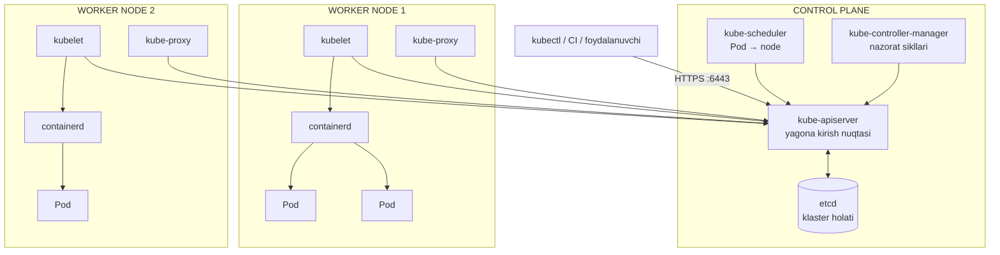
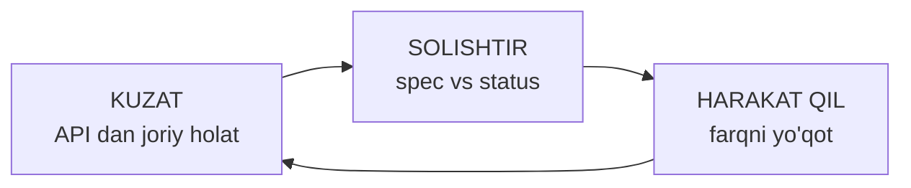
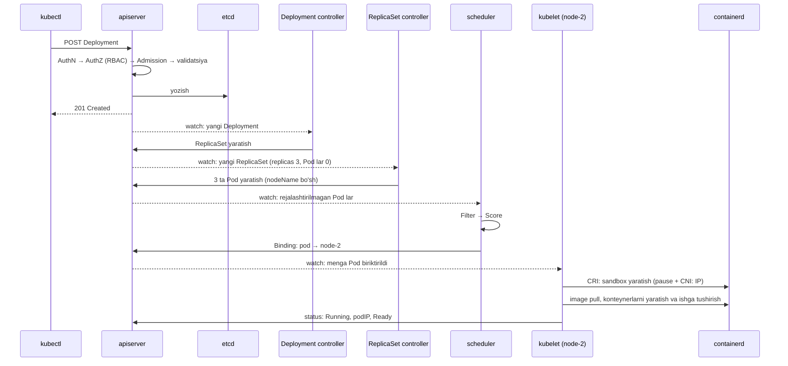
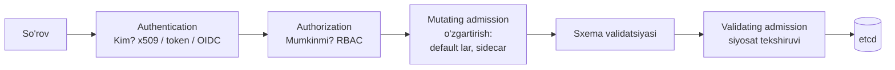
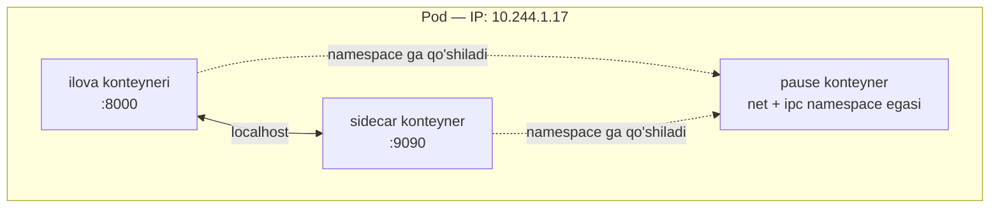
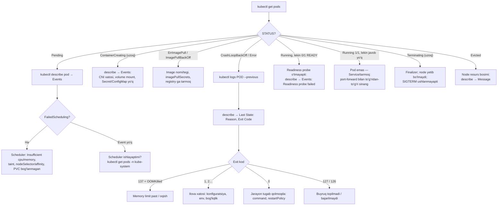

<!-- @section: why -->

## Muammo: konteynerlar ko'payganda

Docker bitta xostda ajoyib ishlaydi. Endi tasavvur qiling: 40 ta mikroservis, har biri 3–10 nusxada, 25 ta serverda. Kechasi soat 03:00 da bitta server o'chdi. Savollar:

- Undagi 30 ta konteynerni kim boshqa serverlarga ko'chiradi? Qaysi serverda joy bor?
- Ko'chgan konteynerlar yangi IP oldi — ularga murojaat qilayotgan servislar buni qayerdan biladi?
- Yangi versiyani 10 nusxaga **uzilishsiz** qanday yoyasiz? Yangi versiya buzuq chiqsa-chi?
- Yuklama 5 baravar oshdi — nusxalarni kim ko'paytiradi?

Bularni bash skriptlar va tungi navbatchilik bilan hal qilish mumkin — bir muddat. Keyin bu skriptlar o'zi alohida, hech kim tushunmaydigan tizimga aylanadi.

## Yechim: orkestrator

**Orkestrator** — konteynerlarni ko'p serverli klasterda avtomatik joylashtiruvchi, kuzatuvchi va tiklovchi tizim. Kubernetes (K8s) Google ning ichki Borg tizimi tajribasidan o'sib chiqqan (2014) va bugun amalda standart.

| Muammo | Kubernetes dagi yechim |
|---|---|
| Qaysi serverga joylash | **Scheduler** — resurs va cheklovlarga qarab tanlaydi |
| Server/konteyner o'lsa | **Self-healing** — controller lar yo'qolgan nusxani qayta yaratadi |
| O'zgaruvchan IP lar | **Service** — barqaror virtual manzil va DNS nomi |
| Uzilishsiz yangilash | **Deployment** — rolling update va rollback |
| Yuklamaga moslashish | **HPA** — avtomatik masshtablash |
| Konfiguratsiya va sirlar | **ConfigMap**, **Secret** |
| Disk | **PersistentVolume** — konteyner ko'chsa ham ma'lumot ergashadi |

## Asosiy g'oya: "nima qilish" emas, "qanday bo'lishi kerak"

Docker bilan siz **buyruq** berasiz: "shu konteynerni ishga tushir". Bu — imperativ yondashuv: natija uchun siz javobgarsiz.

Kubernetes ga siz **xohlangan holatni** aytasiz: "nginx ning 3 ta nusxasi doim ishlab tursin". Bu — **deklarativ** yondashuv. Tizim o'zi hozirgi holatni kuzatadi, xohlangani bilan solishtiradi va farqni yo'qotadi — **to'xtovsiz**.

> **Analogiya — termostat.** Siz isitgichni qo'lda yoqib-o'chirmaysiz (imperativ). Siz "22 daraja bo'lsin" deysiz (deklarativ). Termostat haroratni o'lchaydi, 22 dan past bo'lsa — yoqadi, yuqori bo'lsa — o'chiradi. Deraza ochilib xona sovisa — hech kim buyruq bermasa ham u o'zi reaksiya qiladi. Kubernetes — minglab shunday termostatlar to'plami.

Bu g'oyaning nomi — **reconcile loop** (moslashtirish sikli). Kubernetes ning butun arxitekturasi shuning atrofida qurilgan; uni tushunsangiz, qolgan hamma narsa — tafsilot.

## Qachon Kubernetes kerak EMAS

Halol bo'laylik: K8s — murakkab tizim va uning narxi bor (o'rganish, ekspluatatsiya, resurslar). Bitta-ikkita server va bir nechta servis uchun Docker Compose yoki Swarm ko'pincha to'g'riroq tanlov. K8s o'zini oqlaydi: ko'p servis, ko'p jamoa, yuqori mavjudlik talabi, tez-tez deploy, avtomatik masshtablash zarur bo'lganda.

<!-- @section: theory -->

## Klaster tuzilishi

Kubernetes klasteri ikki xil mashinadan iborat:

- **Control plane** (boshqaruv tekisligi) — klasterning "miyasi": qarorlar qabul qiladi, holatni saqlaydi.
- **Worker node** lar — "mushaklar": ilova konteynerlari shu yerda ishlaydi.



Diagrammadagi eng muhim narsa: **barcha strelkalar API serverga boradi**. Komponentlar bir-biri bilan to'g'ridan-to'g'ri gaplashmaydi; etcd bilan esa **faqat** API server ishlaydi.

Ilovadagi **Kubernetes arxitektura xaritasi** vositasida har bir komponentni bosib, batafsil o'rganing.

## Control plane komponentlari

| Komponent | Vazifasi | Ishdan chiqsa |
|---|---|---|
| **kube-apiserver** | REST API. Har so'rovni autentifikatsiya → avtorizatsiya → admission → validatsiyadan o'tkazib, etcd ga yozadi. Holatsiz — bir necha nusxada ishlaydi | `kubectl` ishlamaydi, hech narsa o'zgarmaydi; **ishlab turgan Pod lar ishlayveradi** |
| **etcd** | Taqsimlangan kalit-qiymat bazasi (Raft). Klasterning **yagona haqiqat manbai**: barcha obyektlar shu yerda | Quorum yo'qolsa klaster "muzlaydi"; zaxirasiz yo'qolsa — klaster holati yo'q |
| **kube-scheduler** | Hali node ga biriktirilmagan Pod larni kuzatadi va har biriga node tanlaydi | Yangi Pod lar `Pending` da qoladi |
| **kube-controller-manager** | O'nlab controller lar bitta jarayonda: Deployment, ReplicaSet, Node, Job, EndpointSlice… | O'z-o'zini tiklash to'xtaydi |
| cloud-controller-manager | Bulut API si bilan integratsiya (LoadBalancer, disklar) | Bulut resurslari yaratilmaydi |

## Node komponentlari

| Komponent | Vazifasi |
|---|---|
| **kubelet** | Har node dagi agent. API serverdan "menga biriktirilgan Pod lar" ni kuzatadi va container runtime orqali ularni ishga tushiradi; probe larni bajaradi; holatni hisobot qiladi |
| **Container runtime** | Konteynerlarni amalda ishga tushiradi: **containerd** yoki CRI-O. (Docker Engine 1.24 dan beri to'g'ridan-to'g'ri qo'llab-quvvatlanmaydi — lekin Docker da yig'ilgan image lar ishlayveradi, chunki format bitta: OCI) |
| **kube-proxy** | Service virtual IP lari uchun tarmoq qoidalarini (iptables/IPVS/nftables) yozadi |
| **CNI plagin** | Pod larga IP beradi va node lararo Pod tarmog'ini quradi (Calico, Cilium, Flannel) |

Uch standart interfeys Kubernetes ni kengaytiriladigan qiladi: **CRI** (runtime), **CNI** (tarmoq), **CSI** (saqlash).

## Pod

**Pod** — Kubernetes dagi eng kichik chiqarish birligi. Kubernetes konteynerlarni to'g'ridan-to'g'ri boshqarmaydi — u Pod larni boshqaradi.

Pod = bir yoki bir necha konteyner, ular:

- **tarmoq namespace ini baham ko'radi** — bitta IP, bir-biriga `localhost` orqali murojaat, portlar umumiy;
- umumiy **volume** larga ega bo'lishi mumkin;
- **birga** rejalashtiriladi, birga yashaydi, birga o'ladi.

**Nega konteyner emas, Pod?** Ba'zi jarayonlar ajralmas juftlik: ilova + uning loglarini jo'natuvchi agent; ilova + service mesh proksisi. Ularni bitta konteynerga tiqish "bitta konteyner — bitta jarayon" tamoyilini buzadi; alohida joylash esa ular orasidagi yaqin aloqani yo'qotadi. Pod — o'rtacha yechim. Yordamchi konteyner **sidecar** deb ataladi.

Amalda ko'pchilik Pod larda **bitta** asosiy konteyner bo'ladi.

**Pod — o'tkinchi (ephemeral).** U o'lsa, "tirilmaydi": o'rniga **yangi** Pod yaratiladi — yangi nom, yangi IP bilan. Shuning uchun:

- Pod ni hech qachon qo'lda, "yalang'och" yaratmaysiz — uni **controller** (Deployment va h.k.) boshqaradi;
- Pod IP siga bog'lanmaysiz — **Service** dan foydalanasiz.

### Pod holatlari (phase)

| Phase | Ma'nosi |
|---|---|
| `Pending` | Qabul qilingan, lekin hali ishlamayapti: node tanlanmagan yoki image tortilmoqda |
| `Running` | Node ga biriktirilgan, kamida bitta konteyner ishlamoqda |
| `Succeeded` | Barcha konteynerlar 0 kod bilan tugagan (Job lar uchun) |
| `Failed` | Kamida bitta konteyner xato bilan tugagan va qayta ishga tushirilmaydi |
| `Unknown` | Node bilan aloqa yo'q |

`kubectl get pods` dagi `STATUS` ustuni phase dan boyroq — u konteyner holatini ham ko'rsatadi: `ContainerCreating`, `ImagePullBackOff`, `CrashLoopBackOff`, `Terminating`, `OOMKilled`.

## Deklarativ model: spec va status

Kubernetes dagi har bir narsa — **obyekt** (resurs): Pod, Deployment, Service, Node… Har obyekt to'rt qismdan iborat:

```yaml
apiVersion: v1              # API guruhi va versiyasi
kind: Pod                   # obyekt turi
metadata:                   # kimligi
  name: web
  namespace: default
  labels:
    app: web
spec:                       # XOHLANGAN holat — siz yozasiz
  containers:
    - name: nginx
      image: nginx:1.27
status:                     # HAQIQIY holat — tizim yozadi
  phase: Running
  podIP: 10.244.1.17
```

| Qism | Kim yozadi | Ma'nosi |
|---|---|---|
| `spec` | Siz | "Shunday bo'lsin" |
| `status` | Controller lar, kubelet | "Hozir shunday" |

Butun tizimning ishi — `status` ni `spec` ga yaqinlashtirish.

### Label va selector

**Label** — obyektga yopishtirilgan `kalit: qiymat` belgisi. **Selector** — label lar bo'yicha so'rov. Bu — Kubernetes dagi obyektlarni bog'lashning **yagona** mexanizmi: Deployment o'z Pod larini, Service o'z backend larini nomi yoki ID si bilan emas, **label lari bo'yicha** topadi.

```text
Service  selector: app=web   ──topadi──▶  Pod (labels: app=web, tier=front)
                                          Pod (labels: app=web, tier=front)
                             ──topmaydi─▶ Pod (labels: app=api)
```

### Namespace

**Namespace** — klaster ichidagi obyektlarni mantiqiy guruhlash: nomlar maydoni, ruxsatlar (RBAC), kvotalar chegarasi. (Linux yadrosi namespace lari bilan adashtirmang — bu butunlay boshqa narsa.)

| Namespace | Nima uchun |
|---|---|
| `default` | Namespace ko'rsatilmaganda |
| `kube-system` | Tizim komponentlari |
| `kube-public` | Hamma o'qiy oladigan ma'lumot |
| `kube-node-lease` | Node larning "yurak urishi" |

Namespace **tarmoq izolyatsiyasi bermaydi** — sukut bo'yicha har Pod har Pod ga yeta oladi (buni NetworkPolicy cheklaydi).

## Reconcile loop

Har bir controller — cheksiz sikl:



Misol — ReplicaSet controller, `replicas: 3`:

| Kuzatilgan | Solishtirish | Harakat |
|---|---|---|
| 3 ta Pod | 3 = 3 | Hech narsa |
| 2 ta Pod (bittasi o'ldi) | 2 < 3 | 1 ta Pod yaratish |
| 4 ta Pod (kimdir qo'lda yaratdi) | 4 > 3 | 1 tasini o'chirish |

Muhim xususiyat — **level-triggered** (darajaga asoslangan): controller "nima bo'ldi" degan hodisaga emas, "hozir qanday" degan holatga qaraydi. Agar u bir muddat ishlamay, hodisalarni o'tkazib yuborgan bo'lsa ham — qayta ishga tushgach holatni ko'radi va tuzatadi. Shu tufayli tizim nosozliklarga chidamli.

Bundan amaliy oqibat: **Kubernetes bilan "kurashib" bo'lmaydi.** Deployment boshqarayotgan Pod ni o'chirsangiz — yangisi paydo bo'ladi. Uni yo'qotish uchun xohlangan holatni o'zgartirish kerak (Deployment ni o'chirish yoki `replicas: 0`).

## kubectl va kubeconfig

`kubectl` — API server uchun buyruq qatori mijozi. U **kubeconfig** faylidan (`~/.kube/config`) uch narsani oladi:

| Bo'lim | Nima |
|---|---|
| `clusters` | API server manzili va CA sertifikati |
| `users` | Autentifikatsiya: mijoz sertifikati, token yoki OIDC |
| `contexts` | (klaster + foydalanuvchi + namespace) uchligi; `current-context` — hozirgisi |

## Atamalar lug'ati

| Atama | Ma'nosi | Misol |
|---|---|---|
| cluster | Control plane + node lar | |
| node | Klasterdagi mashina (VM yoki fizik) | `kubectl get nodes` |
| Pod | Umumiy tarmoqli konteynerlar guruhi | `web-7d4b9c-x2k9p` |
| manifest | Obyekt tavsifi (YAML) | `deploy.yaml` |
| spec / status | Xohlangan / haqiqiy holat | |
| controller | Reconcile siklini bajaruvchi | ReplicaSet controller |
| label / selector | Belgi / belgi bo'yicha tanlash | `app=web` |
| namespace | Mantiqiy guruhlash | `kube-system` |
| kubelet | Node agenti | |
| sidecar | Asosiy konteynerga yordamchi konteyner | log agenti, proksi |

<!-- @section: internals -->

## `kubectl apply` dan ishlab turgan Pod gacha

`kubectl apply -f deployment.yaml` (replicas: 3). Hech bir komponent boshqasiga "buyruq" bermaydi — har biri API ni kuzatadi va o'z ishini qiladi:



Bu zanjirdan chiqadigan xulosalar:

1. `kubectl apply` "muvaffaqiyatli" qaytdi — bu faqat **xohish etcd ga yozildi** degani. Konteynerlar hali yo'q. Natijani `kubectl rollout status` yoki `get pods -w` bilan kutish kerak.
2. Zanjirning har halqasi mustaqil: scheduler o'chiq bo'lsa — Pod lar yaratiladi, lekin `Pending` da turadi; kubelet o'chiq bo'lsa — biriktiriladi, lekin ishga tushmaydi. Qayerda to'xtaganiga qarab, aybdorni topasiz.
3. Scheduler hech narsani ishga tushirmaydi — u faqat Pod ga `nodeName` yozadi.

Ilovadagi **Kubernetes arxitektura xaritasi → "kubectl apply" → Pod oqimi** animatsiyasida har qadamni ko'ring.

## API server ichida: so'rov yo'li



- **401 Unauthorized** — kimligingiz aniqlanmadi; **403 Forbidden** — aniqlandi, lekin ruxsat yo'q.
- **Admission** — obyekt saqlanishidan oldingi oxirgi darvoza: resurs kvotalari, xavfsizlik siyosatlari (Pod Security), webhook lar shu yerda.
- API server **holatsiz**: barcha holat etcd da. Shuning uchun uni bir necha nusxada, yuk taqsimlagich ortida ishlatish oson.

## Watch: tizimning asab tolalari

Controller lar API ni har soniyada so'roq qilmaydi (bu klasterni yiqitardi). Ular **list + watch** dan foydalanadi:

1. **List** — joriy holatni bir marta to'liq oladi; javobda `resourceVersion` bor.
2. **Watch** — "shu versiyadan keyingi o'zgarishlarni oqim qilib yubor" — uzoq yashaydigan HTTP ulanish. API server har o'zgarishda `ADDED` / `MODIFIED` / `DELETED` hodisasini yuboradi.

`resourceVersion` etcd ning global **revision** raqamidan olinadi — har yozuv uni oshiradi. Ulanish uzilsa, mijoz oxirgi ko'rgan versiyadan davom etadi; versiya juda eski bo'lsa (`410 Gone`) — qayta list qiladi.

Mijoz tomonida bu **informer** kutubxonasida amalga oshirilgan: mahalliy kesh + hodisalar navbati. Controller obyektni API dan emas, keshdan o'qiydi.

O'zingiz ko'ring:

```bash
kubectl get pods -w                         # watch — yangi satrlar hodisa kelganda chiqadi
kubectl get pod web -o jsonpath='{.metadata.resourceVersion}{"\n"}'
kubectl get pods -v=8 2>&1 | grep -E 'GET|Response Status'   # kubectl yuborayotgan HTTP so'rovlar
kubectl get --raw /api/v1/namespaces/default/pods | head -c 300
```

## Pod ichida: pause konteyner

Kubelet Pod ni ishga tushirganda, birinchi bo'lib **sandbox** yaratadi — bu maxsus mitti `pause` konteyneri. Uning yagona vazifasi — Pod ning namespace larini (asosan `net` va `ipc`) "ushlab turish".



Ilova konteynerlari yangi tarmoq namespace yaratmaydi — ular `pause` nikiga **qo'shiladi** (Docker dagi `--network container:X` kabi). Shuning uchun:

- Pod dagi barcha konteynerlar bitta IP ga ega va `localhost` orqali gaplashadi;
- ilova konteyneri yiqilib qayta ishga tushsa ham, Pod ning IP si **saqlanadi** — namespace egasi (`pause`) tirik;
- bir Pod dagi ikki konteyner bir xil portni tinglay olmaydi.

Node da ko'rish:

```bash
sudo crictl pods                    # sandbox lar
sudo crictl ps                      # konteynerlar (pause ko'rinmaydi)
sudo crictl inspectp POD_ID | grep -A3 network
```

## Pod tarmoq modeli

Kubernetes tarmoqqa uchta talab qo'yadi (ularni CNI plagin bajaradi):

1. Har Pod **o'z IP manziliga** ega.
2. Har Pod boshqa har Pod bilan **NAT siz** gaplasha oladi — qaysi node da bo'lishidan qat'i nazar.
3. Node dagi agentlar o'sha node dagi barcha Pod larga yeta oladi.

Bu Docker ning standart modelidan (konteynerlar NAT ortida, port mapping) tubdan farq qiladi: port to'qnashuvlari va port xaritalari yo'q; har Pod — tarmoqdagi "oddiy xost".

Bitta node ichida: Pod ↔ `veth` ↔ bridge (yoki to'g'ridan-to'g'ri marshrut). Node lar orasida: overlay (VXLAN, IP-in-IP) yoki marshrutlash (BGP).

## Kubelet ning o'z sikli

Kubelet ham reconcile loop: "menga biriktirilgan Pod lar ro'yxati" (xohlangan) va "runtime da ishlab turgan konteynerlar" (haqiqiy) ni solishtiradi.

- **Konteyner yiqildi** → kubelet uni **o'sha node da** qayta ishga tushiradi (`restartPolicy: Always` bo'lsa). Qayta urinishlar orasidagi kutish eksponensial o'sadi: 10 s, 20 s, 40 s … 5 daqiqagacha — bu **CrashLoopBackOff**. Pod boshqa node ga **ko'chmaydi**.
- **Node o'ldi** → kubelet "yurak urishi"ni (Lease) yangilamay qo'yadi → node controller ~40 s dan keyin node ni `NotReady` deb belgilaydi → yana ~5 daqiqadan keyin undagi Pod lar o'chirishga belgilanadi → ReplicaSet controller boshqa node larda **yangi** Pod lar yaratadi.

Ya'ni ikki xil tiklanish bor: konteyner darajasida — kubelet (tez, joyida); Pod/node darajasida — controller lar (sekinroq, boshqa joyda).

**Static Pod** — kubelet API serversiz, to'g'ridan-to'g'ri diskdagi fayldan (`/etc/kubernetes/manifests/`) ishga tushiradigan Pod. `kubeadm` klasterlarida control plane komponentlarining o'zi (apiserver, etcd, scheduler) aynan shunday ishlaydi — "tovuq va tuxum" muammosining yechimi.

## etcd da nima yotadi

```bash
sudo ETCDCTL_API=3 etcdctl --endpoints=https://127.0.0.1:2379 \
  --cacert=/etc/kubernetes/pki/etcd/ca.crt \
  --cert=/etc/kubernetes/pki/etcd/server.crt --key=/etc/kubernetes/pki/etcd/server.key \
  get /registry/pods/default --prefix --keys-only | head
# /registry/pods/default/web-7d4b9c6f5-x2k9p
```

Kalitlar tuzilishi: `/registry/<resurs>/<namespace>/<nom>`; qiymat — protobuf ko'rinishidagi obyekt. Butun klaster — shu kalitlar to'plami. Shuning uchun **etcd zaxirasi = klaster zaxirasi**.

<!-- @section: commands -->

## Pod manifesti — qator-qator

```yaml
apiVersion: v1
kind: Pod
metadata:
  name: web
  namespace: default
  labels:
    app: web
    tier: frontend
spec:
  containers:
    - name: nginx
      image: nginx:1.27.2-alpine
      imagePullPolicy: IfNotPresent
      ports:
        - name: http
          containerPort: 80
      env:
        - name: TZ
          value: Asia/Tashkent
      resources:
        requests:
          cpu: 100m
          memory: 64Mi
        limits:
          memory: 128Mi
      readinessProbe:
        httpGet:
          path: /
          port: http
        periodSeconds: 5
      securityContext:
        allowPrivilegeEscalation: false
  restartPolicy: Always
  terminationGracePeriodSeconds: 30
```

| Maydon | Nima qiladi | O'chirilsa / xato bo'lsa |
|---|---|---|
| `apiVersion: v1` | Pod "core" API guruhida. Deployment uchun — `apps/v1` | Noto'g'ri bo'lsa: `no matches for kind` |
| `kind: Pod` | Obyekt turi (katta harf bilan boshlanadi) | |
| `metadata.name` | Namespace ichida yagona nom; DNS qoidalariga mos (kichik harf, raqam, `-`) | Majburiy |
| `metadata.namespace` | Qaysi namespace da | Ko'rsatilmasa — kontekstdagi joriy namespace |
| `metadata.labels` | Belgilar — Service va controller lar shu orqali topadi | Label siz Pod ni hech narsa "tanlay" olmaydi |
| `containers[].name` | Pod ichida yagona nom (`logs -c`, `exec -c` uchun) | Majburiy |
| `image` | Image — **aniq teg bilan** | `:latest` yoki tegsiz → `imagePullPolicy` avtomatik `Always`, qaysi versiya ishlayotgani noma'lum |
| `imagePullPolicy` | `IfNotPresent` — node da bo'lsa tortmaydi; `Always` — har safar registry dan digest ni tekshiradi; `Never` | |
| `ports[].containerPort` | **Hujjat** (Docker dagi `EXPOSE` kabi): portni ochmaydi ham, yopmaydi ham. `name` bersangiz, probe va Service da nom bilan murojaat qilasiz | Ilova baribir o'z portida tinglaydi |
| `env` | Muhit o'zgaruvchilari; `valueFrom` — ConfigMap/Secret dan | |
| `resources.requests` | Scheduler uchun: "kamida shuncha kerak". `100m` = 0.1 CPU yadro; `64Mi` = 64 mebibayt | Yo'q bo'lsa — scheduler ko'r-ko'rona joylaydi; Pod `BestEffort` — birinchi bo'lib chiqarib yuboriladi |
| `resources.limits.memory` | Oshsa — `OOMKilled` | Yo'q bo'lsa — oqayotgan ilova node ni yiqitishi mumkin |
| `readinessProbe` | "Trafik qabul qilishga tayyormisan?" | Yo'q bo'lsa — konteyner start bo'lgan zahoti tayyor hisoblanadi |
| `allowPrivilegeEscalation: false` | SUID orqali huquq oshirishni taqiqlaydi | |
| `restartPolicy` | `Always` (standart) / `OnFailure` / `Never` — **konteynerni joyida** qayta ishga tushirish | Deployment da faqat `Always` mumkin |
| `terminationGracePeriodSeconds` | SIGTERM dan SIGKILL gacha kutish (standart 30 s) | |

> ⚠️ **Ehtiyot bo'l: birliklar.** `memory: 128M` — megabayt (10⁶), `128Mi` — mebibayt (2²⁰), `128m` — **millibayt** (deyarli nol — Pod ishga tushmaydi). CPU da esa `m` to'g'ri: `500m` = yarim yadro.

## kubectl: ko'rish

```bash
kubectl get pods -n kube-system -o wide --show-labels
```

```tahlil
{"command":"kubectl get pods -n kube-system -o wide --show-labels","parts":[{"t":"kubectl get","d":"Obyektlar ro'yxati. API ga GET so'rov; -w qo'shilsa watch rejimi"},{"t":"pods","d":"Resurs turi. Qisqartmalar: po, deploy, svc, ns, no, cm. To'liq ro'yxat: kubectl api-resources"},{"t":"-n kube-system","d":"Namespace. Ko'rsatilmasa — joriy kontekstdagi. Barcha namespace lar: -A"},{"t":"-o wide","d":"Qo'shimcha ustunlar: Pod IP, NODE. Boshqa formatlar: yaml, json, jsonpath=..., name"},{"t":"--show-labels","d":"Label larni ko'rsatadi. Filtr: -l app=web"}]}
```

| Buyruq | Vazifasi |
|---|---|
| `kubectl get pods -A` | Barcha namespace lardagi Pod lar |
| `kubectl get pod web -o yaml` | To'liq obyekt — `spec` va `status` bilan |
| `kubectl get pods -l app=web,tier=frontend` | Label selector |
| `kubectl get pods --field-selector status.phase=Pending` | Maydon bo'yicha filtr |
| `kubectl get pods -w` | Jonli kuzatish |
| `kubectl get all` | Asosiy ish yuklamasi resurslari (hammasi **emas**: ConfigMap, Secret, Ingress kirmaydi) |
| `kubectl get events --sort-by=.lastTimestamp` | Hodisalar — vaqt tartibida |
| `kubectl explain pod.spec.containers.resources` | Maydon hujjati — to'g'ridan-to'g'ri API sxemasidan |
| `kubectl api-resources` | Barcha resurs turlari, qisqartmalari, namespace li yoki yo'qligi |

## kubectl describe — birinchi debug vositasi

```bash
kubectl describe pod web
```

Chiqishning eng muhim qismi — pastdagi **Events**:

```text
Events:
  Type     Reason     Age   From               Message
  ----     ------     ----  ----               -------
  Normal   Scheduled  12s   default-scheduler  Successfully assigned default/web to node-2
  Normal   Pulling    11s   kubelet            Pulling image "nginx:1.27.2-alpine"
  Normal   Pulled     6s    kubelet            Successfully pulled image in 4.8s
  Normal   Created    6s    kubelet            Created container nginx
  Normal   Started    5s    kubelet            Started container nginx
```

`From` ustuni — hodisani **kim** yozgani: `default-scheduler` → rejalashtirish bosqichi; `kubelet` → node dagi bosqich. Zanjir qayerda uzilganini shu yerdan ko'rasiz. Hodisalar sukut bo'yicha **1 soat** saqlanadi.

## kubectl: o'zgartirish

```bash
kubectl apply -f manifest.yaml --dry-run=server
```

```tahlil
{"command":"kubectl apply -f manifest.yaml --dry-run=server","parts":[{"t":"kubectl apply","d":"Deklarativ: obyekt yo'q bo'lsa yaratadi, bor bo'lsa farqni qo'llaydi (3-way merge). 'kubectl create' — faqat yaratadi, mavjud bo'lsa xato"},{"t":"-f manifest.yaml","d":"Fayl, katalog yoki URL. Bir faylda '---' bilan ajratilgan bir necha obyekt bo'lishi mumkin. -k — kustomize katalogi"},{"t":"--dry-run=server","d":"So'rov API serverga boradi, admission va validatsiyadan o'tadi, lekin SAQLANMAYDI. 'client' — faqat mahalliy tekshiruv (kuchsizroq)"}]}
```

| Buyruq | Vazifasi |
|---|---|
| `kubectl diff -f manifest.yaml` | Klasterdagi holat bilan farq — `apply` dan oldin |
| `kubectl apply -f k8s/` | Katalogdagi barcha manifestlar |
| `kubectl delete -f manifest.yaml` | Manifestdagi obyektlarni o'chirish |
| `kubectl delete pod web` | Ohista o'chirish (grace period bilan) |
| `kubectl edit deploy web` | Jonli obyektni muharrirda ochish (shoshilinch holat uchun; odatiy yo'l — Git + apply) |
| `kubectl label pod web env=prod` | Label qo'shish |
| `kubectl run tmp --rm -it --image=busybox:1.36 --restart=Never -- sh` | Bir martalik debug Pod |

> ⚠️ **Ehtiyot bo'l.** `kubectl delete pod X --grace-period=0 --force` Pod ni API dan darhol o'chiradi, lekin konteyner node da hali ishlayotgan bo'lishi mumkin — holatli ilovalarda (bazalar) bu ma'lumot buzilishiga olib keladi. `kubectl delete ns X` esa namespace dagi **hamma narsani** o'chiradi. Buyruqni bajarishdan oldin kontekstni tekshiring: `kubectl config current-context`.

## kubectl: debug

| Buyruq | Vazifasi |
|---|---|
| `kubectl logs web` | Konteyner stdout/stderr |
| `kubectl logs web -c nginx -f --tail=100` | Aniq konteyner, jonli, oxirgi 100 satr |
| `kubectl logs web --previous` | **Oldingi** (yiqilgan) nusxaning logi — CrashLoopBackOff da hal qiluvchi |
| `kubectl logs -l app=web --all-containers --prefix` | Label bo'yicha bir necha Pod |
| `kubectl exec -it web -- sh` | Konteynerda buyruq. `--` dan keyingisi — konteyner ichidagi buyruq |
| `kubectl port-forward pod/web 8080:80` | Mahalliy portni Pod ga tunnel (API server orqali) |
| `kubectl debug -it web --image=nicolaka/netshoot --target=nginx` | Ishlab turgan Pod ga vaqtinchalik debug konteyner qo'shish (image da shell bo'lmasa) |
| `kubectl debug node/node-2 -it --image=busybox:1.36` | Node ga kirish (xost FS `/host` da) |
| `kubectl top pod` / `kubectl top node` | CPU/xotira iste'moli (metrics-server kerak) |
| `kubectl cp web:/etc/nginx/nginx.conf ./nginx.conf` | Fayl nusxalash |

## Kontekst va namespace

```bash
kubectl config get-contexts
kubectl config use-context prod-cluster
kubectl config set-context --current --namespace=shop
kubectl config view --minify
```

Bir necha klaster bilan ishlaganda shell prompt iga joriy kontekstni chiqarib qo'ying — "prod da ekanimni bilmay qoldim" eng qimmat xatolardan biri.

## jsonpath va formatlash

```bash
kubectl get pods -o jsonpath='{range .items[*]}{.metadata.name}{"\t"}{.status.podIP}{"\t"}{.spec.nodeName}{"\n"}{end}'
kubectl get pods -o custom-columns=NOM:.metadata.name,IMAGE:.spec.containers[0].image,RESTART:.status.containerStatuses[0].restartCount
kubectl get pod web -o jsonpath='{.status.containerStatuses[0].lastState.terminated.reason}'   # OOMKilled / Error
```

## Tez manifest yaratish

YAML ni yoddan yozish shart emas — `kubectl` skelet yasab beradi:

```bash
kubectl run web --image=nginx:1.27.2-alpine --port=80 --dry-run=client -o yaml > pod.yaml
kubectl create deployment web --image=nginx:1.27.2-alpine --replicas=3 --dry-run=client -o yaml > deploy.yaml
```

<!-- @section: lab -->

## Lab 1. Klaster va uning komponentlari

**Maqsad:** mahalliy klaster ko'tarib, nazariyadagi har bir komponentni "tirik" holda topish.

**Muhit:** Docker o'rnatilgan mashina + `kind` (Kubernetes IN Docker) va `kubectl`. Muqobil: `minikube`.

**Qadamlar:**

1. Uch node li klaster yarating. `kind-config.yaml`:

   ```yaml
   kind: Cluster
   apiVersion: kind.x-k8s.io/v1alpha4
   nodes:
     - role: control-plane
     - role: worker
     - role: worker
   ```

   ```bash
   kind create cluster --name lab --config kind-config.yaml
   ```

2. Node larni va ularning rollarini ko'ring.
3. `kube-system` namespace idagi Pod larni toping: apiserver, etcd, scheduler, controller-manager, kube-proxy, CoreDNS, CNI. Qaysilari har node da bittadan? Nega?
4. Control plane node ga kirib, static Pod manifestlarini toping.
5. API serverning sog'lig'ini "xom" so'rov bilan tekshiring.

**Tekshirish:**

```bash
kubectl get nodes                      # 3 ta, hammasi Ready
kubectl get pods -n kube-system -o wide
kubectl get --raw='/readyz?verbose' | tail -3      # readyz check passed
```

<details><summary>💡 Yechimni ko'rsatish</summary>

```bash
kubectl get nodes -o wide
kubectl get pods -n kube-system -o wide
# kube-proxy-* va kindnet-* (CNI) — har node da bittadan: ular DaemonSet
# etcd-*, kube-apiserver-*, kube-scheduler-*, kube-controller-manager-* — faqat control-plane da: static Pod

docker exec lab-control-plane ls /etc/kubernetes/manifests/
# etcd.yaml  kube-apiserver.yaml  kube-controller-manager.yaml  kube-scheduler.yaml
docker exec lab-control-plane crictl ps --name kube-apiserver
```

Static Pod nomlari oxirida node nomi turadi (`etcd-lab-control-plane`) — ularni kubelet fayldan yaratgan; API dagi yozuv — faqat "ko'zgu" (mirror Pod).

</details>

## Lab 2. Yalang'och Pod va uning hayoti

**Maqsad:** Pod yaratish, hodisalar zanjirini o'qish va Pod "o'tkinchi" ekanini ko'rish.

**Qadamlar:**

1. "Buyruqlar" bo'limidagi Pod manifestini `pod.yaml` ga saqlang va qo'llang.
2. Boshqa terminalda `kubectl get pods -w` ni ishga tushirib, holat o'zgarishlarini kuzating.
3. `kubectl describe pod web` — Events ni o'qing: har qadamni kim bajargan?
4. Pod IP sini aniqlang; `port-forward` orqali unga murojaat qiling.
5. Konteyner ichidagi asosiy jarayonni o'ldiring: `kubectl exec web -- kill 1`. `RESTARTS` ustuni nima bo'ldi? Pod IP si o'zgardimi?
6. Pod ni o'chiring: `kubectl delete pod web`. U qaytib keldimi?

**Tekshirish:** 5-qadamdan keyin `RESTARTS = 1`, IP **o'zgarmagan**. 6-qadamdan keyin Pod **yo'q** — uni hech kim qayta yaratmaydi.

<details><summary>💡 Yechimni ko'rsatish</summary>

```bash
kubectl apply -f pod.yaml
kubectl get pod web -o wide                       # IP va NODE
kubectl port-forward pod/web 8080:80 &            # so'ng: curl -s localhost:8080 | head -4
kubectl exec web -- kill 1
kubectl get pod web -o wide                       # RESTARTS 1, IP o'sha
kubectl describe pod web | grep -A6 'Last State'  # Terminated, Exit Code
kubectl delete pod web && kubectl get pods        # No resources found
```

5-qadamda konteynerni **kubelet** joyida qayta ishga tushirdi (`restartPolicy: Always`); pause konteyner tirik qolgani uchun IP saqlandi. 6-qadamda esa Pod **obyektining o'zi** o'chirildi — uni qayta yaratadigan controller yo'q.

</details>

## Lab 3. Reconcile loop ni kuzatish

**Maqsad:** deklarativ model va o'z-o'zini tiklashni ko'rish.

**Qadamlar:**

1. `kubectl create deployment web --image=nginx:1.27.2-alpine --replicas=3`
2. `kubectl get pods -w` ni ochiq qoldiring. Boshqa terminalda bitta Pod ni o'chiring. Nima bo'ldi? Qancha vaqtda?
3. Zanjirni toping: Pod ning egasi kim? Uning egasi-chi? (`ownerReferences`)
4. Bitta worker node ni "o'ldiring": `docker stop lab-worker`. Node holati qachon o'zgaradi? Pod lar qachon ko'chadi?
5. Node ni qaytaring: `docker start lab-worker`.

<details><summary>💡 Yechimni ko'rsatish</summary>

```bash
kubectl delete pod "$(kubectl get pods -l app=web -o name | head -1 | cut -d/ -f2)"
# -w oynasida: eski Pod Terminating, deyarli bir zumda yangi nomli Pod: Pending → ContainerCreating → Running

kubectl get pod -l app=web -o jsonpath='{.items[0].metadata.ownerReferences[0].kind}{"/"}{.items[0].metadata.ownerReferences[0].name}{"\n"}'
# ReplicaSet/web-5d8f7c9b6
kubectl get rs -l app=web -o jsonpath='{.items[0].metadata.ownerReferences[0].kind}{"\n"}'     # Deployment

docker stop lab-worker
kubectl get nodes -w            # ~40 soniyadan keyin: NotReady
kubectl get pods -o wide -w     # ~5 daqiqadan keyin o'sha node dagi Pod lar Terminating, boshqa node da yangilari
```

Kechikish sababi: node controller avval kutadi (`node-monitor-grace-period` ≈ 40 s), keyin Pod larga `not-ready` taint i uchun standart `tolerationSeconds: 300` beriladi — tarmoqning qisqa uzilishida Pod lar behuda ko'chirilmasligi uchun.

</details>

## Qo'shimcha chaqiriq

Ikki konteynerli Pod yozing: `nginx` va har 5 soniyada umumiy `emptyDir` volume dagi `index.html` ga joriy vaqtni yozadigan `busybox` sidecar. `port-forward` orqali sahifa yangilanib turishini tekshiring. So'ng sidecar dan `wget -qO- localhost` qiling — nega ishlaydi?

<!-- @section: breakfix -->

## 1. Pod `ImagePullBackOff` da

```text
$ kubectl get pods
NAME   READY   STATUS             RESTARTS   AGE
api    0/1     ImagePullBackOff   0          2m
$ kubectl describe pod api | tail -4
  Warning  Failed   kubelet  Failed to pull image "ngnix:1.27.2-alpine": failed to resolve reference
           "docker.io/library/ngnix:1.27.2-alpine": pull access denied, repository does not exist
  Warning  Failed   kubelet  Error: ErrImagePull
  Normal   BackOff  kubelet  Back-off pulling image "ngnix:1.27.2-alpine"
```

```breakfix
{"title":"Image tortilmayapti","lang":"yaml","broken":"apiVersion: v1\nkind: Pod\nmetadata:\n  name: api\n  labels:\n    app: api\nspec:\n  containers:\n    - name: api\n      image: ngnix:1.27.2-alpine\n      ports:\n        - containerPort: 80","hints":["Events ni diqqat bilan o'qing: aynan qaysi image nomi so'ralmoqda?","'repository does not exist' — nom xato yoki private. Nomni harfma-harf tekshiring.","ngnix → nginx."],"solution":"apiVersion: v1\nkind: Pod\nmetadata:\n  name: api\n  labels:\n    app: api\nspec:\n  containers:\n    - name: api\n      image: nginx:1.27.2-alpine\n      ports:\n        - containerPort: 80","explain":"ErrImagePull — kubelet image ni torta olmadi; ImagePullBackOff — u qayta urinishlar orasida kutmoqda. Sabablar: nom/teg xatosi (shu holat), private registry uchun imagePullSecrets yo'q, registry ga tarmoq yo'q, pull limiti. Aniq sabab har doim 'describe' dagi Events da yozilgan."}
```

## 2. Pod abadiy `Pending`

```text
$ kubectl get pods
NAME    READY   STATUS    RESTARTS   AGE
cache   0/1     Pending   0          5m
$ kubectl describe pod cache | tail -2
  Warning  FailedScheduling  default-scheduler  0/3 nodes are available: 1 node(s) had untolerated
           taint {node-role.kubernetes.io/control-plane: }, 2 Insufficient memory.
```

Worker node larning har birida 4 GiB xotira bor.

```breakfix
{"title":"Hech bir node mos kelmadi","lang":"yaml","broken":"apiVersion: v1\nkind: Pod\nmetadata:\n  name: cache\nspec:\n  containers:\n    - name: redis\n      image: redis:7.4-alpine\n      resources:\n        requests:\n          cpu: 250m\n          memory: 8Gi\n        limits:\n          memory: 8Gi","hints":["Events ni yozgan — default-scheduler. Demak muammo rejalashtirish bosqichida: Pod hali hech qaysi node ga biriktirilmagan.","'2 Insufficient memory': scheduler Pod ning REQUESTS ini node dagi bo'sh (allocatable − boshqa Pod lar requests i) joy bilan solishtiradi.","8Gi so'ralmoqda, node larda 4GiB. Kichik Redis uchun 256Mi yetarli."],"solution":"apiVersion: v1\nkind: Pod\nmetadata:\n  name: cache\nspec:\n  containers:\n    - name: redis\n      image: redis:7.4-alpine\n      resources:\n        requests:\n          cpu: 250m\n          memory: 256Mi\n        limits:\n          memory: 256Mi","explain":"Pending + FailedScheduling = scheduler filtridan hech bir node o'tmadi. Xabar har bir sababni node lar soni bilan sanaydi: 1 ta node — control-plane taint i (unga toleration yo'q), 2 tasi — xotira yetmaydi. Scheduler haqiqiy iste'molga emas, requests yig'indisiga qaraydi. Yechim: requests ni haqiqiy ehtiyojga moslash yoki kattaroq node qo'shish."}
```

## 3. Pod `CrashLoopBackOff`

```text
$ kubectl get pods
NAME     READY   STATUS             RESTARTS      AGE
worker   0/1     CrashLoopBackOff   5 (40s ago)   4m
$ kubectl logs worker --previous
ishni boshladim
ishni tugatdim
$ kubectl describe pod worker | grep -A4 'Last State'
    Last State:     Terminated
      Reason:       Completed
      Exit Code:    0
```

```breakfix
{"title":"Jarayon tugab qolmoqda","lang":"yaml","broken":"apiVersion: v1\nkind: Pod\nmetadata:\n  name: worker\nspec:\n  restartPolicy: Always\n  containers:\n    - name: worker\n      image: busybox:1.36\n      command: [\"sh\", \"-c\", \"echo ishni boshladim; sleep 5; echo ishni tugatdim\"]","hints":["Exit Code 0, Reason: Completed — jarayon XATOSIZ tugagan. Nega u holda 'Crash'?","restartPolicy: Always — konteyner qanday tugashidan qat'i nazar qayta ishga tushiriladi. Tugaydigan vazifa cheksiz qayta boshlanmoqda.","Bu bir martalik vazifa: restartPolicy: Never (yoki OnFailure). Amalda bunday ish uchun Job obyekti ishlatiladi."],"solution":"apiVersion: v1\nkind: Pod\nmetadata:\n  name: worker\nspec:\n  restartPolicy: Never\n  containers:\n    - name: worker\n      image: busybox:1.36\n      command: [\"sh\", \"-c\", \"echo ishni boshladim; sleep 5; echo ishni tugatdim\"]","explain":"CrashLoopBackOff — 'konteyner qayta-qayta tugayapti va kubelet urinishlar orasida tobora uzoqroq kutmoqda' degani; sababi xato ham, oddiy tugash ham bo'lishi mumkin. Tashxis tartibi: logs --previous → describe dagi Last State (Reason, Exit Code). Bu yerda jarayon ishini tugatgan: Always siyosati esa 'doimiy xizmat' uchun. Bir martalik ish — Never/OnFailure, yaxshisi Job."}
```

<!-- @section: errors -->

## Metodika: Pod ishlamayapti

Kubernetes da tashxisning oltin qoidasi: **`get` → `describe` → `logs`**. Holatga qarab, zanjirning qaysi halqasi uzilganini topasiz.



## Xatolar jadvali

| Xato xabari / simptom | Sabab | Qanday tekshiriladi | Yechim |
|---|---|---|---|
| `The connection to the server localhost:8080 was refused` | kubeconfig yo'q — `kubectl` standart manzilga urinmoqda | `kubectl config view`; `echo $KUBECONFIG` | kubeconfig ni joylash / `export KUBECONFIG=` |
| `Unable to connect to the server: x509: certificate signed by unknown authority` | kubeconfig dagi CA boshqa klasterniki | `kubectl config current-context` | To'g'ri kubeconfig |
| `error: You must be logged in to the server (Unauthorized)` | Token/sertifikat yaroqsiz yoki muddati o'tgan | — | Kirish ma'lumotlarini yangilash |
| `Error from server (Forbidden): pods is forbidden: User "x" cannot list resource` | RBAC ruxsat bermaydi | `kubectl auth can-i list pods` | Role/RoleBinding |
| `error: resource mapping not found … no matches for kind "Deployment" in version "apps/v1beta1"` | Eskirgan/noto'g'ri `apiVersion` | `kubectl api-resources \| grep -i deploy` | `apps/v1` |
| `error validating data: unknown field "spec.container"` | Maydon nomi xato yoki chekinish noto'g'ri | `kubectl explain pod.spec` | Nomni/chekinishni tuzatish |
| `Pending` + `0/3 nodes are available: 3 Insufficient cpu` | Requests node lardagi bo'sh joydan katta | `kubectl describe node \| grep -A8 'Allocated resources'` | Requests ni kamaytirish / node qo'shish |
| `Pending` + `had untolerated taint` | Node da taint, Pod da toleration yo'q | `kubectl describe node \| grep Taints` | Toleration qo'shish / taint ni olib tashlash |
| `Pending` + `pod has unbound immediate PersistentVolumeClaims` | PVC bog'lanmagan | `kubectl get pvc` | StorageClass / PV |
| `ErrImagePull` → `ImagePullBackOff` | Image nomi/tegi xato; private registry; tarmoq | `describe` → Events | Nom; `imagePullSecrets` |
| `CreateContainerConfigError` | Havola qilingan Secret/ConfigMap yoki undagi kalit yo'q | `describe` → `secret "x" not found` | Obyektni yaratish / nomni tuzatish |
| `CrashLoopBackOff` | Konteyner qayta-qayta tugamoqda | `logs --previous`; `describe` → Last State | Sababga qarab |
| `OOMKilled` (exit 137) | Xotira limitidan oshdi | `describe` → `Reason: OOMKilled`; `kubectl top pod` | Limitni oshirish / oqishni tuzatish |
| `RunContainerError: exec: "x": executable file not found` | `command`/`args` xato | `kubectl get pod -o yaml` | Buyruqni tuzatish |
| `ContainerCreating` da qotgan + `failed to set up sandbox … network plugin` | CNI muammosi | `kubectl get pods -n kube-system` | CNI Pod larini tiklash |
| `0/1 Running`, `Readiness probe failed` | Ilova tayyor emas yoki probe yo'li/porti xato | `describe` → Events; `exec` bilan qo'lda `wget` | Probe ni tuzatish |
| Node `NotReady` | kubelet o'chiq, CNI yo'q, disk/xotira bosimi | `kubectl describe node` → Conditions; node da `journalctl -u kubelet` | Sababga qarab |
| `Evicted` Pod lar | Node da disk yoki xotira tugagan | `kubectl describe pod` → `The node was low on resource` | Requests/limits; node ni tozalash |
| `Terminating` da qotgan | Finalizer; yetib bo'lmaydigan node | `kubectl get pod -o jsonpath='{.metadata.finalizers}'` | Finalizer sababini hal qilish (56-dars) |
| `kubectl apply` "configured" dedi, lekin Pod o'zgarmadi | Yalang'och Pod ning ko'p maydoni o'zgarmas; yoki Deployment emas, Pod tahrirlangan | `kubectl get pod -o yaml` | Controller orqali boshqarish |

## Debug uchun asosiy buyruqlar

```bash
kubectl get pods -A -o wide | grep -v Running          # muammoli Pod lar
kubectl describe pod POD                                # Events — pastda
kubectl logs POD --previous --tail=50
kubectl get events -A --sort-by=.lastTimestamp | tail -20
kubectl get pod POD -o jsonpath='{.status.containerStatuses[*].lastState}'
kubectl describe node NODE | sed -n '/Conditions/,/Events/p'
kubectl top nodes; kubectl top pods -A --sort-by=memory
kubectl auth can-i --list
kubectl get --raw='/readyz?verbose'
kubectl run dbg --rm -it --image=nicolaka/netshoot --restart=Never -- bash
# Node da:
sudo journalctl -u kubelet --since "10 min ago" | tail -40
sudo crictl ps -a; sudo crictl logs CONTAINER_ID
```

<!-- @section: production -->

## Xavfsizlik

**1. Hech qachon yalang'och Pod.** Production da Pod ni doim controller (Deployment, StatefulSet, DaemonSet, Job) boshqaradi — aks holda node o'lsa, Pod ham abadiy yo'qoladi.

**2. Har konteynerga `securityContext`.**

```yaml
securityContext:
  runAsNonRoot: true
  runAsUser: 10001
  allowPrivilegeEscalation: false
  readOnlyRootFilesystem: true
  capabilities:
    drop: ["ALL"]
  seccompProfile:
    type: RuntimeDefault
```

Namespace darajasida majburlash — **Pod Security Admission**:

```bash
kubectl label namespace shop pod-security.kubernetes.io/enforce=restricted
```

**3. API serverga kirish.** kubeconfig — klaster kaliti: `cluster-admin` huquqli faylni noutbuklarda saqlamang; shaxsiy hisoblar (OIDC) va RBAC bilan eng kam huquq. API server porti (6443) internetga ochiq bo'lmasin.

**4. Image lar.** Aniq teg yoki digest; ishonchli registry; zaiflik skaneri; `imagePullPolicy` ni ongli tanlang.

**5. etcd.** Unda barcha Secret lar yotadi: diskda shifrlash (encryption at rest), faqat apiserver kirishi, TLS.

## Ishonchlilik

| Amaliyot | Nega |
|---|---|
| Control plane — 3 node (toq son) | etcd quorum: 3 tadan 1 tasi o'chsa ishlaydi |
| **etcd zaxirasi** — rejali va tiklanishi sinalgan | Klaster holatining yagona manbai |
| Har Pod da `resources.requests` | Scheduler to'g'ri joylasin; node lar ortiqcha yuklanmasin |
| `memory` limit = request | Xotira bo'yicha kafolat (oshib ketish — eviction xavfi) |
| Readiness probe | Tayyor bo'lmagan Pod trafik olmasin |
| Kamida 2 nusxa + turli node larga taqsimlash | Bitta node nosozligi xizmatni to'xtatmasin |
| Ilova SIGTERM ni ushlasin | Ohista to'xtash — rolling update va drain da |
| Manifestlar Git da; `kubectl edit` — faqat favqulodda | Takrorlanuvchanlik, tarix, review |

## Resurslar: asosiy qoidalar

- `requests` — scheduler va kafolat uchun; `limits` — yuqori chegara.
- **CPU limiti** oshsa — throttling (sekinlik); **memory limiti** oshsa — OOMKilled.
- `requests` siz Pod — `BestEffort`: node da bosim bo'lsa birinchi bo'lib chiqarib yuboriladi.
- Namespace darajasida: `LimitRange` (standart qiymatlar), `ResourceQuota` (jami chegara).

Batafsil — 50-darsda.

## Kuzatuv

| Nimani | Qanday |
|---|---|
| Control plane sog'lig'i | `/readyz`, `/livez`; apiserver kechikishi va xatolari |
| etcd | Disk fsync kechikishi, baza hajmi, leader almashinuvlari |
| Node lar | `Ready` holati, bosim shartlari (`MemoryPressure`, `DiskPressure`) |
| Pod lar | Restart lar soni, `Pending` da turgan vaqt, OOMKilled |
| Hodisalar | Events 1 soatda o'chadi — ularni tashqi tizimga eksport qiling |
| Sertifikatlar | kubeadm sertifikatlari **1 yil** amal qiladi — muddatiga alert |

Standart to'plam: kube-prometheus-stack (Prometheus + Alertmanager + Grafana + kube-state-metrics + node-exporter).

## Production ga chiqishdan oldingi tekshiruv ro'yxati

- [ ] Control plane HA (3 node); etcd zaxirasi sozlangan va tiklash sinalgan
- [ ] Barcha ish yuklamalari controller orqali — yalang'och Pod yo'q
- [ ] Har konteynerda `requests` va memory `limits`
- [ ] Image teglari aniq (`latest` yo'q)
- [ ] `securityContext`: root emas, privilege escalation yo'q
- [ ] Readiness probe lar bor
- [ ] Namespace lar bo'yicha ajratilgan; RBAC — eng kam huquq
- [ ] Manifestlar Git da; o'zgarishlar `kubectl diff` / review orqali
- [ ] Monitoring va alertlar: node NotReady, Pod restart, sertifikat muddati
- [ ] Kontekst prompt da ko'rinadi; prod uchun alohida kubeconfig

## Anti-pattern lar

| Anti-pattern | Nima uchun yomon | To'g'risi |
|---|---|---|
| Yalang'och Pod lar | O'z-o'zini tiklash yo'q | Deployment / StatefulSet |
| `kubectl edit` / `kubectl set` bilan boshqarish | Git bilan farq (drift); kim, nega — noma'lum | Git → apply (yoki GitOps) |
| `image: app:latest` | Qaysi versiya ishlayotgani noma'lum; rollback imkonsiz | Aniq teg / digest |
| Hamma narsa `default` namespace da | Ruxsat va kvota chegarasi yo'q | Namespace lar |
| `requests`/`limits` yo'q | "Shovqinli qo'shni", kutilmagan eviction | Har konteynerga |
| Bitta Pod da ilova + baza | Ular alohida masshtablanadi va yangilanadi | Alohida ish yuklamalari |
| Pod IP siga bog'lanish | IP har qayta yaratishda o'zgaradi | Service + DNS |
| `--force --grace-period=0` odat sifatida | Ma'lumot buzilishi xavfi | Sababni topish |
| Barchaga `cluster-admin` | Bitta xato buyruq — butun klaster | RBAC |

<!-- @section: interview -->

### 1. Kubernetes arxitekturasini tushuntiring.

🟢 Junior

**Namunaviy javob.** Klaster control plane va worker node lardan iborat. Control plane da: **kube-apiserver** — yagona kirish nuqtasi, barcha komponentlar faqat u orqali gaplashadi; **etcd** — klaster holati saqlanadigan taqsimlangan baza; **scheduler** — yangi Pod larga node tanlaydi; **controller-manager** — xohlangan va haqiqiy holatni moslashtiruvchi nazorat sikllari. Har node da: **kubelet** — o'z node iga biriktirilgan Pod larni runtime orqali ishga tushiradi va holatini hisobot qiladi; **container runtime** (containerd); **kube-proxy** — Service lar uchun tarmoq qoidalari; va **CNI plagin** — Pod tarmog'i. Asosiy g'oya: tizim deklarativ — biz xohlangan holatni API ga yozamiz, komponentlar esa uni kuzatib, haqiqatni shunga moslashtiradi.

**Intervyuer nimani kutadi:** faqat ro'yxatni emas — komponentlar qanday o'zaro ishlashini (hammasi API orqali, watch).

### 2. `kubectl apply -f deployment.yaml` dan keyin nima sodir bo'ladi?

🟡 Middle

**Namunaviy javob.** kubectl manifestni API serverga yuboradi. API server autentifikatsiya, RBAC avtorizatsiya, admission (mutating, keyin validating) va sxema tekshiruvidan o'tkazib, obyektni etcd ga yozadi. Deployment controller watch orqali yangi Deployment ni ko'rib, ReplicaSet yaratadi. ReplicaSet controller kerakli sondagi Pod obyektlarini yaratadi — ularda `nodeName` bo'sh. Scheduler bunday Pod larni ko'rib, har biri uchun node larni filtrlaydi va baholaydi, so'ng Binding orqali node ni yozadi. O'sha node dagi kubelet o'ziga biriktirilgan Pod ni ko'radi: CRI orqali sandbox (pause konteyner) yaratadi, CNI Pod ga IP beradi, image tortiladi, konteynerlar ishga tushadi, probe lar boshlanadi. Kubelet statusni API ga yozadi; Pod Ready bo'lgach, EndpointSlice controller uni Service ortiga qo'shadi. Hech bir komponent boshqasini to'g'ridan-to'g'ri chaqirmaydi — hammasi API ni kuzatish orqali.

**Qo'shimcha savol:** Scheduler o'chiq bo'lsa, bu zanjir qayerda to'xtaydi?

### 3. Pod nima? Nega Kubernetes konteynerlarni to'g'ridan-to'g'ri boshqarmaydi?

🟢 Junior

**Namunaviy javob.** Pod — eng kichik chiqarish birligi: bir yoki bir necha konteyner, ular tarmoq namespace ini (bitta IP, umumiy localhost va portlar maydoni), ixtiyoriy ravishda volume larni baham ko'radi va birga rejalashtiriladi. Pod abstraksiyasi ikki sababdan kerak. Birinchisi — yaqin bog'langan jarayonlar: asosiy ilova va unga yordamchi sidecar (log jo'natuvchi, proksi) birga yashashi, lekin alohida image va alohida hayot sikliga ega bo'lishi kerak. Ikkinchisi — runtime dan mustaqillik: Kubernetes Pod bilan ishlaydi, konteyner texnologiyasi esa CRI ortida. Texnik jihatdan Pod ning namespace larini `pause` konteyneri ushlab turadi; ilova konteynerlari unga qo'shiladi — shuning uchun konteyner qayta ishga tushsa ham Pod IP si saqlanadi.

### 4. Reconcile loop nima?

🟡 Middle

**Namunaviy javob.** Bu Kubernetes ning asosiy ishlash tamoyili: har bir controller cheksiz siklda joriy holatni kuzatadi, uni xohlangan holat (`spec`) bilan solishtiradi va farqni yo'qotish uchun harakat qiladi. Masalan ReplicaSet controller: `replicas: 3`, mavjud Pod lar 2 — bitta yaratadi. Muhim xususiyati — level-triggered: u "nima bo'ldi" hodisasiga emas, "hozir qanday" holatiga asoslanadi. Shuning uchun controller bir muddat ishlamasa yoki hodisani o'tkazib yuborsa ham, qaytgach holatni ko'rib tuzatadi; amallar idempotent. Amaliy oqibati — tizim bilan qo'lda "kurashib" bo'lmaydi: o'chirilgan Pod qayta paydo bo'ladi; nimanidir o'zgartirish uchun xohlangan holatni o'zgartirish kerak.

### 5. etcd ishdan chiqsa nima bo'ladi?

🟡 Middle

**Namunaviy javob.** Bog'liq — qanchasi. etcd Raft konsensusidan foydalanadi: 3 node li klasterda bittasi o'chsa — quorum (2) saqlanadi, hammasi ishlaydi. Quorum yo'qolsa — etcd yozuvlarni qabul qilmaydi: API server o'zgartirish so'rovlariga xato qaytaradi, yangi Pod yaratilmaydi, rejalashtirish va o'z-o'zini tiklash to'xtaydi. Lekin **ishlab turgan Pod lar ishlayveradi** — kubelet oxirgi ma'lum holatni ushlab turadi, kube-proxy qoidalari joyida, trafik oqadi. Xavf shundaki, bu paytda biror narsa o'lsa — tiklanmaydi. Agar etcd ma'lumotlari zaxirasiz yo'qolsa — klaster o'zining butun holatini "unutadi": obyektlar yo'q. Shuning uchun: toq sonli (3 yoki 5) etcd a'zolari, tez disk (fsync kechikishi kritik), rejali snapshot va tiklashni mashq qilish.

### 6. Pod `Pending` holatida. Qanday tashxis qo'yasiz?

🟡 Middle

**Namunaviy javob.** `Pending` — Pod qabul qilingan, lekin konteynerlari hali ishlamayapti; odatda u node ga biriktirilmagan. `kubectl describe pod` → Events ga qarayman. `FailedScheduling` bo'lsa, xabar sababni node lar soni bilan aytadi: `Insufficient cpu/memory` — requests node lardagi bo'sh joydan katta (scheduler haqiqiy iste'molga emas, requests yig'indisiga qaraydi — `describe node` da "Allocated resources"); `untolerated taint` — toleration yo'q; `didn't match node affinity/selector` — label lar mos emas; `unbound PersistentVolumeClaims` — PVC bog'lanmagan. Agar hech qanday event bo'lmasa — scheduler ning o'zi ishlamayotgan bo'lishi mumkin. Agar Pod node ga biriktirilgan (`NODE` ustuni to'la), lekin `ContainerCreating` da tursa — bu endi kubelet bosqichi: image, volume, CNI.

### 7. `CrashLoopBackOff` nimani anglatadi va qanday tuzatiladi?

🟡 Middle

**Namunaviy javob.** Bu holat emas, simptom: konteyner ishga tushib, qayta-qayta tugamoqda, kubelet esa urinishlar orasida eksponensial o'suvchi (10 s dan 5 daqiqagacha) pauza qilmoqda. Tashxis: `kubectl logs POD --previous` — oldingi, yiqilgan nusxaning chiqishi; `describe` dagi `Last State` — `Reason` va `Exit Code`. 137 va `OOMKilled` — xotira limiti; 1 — ilova xatosi (konfiguratsiya, yetishmayotgan env, bazaga ulana olmaslik); 0 — jarayon shunchaki tugayapti (noto'g'ri `command` yoki bir martalik vazifa `restartPolicy: Always` bilan); 127 — buyruq topilmadi. Yana bir keng tarqalgan sabab — juda agressiv liveness probe: ilova ishga tushishga ulgurmay o'ldiriladi (Events da `Liveness probe failed`); yechimi — startup probe.

### 8. Deklarativ va imperativ yondashuv farqi? `kubectl create` va `apply` farqi?

🟢 Junior

**Namunaviy javob.** Imperativ — "nima qilish"ni aytish: `kubectl run`, `kubectl scale`, `kubectl create`. Deklarativ — "qanday bo'lishi kerak"ni tavsiflash: manifest fayl + `kubectl apply`. `create` — obyekt mavjud bo'lsa xato beradi; `apply` — yo'q bo'lsa yaratadi, bor bo'lsa farqni hisoblab (oxirgi qo'llangan konfiguratsiya, joriy holat va yangi manifest o'rtasida uch tomonlama birlashtirish; yoki server-side apply) faqat o'zgarganini qo'llaydi. Production da deklarativ yondashuv: manifestlar Git da — tarix, review, takrorlanuvchanlik, GitOps. Imperativ buyruqlar — o'rganish, debug va skelet yaratish uchun (`--dry-run=client -o yaml`).

### 9. Node o'chib qolsa, undagi Pod larga nima bo'ladi? Qancha vaqtda?

🔴 Senior

**Namunaviy javob.** Kubelet node Lease ni har ~10 soniyada yangilaydi. Yangilanish to'xtasa, node controller taxminan 40 soniyadan keyin (`node-monitor-grace-period`) node ni `NotReady`/`Unknown` deb belgilaydi va unga `node.kubernetes.io/unreachable:NoExecute` taint ini qo'yadi. Pod larda bu taint uchun standart `tolerationSeconds: 300` bor — ya'ni yana 5 daqiqa kutiladi; shundan keyin Pod lar o'chirishga belgilanadi va ularning controller lari boshqa node larda yangilarini yaratadi. Jami ~5–6 daqiqa. Nozik joylari: node haqiqatan o'lik bo'lsa, eski Pod obyektlari `Terminating` da "osilib" turadi (kubelet tasdiqlay olmaydi); Deployment uchun bu muammo emas, lekin **StatefulSet** yangi Pod ni yaratmaydi — eski Pod aniq yo'qolganiga ishonch hosil qilinmaguncha (ikki nusxa bir diskka yozmasligi uchun). Tezlashtirish: `tolerationSeconds` ni kamaytirish; ilovani bir necha nusxada, turli node larda ushlash — shunda node yo'qolishi umuman sezilmaydi.

**Intervyuer nimani kutadi:** vaqt oraliqlarini va StatefulSet dagi farqni.

### 10. API serverga kelgan so'rov qanday bosqichlardan o'tadi? Admission controller nima?

🔴 Senior

**Namunaviy javob.** Bosqichlar: (1) **Authentication** — so'rov kimdan: mijoz sertifikati, bearer token (ServiceAccount, OIDC) va h.k.; natija — foydalanuvchi nomi va guruhlari; muvaffaqiyatsiz bo'lsa 401. (2) **Authorization** — odatda RBAC: shu subyektga shu resurs ustida shu amal ruxsat etilganmi; aks holda 403. (3) **Mutating admission** — so'rovni o'zgartira oladigan plaginlar va webhook lar: standart qiymatlar, sidecar qo'shish, default StorageClass. (4) Sxema validatsiyasi. (5) **Validating admission** — faqat qabul yoki rad: ResourceQuota, Pod Security Admission, siyosat dvigatellari (Kyverno, Gatekeeper), ValidatingAdmissionPolicy. (6) etcd ga yozish. Admission — avtorizatsiyadan nozikroq nazorat: RBAC "Pod yarata oladimi" ni hal qiladi, admission esa "qanday Pod" ni — masalan privileged bo'lmasin, image faqat ichki registry dan bo'lsin, resurs limitlari bo'lsin. Xavfi: admission webhook ishlamay qolsa va `failurePolicy: Fail` bo'lsa, klasterda hech narsa yaratib bo'lmaydi — shuning uchun webhook lar yuqori mavjudlikda bo'lishi va `kube-system` ni istisno qilishi kerak.

<!-- @section: cheatsheet -->

## Arxitektura

**Control plane:** apiserver (kirish nuqtasi) · etcd (holat) · scheduler (Pod → node) · controller-manager (sikllar)
**Node:** kubelet (agent) · containerd (runtime) · kube-proxy (Service qoidalari) · CNI (Pod tarmog'i)

Hammasi API server orqali · `spec` = xohlangan, `status` = haqiqiy · **kuzat → solishtir → tuzat**

## Tashxis: get → describe → logs

| STATUS | Qayerga qarash |
|---|---|
| `Pending` | `describe` → FailedScheduling: resurs, taint, selector, PVC |
| `ImagePullBackOff` | Image nomi/tegi, `imagePullSecrets` |
| `CreateContainerConfigError` | Secret/ConfigMap yo'q |
| `CrashLoopBackOff` | `logs --previous`; Last State → Exit Code |
| `OOMKilled` (137) | Memory limit |
| `0/1 Running` | Readiness probe |
| `Evicted` | Node bosimi |

## kubectl

| Buyruq | Nima qiladi |
|---|---|
| `kubectl get pods -A -o wide` | Hamma Pod lar, IP va node bilan |
| `kubectl get pod X -o yaml` | To'liq obyekt |
| `kubectl describe pod X` | Tafsilot + **Events** |
| `kubectl logs X [-c C] [-f] [--previous]` | Loglar |
| `kubectl exec -it X -- sh` | Ichiga kirish |
| `kubectl port-forward pod/X 8080:80` | Mahalliy tunnel |
| `kubectl apply -f F` / `kubectl diff -f F` | Qo'llash / farq |
| `kubectl delete -f F` | O'chirish |
| `kubectl get events --sort-by=.lastTimestamp` | Hodisalar |
| `kubectl explain pod.spec.containers` | Maydon hujjati |
| `kubectl run X --image=I --dry-run=client -o yaml` | Skelet |
| `kubectl top pods` / `nodes` | Resurslar |
| `kubectl config current-context` | Qaysi klasterdaman? |
| `kubectl config set-context --current --namespace=N` | Namespace |
| `kubectl debug -it X --image=nicolaka/netshoot` | Debug konteyner |

## Minimal Pod

```yaml
apiVersion: v1
kind: Pod
metadata: { name: web, labels: { app: web } }
spec:
  containers:
    - name: web
      image: nginx:1.27.2-alpine
      ports: [{ containerPort: 80 }]
      resources:
        requests: { cpu: 100m, memory: 64Mi }
        limits: { memory: 128Mi }
```

**Birliklar:** CPU `500m` = 0.5 yadro · xotira `128Mi` (✓) — `128m` (✗ millibayt!)

## Esda tut

1. `apply` qaytdi ≠ Pod ishlayapti. `get pods -w` / `rollout status`.
2. Pod o'tkinchi — yalang'och Pod yaratmang; IP ga bog'lanmang.
3. Konteyner yiqilsa — kubelet joyida qayta ishga tushiradi; node o'lsa — controller boshqa joyda yaratadi (~5 daq).
4. Scheduler requests ga qaraydi, haqiqiy iste'molga emas.
5. Events 1 soat yashaydi — `describe` ni darhol qiling.
6. `logs --previous` — yiqilgan konteyner uchun.
7. Prod da buyruq berishdan oldin: `current-context`.
8. etcd zaxirasi = klaster zaxirasi.
