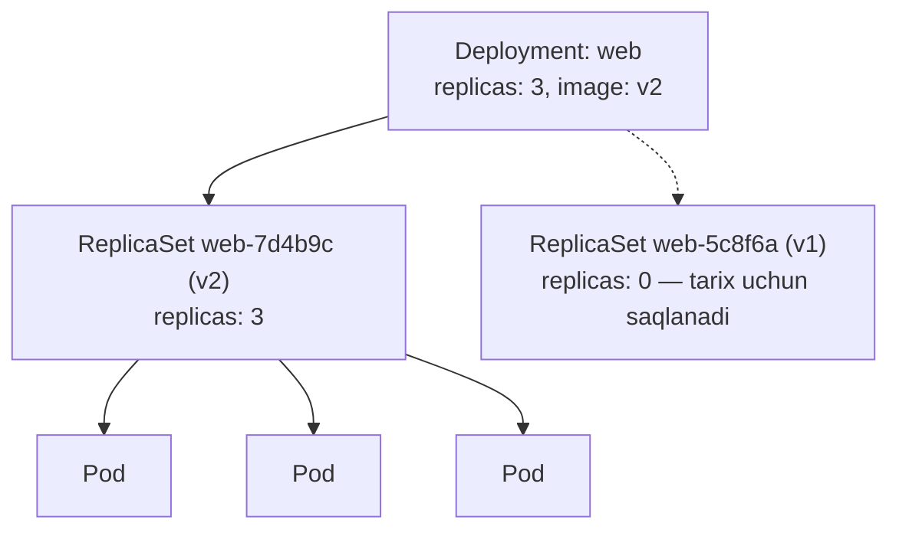
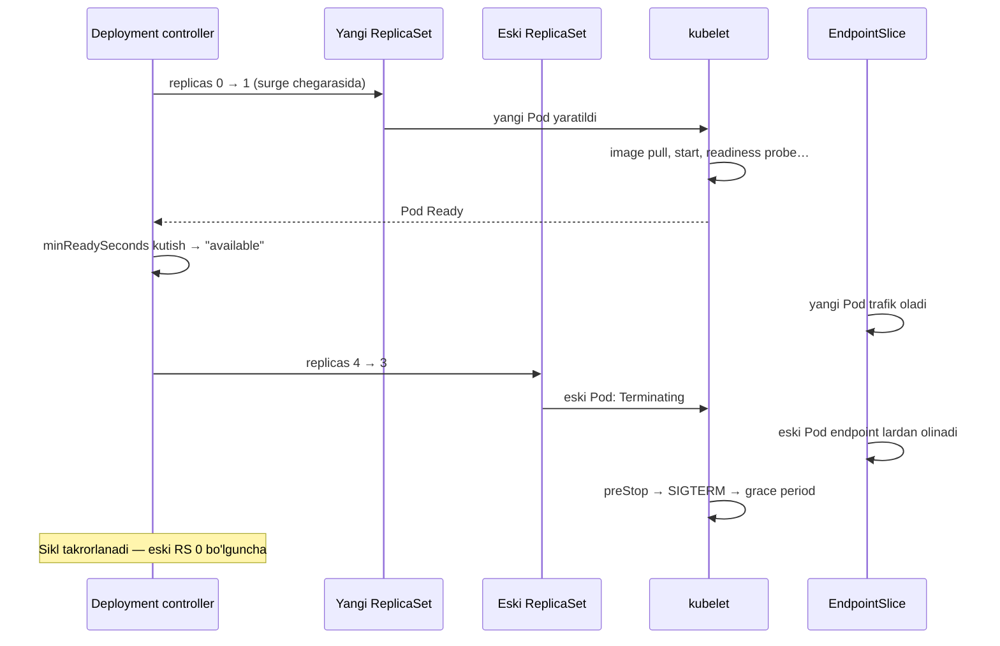
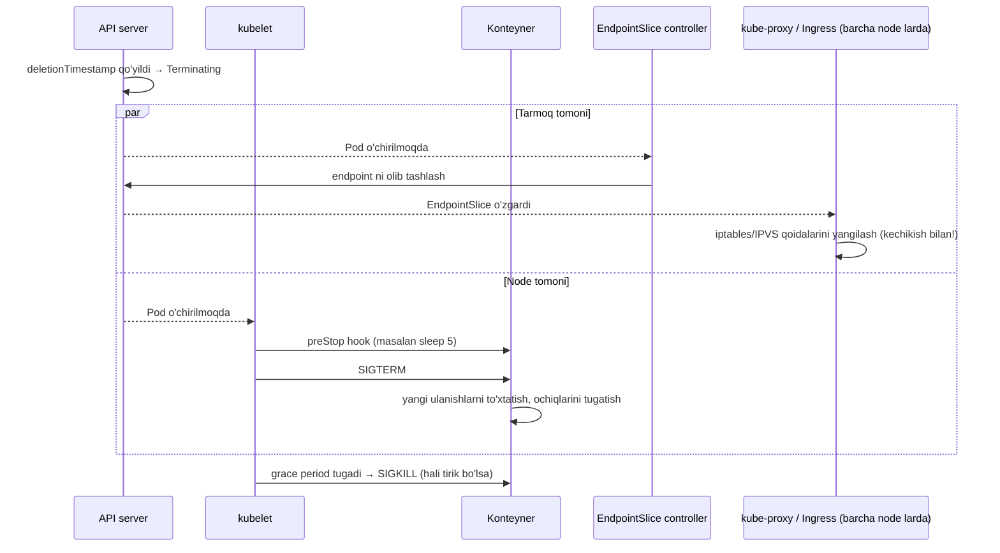
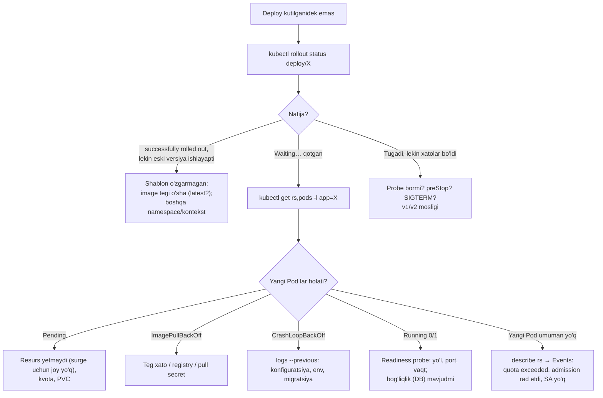

<!-- @section: why -->

## Muammo: yalang'och Pod — yetim Pod

Oldingi darsda Pod yaratdik va uni o'chirganimizda... u shunchaki yo'qoldi. Hech kim uni qayta yaratmadi. Production uchun bu qabul qilib bo'lmaydi:

- **Node o'ldi** — undagi Pod lar bilan birga xizmat ham o'ldi.
- **Yuklama oshdi** — 10 ta nusxa kerak. O'nta YAML faylmi?
- **Yangi versiya** — eski Pod larni o'chirib, yangilarini yaratish kerak. O'chirish va yaratish orasida xizmat ishlamaydi.
- **Yangi versiya buzuq chiqdi** — oldingisiga qanday qaytamiz? Qaysi image edi o'zi?

## Yechim: controller lar ierarxiyasi

Kubernetes da Pod larni odam emas, **controller** boshqaradi. Ikki qavatli tuzilma:

| Obyekt | Bitta vazifasi |
|---|---|
| **ReplicaSet** | "Shu shablondagi Pod lardan doim **N ta** bo'lsin" |
| **Deployment** | "ReplicaSet larni boshqarib, **versiyalar o'rtasida** xavfsiz o'tishni ta'minla" |



Siz faqat Deployment bilan ishlaysiz; ReplicaSet va Pod lar — uning ichki mexanikasi.

> **Analogiya.** ReplicaSet — navbatchi: "postda doim 3 kishi tursin" — biri ketsa, o'rniga yangisini qo'yadi. Deployment — smena boshlig'i: eski smenani yangisiga almashtirishda post bir daqiqa ham bo'sh qolmasligi uchun odamlarni birma-bir almashtiradi; yangi smena ishni eplay olmasa — eskisini qaytaradi.

## Rolling update: uzilishsiz yangilash g'oyasi

Hamma Pod ni birdan almashtirish o'rniga — **bosqichma-bosqich**: bitta yangi Pod yaratiladi → u **tayyor** (Ready) bo'lgach, bitta eski Pod o'chiriladi → va hokazo. Har lahzada yetarli sondagi Pod so'rovlarga xizmat qiladi.

Bu g'oya uchta narsaga tayanadi — ularning har biri bo'lmasa "uzilishsiz" degan so'z yolg'onga aylanadi:

1. **Readiness probe** — Kubernetes yangi Pod haqiqatan tayyor ekanini qayerdan biladi?
2. **Graceful shutdown** — eski Pod o'chayotganda ochiq so'rovlarni tugatadimi?
3. **Orqaga mos versiyalar** — yangilash davomida v1 va v2 **bir vaqtda** ishlaydi.

Bu dars — shu mexanizmning ichki tuzilishi va uni to'g'ri sozlash haqida.

<!-- @section: theory -->

## Label va selector: bog'lovchi yelim

Deployment, ReplicaSet va Pod bir-biriga nom bilan emas, **label lar** bilan bog'lanadi.

```yaml
spec:
  selector:
    matchLabels:
      app: web          # "mening Pod larim — shu label lilar"
  template:
    metadata:
      labels:
        app: web        # yaratiladigan Pod larga shu label qo'yiladi
```

Uchta qoida:

1. `selector` va `template.metadata.labels` **mos kelishi shart** — aks holda API manifestni rad etadi.
2. `selector` yaratilgandan keyin **o'zgartirib bo'lmaydi** (immutable).
3. Selector faqat **shu** ish yuklamasining Pod lariga mos kelishi kerak. Ikki Deployment ning selektori kesishsa — ular bir-birining Pod larini "o'g'irlab", cheksiz kurashadi.

Selector turlari:

| Tur | Misol | Ma'nosi |
|---|---|---|
| `matchLabels` | `app: web` | Aynan teng (bir nechtasi — VA) |
| `matchExpressions` | `{key: tier, operator: In, values: [front, api]}` | `In`, `NotIn`, `Exists`, `DoesNotExist` |

## ReplicaSet

ReplicaSet uchta narsadan iborat: **selector** (kimlarni sanash), **replicas** (nechta bo'lishi kerak), **template** (yetmasa — qanday yaratish).

Uning controller i juda sodda sikl: selector ga mos Pod larni sanaydi → kam bo'lsa shablondan yaratadi, ko'p bo'lsa o'chiradi.

Muhim nozik joy: ReplicaSet **shablonni mavjud Pod larga qo'llamaydi**. Shablonda image ni o'zgartirsangiz — ishlab turgan Pod lar o'zgarmaydi; faqat **kelajakda yaratiladigan** Pod lar yangi shablondan bo'ladi. Aynan shu sababli versiyalarni almashtirish uchun yuqoriroq obyekt — Deployment kerak.

ReplicaSet ni to'g'ridan-to'g'ri yaratmaysiz — uni Deployment boshqaradi.

## Deployment

Deployment — ReplicaSet lar ustidagi boshqaruvchi. U Pod shabloni o'zgarganda:

1. Yangi shablon uchun **yangi ReplicaSet** yaratadi.
2. Yangi RS ni bosqichma-bosqich **oshiradi**, eskisini **kamaytiradi**.
3. Eski RS ni `replicas: 0` holatida **saqlab qoladi** — rollback uchun.

**Rollout ni nima boshlaydi?** Faqat `spec.template` (Pod shabloni) ning o'zgarishi: image, env, resurslar, label lar, probe lar. `replicas` ni o'zgartirish — rollout **emas**, shunchaki masshtablash.

### Yangilash strategiyalari

| Strategiya | Qanday | Qachon |
|---|---|---|
| **RollingUpdate** (standart) | Bosqichma-bosqich almashtirish | Deyarli har doim |
| **Recreate** | Avval hamma eski Pod o'chiriladi, keyin yangilari yaratiladi — **uzilish bilan** | Ikki versiya bir vaqtda ishlay olmasa: bitta yozuvchi talab qiladigan disk (RWO), mos kelmaydigan sxema |

### maxSurge va maxUnavailable

Rolling update tezligi va xavfsizligini ikki parametr boshqaradi:

| Parametr | Ma'nosi | Standart |
|---|---|---|
| `maxSurge` | Yangilash paytida `replicas` dan **ortiqcha** nechta Pod bo'lishi mumkin | 25% |
| `maxUnavailable` | `replicas` dan nechta Pod **mavjud bo'lmasligi** mumkin | 25% |

Foizlar yaxlitlanishi **turli tomonga**: `maxSurge` — **yuqoriga**, `maxUnavailable` — **pastga**. (Ikkalasi bir vaqtda 0 bo'lishi mumkin emas — aks holda hech narsa qila olmaydi.)

`replicas: 10`, ikkalasi 25%:

- `maxSurge` = ceil(2.5) = **3** → jami eng ko'pi **13** Pod
- `maxUnavailable` = floor(2.5) = **2** → kamida **8** ta mavjud Pod

| Sozlama | Xulqi | Qachon |
|---|---|---|
| `maxSurge: 1`, `maxUnavailable: 0` | Avval yangisi ko'tariladi, keyin eskisi o'chadi; sig'im hech qachon kamaymaydi | Xavfsiz standart; qo'shimcha resurs kerak |
| `maxSurge: 0`, `maxUnavailable: 1` | Avval eskisi o'chadi, keyin yangisi; ortiqcha resurs kerak emas | Klaster to'la; nusxalar ko'p |
| `maxSurge: 100%`, `maxUnavailable: 0` | Barcha yangilari birdan, so'ng eskilari o'chadi (blue-green ga o'xshash) | Tez; resurs ikki baravar |
| `replicas: 1`, standart sozlama | surge=1, unavailable=**0** (floor(0.25)) → uzilishsiz | |

### "Mavjud" (available) nimani anglatadi

Pod **mavjud** hisoblanadi, agar u `Ready` bo'lsa va shu holatda kamida `minReadySeconds` (standart 0) turgan bo'lsa.

`Ready` esa: barcha konteynerlar ishga tushgan **va** readiness probe lar o'tgan. **Readiness probe bo'lmasa** — konteyner start bo'lgan zahoti Pod `Ready` hisoblanadi, garchi ilova hali 20 soniya yuklansa ham. Rolling update "ko'r" bo'lib qoladi: yangi Pod ni tayyor deb o'ylab, eskisini o'chiradi → foydalanuvchilar xato ko'radi.

**Xulosa: readiness probe siz rolling update uzilishsiz bo'lmaydi.**

### Revision va rollback

Har yangi Pod shabloni — yangi **revision** (raqam ReplicaSet annotatsiyasida saqlanadi). `revisionHistoryLimit` (standart 10) — nechta eski ReplicaSet saqlanishi.

**Rollback** — sehr emas: Deployment shablonini eski ReplicaSet shabloniga qaytaradi va odatdagi rolling update bajariladi (faqat teskari yo'nalishda). Eski RS nusxalari oshadi, yangisiniki kamayadi.

### Progress deadline

`progressDeadlineSeconds` (standart 600) — rollout shu vaqt ichida oldinga siljimasa, Deployment `Progressing=False, reason: ProgressDeadlineExceeded` holatini oladi. Muhim: Kubernetes **o'zi rollback qilmaydi** — faqat belgi qo'yadi. Lekin `maxUnavailable` tufayli eski Pod lar ham o'chirilmaydi: buzuq rollout "qotib" qoladi, xizmat eski versiyada ishlayveradi.

## Egalik: ownerReferences

Deployment → ReplicaSet → Pod zanjiri `metadata.ownerReferences` orqali yoziladi. Bu ikki narsa uchun kerak:

- **Garbage collection:** egasi o'chirilsa, unga tegishlilar ham o'chiriladi (kaskad).
- **Asrab olish (adoption):** controller selektoriga mos, lekin egasiz Pod ni topsa — uni o'ziga oladi (va ortiqcha bo'lsa — o'chiradi!).

## Pod ning ohista to'xtashi

Rolling update da eski Pod lar o'chiriladi. Ketma-ketlik:

1. Pod `Terminating` deb belgilanadi (`deletionTimestamp`).
2. **Parallel ravishda:** (a) Pod Service endpoint laridan olib tashlanadi; (b) kubelet `preStop` hook ni bajaradi, so'ng konteynerga **SIGTERM** yuboradi.
3. `terminationGracePeriodSeconds` (standart 30 s) kutiladi.
4. Hali tirik bo'lsa — **SIGKILL**.

2-qadamdagi parallellik — poyga holati: SIGTERM endpoint yangilanishidan tezroq yetib kelishi mumkin; ilova darhol yopilsa, hali unga yo'naltirilayotgan so'rovlar xato oladi. Standart davo — `preStop` da qisqa pauza.

## Atamalar lug'ati

| Atama | Ma'nosi | Misol |
|---|---|---|
| ReplicaSet | Pod nusxalari sonini ushlab turuvchi | `web-7d4b9c6f5` |
| Deployment | RS larni boshqarib, yangilashni ta'minlovchi | `kubectl get deploy` |
| pod-template-hash | Shablon hash i — RS va Pod larni versiya bo'yicha ajratuvchi label | `7d4b9c6f5` |
| rollout | Yangi versiyaga o'tish jarayoni | `kubectl rollout status` |
| revision | Shablon versiyasi raqami | `--to-revision=2` |
| maxSurge / maxUnavailable | Ortiqcha / yetishmaydigan Pod lar chegarasi | |
| available | Ready + minReadySeconds | |
| graceful shutdown | SIGTERM ni ushlab, ishni tugatib chiqish | |
| preStop | To'xtatishdan oldingi hook | `sleep 5` |

<!-- @section: internals -->

## pod-template-hash: versiyalarni ajratish

Deployment controller Pod shablonidan (`spec.template`) hash hisoblaydi. Bu hash:

- ReplicaSet **nomiga** qo'shiladi: `web-7d4b9c6f5`;
- RS ning selektoriga va u yaratadigan Pod larga `pod-template-hash=7d4b9c6f5` **label i** sifatida qo'shiladi.

```bash
kubectl get rs -l app=web --show-labels
# NAME             DESIRED   CURRENT   READY   LABELS
# web-5c8f6a7b9    0         0         0       app=web,pod-template-hash=5c8f6a7b9
# web-7d4b9c6f5    3         3         3       app=web,pod-template-hash=7d4b9c6f5
kubectl get pods -l app=web -L pod-template-hash
```

Shu label tufayli eski va yangi RS bir-birining Pod larini aralashtirmaydi — garchi ikkalasi ham `app=web` ga ega bo'lsa-da. Shablon aynan oldingi holatiga qaytarilsa — hash ham o'sha bo'ladi va **mavjud eski RS qayta ishlatiladi** (rollback aynan shunday ishlaydi).

## Rolling update algoritmi

Deployment controller ning har siklda qiladigan hisobi (`replicas=R`, `maxSurge=S`, `maxUnavailable=U`):

- **Yangi RS ni oshirish:** jami Pod lar soni `R + S` dan oshmasligi kerak → `yangi += (R + S) − jami`.
- **Eski RS ni kamaytirish:** mavjud Pod lar `R − U` dan kam bo'lmasligi kerak → `eski −= mavjud − (R − U)`.

`replicas: 4`, `maxSurge: 1`, `maxUnavailable: 1` uchun qadamma-qadam:

| Qadam | Eski RS | Yangi RS | Jami (≤ 5) | Mavjud (≥ 3) | Nima bo'ldi |
|---|---|---|---|---|---|
| 0 | 4 (4 tayyor) | 0 | 4 | 4 | Boshlanish |
| 1 | 3 | 1 (0 tayyor) | 4 → 5 | 3 | Surge: +1 yangi; unavailable: −1 eski |
| 1b | 3 | 2 (0 tayyor) | 5 | 3 | Bo'shagan o'ringa yana +1 yangi |
| 2 | 2 | 2 (**1 tayyor**) | 4 → 5 | 3 | Bitta yangi Ready → yana bitta eski o'chadi, +1 yangi |
| 3 | 1 | 3 (2 tayyor) | … | 3 | davom |
| … | 0 | 4 (4 tayyor) | 4 | 4 | Tugadi; eski RS `replicas: 0` |

Kalit nuqta: **eski Pod faqat yangi Pod `available` bo'lgandagina o'chiriladi.** Yangi Pod lar hech qachon Ready bo'lmasa (buzuq image, xato konfiguratsiya, o'tmaydigan probe) — rollout shu yerda **to'xtab qoladi**, eski Pod larning `R − U` tasi ishlayveradi. Bu — o'rnatilgan himoya mexanizmi.



Jarayonni jonli kuzatish:

```bash
kubectl set image deploy/web web=nginx:1.27.3-alpine
kubectl rollout status deploy/web
# Waiting for deployment "web" rollout to finish: 1 out of 4 new replicas have been updated...
# Waiting for deployment "web" rollout to finish: 2 old replicas are pending termination...
# deployment "web" successfully rolled out
kubectl get rs -l app=web -w          # ikki RS ning DESIRED/READY ustunlari qarama-qarshi o'zgaradi
```

## Deployment status ni o'qish

```bash
kubectl get deploy web
# NAME   READY   UP-TO-DATE   AVAILABLE   AGE
# web    3/4     2            3           10m
```

| Ustun | Ma'nosi |
|---|---|
| `READY 3/4` | Ready Pod lar / xohlangan |
| `UP-TO-DATE 2` | **Yangi** shablondagi Pod lar soni |
| `AVAILABLE 3` | Ready + `minReadySeconds` o'tgan |

`describe` dagi **Conditions**:

| Shart | Qiymat | Ma'nosi |
|---|---|---|
| `Available` | True | Kamida `R − U` Pod mavjud |
| `Progressing` | True, `NewReplicaSetAvailable` | Rollout tugagan |
| `Progressing` | True, `ReplicaSetUpdated` | Rollout davom etmoqda |
| `Progressing` | **False**, `ProgressDeadlineExceeded` | Rollout qotgan |

`kubectl rollout status` aynan shu shartlarga qaraydi va qotgan rollout da **nolga teng bo'lmagan kod** bilan chiqadi — CI pipeline da deploy muvaffaqiyatini shu bilan tekshirasiz.

## Egalik va asrab olish

```bash
kubectl get pod web-7d4b9c6f5-x2k9p -o jsonpath='{.metadata.ownerReferences}' | python3 -m json.tool
# [{ "apiVersion": "apps/v1", "kind": "ReplicaSet", "name": "web-7d4b9c6f5",
#    "uid": "…", "controller": true, "blockOwnerDeletion": true }]
```

- `kubectl delete deploy web` — standart **background** kaskad: Deployment o'chadi, garbage collector RS larni, ular bilan Pod larni o'chiradi.
- `--cascade=orphan` — Deployment o'chadi, RS va Pod lar **qoladi** (egasiz).
- Egasiz, lekin selektorga mos Pod ni ReplicaSet **asrab oladi**. Agar shu bilan Pod lar soni `replicas` dan oshsa — ortiqchasi o'chiriladi. Shuning uchun boshqa maqsaddagi Pod ga tasodifan `app=web` label ini qo'yish — uni yo'qotish demak.

Teskari hiyla — **karantin**: muammoli Pod ni tekshirish uchun trafikdan va controller dan ajratish:

```bash
kubectl label pod web-7d4b9c6f5-x2k9p app=web-debug --overwrite
# Pod endi selektorga mos emas: RS uni "unutadi" va o'rniga yangisini yaratadi;
# Service ham unga trafik yubormaydi. Pod esa tirik — bemalol tekshirasiz.
```

## Pod o'chirilishi: poyga holati



Ikki tarmoq bir-biridan mustaqil va **tartibi kafolatlanmagan**. kube-proxy barcha node larda qoidalarni yangilagunicha bir necha yuz millisekund — ba'zan soniyalar — o'tadi. Shu oraliqda eski Pod ga hali so'rovlar keladi. Agar ilova SIGTERM ni olgan zahoti tinglashni to'xtatsa → `connection refused` → foydalanuvchida 502.

**Davo:** `preStop: sleep 5` — konteyner SIGTERM ni olishidan oldin 5 soniya odatdagidek ishlaydi; bu vaqtda tarmoq qoidalari yangilanib ulguradi. So'ngra ilova SIGTERM da ochiq so'rovlarni tugatib chiqadi.

`terminationGracePeriodSeconds` **preStop vaqtini ham o'z ichiga oladi**: `preStop` 5 s + ilovaning eng uzun so'rovi < grace period bo'lishi kerak.

<!-- @section: commands -->

## Deployment manifesti — qator-qator

```yaml
apiVersion: apps/v1
kind: Deployment
metadata:
  name: web
  labels:
    app: web
spec:
  replicas: 4
  revisionHistoryLimit: 5
  minReadySeconds: 5
  progressDeadlineSeconds: 300
  selector:
    matchLabels:
      app: web
  strategy:
    type: RollingUpdate
    rollingUpdate:
      maxSurge: 1
      maxUnavailable: 0
  template:
    metadata:
      labels:
        app: web
    spec:
      terminationGracePeriodSeconds: 40
      containers:
        - name: web
          image: registry.example.uz/web:1.4.2
          ports:
            - name: http
              containerPort: 8000
          resources:
            requests: { cpu: 100m, memory: 128Mi }
            limits: { memory: 256Mi }
          readinessProbe:
            httpGet: { path: /readyz, port: http }
            periodSeconds: 5
            failureThreshold: 3
          lifecycle:
            preStop:
              exec:
                command: ["sleep", "5"]
```

| Maydon | Nima qiladi | O'chirilsa / xato bo'lsa |
|---|---|---|
| `apiVersion: apps/v1` | Deployment `apps` guruhida | `extensions/v1beta1`, `apps/v1beta1` — eski, 1.16 da olib tashlangan |
| `metadata.labels` | **Deployment ning o'ziga** label (qidirish uchun) — Pod larga ta'sir qilmaydi | Uchta joydagi label larni adashtirmang |
| `replicas: 4` | Xohlangan nusxalar | Ko'rsatilmasa 1. HPA ishlatilsa — manifestdan **olib tashlang** (aks holda har `apply` HPA qiymatini bosib ketadi) |
| `revisionHistoryLimit: 5` | Nechta eski RS saqlansin | `0` — rollback imkonsiz |
| `minReadySeconds: 5` | Ready bo'lgandan keyin yana 5 s barqaror tursagina "available" | 0 — bir lahzaga Ready bo'lib yiqiladigan Pod ham o'tib ketadi |
| `progressDeadlineSeconds: 300` | 5 daqiqada siljimasa — "qotgan" deb belgilash | Standart 600 |
| `selector.matchLabels` | Qaysi Pod lar meniki. **O'zgarmas** | `template` label lariga mos kelmasa — API rad etadi |
| `strategy.rollingUpdate` | `maxSurge: 1, maxUnavailable: 0` — sig'im hech qachon kamaymaydi | Standart 25%/25% |
| `template.metadata.labels` | Pod larga qo'yiladigan label lar | Selector ga mos bo'lishi shart |
| `terminationGracePeriodSeconds: 40` | SIGTERM (va preStop) uchun jami vaqt | Standart 30 |
| `image: …:1.4.2` | Aniq teg | Teg o'zgarmasa (`latest`) — shablon o'zgarmaydi → **rollout boshlanmaydi** |
| `readinessProbe` | Tayyorlik mezoni — rolling update ning "ko'zi" | Yo'q bo'lsa — yangilashda xatolar |
| `preStop: sleep 5` | Endpoint yangilanishi uchun vaqt | Yo'q bo'lsa — to'xtash paytida qisqa 502 lar. (1.30+ da: `preStop: { sleep: { seconds: 5 } }` — image da `sleep` bo'lishi shart emas) |

## Rollout boshqaruvi

```bash
kubectl rollout status deployment/web --timeout=5m
```

```tahlil
{"command":"kubectl rollout status deployment/web --timeout=5m","parts":[{"t":"kubectl rollout","d":"Rollout ni boshqarish buyruqlari guruhi: status, history, undo, pause, resume, restart"},{"t":"status","d":"Rollout tugaguncha kutadi va jarayonni ko'rsatadi. Muvaffaqiyatda 0, qotgan/muddat o'tgan bo'lsa nolga teng bo'lmagan kod — CI da deploy natijasini tekshirish uchun"},{"t":"deployment/web","d":"Resurs turi/nomi. DaemonSet va StatefulSet uchun ham ishlaydi"},{"t":"--timeout=5m","d":"Shuncha kutib, tugamasa xato bilan chiqadi. Busiz cheksiz (progressDeadline gacha) kutadi"}]}
```

| Buyruq | Vazifasi |
|---|---|
| `kubectl set image deploy/web web=reg/web:1.4.3` | Image ni almashtirish (`KONTEYNER=IMAGE`) → rollout |
| `kubectl rollout history deploy/web` | Revision lar ro'yxati |
| `kubectl rollout history deploy/web --revision=3` | Shu revision ning shabloni |
| `kubectl rollout undo deploy/web` | Oldingi revision ga qaytish |
| `kubectl rollout undo deploy/web --to-revision=2` | Aniq revision ga |
| `kubectl rollout pause deploy/web` | To'xtatib turish (bir necha o'zgarishni bitta rollout ga yig'ish; canary) |
| `kubectl rollout resume deploy/web` | Davom ettirish |
| `kubectl rollout restart deploy/web` | Shablonni o'zgartirmasdan barcha Pod larni rolling tarzda qayta yaratish (ConfigMap/Secret yangilanganda) |
| `kubectl scale deploy/web --replicas=6` | Masshtablash (rollout emas) |

`rollout history` dagi `CHANGE-CAUSE` ustunini to'ldirish:

```bash
kubectl annotate deploy/web kubernetes.io/change-cause="1.4.3: to'lov xatosi tuzatildi" --overwrite
```

> ⚠️ **Ehtiyot bo'l: `kubectl rollout undo` va GitOps.** `undo` klasterdagi holatni o'zgartiradi, lekin Git dagi manifest eski (buzuq) versiyada qoladi — keyingi `apply` yoki ArgoCD sync uni yana "tuzatib" qo'yadi. To'g'ri rollback: Git da `revert` → pipeline. `undo` — faqat favqulodda birinchi yordam.

`rollout restart` ichida nima bo'ladi: Pod shabloniga `kubectl.kubernetes.io/restartedAt: <vaqt>` annotatsiyasi qo'shiladi → shablon o'zgardi → hash o'zgardi → yangi RS → oddiy rolling update.

## Kuzatish

```bash
kubectl get deploy,rs,pods -l app=web
kubectl describe deploy web | sed -n '/Conditions/,/Events/p'
kubectl get pods -l app=web -L pod-template-hash -o wide
kubectl get rs -l app=web -o custom-columns=NOM:.metadata.name,REV:.metadata.annotations.deployment\\.kubernetes\\.io/revision,KERAK:.spec.replicas,TAYYOR:.status.readyReplicas
```

## Yangilashdan oldin

```bash
kubectl diff -f deployment.yaml                    # klasterda nima o'zgaradi
kubectl apply -f deployment.yaml --dry-run=server  # admission dan o'tadimi
kubectl apply -f deployment.yaml && kubectl rollout status deploy/web --timeout=5m \
  || { kubectl rollout undo deploy/web; exit 1; }  # CI da: qotsa — qaytarish
```

<!-- @section: lab -->

## Lab 1. Rolling update ni kuzatish

**Maqsad:** Deployment → ReplicaSet → Pod zanjirini va yangilanish jarayonini ko'rish.

**Muhit:** `kind` yoki `minikube` klasteri.

**Qadamlar:**

1. Deployment yarating: 4 nusxa, `nginx:1.27.1-alpine`, readiness probe (`httpGet /`, port 80), `maxSurge: 1`, `maxUnavailable: 0`.
2. Uchta terminal oching: `kubectl get rs -l app=web -w`, `kubectl get pods -l app=web -w`, va buyruqlar uchun.
3. Image ni `1.27.2-alpine` ga o'zgartiring. ReplicaSet lar soni qanday o'zgardi? Pod lar soni hech qachon 5 dan oshdimi, tayyorlari 4 dan kamaydimi?
4. `kubectl rollout history` — nechta revision?
5. Rollback qiling. Yangi ReplicaSet yaratildimi yoki eskisi qayta ishlatildimi?
6. `replicas` ni 6 ga o'zgartiring. Yangi revision paydo bo'ldimi?

**Tekshirish:**

```bash
kubectl get rs -l app=web        # 2 ta RS: biri 4 (yoki 6), biri 0
kubectl rollout history deploy/web
```

<details><summary>💡 Yechimni ko'rsatish</summary>

```yaml
apiVersion: apps/v1
kind: Deployment
metadata: { name: web }
spec:
  replicas: 4
  selector: { matchLabels: { app: web } }
  strategy: { rollingUpdate: { maxSurge: 1, maxUnavailable: 0 } }
  template:
    metadata: { labels: { app: web } }
    spec:
      containers:
        - name: web
          image: nginx:1.27.1-alpine
          ports: [{ containerPort: 80 }]
          readinessProbe: { httpGet: { path: /, port: 80 }, periodSeconds: 2 }
```

```bash
kubectl apply -f deploy.yaml
kubectl set image deploy/web web=nginx:1.27.2-alpine
kubectl rollout status deploy/web
kubectl rollout undo deploy/web
kubectl get rs -l app=web        # birinchi RS yana 4 — qayta ishlatildi; revision raqami esa oshdi (3)
kubectl scale deploy/web --replicas=6
kubectl rollout history deploy/web   # o'zgarmadi: masshtablash — rollout emas
```

</details>

## Lab 2. Buzuq rollout va himoya mexanizmi

**Maqsad:** rollout qanday "qotishini" va xizmat nega to'xtamasligini ko'rish.

**Qadamlar:**

1. Lab 1 dagi Deployment da image ni mavjud bo'lmagan tegga o'zgartiring: `nginx:9.99-yoq`.
2. `kubectl rollout status deploy/web --timeout=60s` — nima bo'ldi? Exit kod?
3. `kubectl get pods -l app=web` — nechta eski Pod ishlamoqda? Nechta yangi, qaysi holatda?
4. `kubectl describe deploy web` da Conditions ni toping.
5. Tuzating — ikki usulda: `undo` bilan va to'g'ri image ni qo'yib.

<details><summary>💡 Yechimni ko'rsatish</summary>

```bash
kubectl set image deploy/web web=nginx:9.99-yoq
kubectl rollout status deploy/web --timeout=60s ; echo "exit=$?"
# error: timed out waiting for the condition      exit=1
kubectl get pods -l app=web
# 4 ta eski — Running 1/1;  1 ta yangi — ImagePullBackOff
```

`maxUnavailable: 0` bo'lgani uchun eski Pod larning birortasi ham o'chirilmagan; `maxSurge: 1` — faqat bitta yangi Pod yaratilgan. Xizmat to'liq sig'imda ishlamoqda. `progressDeadlineSeconds` dan keyin: `Progressing False ProgressDeadlineExceeded`.

```bash
kubectl rollout undo deploy/web          # yoki: kubectl set image deploy/web web=nginx:1.27.2-alpine
```

</details>

## Lab 3. Readiness probe ning ahamiyati

**Maqsad:** probe siz rolling update foydalanuvchiga xato ko'rsatishini o'lchash.

**Qadamlar:**

1. Sekin ishga tushadigan ilovani taqlid qiling: konteyner `command` i avval 15 soniya kutsin, keyin serverni boshlasin:

   ```yaml
   command: ["sh", "-c", "sleep 15; nginx -g 'daemon off;'"]
   ```

2. Deployment (3 nusxa, **probe siz**) va ClusterIP Service yarating.
3. Klaster ichidan to'xtovsiz so'rov yuboring va xatolarni sanang:

   ```bash
   kubectl run yuk --rm -it --image=busybox:1.36 --restart=Never -- sh -c \
     'ok=0; err=0; while true; do wget -q -T 1 -O /dev/null http://web && ok=$((ok+1)) || err=$((err+1)); echo "ok=$ok err=$err"; sleep 0.2; done'
   ```

4. Rolling update boshlang (`kubectl rollout restart deploy/web`). `err` o'sdimi?
5. Readiness probe qo'shing va tajribani takrorlang.

<details><summary>💡 Yechimni ko'rsatish</summary>

Probe siz: yangi Pod konteyneri start bo'lishi bilan `Ready` → Service unga trafik yuboradi → 15 soniya davomida `connection refused` → shu orada eski Pod lar o'chirilgan → xatolar ko'p.

Probe bilan:

```yaml
readinessProbe:
  httpGet: { path: /, port: 80 }
  periodSeconds: 2
```

Yangi Pod 15 soniya `0/1` da turadi, trafik olmaydi, eski Pod ham o'chirilmaydi → `err` deyarli o'smaydi. (Qolgan yakka xatolar — to'xtash paytidagi poyga; ularni `preStop: sleep` yo'qotadi.)

</details>

## Qo'shimcha chaqiriq

"Qo'lbola canary": `web` Deployment ni 9 nusxada v1 bilan qoldiring; aynan o'sha `app=web` label li, lekin qo'shimcha `track=canary` label va v2 image li ikkinchi Deployment ni 1 nusxada yarating. Service selektori faqat `app=web` bo'lsin. So'rovlarning taxminan necha foizi v2 ga tushadi? Ikki Deployment selektorlari kesishmasligi uchun nimaga e'tibor berish kerak?

<!-- @section: breakfix -->

## 1. Manifest rad etildi

```text
The Deployment "api" is invalid: spec.template.metadata.labels: Invalid value:
map[string]string{"app":"api-server"}: `selector` does not match template `labels`
```

```breakfix
{"title":"Selector va label","lang":"yaml","broken":"apiVersion: apps/v1\nkind: Deployment\nmetadata:\n  name: api\n  labels:\n    app: api\nspec:\n  replicas: 2\n  selector:\n    matchLabels:\n      app: api\n  template:\n    metadata:\n      labels:\n        app: api-server\n    spec:\n      containers:\n        - name: api\n          image: registry.example.uz/api:2.1.0","hints":["Manifestda label lar UCH joyda bor: Deployment ning o'zida, selector da va Pod shablonida. Qaysi ikkitasi mos kelishi shart?","Deployment o'z Pod larini selector orqali topadi; u yaratadigan Pod lar esa template dagi label larni oladi.","template.metadata.labels dagi app qiymatini selector bilan bir xil qiling."],"solution":"apiVersion: apps/v1\nkind: Deployment\nmetadata:\n  name: api\n  labels:\n    app: api\nspec:\n  replicas: 2\n  selector:\n    matchLabels:\n      app: api\n  template:\n    metadata:\n      labels:\n        app: api\n    spec:\n      containers:\n        - name: api\n          image: registry.example.uz/api:2.1.0","explain":"selector.matchLabels va template.metadata.labels mos kelmasa, Deployment yaratgan Pod larini o'zi 'tanimaydi' va cheksiz yangi Pod yaratardi — shuning uchun API buni oldindan rad etadi. metadata.labels (eng yuqoridagi) esa faqat Deployment obyektining o'ziga tegishli."}
```

## 2. Rollout 10 daqiqadan beri qotib turibdi

```text
$ kubectl rollout status deploy/web
Waiting for deployment "web" rollout to finish: 1 out of 3 new replicas have been updated...
$ kubectl get pods -l app=web
web-5c8f6a7b9-aaaaa   1/1   Running   0   2d
web-5c8f6a7b9-bbbbb   1/1   Running   0   2d
web-5c8f6a7b9-ccccc   1/1   Running   0   2d
web-7d4b9c6f5-zzzzz   0/1   Running   0   10m
$ kubectl describe pod web-7d4b9c6f5-zzzzz | tail -2
  Warning  Unhealthy  kubelet  Readiness probe failed: Get "http://10.244.1.9:80/healthz":
           dial tcp 10.244.1.9:80: connect: connection refused
```

Yangi versiyada ilova porti 8000 ga o'zgartirilgan.

```breakfix
{"title":"Yangi Pod Ready bo'lmayapti","lang":"yaml","broken":"apiVersion: apps/v1\nkind: Deployment\nmetadata:\n  name: web\nspec:\n  replicas: 3\n  selector:\n    matchLabels:\n      app: web\n  template:\n    metadata:\n      labels:\n        app: web\n    spec:\n      containers:\n        - name: web\n          image: registry.example.uz/web:2.0.0\n          ports:\n            - containerPort: 8000\n          readinessProbe:\n            httpGet:\n              path: /healthz\n              port: 80\n            periodSeconds: 5","hints":["Pod Running, lekin 0/1 — konteyner tirik, readiness o'tmayapti. Events da aniq manzil yozilgan.","Probe 80-portga murojaat qilmoqda: 'connection refused' — u portda hech kim tinglamayapti.","Ilova endi 8000 da. Probe portini moslang — yaxshisi portga nom berib, probe da nom ishlating."],"solution":"apiVersion: apps/v1\nkind: Deployment\nmetadata:\n  name: web\nspec:\n  replicas: 3\n  selector:\n    matchLabels:\n      app: web\n  template:\n    metadata:\n      labels:\n        app: web\n    spec:\n      containers:\n        - name: web\n          image: registry.example.uz/web:2.0.0\n          ports:\n            - name: http\n              containerPort: 8000\n          readinessProbe:\n            httpGet:\n              path: /healthz\n              port: http\n            periodSeconds: 5","explain":"Yangi Pod hech qachon Ready bo'lmaydi → 'available' emas → Deployment eski Pod larni o'chirmaydi → rollout qotadi. Bu yaxshi xabar: xizmat eski versiyada ishlayapti — himoya mexanizmi ishladi. Portga nom berish (name: http) va probe/Service da shu nomni ishlatish — port raqami o'zgarganda bitta joyni tuzatish kifoya."}
```

## 3. Deploy paytida qisqa 502 lar

Har deploy da monitoring bir necha soniya davomida 502 xatolarini ko'rsatadi. Readiness probe bor va to'g'ri ishlaydi. Xatolar aynan **eski** Pod lar o'chirilayotgan paytga to'g'ri keladi.

```breakfix
{"title":"To'xtash paytidagi poyga","lang":"yaml","broken":"apiVersion: apps/v1\nkind: Deployment\nmetadata:\n  name: web\nspec:\n  replicas: 3\n  selector:\n    matchLabels:\n      app: web\n  template:\n    metadata:\n      labels:\n        app: web\n    spec:\n      terminationGracePeriodSeconds: 30\n      containers:\n        - name: web\n          image: registry.example.uz/web:2.0.1\n          ports:\n            - name: http\n              containerPort: 8000\n          readinessProbe:\n            httpGet:\n              path: /healthz\n              port: http","hints":["Pod Terminating bo'lganda ikki narsa PARALLEL sodir bo'ladi: endpoint lardan olib tashlash va SIGTERM yuborish.","kube-proxy va ingress barcha node larda qoidalarni yangilagunicha, eski Pod ga hali so'rovlar keladi — u esa SIGTERM olib, allaqachon yopilgan.","SIGTERM ni kechiktiring: lifecycle.preStop da bir necha soniya sleep."],"solution":"apiVersion: apps/v1\nkind: Deployment\nmetadata:\n  name: web\nspec:\n  replicas: 3\n  selector:\n    matchLabels:\n      app: web\n  template:\n    metadata:\n      labels:\n        app: web\n    spec:\n      terminationGracePeriodSeconds: 40\n      containers:\n        - name: web\n          image: registry.example.uz/web:2.0.1\n          ports:\n            - name: http\n              containerPort: 8000\n          readinessProbe:\n            httpGet:\n              path: /healthz\n              port: http\n          lifecycle:\n            preStop:\n              exec:\n                command: [\"sleep\", \"5\"]","explain":"Endpoint ni olib tashlash va SIGTERM — mustaqil, parallel jarayonlar. preStop: sleep 5 konteynerni yana 5 soniya odatdagidek ishlatadi — bu vaqtda tarmoq qoidalari yangilanib ulguradi; shundan keyin SIGTERM keladi va ilova ochiq so'rovlarni tugatib chiqadi. Grace period ni preStop vaqtiga oshirish kerak. Ilova SIGTERM ni ushlab, ohista to'xtashi ham shart."}
```

<!-- @section: errors -->

## Metodika: rollout muammosi



Unutmang: **yangi Pod yaratilmasa — sabab ReplicaSet ning Events ida**, Pod da emas (Pod yo'q-ku).

## Xatolar jadvali

| Xato xabari / simptom | Sabab | Qanday tekshiriladi | Yechim |
|---|---|---|---|
| `selector does not match template labels` | Selector ≠ Pod label lari | Manifest | Mos qilish |
| `field is immutable` (`spec.selector`) | Selector ni o'zgartirishga urinish | — | Deployment ni o'chirib qayta yaratish (yoki yangi nom) |
| `apply` — `unchanged`, Pod lar yangilanmadi | Shablon o'zgarmagan (teg bir xil) | `kubectl get deploy -o jsonpath='{..image}'` | Yangi teg; `rollout restart` |
| `Waiting for rollout to finish: N old replicas are pending termination` | Eski Pod lar sekin to'xtamoqda (SIGTERM ushlanmayapti) | `kubectl get pods` → `Terminating` | Signal ishlovchisi; grace period |
| `ProgressDeadlineExceeded` | Yangi Pod lar muddat ichida available bo'lmadi | `describe deploy` → Conditions; yangi Pod holati | Sababni tuzatish yoki `undo` |
| Yangi Pod `Pending`: `Insufficient cpu` | Surge Pod uchun bo'sh joy yo'q | `describe pod` | `maxSurge: 0, maxUnavailable: 1`; node qo'shish |
| RS da: `exceeded quota` | Namespace ResourceQuota — surge sig'maydi | `kubectl describe rs`; `kubectl describe quota` | Kvota / strategiya |
| RS da: `forbidden: violates PodSecurity` | Pod Security Admission rad etdi | `kubectl describe rs` | `securityContext` ni to'g'rilash |
| `Multi-Attach error for volume` | RWO volume: yangi Pod boshqa node da, eski hali ushlab turibdi | `describe pod` | `strategy: Recreate` yoki StatefulSet |
| Deploy da qisqa 502/`connection refused` | Probe yo'q; yoki to'xtashdagi poyga | Xatolar vaqtini Pod hodisalari bilan solishtirish | Readiness probe; `preStop sleep`; SIGTERM |
| `rollout undo`: `no rollout history found` | `revisionHistoryLimit: 0` yoki birinchi revision | `rollout history` | Limitni oshirish |
| `undo` dan keyin yana buzuq versiya qaytdi | GitOps/CI Git dagi holatni qayta qo'lladi | ArgoCD/pipeline tarixi | Git da `revert` |
| `kubectl scale` dan keyin nusxalar eski songa qaytdi | HPA boshqarmoqda; yoki `apply` manifestdagi `replicas` ni qaytardi | `kubectl get hpa` | HPA da min/max; manifestdan `replicas` ni olish |
| Pod lar to'xtovsiz yaratilib-o'chirilmoqda | Ikki controller selektori kesishgan | `kubectl get deploy,rs -o wide` — SELECTOR ustuni | Noyob label lar |
| Qo'lda yaratilgan Pod yo'qoldi | Label i RS selektoriga mos kelib, "ortiqcha" deb o'chirildi | `kubectl get events` | Boshqa label |
| ConfigMap o'zgardi, ilova eski qiymatda | Env o'zgaruvchilar faqat Pod yaratilganda o'qiladi | `kubectl exec … env` | `rollout restart`; shablonda checksum annotatsiya |
| Rollout juda sekin | `maxSurge/Unavailable` kichik; `minReadySeconds` katta; image katta | `get rs -w` | Parametrlarni oshirish; image ni kichraytirish |

## Debug uchun asosiy buyruqlar

```bash
kubectl rollout status deploy/X --timeout=2m; echo "exit=$?"
kubectl get deploy,rs,pods -l app=X -o wide
kubectl describe deploy X | sed -n '/Conditions/,$p'
kubectl describe rs -l app=X | grep -A10 Events
kubectl rollout history deploy/X
kubectl get pods -l app=X -L pod-template-hash
kubectl get events --sort-by=.lastTimestamp | grep -i -E "X|replicaset" | tail -20
kubectl get deploy X -o jsonpath='{.spec.template.spec.containers[*].image}{"\n"}'
kubectl logs deploy/X --previous --tail=30       # deploy/ — Pod lardan birini tanlaydi
```

<!-- @section: production -->

## Uzilishsiz deploy: to'liq retsept

"Zero-downtime" bitta sozlama emas — beshta shartning yig'indisi:

| # | Shart | Qanday |
|---|---|---|
| 1 | Kamida 2 nusxa | `replicas: 2+` (yaxshisi 3) |
| 2 | Tayyorlikni aniq bilish | `readinessProbe` — haqiqatan so'rov qabul qila olishini tekshiradi |
| 3 | Sig'im kamaymasin | `maxUnavailable: 0`, `maxSurge: 1` (yoki 25%) |
| 4 | Ohista to'xtash | Ilova SIGTERM ni ushlaydi + `preStop: sleep 5` + yetarli `terminationGracePeriodSeconds` |
| 5 | Versiyalar mosligi | v1 va v2 bir vaqtda ishlay oladi: API orqaga mos, DB migratsiyalari "expand → migrate → contract" |

Beshinchi shart eng ko'p unutiladi: rolling update paytida so'rovlarning bir qismi eski, bir qismi yangi kodga tushadi; ikkalasi ham **bitta** bazaga yozadi. Ustunni o'chiradigan migratsiya eski kodni sindiradi.

## Ishonchlilik

**Nusxalarni tarqating.** 3 nusxa bitta node da bo'lsa — bu bitta nusxa:

```yaml
topologySpreadConstraints:
  - maxSkew: 1
    topologyKey: kubernetes.io/hostname
    whenUnsatisfiable: ScheduleAnyway
    labelSelector:
      matchLabels: { app: web }
```

**PodDisruptionBudget** — node larga xizmat ko'rsatish (drain) paytida himoya:

```yaml
apiVersion: policy/v1
kind: PodDisruptionBudget
metadata: { name: web }
spec:
  minAvailable: 2
  selector:
    matchLabels: { app: web }
```

**Probe larni to'g'ri ajrating:**

| Probe | Savol | Muvaffaqiyatsiz bo'lsa |
|---|---|---|
| `startupProbe` | Ishga tushib bo'ldimi? | Kutadi (boshqa probe lar o'chiq); muddat tugasa — restart |
| `readinessProbe` | Hozir trafik qabul qila oladimi? | Endpoint lardan chiqariladi — **restart yo'q** |
| `livenessProbe` | Tirikmi yoki osilib qolganmi? | Konteyner **qayta ishga tushiriladi** |

Liveness da tashqi bog'liqlikni (bazani) tekshirmang: baza qisqa uzilsa — barcha Pod lar bir vaqtda restart bo'ladi va vaziyat yomonlashadi.

## Xavfsizlik va boshqaruv

- **Image tegi — o'zgarmas.** Har build — yangi teg (git SHA yoki semver). `latest` bilan: rollout boshlanmaydi, rollback imkonsiz, node larda turli versiyalar.
- **Manifestlar Git da; deploy — pipeline orqali.** `kubectl set image` va `edit` — drift manbai.
- `replicas` ni HPA boshqarsa — manifestda yozmang.
- `revisionHistoryLimit` — 3–10: rollback uchun yetarli, axlat ko'p emas.
- CI da: `kubectl rollout status --timeout` — deploy natijasini **kutish**; muvaffaqiyatsiz bo'lsa pipeline qizarsin.

## Ilg'or strategiyalar

Deployment faqat `RollingUpdate` va `Recreate` ni biladi. Qolganlari — andozalar:

| Strategiya | G'oya | Qanday amalga oshiriladi |
|---|---|---|
| **Blue-green** | Yangi versiya to'liq yonma-yon ko'tariladi; trafik bir zarbda o'tkaziladi | Ikki Deployment + Service selektorini almashtirish; yoki Argo Rollouts |
| **Canary** | Trafikning kichik ulushi (1–5%) yangi versiyaga; metrikalar yaxshi bo'lsa — kengaytirish | Ingress/mesh vazn bilan; Argo Rollouts, Flagger |
| **`rollout pause`** | Birinchi yangi Pod lardan keyin to'xtab, kuzatish | `kubectl rollout pause/resume` |

## Kuzatuv

| Metrika (kube-state-metrics) | Alert |
|---|---|
| `kube_deployment_status_replicas_available < kube_deployment_spec_replicas` (10+ daqiqa) | Nusxalar yetishmayapti |
| `kube_deployment_status_condition{condition="Progressing",status="false"}` | Rollout qotgan |
| `kube_deployment_status_observed_generation != kube_deployment_metadata_generation` | Controller o'zgarishni ko'rmayapti |
| `rate(kube_pod_container_status_restarts_total[15m]) > 0` | Restart lar |
| Deploy vaqtida HTTP 5xx ulushi | Uzilishsiz emas |

Deploy larni Grafana da annotatsiya sifatida belgilang — metrikalardagi o'zgarishni versiya bilan bog'lash uchun.

## Production ga chiqishdan oldingi tekshiruv ro'yxati

- [ ] `replicas ≥ 2`, nusxalar turli node larda (spread/anti-affinity)
- [ ] `readinessProbe` bor va haqiqiy tayyorlikni tekshiradi
- [ ] `maxUnavailable: 0` (yoki ongli tanlangan qiymat)
- [ ] Ilova SIGTERM ni ushlaydi; `preStop` pauzasi; grace period yetarli
- [ ] Image tegi noyob va o'zgarmas
- [ ] `resources.requests/limits` belgilangan
- [ ] PodDisruptionBudget bor
- [ ] CI `kubectl rollout status --timeout` ni kutadi
- [ ] Rollback yo'li aniq (Git revert) va sinalgan
- [ ] DB migratsiyalari orqaga mos
- [ ] Deploy paytida xato ulushi o'lchanadi

## Anti-pattern lar

| Anti-pattern | Nima uchun yomon | To'g'risi |
|---|---|---|
| `replicas: 1` production da | Har node nosozligi/drain — uzilish | 2+ va PDB |
| Readiness probe yo'q | Rolling update "ko'r" | Probe |
| Liveness = readiness (bir xil endpoint, agressiv) | Yuklama ostida restart sikli | Alohida, liveness yumshoq |
| `image: app:latest` + `imagePullPolicy: Always` | Deploy boshlanmaydi; versiya noma'lum | Noyob teg |
| `strategy: Recreate` sababsiz | Har deploy — uzilish | RollingUpdate |
| `kubectl delete pod` bilan "qayta ishga tushirish" | PDB va surge hisobga olinmaydi | `rollout restart` |
| ReplicaSet ni to'g'ridan-to'g'ri yaratish | Yangilash mexanizmi yo'q | Deployment |
| Deployment bilan baza ishlatish | Barqaror nom va shaxsiy disk yo'q | StatefulSet / operator |
| `maxUnavailable: 100%` | Bir zarbda hammasi o'chadi | Ongli kichik qiymat |

<!-- @section: interview -->

### 1. Deployment va ReplicaSet farqi nima?

🟢 Junior

**Namunaviy javob.** ReplicaSet bitta ishni qiladi: selektoriga mos Pod lardan belgilangan sondagisi doim ishlab turishini ta'minlaydi — kam bo'lsa shablondan yaratadi, ko'p bo'lsa o'chiradi. Lekin u shablon o'zgarishini mavjud Pod larga qo'llamaydi. Deployment — undan yuqori daraja: Pod shabloni o'zgarganda yangi ReplicaSet yaratadi va eski hamda yangi RS larning nusxalar sonini bosqichma-bosqich o'zgartirib, versiyalar o'rtasida nazoratli o'tishni ta'minlaydi; eski RS larni tarix sifatida saqlab, rollback imkonini beradi. Amalda ReplicaSet ni qo'lda yaratmaymiz — faqat Deployment bilan ishlaymiz.

### 2. Rolling update qanday ishlaydi?

🟡 Middle

**Namunaviy javob.** Pod shabloni o'zgarganda Deployment controller shablon hash i bilan yangi ReplicaSet yaratadi. So'ng siklda: jami Pod lar `replicas + maxSurge` dan oshmaydigan qilib yangi RS ni oshiradi; mavjud Pod lar `replicas − maxUnavailable` dan kam bo'lmaydigan qilib eski RS ni kamaytiradi. Eski Pod faqat yangi Pod "available" — ya'ni Ready va `minReadySeconds` davomida barqaror — bo'lgandagina o'chiriladi. Shuning uchun readiness probe hal qiluvchi: usiz Pod darhol Ready hisoblanadi. Yangi Pod lar tayyor bo'lmasa, rollout to'xtab qoladi va `progressDeadlineSeconds` dan keyin `ProgressDeadlineExceeded` sharti qo'yiladi — eski Pod lar ishlashda davom etadi; avtomatik rollback yo'q.

**Qo'shimcha savol:** Uzilishsiz bo'lishi uchun yana nima kerak? (Graceful shutdown, preStop, versiyalar mosligi.)

### 3. `replicas: 10`, `maxSurge: 25%`, `maxUnavailable: 25%`. Eng ko'p va eng kam Pod soni?

🟡 Middle

**Namunaviy javob.** `maxSurge` yuqoriga yaxlitlanadi: ceil(2.5) = 3 → jami eng ko'pi 13 Pod. `maxUnavailable` pastga yaxlitlanadi: floor(2.5) = 2 → kamida 8 ta mavjud Pod. Yaxlitlash yo'nalishlari ataylab shunday: ikkalasi ham "xavfsiz tomon"ga — ko'proq qo'shimcha sig'im, kamroq yo'qotish. `replicas: 1` da standart sozlama bilan surge = 1, unavailable = 0 — ya'ni bitta nusxali Deployment ham avval yangisini ko'tarib, keyin eskisini o'chiradi.

### 4. Rollback ichida nima sodir bo'ladi?

🟡 Middle

**Namunaviy javob.** `kubectl rollout undo` Deployment ning Pod shablonini ko'rsatilgan (yoki oldingi) revision ga tegishli ReplicaSet shabloni bilan almashtiradi. Shablon hash i o'sha eski RS nikiga teng bo'lgani uchun yangi RS yaratilmaydi — mavjud eski RS qayta ishlatiladi va odatdagi rolling update bajariladi: uning nusxalari oshadi, buzuq versiyaniki kamayadi. Revision raqami esa oshadi (orqaga qaytmaydi). Rollback faqat Pod shabloniga tegishli — `replicas` yoki strategiya qaytmaydi. Saqlangan RS lar soni `revisionHistoryLimit` bilan cheklangan. GitOps muhitida `undo` vaqtinchalik chora: Git dagi manifest o'zgarmagan, keyingi sync buzuq versiyani qaytaradi — to'g'ri yo'l Git da revert.

### 5. `kubectl apply` qildim, lekin Pod lar yangilanmadi. Nega?

🟡 Middle

**Namunaviy javob.** Rollout faqat `spec.template` o'zgarganda boshlanadi. Eng ko'p sabab — image tegi o'zgarmagan: `myapp:latest` ga yangi image push qilingan, lekin manifestdagi satr o'sha-o'sha — Kubernetes uchun hech narsa o'zgarmagan. Xuddi shunday, ConfigMap yoki Secret mazmuni o'zgarsa ham shablon o'zgarmaydi. Boshqa sabablar: noto'g'ri namespace/kontekstga apply qilingan; o'zgarish shablondan tashqarida (`replicas`). Yechim: har build ga noyob teg; konfiguratsiya uchun — shablonga ConfigMap checksum annotatsiyasini qo'shish yoki `kubectl rollout restart`.

### 6. Zero-downtime deploy uchun nimalar kerak?

🟡 Middle

**Namunaviy javob.** Beshta narsa. (1) Bir nechta nusxa. (2) To'g'ri readiness probe — yangi Pod haqiqatan so'rov qabul qila olgandagina trafik oladi va eski Pod o'chiriladi. (3) Strategiya: `maxUnavailable: 0` — sig'im kamaymasin. (4) Ohista to'xtash: ilova SIGTERM da yangi ulanishlarni to'xtatib, ochiqlarini tugatadi; endpoint olib tashlanishi va SIGTERM parallel bo'lgani uchun `preStop` da bir necha soniya pauza; grace period shularga yetarli. (5) Versiyalar mosligi: yangilanish paytida ikkala versiya birga ishlaydi — API va ma'lumotlar bazasi sxemasi orqaga mos bo'lishi kerak. Va buni o'lchash: deploy paytida 5xx ulushi.

### 7. Recreate strategiyasi qachon kerak?

🟢 Junior

**Namunaviy javob.** Recreate avval barcha eski Pod larni o'chiradi, keyin yangilarini yaratadi — ya'ni uzilish bilan. U ikki versiya bir vaqtda ishlay olmaydigan holatlar uchun: ilova `ReadWriteOnce` hajmni ishlatadi va yangi Pod boshqa node ga tushsa `Multi-Attach` xatosi bo'ladi; ilova bitta nusxada ishlashi shart (masalan navbatni yagona iste'molchi sifatida o'qiydi, yoki Celery beat); versiyalar orasida mos kelmaydigan sxema o'zgarishi bor. Ko'p hollarda bunday ish yuklamasi uchun StatefulSet to'g'riroq.

### 8. Pod o'chirilayotganda nima sodir bo'ladi? Nega deploy da 502 chiqishi mumkin?

🔴 Senior

**Namunaviy javob.** Pod ga `deletionTimestamp` qo'yiladi va ikki jarayon **parallel** boshlanadi. Birinchisi: EndpointSlice controller Pod ni endpoint lardan olib tashlaydi, kube-proxy va ingress controller lar barcha node larda o'z qoidalarini yangilaydi. Ikkinchisi: kubelet `preStop` hook ni bajaradi, keyin konteynerga SIGTERM yuboradi; `terminationGracePeriodSeconds` tugagach — SIGKILL. Bu ikki jarayon sinxronlanmagan: SIGTERM tarmoq qoidalari yangilanishidan oldin yetib kelishi mumkin. Agar ilova SIGTERM da darhol tinglashni to'xtatsa, hali unga yo'naltirilayotgan so'rovlar `connection refused` oladi — ingress buni 502 ga aylantiradi. Yechim: `preStop` da 5–10 soniya kutish (bu vaqtda ilova odatdagidek xizmat qiladi), so'ng SIGTERM da ochiq so'rovlarni tugatib chiqish. Uzoq yashaydigan ulanishlar (WebSocket, keep-alive) uchun qo'shimcha: ilova `Connection: close` yuborishi kerak.

**Intervyuer nimani kutadi:** parallellik va poyga holatini; "preStop sleep" nima uchun ishlashini.

### 9. Ikki Deployment ning selektorlari kesishsa nima bo'ladi?

🔴 Senior

**Namunaviy javob.** Har Deployment ning ReplicaSet lari qo'shimcha `pod-template-hash` label i bilan ajratilgani uchun to'g'ridan-to'g'ri RS darajasida odatda to'qnashuv bo'lmaydi; lekin Deployment darajasida controller selektorga mos barcha ReplicaSet larni "o'ziniki" deb hisoblashga urinadi — egalik (`ownerReferences`) tekshiruvi buni cheklaydi, ammo egasiz qolgan RS/Pod lar asrab olinishi mumkin. Qo'lda yaratilgan ReplicaSet lar yoki yalang'och Pod lar bilan esa muammo aniq: selektorga mos egasiz Pod asrab olinadi va agar son `replicas` dan oshsa — o'chiriladi; ikki RS bir xil selektorga ega bo'lsa — biri yaratgan Pod ni ikkinchisi sanab, o'zinikini o'chiradi va cheksiz tebranish boshlanadi. Bundan tashqari Service, PDB, HPA va NetworkPolicy ham shu label larga tayanadi — kesishgan label lar trafikning noto'g'ri Pod larga borishiga olib keladi. Qoida: har ish yuklamasiga noyob label to'plami (`app.kubernetes.io/name` + `instance`).

### 10. Deployment da canary deploy ni qanday qilasiz?

🔴 Senior

**Namunaviy javob.** Deployment ning o'zida canary yo'q, bir necha yo'l bor. Eng sodda: ikki Deployment — `stable` (9 nusxa) va `canary` (1 nusxa), umumiy `app` label i va farqlovchi `track` label i bilan; Service faqat umumiy label ni tanlaydi — trafik nusxalar soniga mutanosib bo'linadi (~10%). Kamchiligi: ulush nusxalar soniga bog'liq, 1% uchun 100 nusxa kerak. `kubectl rollout pause` bilan ham "to'xtab kuzatish" mumkin, lekin nazorat qo'pol. Aniq foizli trafik uchun L7 kerak: ingress-nginx ning canary annotatsiyalari (`canary-weight`), Gateway API `HTTPRoute` vaznlari yoki service mesh. To'liq avtomatlashtirish — Argo Rollouts yoki Flagger: ular bosqichma-bosqich vaznni oshiradi, har bosqichda Prometheus metrikalarini (xato ulushi, kechikish) tahlil qiladi va yomonlashsa avtomatik qaytaradi. Qaysi usulda bo'lmasin, sharti bir xil: ikki versiya bir vaqtda ishlay olishi va canary ni baholash uchun metrikalar bo'lishi.

<!-- @section: cheatsheet -->

## Tuzilma

**Deployment** → **ReplicaSet** (har shablon versiyasiga bitta) → **Pod** lar

Bog'lanish: `selector.matchLabels` = `template.metadata.labels` (selector o'zgarmas)
Rollout ni faqat `spec.template` o'zgarishi boshlaydi (`replicas` emas)

## Skelet

```yaml
apiVersion: apps/v1
kind: Deployment
metadata: { name: web }
spec:
  replicas: 3
  selector: { matchLabels: { app: web } }
  strategy: { rollingUpdate: { maxSurge: 1, maxUnavailable: 0 } }
  template:
    metadata: { labels: { app: web } }
    spec:
      terminationGracePeriodSeconds: 40
      containers:
        - name: web
          image: reg/web:1.4.2            # noyob teg!
          readinessProbe: { httpGet: { path: /readyz, port: 8000 } }
          lifecycle: { preStop: { exec: { command: ["sleep", "5"] } } }
```

## maxSurge / maxUnavailable

Eng ko'p Pod = `replicas + ceil(surge)` · Eng kam mavjud = `replicas − floor(unavailable)`

| Sozlama | Xulqi |
|---|---|
| surge 1, unavail 0 | Avval yangisi, keyin eskisi — xavfsiz |
| surge 0, unavail 1 | Qo'shimcha resurs kerak emas |
| 25% / 25% | Standart |

## Buyruqlar

| Buyruq | Nima qiladi |
|---|---|
| `kubectl rollout status deploy/X --timeout=5m` | Kutish (CI uchun — exit kod) |
| `kubectl set image deploy/X KONT=IMG:TEG` | Yangilash |
| `kubectl rollout history deploy/X` | Revision lar |
| `kubectl rollout undo deploy/X [--to-revision=N]` | Qaytarish |
| `kubectl rollout restart deploy/X` | Pod larni rolling qayta yaratish |
| `kubectl rollout pause / resume deploy/X` | To'xtatish / davom |
| `kubectl scale deploy/X --replicas=N` | Masshtab |
| `kubectl get deploy,rs,pods -l app=X` | Zanjirni ko'rish |
| `kubectl describe rs -l app=X` | Pod yaratilmasa — sabab shu yerda |

## `kubectl get deploy` ustunlari

`READY 3/4` tayyor/xohlangan · `UP-TO-DATE` yangi shablondagilar · `AVAILABLE` Ready + minReadySeconds

## Rollout qotsa

Yangi Pod: `Pending` → resurs/kvota · `ImagePullBackOff` → teg · `CrashLoop` → `logs --previous` · `0/1` → readiness · Pod yo'q → `describe rs`

## Esda tut

1. Readiness probe siz rolling update uzilishsiz emas.
2. Eski Pod faqat yangisi available bo'lganda o'chadi → buzuq rollout qotadi, xizmat ishlayveradi.
3. Avtomatik rollback **yo'q** — `rollout status` ni CI da tekshiring.
4. Teg o'zgarmasa — rollout yo'q. `latest` ishlatmang.
5. `preStop: sleep 5` + SIGTERM ishlovchisi → to'xtashda 502 yo'q.
6. v1 va v2 bir vaqtda ishlaydi — orqaga moslik.
7. `undo` — birinchi yordam; haqiqiy rollback — Git da.
8. HPA bo'lsa — manifestda `replicas` yozmang.
