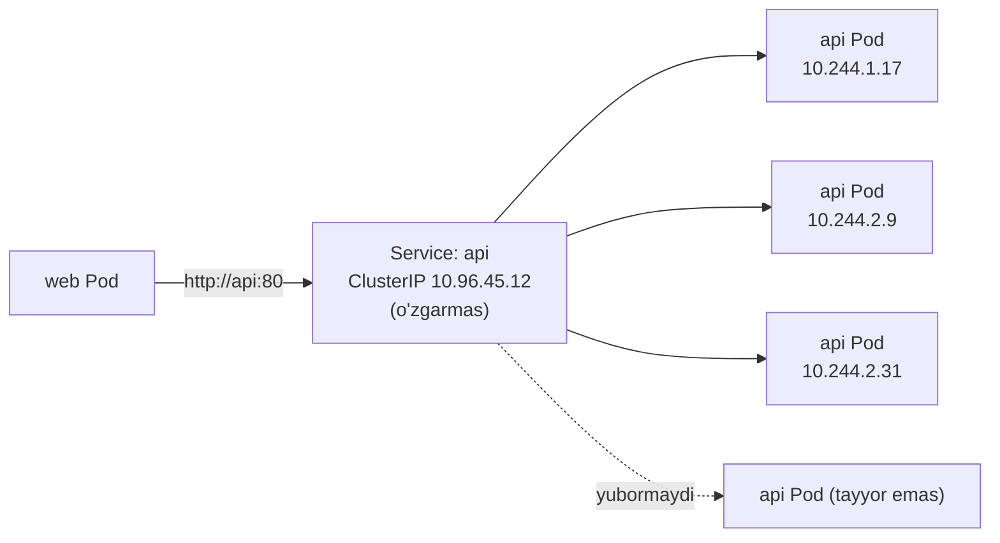
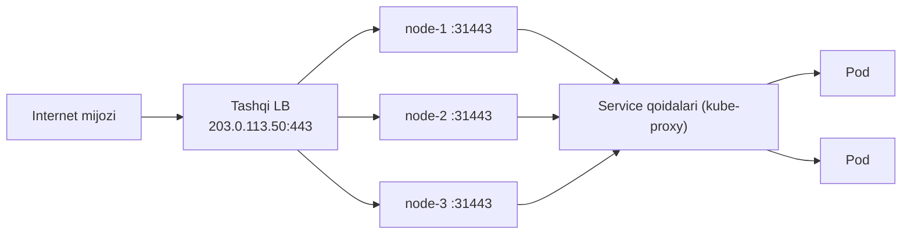
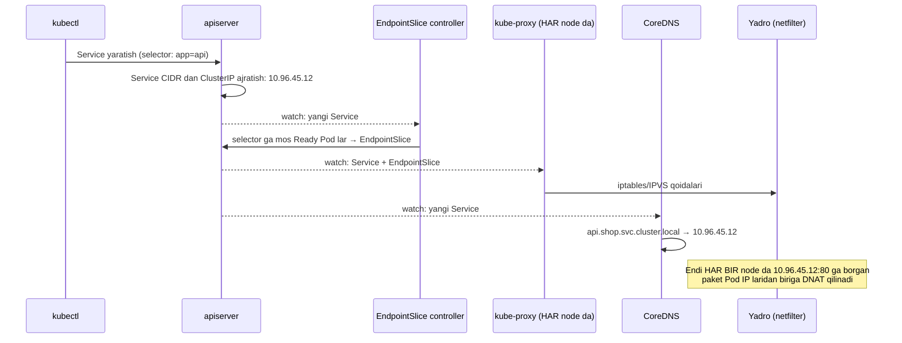
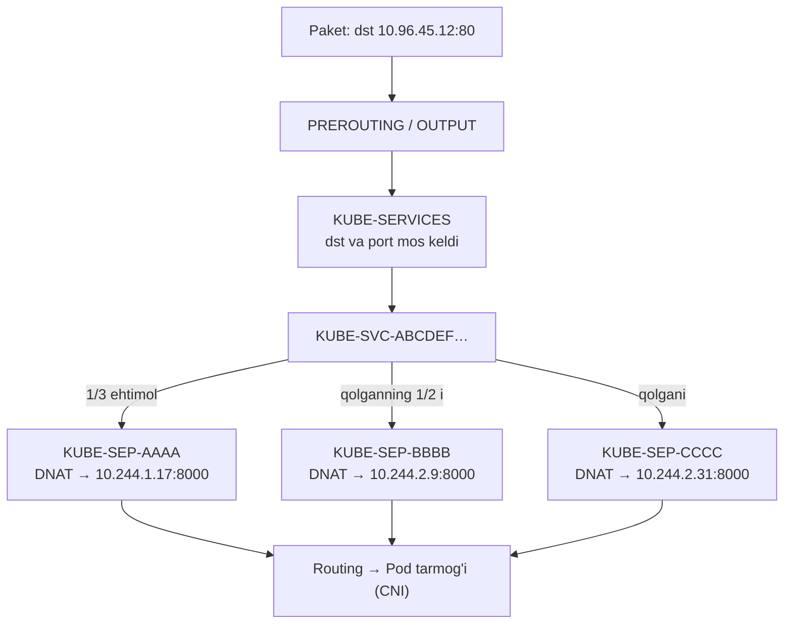
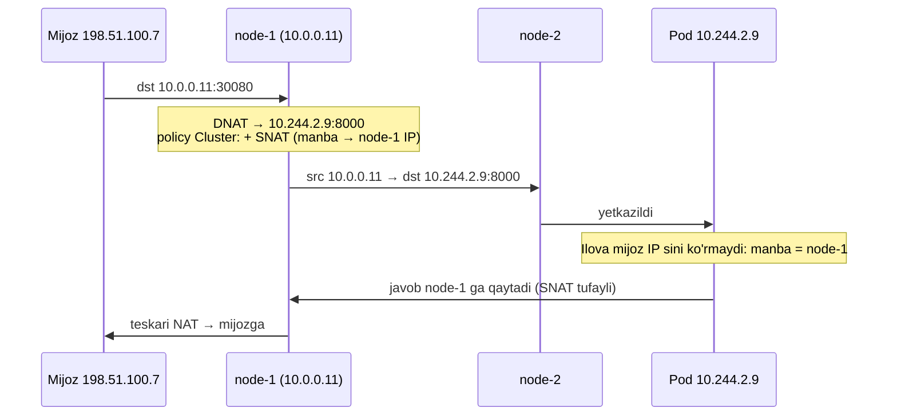
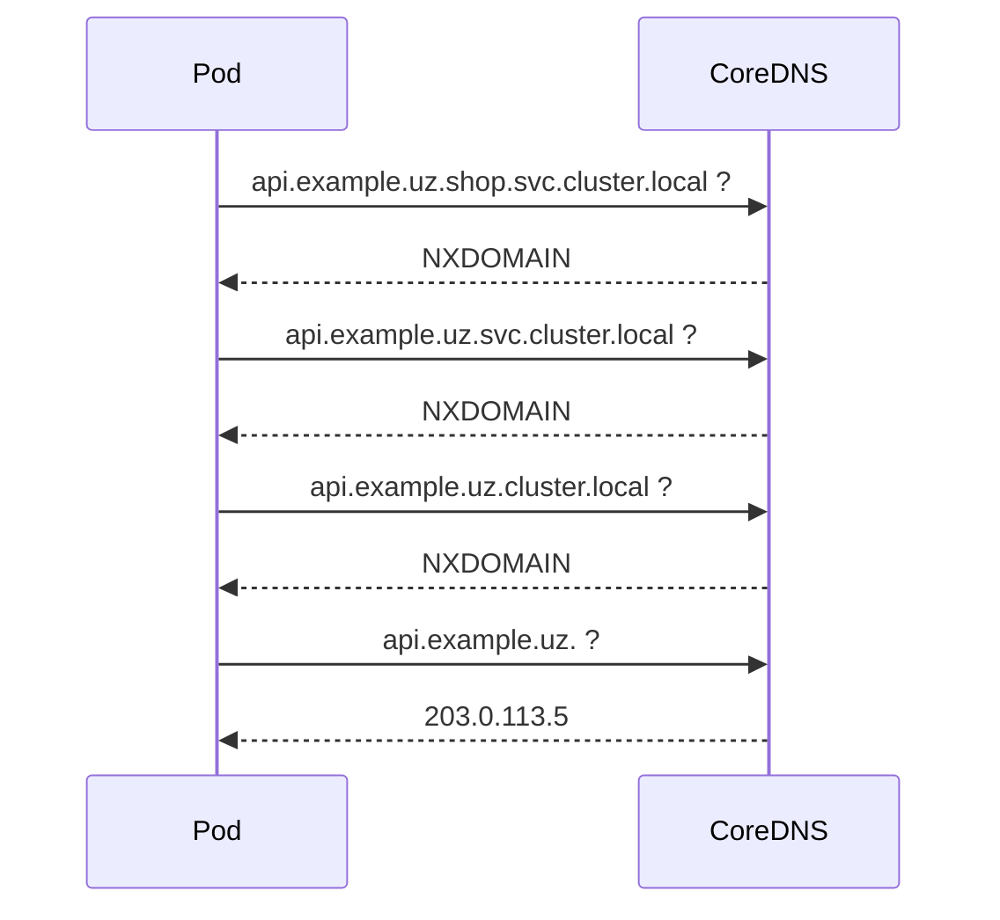
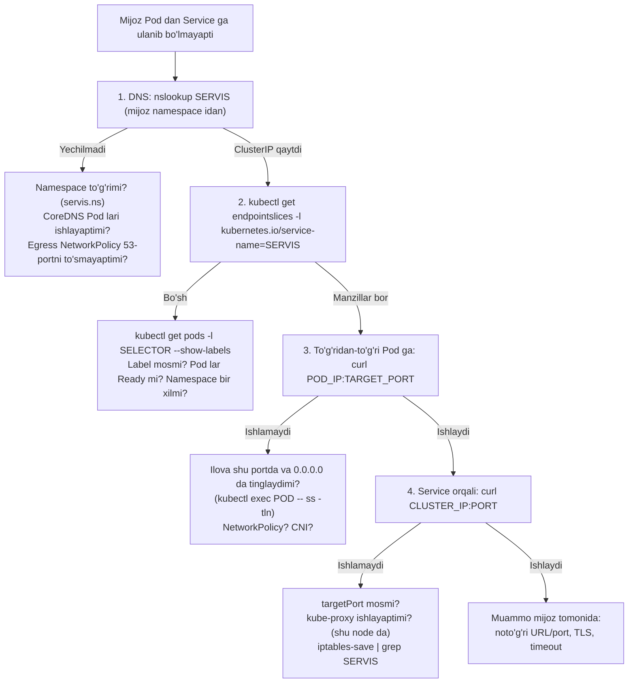

<!-- @section: why -->

## Muammo: Pod lar ko'chmanchi

Deployment 3 ta `api` Pod ini ishga tushirdi. Ularning IP lari: `10.244.1.17`, `10.244.2.9`, `10.244.2.31`. `web` ilovasi `api` ga murojaat qilishi kerak. Qaysi manzilga?

- Rolling update bo'ldi — uchala Pod ham **yangi IP** bilan qayta yaratildi.
- Bitta node o'ldi — Pod boshqa node da, **boshqa IP** bilan tirildi.
- HPA nusxalarni 3 dan 8 ga oshirdi — yana 5 ta **noma'lum** manzil.
- Bitta Pod hali ishga tushmoqda — unga so'rov yuborilsa, xato qaytadi.

Pod IP si — qumga yozilgan manzil. Unga bog'lanib bo'lmaydi.

## Yechim: Service

**Service** — o'zgaruvchan Pod lar to'plami oldidagi **barqaror** kirish nuqtasi. U uchta narsani beradi:

| Nima | Qanday |
|---|---|
| **Barqaror manzil** | Virtual IP (ClusterIP) — Service yashagan davr mobaynida o'zgarmaydi |
| **Barqaror nom** | DNS: `api.shop.svc.cluster.local` |
| **Yuk taqsimlash** | So'rovlar sog'lom (Ready) Pod lar o'rtasida taqsimlanadi |



> **Analogiya.** Service — kompaniyaning umumiy telefon raqami. Operatorlar (Pod lar) almashadi, smenaga keladi-ketadi, kasal bo'ladi — raqam o'zgarmaydi. Qo'ng'iroq hozir bo'sh va ishga tayyor operatorga ulanadi.

## Service turlari — kim qayerdan murojaat qiladi

| Savol | Tur |
|---|---|
| Klaster **ichidagi** Pod lar bir-biriga | **ClusterIP** |
| Klaster **tashqarisidan**, node IP si orqali | **NodePort** |
| Tashqaridan, alohida tashqi IP orqali | **LoadBalancer** |
| Klaster ichidan **tashqi** xizmatga nom berish | **ExternalName** |

## Eng qiziq savol

ClusterIP `10.96.45.12` — bu manzil **hech qaysi tarmoq interfeysida yo'q**. Unga `ping` ko'pincha ishlamaydi. Hech qanday jarayon bu manzilda tinglamaydi. U qanday ishlaydi?

Javob — 7-darsda: **netfilter**. Service — bu har bir node dagi DNAT qoidalari to'plami. Bu darsda shu "sehr"ni qismlarga ajratamiz.

<!-- @section: theory -->

## Service anatomiyasi

```yaml
apiVersion: v1
kind: Service
metadata:
  name: api
  namespace: shop
spec:
  type: ClusterIP
  selector:
    app: api            # qaysi Pod lar
  ports:
    - name: http
      port: 80          # Service ning o'z porti
      targetPort: 8000  # Pod dagi port
```

Uchta tushuncha birga ishlaydi:

| Obyekt | Roli |
|---|---|
| **Service** | Barqaror virtual IP + port + selector |
| **EndpointSlice** | Selector ga mos **Ready** Pod larning haqiqiy `IP:port` ro'yxati — avtomatik yuritiladi |
| **kube-proxy** | Har node da: Service va EndpointSlice larni kuzatib, yadroga tarmoq qoidalarini yozadi |

### port, targetPort, nodePort

Eng ko'p chalkashlik tug'diradigan uchlik:

```text
Tashqi mijoz ──▶ NODE_IP : nodePort (30080)
                       │
Ichki mijoz ──▶ ClusterIP : port (80)
                       │
                       ▼
                 Pod IP : targetPort (8000)   ← ilova shu portda tinglaydi
```

| Maydon | Kimniki | Misol |
|---|---|---|
| `port` | Service ning — mijozlar shu portga murojaat qiladi | `80` |
| `targetPort` | Pod ning — trafik shu portga yetkaziladi. Ko'rsatilmasa = `port`. **Nom** bo'lishi mumkin (`http`) | `8000` |
| `nodePort` | Har node ning — tashqi kirish (30000–32767) | `30080` |

`targetPort` ilova tinglayotgan portga mos kelmasa — `connection refused`. Bu Service xatolarining eng keng tarqalgani.

## ClusterIP

Standart tur. Service ga klaster ichki **Service CIDR** idan (masalan `10.96.0.0/12`) virtual IP ajratiladi. U faqat klaster ichidan yetiladi.

Virtual IP ning xususiyatlari:

- Hech qaysi interfeysga tayinlanmagan — u faqat netfilter/IPVS qoidalarida mavjud.
- Faqat e'lon qilingan **port** va **protokol** uchun ishlaydi. ICMP (ping) — iptables rejimida javob bermaydi.
- Barqaror: Service o'chirilmaguncha o'zgarmaydi.

### Headless Service

`clusterIP: None` — virtual IP **yo'q**, yuk taqsimlash yo'q. DNS to'g'ridan-to'g'ri **Pod IP lari ro'yxatini** qaytaradi.

Qachon kerak: mijoz o'zi barcha nusxalarni bilishi kerak bo'lganda — StatefulSet (har Pod ga barqaror DNS nomi: `pg-0.pg.db.svc.cluster.local`), ma'lumotlar bazasi klasterlari, o'z yuk taqsimlashiga ega mijozlar (gRPC).

## NodePort

ClusterIP ustiga qurilgan: qo'shimcha ravishda **har bir node da** bir xil port (30000–32767 oralig'idan) ochiladi. `<istalgan node IP>:<nodePort>` ga kelgan trafik Service ga yo'naltiriladi.

- Port **barcha** node larda ochiladi — hatto o'sha node da birorta Pod bo'lmasa ham.
- Kamchiliklari: nostandart portlar; node IP larini mijoz bilishi kerak; node o'lsa — o'sha manzil ishlamaydi.
- Amalda: to'g'ridan-to'g'ri kam ishlatiladi; tashqi yuk taqsimlagich yoki Ingress controller uchun poydevor.

## LoadBalancer

NodePort ustiga qurilgan: qo'shimcha ravishda tashqi **yuk taqsimlagich** so'raladi va u Service ga **tashqi IP** beradi.



- **Bulutda** (AWS, GCP, DigitalOcean): cloud-controller-manager provayder API si orqali haqiqiy LB yaratadi.
- **Bare-metal da**: hech kim LB yaratmaydi — `EXTERNAL-IP` abadiy `<pending>`. Yechim: **MetalLB** yoki kube-vip (45-dars).
- Har LoadBalancer Service — alohida LB va alohida IP (bulutda — alohida to'lov). Shuning uchun HTTP xizmatlar uchun odatda **bitta** LB + **Ingress** ishlatiladi.

Turlar bir-birining ustiga quriladi: **LoadBalancer ⊃ NodePort ⊃ ClusterIP**.

## ExternalName

Selector ham, IP ham, proksi ham yo'q — faqat DNS **CNAME** yozuvi:

```yaml
spec:
  type: ExternalName
  externalName: db.prod.example.uz
```

Pod `mydb.shop.svc.cluster.local` ni so'rasa, CoreDNS `db.prod.example.uz` ga CNAME qaytaradi. Foydasi: ilova konfiguratsiyasida ichki nom; tashqi manzil o'zgarsa — faqat Service ni tuzatasiz. Tuzoq: TLS/HTTP `Host` sarlavhasi ichki nom bo'lib ketadi — sertifikat mos kelmasligi mumkin.

## EndpointSlice va readiness

Service → Pod bog'lanishi to'g'ridan-to'g'ri emas, **EndpointSlice** orqali. EndpointSlice controller selektorga mos Pod larni kuzatadi va ularning manzillarini ro'yxatga yozadi — har biriga `ready` belgisi bilan.

**Trafik faqat Ready Pod larga boradi.** Readiness probe muvaffaqiyatsiz bo'lsa — Pod o'chirilmaydi, qayta ishga tushirilmaydi; u shunchaki endpoint lardan chiqariladi va trafik olmaydi. Tuzalgach — qaytadi.

(Eski `Endpoints` obyekti ham hozircha mavjud, lekin 1.33 dan rasman eskirgan — `EndpointSlice` dan foydalaning.)

### Selector siz Service

Selector ko'rsatilmasa, EndpointSlice avtomatik yaratilmaydi — uni **qo'lda** yozasiz. Shu yo'l bilan klaster tashqarisidagi IP ga (masalan alohida serverdagi bazaga) Service nomi beriladi.

## Service discovery: DNS

Har Service uchun **CoreDNS** avtomatik yozuv yaratadi:

```text
<service>.<namespace>.svc.<klaster-domeni>
api.shop.svc.cluster.local   →   10.96.45.12
```

| Qayerdan murojaat | Yetarli nom |
|---|---|
| O'sha namespace dan | `api` |
| Boshqa namespace dan | `api.shop` |
| To'liq (FQDN) | `api.shop.svc.cluster.local.` |

Qisqa nomlar Pod ning `/etc/resolv.conf` idagi `search` ro'yxati tufayli ishlaydi. Boshqa namespace dagi servisga faqat `api` deb murojaat qilish — klassik xato.

Qo'shimcha yozuvlar: nomlangan portlar uchun **SRV** (`_http._tcp.api.shop.svc.cluster.local`); headless Service uchun — har Pod ga A yozuv.

## Yuk taqsimlash haqida haqiqat

Service — **L4** (TCP/UDP) yuk taqsimlagich, va u **ulanish** darajasida ishlaydi, so'rov darajasida emas.

- iptables rejimi: har **yangi ulanish** uchun tasodifiy Pod tanlanadi.
- Ulanish o'rnatilgach, uning barcha paketlari o'sha Pod ga boradi (conntrack).

Oqibat: **uzoq yashaydigan ulanishlar** (HTTP keep-alive, HTTP/2, gRPC, DB pool) bitta Pod ga "yopishib" qoladi. 3 ta Pod bor, lekin bittasi 90% yuklangan. Yangi qo'shilgan Pod lar esa trafik olmaydi. Yechim — L7 taqsimlash (Ingress, service mesh, mijoz tomonida) yoki headless Service.

## Trafik siyosatlari

| Maydon | Qiymat | Ma'nosi |
|---|---|---|
| `sessionAffinity` | `ClientIP` | Bitta mijoz IP si doim bitta Pod ga (standart 3 soat) |
| `externalTrafficPolicy` | `Cluster` (standart) | Tashqi trafik istalgan node dagi Pod ga; manba IP **yo'qoladi** (SNAT), ortiqcha hop bo'lishi mumkin |
| | `Local` | Faqat **shu node dagi** Pod larga; manba IP **saqlanadi**; Pod siz node — trafikni tashlaydi |
| `internalTrafficPolicy` | `Local` | Ichki trafik ham faqat shu node dagi Pod larga (node-local agentlar uchun) |

## Atamalar lug'ati

| Atama | Ma'nosi | Misol |
|---|---|---|
| Service | Pod lar oldidagi barqaror manzil | `kubectl get svc` |
| ClusterIP | Ichki virtual IP | `10.96.45.12` |
| Service CIDR | Virtual IP lar oralig'i | `10.96.0.0/12` |
| EndpointSlice | Service ortidagi Pod manzillari | `kubectl get endpointslices` |
| kube-proxy | Qoidalarni yozuvchi node komponenti | DaemonSet |
| headless | ClusterIP siz Service | `clusterIP: None` |
| CoreDNS | Klaster DNS serveri | `kube-dns` Service |
| targetPort | Pod dagi port | `8000` yoki `http` |
| externalTrafficPolicy | Tashqi trafik qaysi Pod larga borishi | `Local` |

<!-- @section: internals -->

## Service yaratilganda nima bo'ladi



Pod yaratilsa, o'chsa yoki readiness holati o'zgarsa — EndpointSlice yangilanadi → har node dagi kube-proxy qoidalarni qayta yozadi.

Muhim: **kube-proxy — proksi emas** (nomi tarixiy). Trafik uning jarayonidan o'tmaydi; u faqat yadroga qoida yozadi. kube-proxy o'chib qolsa — mavjud qoidalar ishlayveradi, lekin yangilanmaydi.

## iptables rejimi: zanjirlarni o'qiymiz

Service `api` (`10.96.45.12:80`), ortida 3 ta Pod. Istalgan node da:

```bash
sudo iptables -t nat -S KUBE-SERVICES | grep 10.96.45.12
```

```text
-A KUBE-SERVICES -d 10.96.45.12/32 -p tcp -m comment --comment "shop/api:http cluster IP" --dport 80 -j KUBE-SVC-ABCDEF1234567890
```

Service zanjiri — ehtimollik bilan tanlash:

```text
-A KUBE-SVC-ABCDEF… -m statistic --mode random --probability 0.33333 -j KUBE-SEP-AAAA
-A KUBE-SVC-ABCDEF… -m statistic --mode random --probability 0.50000 -j KUBE-SEP-BBBB
-A KUBE-SVC-ABCDEF…                                                  -j KUBE-SEP-CCCC
```

Har endpoint zanjiri — DNAT:

```text
-A KUBE-SEP-AAAA -p tcp -j DNAT --to-destination 10.244.1.17:8000
-A KUBE-SEP-BBBB -p tcp -j DNAT --to-destination 10.244.2.9:8000
-A KUBE-SEP-CCCC -p tcp -j DNAT --to-destination 10.244.2.31:8000
```



**Ehtimolliklar nega 0.33, 0.50, 1.0?** Qoidalar ketma-ket tekshiriladi: birinchisi 1/3 ehtimol bilan tanlanadi; tanlanmasa (2/3) — qolgan ikkitadan biri 1/2 ehtimol bilan: 2/3 × 1/2 = 1/3; qolgani — oxirgisi: 1/3. Natijada har biriga teng ulush.

Bundan kelib chiqadigan xulosalar (7-dars bilan bog'lang):

- DNAT **PREROUTING** (boshqa Pod yoki tashqi mijozdan) va **OUTPUT** (shu node dagi jarayondan) zanjirlarida — routing qaroridan oldin.
- Qaror faqat ulanishning **birinchi paketi** uchun qabul qilinadi; qolgani — **conntrack**. Shuning uchun taqsimlash ulanish darajasida.
- ClusterIP ga `ping` ishlamaydi: qoida faqat `-p tcp --dport 80` uchun; ICMP ga mos qoida yo'q, manzil esa hech qaysi interfeysda emas.
- Endpoint lar yo'q bo'lsa, kube-proxy `REJECT` qoidasini yozadi — mijoz darhol `connection refused` oladi.

## IPVS va nftables rejimlari

| Rejim | Mexanizm | Xususiyati |
|---|---|---|
| **iptables** (standart) | Chiziqli qoidalar zanjirlari | Sodda, hamma joyda; minglab Service da qoidalarni yangilash sekinlashadi |
| **IPVS** | Yadrodagi L4 yuk taqsimlagich, hash jadvallar | Katta klasterlarda tezroq; algoritmlar: rr, lc, sh… (1.35 dan boshlab rasman eskirgan deb e'lon qilingan — yangi klasterlar uchun tavsiya etilmaydi) |
| **nftables** | nftables to'plam va xaritalari | iptables rejimining zamonaviy vorisi (1.33 da GA); yangilash tezroq |
| eBPF (Cilium) | kube-proxy **o'rniga** | iptables umuman ishlatilmaydi |

Qaysi rejim ishlayotganini bilish:

```bash
kubectl -n kube-system get cm kube-proxy -o jsonpath='{.data.config\.conf}' | grep -E '^mode'
kubectl -n kube-system logs ds/kube-proxy | grep -i 'using .* proxier'
sudo ipvsadm -Ln              # IPVS rejimida: virtual serverlar va real serverlar
sudo nft list table ip kube-proxy | head     # nftables rejimida
```

## NodePort va externalTrafficPolicy

NodePort uchun qo'shimcha qoida: `KUBE-NODEPORTS` zanjirida `--dport 30080` → o'sha `KUBE-SVC-…`.

Tashqi mijoz `node-1:30080` ga murojaat qildi, tanlangan Pod esa `node-2` da:



**Nega SNAT kerak (`Cluster` siyosatida)?** Javob aynan o'sha node orqali qaytishi shart — conntrack yozuvi o'sha yerda. SNAT siz Pod javobni to'g'ridan-to'g'ri mijozga yuborardi, mijoz esa uni tanimasdi (7-darsdagi asimmetrik marshrut).

`externalTrafficPolicy: Local` da: node faqat **o'zidagi** Pod larga yo'naltiradi → boshqa node ga o'tish yo'q → SNAT kerak emas → **mijoz IP si saqlanadi**. Narxi: o'sha node da Pod bo'lmasa — paket tashlanadi. Shuning uchun LB `healthCheckNodePort` orqali qaysi node larda Pod borligini tekshiradi va faqat ularga yuboradi. Yana bir nozik joy: taqsimlash node lar bo'yicha teng, Pod lar bo'yicha emas (bir node da 1 ta, boshqasida 5 ta Pod bo'lsa — notekis).

## DNS: Pod ichidan nom qanday yechiladi

Pod ning `/etc/resolv.conf` fayli (kubelet yozadi):

```text
nameserver 10.96.0.10
search shop.svc.cluster.local svc.cluster.local cluster.local
options ndots:5
```

- `nameserver 10.96.0.10` — bu `kube-dns` **Service** ning ClusterIP si (ortida CoreDNS Pod lari). Ya'ni DNS ning o'zi ham Service orqali ishlaydi.
- `search` — qisqa nomga navbat bilan qo'shib ko'riladigan domenlar.
- `ndots:5` — nomda nuqtalar soni **5 dan kam** bo'lsa, avval `search` domenlari bilan sinab ko'riladi.

`api` nomi uchun: `api.shop.svc.cluster.local` — birinchi urinishda topiladi.

`api.example.uz` (2 nuqta < 5) uchun esa:



Har tashqi nom uchun **3 ta behuda so'rov** (IPv6 bilan — 6 ta). Yuqori yuklamada bu CoreDNS ni bo'g'adi va kechikish qo'shadi. Davolari: nom oxiriga nuqta qo'yish (`api.example.uz.` — FQDN); Pod da `dnsConfig` orqali `ndots: 2`; NodeLocal DNSCache.

CoreDNS konfiguratsiyasi — `kube-system/coredns` ConfigMap dagi **Corefile**: `kubernetes` plagini klaster nomlarini API dan oladi; `forward . /etc/resolv.conf` — qolganini node ning resolverlariga uzatadi; `cache 30` — keshlash.

O'zingiz ko'ring:

```bash
kubectl run dns --rm -it --image=busybox:1.36 --restart=Never -- sh -c \
  'cat /etc/resolv.conf; nslookup api.shop.svc.cluster.local; nslookup kubernetes.default'
kubectl -n kube-system get svc kube-dns
kubectl -n kube-system get cm coredns -o jsonpath='{.data.Corefile}'
```

<!-- @section: commands -->

## ClusterIP Service — qator-qator

```yaml
apiVersion: v1
kind: Service
metadata:
  name: api
  namespace: shop
  labels:
    app: api
spec:
  type: ClusterIP
  selector:
    app: api
  ports:
    - name: http
      protocol: TCP
      port: 80
      targetPort: http
    - name: metrics
      port: 9090
      targetPort: 9090
```

| Maydon | Nima qiladi | O'chirilsa / xato bo'lsa |
|---|---|---|
| `metadata.name` | DNS nomi bo'ladi: `api.shop.svc…` | DNS label qoidalariga mos bo'lishi shart |
| `type: ClusterIP` | Faqat ichki | Ko'rsatilmasa ham shu |
| `selector` | Qaysi Pod lar. **Pod label lari** bilan solishtiriladi (Deployment nomi bilan emas) | Mos kelmasa — endpoint lar bo'sh, xato xabari yo'q |
| `ports[].name` | Bir nechta port bo'lsa **majburiy**; Ingress, ServiceMonitor shu nom bilan murojaat qiladi | |
| `protocol` | `TCP` (standart), `UDP`, `SCTP` | DNS kabi UDP xizmatlar uchun aniq yozing |
| `port: 80` | Mijozlar murojaat qiladigan port | |
| `targetPort: http` | Pod dagi port — bu yerda konteynerdagi `ports[].name` ga havola | Raqam yozib, ilova porti o'zgarsa — `connection refused` |

Selector **Service bilan bir namespace dagi** Pod larnigina tanlaydi.

## NodePort va LoadBalancer

```yaml
apiVersion: v1
kind: Service
metadata:
  name: web
spec:
  type: LoadBalancer
  externalTrafficPolicy: Local
  selector:
    app: web
  ports:
    - name: https
      port: 443
      targetPort: 8443
      nodePort: 31443
```

| Maydon | Izoh |
|---|---|
| `type: LoadBalancer` | Tashqi IP so'raydi; ichida NodePort va ClusterIP ham yaratiladi |
| `externalTrafficPolicy: Local` | Mijoz IP si saqlanadi; faqat Pod bor node lar trafik oladi |
| `nodePort: 31443` | Ko'rsatilmasa — oraliqdan avtomatik tanlanadi (tavsiya: avtomatik) |
| `loadBalancerSourceRanges: [203.0.113.0/24]` | LB ga kirishni manba bo'yicha cheklash |
| `allocateLoadBalancerNodePorts: false` | NodePort siz LB (LB to'g'ridan-to'g'ri Pod IP larga yuborsa) |

## Headless va ExternalName

```yaml
apiVersion: v1
kind: Service
metadata: { name: pg }
spec:
  clusterIP: None            # headless
  selector: { app: pg }
  ports: [{ name: pg, port: 5432 }]
---
apiVersion: v1
kind: Service
metadata: { name: legacy-db }
spec:
  type: ExternalName
  externalName: db.prod.example.uz
```

## Selector siz Service — tashqi IP ga nom berish

```yaml
apiVersion: v1
kind: Service
metadata: { name: ext-db }
spec:
  ports: [{ name: pg, port: 5432 }]
---
apiVersion: discovery.k8s.io/v1
kind: EndpointSlice
metadata:
  name: ext-db-1
  labels:
    kubernetes.io/service-name: ext-db      # Service ga bog'lovchi label — majburiy
addressType: IPv4
ports: [{ name: pg, port: 5432 }]
endpoints:
  - addresses: ["10.0.50.12"]
```

## kubectl buyruqlari

```bash
kubectl expose deployment api --name=api --port=80 --target-port=8000 --dry-run=client -o yaml
```

```tahlil
{"command":"kubectl expose deployment api --name=api --port=80 --target-port=8000 --dry-run=client -o yaml","parts":[{"t":"kubectl expose","d":"Mavjud resurs (Deployment, Pod) uchun Service yaratadi — selector ni uning label laridan o'zi oladi"},{"t":"deployment api","d":"Manba: shu Deployment ning Pod selektori Service selektoriga aylanadi"},{"t":"--name=api","d":"Service nomi (va DNS nomi). Ko'rsatilmasa — resurs nomi"},{"t":"--port=80","d":"Service porti"},{"t":"--target-port=8000","d":"Pod dagi port. Ko'rsatilmasa --port ga teng — ilova boshqa portda bo'lsa xato manbai"},{"t":"--dry-run=client -o yaml","d":"Yaratmasdan YAML ni chiqaradi — faylga saqlab, Git ga qo'shish uchun. --type=NodePort bilan tur ham beriladi"}]}
```

| Buyruq | Vazifasi |
|---|---|
| `kubectl get svc -o wide` | Service lar: tur, ClusterIP, EXTERNAL-IP, portlar, **SELECTOR** |
| `kubectl describe svc api` | `Endpoints:` satri — ortida kim bor |
| `kubectl get endpointslices -l kubernetes.io/service-name=api -o wide` | Endpoint manzillari va holati |
| `kubectl get pods -l app=api -o wide` | Selektorga mos Pod lar (Service selektorini shu yerga yozib sinang) |
| `kubectl port-forward svc/api 8080:80` | Mahalliy mashinadan Service ga tunnel |
| `kubectl get svc api -o jsonpath='{.spec.clusterIP}'` | ClusterIP |

`get svc` chiqishini o'qish:

```text
NAME   TYPE           CLUSTER-IP     EXTERNAL-IP     PORT(S)         AGE
api    ClusterIP      10.96.45.12    <none>          80/TCP          5d
web    LoadBalancer   10.96.201.7    203.0.113.50    443:31443/TCP   5d
old    NodePort       10.96.13.99    <none>          80:30080/TCP    9d
```

`443:31443/TCP` — `port:nodePort/protokol`. `EXTERNAL-IP <pending>` — LB hali (yoki hech qachon) berilmagan.

## Klaster ichidan sinash

```bash
kubectl run dbg --rm -it --image=nicolaka/netshoot --restart=Never -n shop -- bash
```

```tahlil
{"command":"kubectl run dbg --rm -it --image=nicolaka/netshoot --restart=Never -n shop -- bash","parts":[{"t":"kubectl run dbg","d":"'dbg' nomli Pod yaratadi"},{"t":"--rm","d":"Chiqilganda Pod ni avtomatik o'chiradi"},{"t":"-it","d":"Interaktiv terminal"},{"t":"--image=nicolaka/netshoot","d":"Tarmoq vositalari to'plami: dig, curl, nc, tcpdump, ss… Yengilroq muqobil: busybox:1.36"},{"t":"--restart=Never","d":"Yalang'och Pod (Deployment emas) — bir martalik ish uchun"},{"t":"-n shop","d":"Sinov AYNAN mijoz ishlaydigan namespace da o'tkazilishi kerak — DNS search va NetworkPolicy shunga bog'liq"},{"t":"-- bash","d":"-- dan keyin konteyner ichidagi buyruq"}]}
```

Ichkarida — qatlamma-qatlam:

```bash
dig +short api.shop.svc.cluster.local      # 1. DNS: ClusterIP qaytadimi?
nc -zv api 80                              # 2. L4: Service porti
curl -sv http://api/healthz                # 3. L7
curl -sv http://10.244.1.17:8000/healthz   # 4. Service ni chetlab — to'g'ridan-to'g'ri Pod ga
```

4-qadam ishlasa, 2–3 ishlamasa — muammo Service da (selector, targetPort). 4 ham ishlamasa — muammo Pod yoki tarmoqda (CNI, NetworkPolicy).

<!-- @section: lab -->

## Lab 1. Service va uning ortidagi mexanizm

**Maqsad:** Service → EndpointSlice → iptables zanjirini o'z ko'zingiz bilan ko'rish.

**Muhit:** `kind` klasteri (kube-proxy iptables rejimida).

**Qadamlar:**

1. 3 nusxali Deployment yarating — har Pod o'z nomini qaytarsin:

   ```bash
   kubectl create deployment kim --image=registry.k8s.io/e2e-test-images/agnhost:2.47 --replicas=3 -- /agnhost netexec --http-port=8080
   kubectl expose deployment kim --port=80 --target-port=8080
   ```

2. Service ning ClusterIP si va EndpointSlice dagi manzillarni toping. Ular Pod IP lariga mos keladimi?
3. Vaqtinchalik Pod dan 10 marta so'rov yuboring: `wget -qO- http://kim/hostname`. Javoblar turli Pod lardan keladimi?
4. Node ga kirib (`docker exec -it <klaster>-worker bash`), `iptables -t nat` da shu Service ning `KUBE-SVC-…` va `KUBE-SEP-…` zanjirlarini toping. Ehtimolliklar qanday?
5. Deployment ni 5 nusxaga oshiring — zanjirlar qanday o'zgardi?
6. ClusterIP ga `ping` qilib ko'ring. Nega ishlamaydi?

**Tekshirish:**

```bash
kubectl get endpointslices -l kubernetes.io/service-name=kim -o wide     # 3 (keyin 5) manzil
```

<details><summary>💡 Yechimni ko'rsatish</summary>

```bash
kubectl get svc kim; kubectl get pods -l app=kim -o wide
kubectl get endpointslices -l kubernetes.io/service-name=kim -o wide

kubectl run c --rm -it --image=busybox:1.36 --restart=Never -- sh -c \
  'for i in $(seq 10); do wget -qO- http://kim/hostname; echo; done'

IP=$(kubectl get svc kim -o jsonpath='{.spec.clusterIP}')
docker exec kind-worker sh -c "iptables -t nat -S | grep $IP"
docker exec kind-worker iptables -t nat -S KUBE-SVC-XXXXXXXXXXXXXXXX     # yuqoridagi natijadan
# --probability 0.33333333349 → SEP-1;  0.50000000000 → SEP-2;  shartsiz → SEP-3

kubectl scale deploy kim --replicas=5
# endi: 0.2, 0.25, 0.333, 0.5, shartsiz
```

6: ClusterIP hech qaysi interfeysda yo'q; iptables da faqat `tcp dpt:80` uchun DNAT qoidasi bor — ICMP paketiga hech narsa mos kelmaydi va u hech qayerga bormaydi.

</details>

## Lab 2. Readiness va endpoint lar

**Maqsad:** tayyor bo'lmagan Pod trafikdan avtomatik chiqarilishini ko'rish.

**Qadamlar:**

1. Lab 1 dagi Deployment ga readiness probe qo'shing: `httpGet /healthz` port 8080, `periodSeconds: 2`.
2. Bir terminalda: `kubectl get endpointslices -l kubernetes.io/service-name=kim -o wide -w`.
3. Bitta Pod ni "kasal" qiling: agnhost da `/healthz` ni xato qaytaradigan qilish mumkin emas, shuning uchun faylga asoslangan probe ishlating — probe ni `exec: ["cat", "/tmp/tayyor"]` ga almashtiring va konteyner `command` ida avval `touch /tmp/tayyor` bajaring.
4. `kubectl exec POD -- rm /tmp/tayyor`. Pod holati (`READY`) va EndpointSlice da nima o'zgardi? Pod qayta ishga tushdimi?
5. So'rovlar yuborib, "kasal" Pod javob bermayotganiga ishonch hosil qiling.
6. Faylni qaytaring: `kubectl exec POD -- touch /tmp/tayyor`.

<details><summary>💡 Yechimni ko'rsatish</summary>

```yaml
containers:
  - name: agnhost
    image: registry.k8s.io/e2e-test-images/agnhost:2.47
    command: ["sh", "-c", "touch /tmp/tayyor && exec /agnhost netexec --http-port=8080"]
    readinessProbe:
      exec: { command: ["cat", "/tmp/tayyor"] }
      periodSeconds: 2
```

4-qadam: bir necha soniyada Pod `0/1 Running` bo'ladi; EndpointSlice da uning manzili `ready: false` (yoki ro'yxatdan chiqadi). `RESTARTS` — 0: readiness konteynerni qayta ishga tushirmaydi (bu liveness ning ishi). 6-qadamdan keyin Pod yana `1/1` va trafik oladi.

</details>

## Lab 3. DNS va ndots

**Qadamlar:**

1. Ikki namespace yarating: `a` va `b`. `b` da `kim` Service bo'lsin.
2. `a` namespace dagi Pod dan `wget -qO- http://kim/hostname` — ishlaydimi? `http://kim.b/hostname`-chi?
3. Pod da `cat /etc/resolv.conf`.
4. `netshoot` Pod da: `dig +search +noall +answer +question kubernetes.io` va DNS so'rovlarini kuzating: `tcpdump -ni any port 53 -c 12 &` so'ng `curl -s -o /dev/null https://kubernetes.io`. Nechta so'rov ketdi?
5. Xuddi shuni oxirida nuqta bilan takrorlang: `https://kubernetes.io.`

<details><summary>💡 Yechimni ko'rsatish</summary>

2: `kim` — `wget: bad address 'kim'` (search ro'yxati `a.svc.cluster.local` dan boshlanadi, `b` yo'q); `kim.b` — ishlaydi (`kim.b.svc.cluster.local` ikkinchi search domeni orqali).

4: `kubernetes.io` da 1 nuqta < `ndots:5` → avval uchta search domeni bilan (A va AAAA — jami 6 so'rov, hammasi NXDOMAIN), keyin asl nom. 5: nuqta bilan — faqat asl nom so'raladi.

</details>

## Qo'shimcha chaqiriq

`externalTrafficPolicy` ni sinang: NodePort Service yarating, tashqaridan (node IP:nodePort) murojaat qilib, ilova ko'rgan mijoz manzilini chiqaring (`/clientip` — agnhost da bor). `Cluster` va `Local` da natija qanday farq qiladi? `Local` da Pod yo'q node ga murojaat qilsangiz nima bo'ladi?

<!-- @section: breakfix -->

## 1. Service bor, lekin "connection refused"

```text
$ kubectl exec web-xxx -- curl -s http://api/healthz
curl: (7) Failed to connect to api port 80: Connection refused
$ kubectl get pods -l app=api
api-6d5f8-aaaaa   1/1   Running
api-6d5f8-bbbbb   1/1   Running
$ kubectl get endpointslices -l kubernetes.io/service-name=api
NAME        ADDRESSTYPE   PORTS   ENDPOINTS                 AGE
api-x7k2p   IPv4          80      10.244.1.17,10.244.2.9    4m
$ kubectl exec api-6d5f8-aaaaa -- ss -tln
LISTEN 0 128 0.0.0.0:8000 0.0.0.0:*
```

```breakfix
{"title":"targetPort","lang":"yaml","broken":"apiVersion: v1\nkind: Service\nmetadata:\n  name: api\nspec:\n  selector:\n    app: api\n  ports:\n    - name: http\n      port: 80","hints":["Endpoint lar bor — selector to'g'ri. DNS ham ishlayapti (IP ga ulanishga urinildi). Demak muammo portda.","EndpointSlice da PORTS ustuni 80. Ilova esa (ss chiqishi) 8000 da tinglaydi.","targetPort ko'rsatilmagan — u port ga teng deb olinadi. targetPort: 8000 qo'shing."],"solution":"apiVersion: v1\nkind: Service\nmetadata:\n  name: api\nspec:\n  selector:\n    app: api\n  ports:\n    - name: http\n      port: 80\n      targetPort: 8000","explain":"targetPort berilmasa port qiymatini oladi: trafik Pod ning 80-portiga DNAT qilinadi, u yerda esa hech kim tinglamaydi → RST → 'connection refused'. Belgi: endpoint lar bor, lekin PORTS ustunidagi raqam ilova portiga mos emas. Eng ishonchli usul — konteynerda portga nom berib (name: http), targetPort: http yozish."}
```

## 2. Endpoint lar bo'sh

```text
$ kubectl describe svc web | grep -E 'Selector|Endpoints'
Selector:   app=web,tier=frontend
Endpoints:  <none>
$ kubectl get pods --show-labels
web-7d4b9-aaaaa   1/1   Running   app=web,pod-template-hash=7d4b9
web-7d4b9-bbbbb   1/1   Running   app=web,pod-template-hash=7d4b9
```

```breakfix
{"title":"Selector hech kimni tanlamayapti","lang":"yaml","broken":"apiVersion: v1\nkind: Service\nmetadata:\n  name: web\nspec:\n  selector:\n    app: web\n    tier: frontend\n  ports:\n    - port: 80\n      targetPort: 8080","hints":["Endpoints: <none> — selector ga mos Ready Pod yo'q. Pod lar Running va Ready — demak gap label larda.","Selector dagi BARCHA label lar Pod da bo'lishi kerak (VA). Pod larda tier=frontend bormi?","Pod larda faqat app=web. Selector dan tier ni olib tashlang (yoki Deployment shabloniga shu label ni qo'shing)."],"solution":"apiVersion: v1\nkind: Service\nmetadata:\n  name: web\nspec:\n  selector:\n    app: web\n  ports:\n    - port: 80\n      targetPort: 8080","explain":"Selector dagi juftliklar VA mantiqi bilan birlashadi — Pod ularning HAMMASIga ega bo'lishi shart. Mos Pod bo'lmasa Kubernetes hech qanday xato bermaydi: Service yaratiladi, endpoint lar esa bo'sh. Mijoz 'connection refused' oladi (kube-proxy REJECT qoidasi). Tekshirish: kubectl get pods -l app=web,tier=frontend."}
```

## 3. Boshqa namespace dagi servis topilmayapti

`shop` namespace dagi `web` ilovasi `infra` namespace dagi Redis ga ulana olmayapti:

```text
redis.exceptions.ConnectionError: Error -2 connecting to redis:6379. Name or service not known.
$ kubectl get svc -n infra
NAME    TYPE        CLUSTER-IP     PORT(S)
redis   ClusterIP   10.96.88.140   6379/TCP
```

```breakfix
{"title":"DNS va namespace","lang":"yaml","broken":"apiVersion: apps/v1\nkind: Deployment\nmetadata:\n  name: web\n  namespace: shop\nspec:\n  replicas: 2\n  selector:\n    matchLabels:\n      app: web\n  template:\n    metadata:\n      labels:\n        app: web\n    spec:\n      containers:\n        - name: web\n          image: registry.example.uz/web:1.4.2\n          env:\n            - name: REDIS_URL\n              value: redis://redis:6379/0","hints":["'Name or service not known' — bu DNS xatosi, tarmoq emas. Pod qaysi nomni yecha olmayapti?","Qisqa nom ('redis') Pod ning o'z namespace i bo'yicha qidiriladi: redis.shop.svc.cluster.local. Servis esa infra da.","Namespace ni nomga qo'shing: redis.infra (yoki to'liq FQDN)."],"solution":"apiVersion: apps/v1\nkind: Deployment\nmetadata:\n  name: web\n  namespace: shop\nspec:\n  replicas: 2\n  selector:\n    matchLabels:\n      app: web\n  template:\n    metadata:\n      labels:\n        app: web\n    spec:\n      containers:\n        - name: web\n          image: registry.example.uz/web:1.4.2\n          env:\n            - name: REDIS_URL\n              value: redis://redis.infra.svc.cluster.local:6379/0","explain":"Pod ning resolv.conf idagi search ro'yxati: shop.svc.cluster.local, svc.cluster.local, cluster.local. 'redis' → redis.shop.svc… (yo'q) → redis.svc… (yo'q) → … Boshqa namespace uchun kamida <servis>.<namespace> yozish kerak. Agar nom yechilsa-yu, ulanish timeout bo'lsa — bu endi NetworkPolicy masalasi."}
```

<!-- @section: errors -->

## Metodika: Service ishlamayapti

Zanjir bo'ylab, chapdan o'ngga: **DNS → Service → Endpoint lar → Pod**.



Xato turiga qarab tez tashxis:

| Mijoz ko'rgan xato | Eng ehtimolli sabab |
|---|---|
| `Could not resolve host` / `Name or service not known` | DNS: nom, namespace, CoreDNS |
| `Connection refused` (darhol) | Endpoint lar bo'sh (REJECT) yoki `targetPort` noto'g'ri |
| `Connection timed out` | NetworkPolicy, CNI muammosi, kube-proxy qoidalari yo'q |
| Vaqti-vaqti bilan xato | Endpoint lardan biri buzuq va readiness probe yo'q; conntrack |

## Xatolar jadvali

| Xato xabari / simptom | Sabab | Qanday tekshiriladi | Yechim |
|---|---|---|---|
| `Endpoints: <none>` | Selector Pod label lariga mos emas; Pod lar Ready emas; boshqa namespace | `kubectl get pods -l … --show-labels` | Label/selector; probe |
| `connection refused`, endpoint lar bor | `targetPort` ≠ ilova porti | `kubectl exec POD -- ss -tln` | `targetPort` ni tuzatish |
| Pod ga to'g'ridan-to'g'ri ham `refused` | Ilova `127.0.0.1` da tinglaydi | `ss -tln` → `127.0.0.1:8000` | `0.0.0.0` ga bind |
| Nom yechilmaydi (boshqa namespace) | Qisqa nom ishlatilgan | `nslookup svc.ns` | `servis.namespace` |
| Barcha nomlar yechilmaydi | CoreDNS ishlamayapti; `kube-dns` Service endpoint siz | `kubectl -n kube-system get pods -l k8s-app=kube-dns` | CoreDNS ni tiklash |
| DNS vaqti-vaqti bilan 5 s kechikadi | conntrack poygasi (UDP); CoreDNS yuklangan | CoreDNS metrikalari; `dmesg` | NodeLocal DNSCache; CoreDNS nusxalarini oshirish |
| default-deny dan keyin hech narsa yechilmaydi | Egress policy DNS ni to'sgan | `kubectl get netpol` | `kube-dns` ga UDP/TCP 53 egress |
| `EXTERNAL-IP <pending>` | LB provayder yo'q (bare-metal) yoki bulut kvotasi | `kubectl describe svc` → Events | MetalLB; bulut integratsiyasi |
| NodePort tashqaridan ochilmaydi | Firewall / security group 30000–32767 ni to'sgan | `nc -zv NODE_IP PORT` | Portni ochish |
| NodePort faqat ba'zi node larda ishlaydi | `externalTrafficPolicy: Local` — Pod siz node lar tashlaydi | `kubectl get pods -o wide` | Kutilgan xulq; LB health check |
| Ilova loglarida mijoz IP si o'rnida node IP | `externalTrafficPolicy: Cluster` SNAT qiladi | — | `Local`; yoki PROXY protokol / `X-Forwarded-For` |
| Trafik Pod lar orasida notekis | Uzoq yashaydigan ulanishlar (keep-alive, gRPC) | Pod metrikalari | L7 LB / mesh; headless + mijoz LB |
| Pod o'chirilgandan keyin unga hali so'rov boradi | Qoidalar yangilanishi kechikadi; keep-alive | — | `preStop sleep` (39-dars) |
| `provided port is not in the valid range` | `nodePort` 30000–32767 dan tashqarida | — | Oraliqdan tanlash |
| `port is already allocated` | Shu nodePort band | `kubectl get svc -A \| grep PORT` | Boshqa port / avtomatik |
| ClusterIP ga `ping` javobsiz | Normal: virtual IP faqat port uchun | — | `nc`/`curl` bilan sinang |
| Service o'zgartirildi, eski Pod ga boradi | conntrack da eski yozuv (ayniqsa UDP) | `conntrack -L \| grep CLUSTER_IP` | `conntrack -D -d CLUSTER_IP` |
| ExternalName orqali HTTPS xato | `Host`/SNI ichki nom — sertifikat mos emas | `curl -v` | Mijozda to'g'ri `Host`; yoki tashqi nomni bevosita ishlatish |

## Debug uchun asosiy buyruqlar

```bash
kubectl get svc,endpointslices -n NS -o wide
kubectl describe svc SVC -n NS
kubectl get pods -n NS -l SELECTOR -o wide --show-labels
kubectl run dbg --rm -it --image=nicolaka/netshoot --restart=Never -n NS -- bash
#   dig +short SVC.NS.svc.cluster.local;  nc -zv SVC PORT;  curl -sv http://POD_IP:TARGET_PORT/
kubectl -n kube-system get pods -l k8s-app=kube-dns -o wide
kubectl -n kube-system logs -l k8s-app=kube-dns --tail=30
kubectl -n kube-system get ds kube-proxy; kubectl -n kube-system logs ds/kube-proxy --tail=30
# Node da:
sudo iptables-save -t nat | grep -E 'NS/SVC'
sudo conntrack -L -d CLUSTER_IP 2>/dev/null | head
```

<!-- @section: production -->

## Xavfsizlik

**1. Eng tor tur.** Ichki xizmat — `ClusterIP`. `NodePort`/`LoadBalancer` — faqat haqiqatan tashqi kirish kerak bo'lsa. Ma'lumotlar bazasi uchun `LoadBalancer` — deyarli har doim xato.

**2. Tashqi kirishni cheklang.** `loadBalancerSourceRanges`; NodePort oralig'ini (30000–32767) node firewall ida internetdan yoping.

**3. NetworkPolicy.** Sukut bo'yicha har Pod har Service ga yeta oladi — namespace lar chegara emas. default-deny + aniq ruxsatlar (54-dars); DNS (53) ga egress ni unutmang.

**4. HTTP xizmatlar uchun — Ingress.** Har servisga alohida LoadBalancer o'rniga bitta kirish nuqtasi: TLS, marshrutlash, cheklovlar bir joyda.

## Ishonchlilik

| Amaliyot | Nega |
|---|---|
| **Readiness probe** har Pod da | Service faqat tayyor Pod larga yuboradi — probe siz "tayyor" degan tushuncha yo'q |
| `targetPort` — **nom** bilan | Ilova porti o'zgarsa, Service ni tuzatish shart emas; rolling update da eski va yangi Pod lar turli portda bo'lishi mumkin |
| Portlarga `name` | Ingress, ServiceMonitor, mesh shu nomga tayanadi (`http`, `grpc`, `metrics`) |
| `preStop` pauzasi | Endpoint olib tashlanishi va SIGTERM poygasi |
| Mijozda timeout va retry | Service "ulanish" darajasida — buzuq Pod ga tushgan so'rov o'zi tiklanmaydi |
| CoreDNS — 2+ nusxa, turli node larda | DNS — hamma narsaning bog'liqligi |
| `externalTrafficPolicy: Local` + anti-affinity | Mijoz IP si kerak bo'lsa; Pod lar node larga teng tarqalsin |

## Performance

- **`ndots:5` solig'i:** tashqi nomlar uchun 3–6 ta ortiqcha DNS so'rov. Davo: FQDN oxirida nuqta; yoki

  ```yaml
  dnsConfig:
    options:
      - { name: ndots, value: "2" }
  ```

- **NodeLocal DNSCache** — har node da kesh agenti: CoreDNS yuklamasi va conntrack poygalarini kamaytiradi.
- **Katta klasterlar** (minglab Service): iptables rejimida qoidalarni yangilash sekinlashadi → nftables rejimi yoki eBPF (Cilium).
- **Uzoq ulanishlar:** gRPC/HTTP2 uchun Service L4 taqsimlashi yetarli emas — L7 proksi (mesh, Ingress) yoki headless Service + mijoz tomonida taqsimlash; server tomonda ulanishning maksimal umrini cheklash.
- **conntrack:** yuqori yuklamali node larda `nf_conntrack_max` ni oshiring va to'lishini kuzating.

## Kuzatuv

| Metrika | Nega |
|---|---|
| Endpoint siz Service lar (`kube_endpoint_address_available == 0`) | Xizmat amalda o'chiq |
| CoreDNS: so'rovlar tezligi, `SERVFAIL`/`NXDOMAIN` ulushi, kechikish p99 | DNS — yashirin sekinlik manbai |
| kube-proxy: `sync_proxy_rules_duration_seconds` | Qoidalar yangilanishi kechikmoqda |
| `node_nf_conntrack_entries / _limit` | Jadval to'lishi → tasodifiy timeout lar |
| LB / Ingress darajasida 5xx va kechikish | Foydalanuvchi ko'rgan holat |

## Production ga chiqishdan oldingi tekshiruv ro'yxati

- [ ] Har Service ning endpoint lari bo'sh emas (`kubectl get endpointslices`)
- [ ] `targetPort` nom bilan; portlar nomlangan
- [ ] Barcha backend Pod larda readiness probe
- [ ] Ichki xizmatlar `ClusterIP`; tashqi kirish ongli va cheklangan
- [ ] Boshqa namespace ga murojaatlar `servis.namespace` shaklida
- [ ] CoreDNS 2+ nusxa; DNS metrikalari kuzatiladi
- [ ] NetworkPolicy lar DNS ga ruxsat beradi
- [ ] Mijoz IP si kerak bo'lsa — `externalTrafficPolicy: Local` yoki `X-Forwarded-For`
- [ ] gRPC/uzoq ulanishlar uchun taqsimlash strategiyasi bor
- [ ] Mijozlarda timeout/retry sozlangan

## Anti-pattern lar

| Anti-pattern | Nima uchun yomon | To'g'risi |
|---|---|---|
| Pod IP sini konfiguratsiyaga yozish | Keyingi restart da o'zgaradi | Service DNS nomi |
| ClusterIP ni kodga yozish | Service qayta yaratilsa o'zgaradi | DNS nomi |
| Har mikroservisga `LoadBalancer` | Qimmat, boshqarib bo'lmaydi | Ingress / Gateway API |
| Bazani `NodePort` bilan tashqariga ochish | Internetga ochiq baza | ClusterIP + VPN/bastion |
| Selector juda keng (`app: web` ikki xil ilovada) | Trafik begona Pod larga | Noyob label lar |
| `hostNetwork`/`hostPort` Service o'rniga | Port to'qnashuvi, node ga bog'lanish | Service |
| Readiness probe siz Service | Yuklanayotgan Pod ga trafik | Probe |
| "ping ishlamayapti — Service buzuq" | ClusterIP ICMP ga javob bermaydi | `nc`, `curl` |
| `sessionAffinity: ClientIP` bilan holatni Pod da saqlash | Pod o'lsa — sessiya yo'q | Holat tashqi omborda (Redis) |

<!-- @section: interview -->

### 1. Service nima uchun kerak? Qanday turlari bor?

🟢 Junior

**Namunaviy javob.** Pod lar o'tkinchi: har qayta yaratilganda IP si o'zgaradi, nusxalar soni ham o'zgarib turadi. Service ular oldiga barqaror virtual IP va DNS nomi qo'yadi hamda trafikni sog'lom Pod lar orasida taqsimlaydi. Turlari: **ClusterIP** — faqat klaster ichida (standart); **NodePort** — qo'shimcha ravishda har node da 30000–32767 oralig'idan port ochiladi; **LoadBalancer** — qo'shimcha ravishda tashqi yuk taqsimlagich va tashqi IP (bulutda provayder, bare-metal da MetalLB); **ExternalName** — tashqi domen uchun DNS CNAME. Birinchi uchtasi bir-birining ustiga quriladi. Yana headless Service bor (`clusterIP: None`) — virtual IP siz, DNS to'g'ridan-to'g'ri Pod IP larini qaytaradi.

### 2. `port`, `targetPort` va `nodePort` farqi?

🟢 Junior

**Namunaviy javob.** `port` — Service ning o'z porti: klaster ichidagi mijozlar `ClusterIP:port` ga murojaat qiladi. `targetPort` — trafik yetkaziladigan Pod dagi port, ya'ni ilova tinglayotgan port; ko'rsatilmasa `port` ga teng; raqam o'rniga konteyner portining nomi bo'lishi mumkin. `nodePort` — NodePort/LoadBalancer turida har node da ochiladigan tashqi port. Yo'l: `nodeIP:nodePort` → `ClusterIP:port` → `PodIP:targetPort`. Eng ko'p xato — `targetPort` ilova portiga mos kelmasligi: endpoint lar bor, lekin `connection refused`.

### 3. kube-proxy qanday ishlaydi?

🟡 Middle

**Namunaviy javob.** kube-proxy har node da ishlaydi va nomiga qaramay proksi emas: u API dan Service va EndpointSlice larni kuzatib, yadroga qoidalar yozadi; trafik uning jarayonidan o'tmaydi. iptables rejimida: `nat` jadvalida `KUBE-SERVICES` zanjiri ClusterIP:port ga mos paketni `KUBE-SVC-…` zanjiriga yuboradi; u yerda `statistic` moduli bilan ehtimollik asosida endpoint zanjirlaridan biri (`KUBE-SEP-…`) tanlanadi; u esa DNAT bilan manzilni Pod IP:port ga almashtiradi. Qaror ulanishning birinchi paketida qabul qilinadi, qolgan paketlar conntrack bo'yicha ketadi. Boshqa rejimlar: IPVS (yadro L4 balanser, hash jadvallar), nftables (iptables rejimining zamonaviy vorisi). Cilium kabi CNI lar kube-proxy ni eBPF bilan to'liq almashtiradi.

**Intervyuer nimani kutadi:** "qoidalar yozadi, trafik undan o'tmaydi"; DNAT va conntrack.

### 4. ClusterIP ga `ping` nega ishlamaydi?

🟡 Middle

**Namunaviy javob.** ClusterIP — virtual manzil: u hech qaysi tarmoq interfeysiga tayinlanmagan va hech qanday xost unga ARP javobi bermaydi. U faqat netfilter qoidalarida mavjud, va bu qoidalar aniq protokol hamda port uchun yozilgan (masalan TCP 80). ICMP echo paketiga mos qoida yo'q — u DNAT qilinmaydi va hech qayerga yetib bormaydi. Shuning uchun Service ni `ping` bilan emas, `nc -zv` yoki `curl` bilan — aynan e'lon qilingan portga — tekshirish kerak. (IPVS rejimida ClusterIP lar `kube-ipvs0` soxta interfeysiga bog'lanadi va ping ishlashi mumkin.)

### 5. Service ortida endpoint lar bo'sh. Sabablarini sanang.

🟡 Middle

**Namunaviy javob.** (1) Selector Pod label lariga mos emas — imlo, yoki selektorda Pod da yo'q qo'shimcha label (juftliklar VA bilan birlashadi). (2) Pod lar mavjud, lekin Ready emas: readiness probe o'tmayapti, konteyner yiqilmoqda. (3) Service va Pod lar turli namespace da — selector faqat o'z namespace ida ishlaydi. (4) Pod lar umuman yo'q (Deployment 0 nusxada). (5) Service selector siz yaratilgan va EndpointSlice qo'lda yozilmagan. Tekshirish: `kubectl describe svc` dan selektorni olib, `kubectl get pods -l <selector> --show-labels` — bo'sh chiqsa label muammosi; Pod lar chiqsa-yu `0/1` bo'lsa — readiness.

### 6. Readiness probe va Service o'rtasidagi bog'liqlik?

🟡 Middle

**Namunaviy javob.** EndpointSlice controller Service selektoriga mos Pod larni ro'yxatga oladi, lekin trafik uchun faqat Ready holatidagilari ishlatiladi. Readiness probe muvaffaqiyatsiz bo'lsa, Pod o'chirilmaydi va qayta ishga tushirilmaydi — u endpoint larda "tayyor emas" deb belgilanadi, kube-proxy uni qoidalardan chiqaradi; probe yana o'tsa — qaytadi. Bu uch holatda muhim: ishga tushish (ilova yuklanguncha trafik bermaslik), vaqtinchalik ortiqcha yuklanish (Pod "nafas olishi" uchun), rolling update (yangi Pod tayyor bo'lmaguncha eskisini o'chirmaslik). Probe umuman bo'lmasa, konteyner start bo'lishi bilan Pod Ready hisoblanadi.

### 7. Bare-metal klasterda LoadBalancer Service `<pending>` da qolgan. Nega va nima qilish kerak?

🟡 Middle

**Namunaviy javob.** LoadBalancer turi Kubernetes ning o'zida amalga oshirilmagan — u faqat "tashqi LB kerak" degan so'rov. Bulutda cloud-controller-manager provayder API si orqali LB yaratib, IP ni Service statusiga yozadi. Bare-metal da bunday controller yo'q — shuning uchun abadiy `<pending>`. Yechim: **MetalLB** (yoki kube-vip, Cilium LB IPAM): unga IP manzillar hovuzi beriladi; L2 rejimida bitta node shu IP uchun ARP ga javob beradi (failover bilan, lekin haqiqiy taqsimlash emas — barcha trafik bitta node orqali); BGP rejimida node lar IP ni routerga e'lon qiladi va ECMP bilan haqiqiy taqsimlash bo'ladi. Muqobil: NodePort + tashqi HAProxy/keepalived.

### 8. `externalTrafficPolicy: Local` nima beradi va narxi qanday?

🔴 Senior

**Namunaviy javob.** Standart `Cluster` siyosatida tashqi trafik istalgan node ga kelib, istalgan node dagi Pod ga yo'naltirilishi mumkin; javob o'sha kirish node i orqali qaytishi uchun manba manzil node IP siga SNAT qilinadi — ilova mijozning haqiqiy IP sini ko'rmaydi, va ortiqcha tarmoq hop i qo'shiladi. `Local` da node faqat o'zidagi Pod larga yuboradi: SNAT kerak emas → mijoz IP si saqlanadi, hop yo'q. Narxi: (1) Pod yo'q node ga kelgan trafik tashlanadi — shuning uchun LB `healthCheckNodePort` orqali faqat Pod bor node larni tanlashi kerak; (2) taqsimlash notekis bo'lishi mumkin — LB node lar o'rtasida teng bo'ladi, node larda esa Pod lar soni har xil; (3) rolling update da node dagi yagona Pod almashayotgan lahzada qisqa yo'qotish xavfi. Shuning uchun `Local` ni anti-affinity / topology spread bilan birga ishlatiladi.

### 9. Pod da `curl https://api.example.com` sekin. DNS ga shubha qilasiz. Nimani tekshirasiz?

🔴 Senior

**Namunaviy javob.** Birinchi gumon — `ndots:5`. Pod ning `resolv.conf` ida search ro'yxati va `ndots:5` bor: nomda 5 tadan kam nuqta bo'lsa, resolver avval har search domenini qo'shib sinaydi. `api.example.com` uchun bu 3 ta (A va AAAA bilan 6 ta) NXDOMAIN so'rovi, keyingina asl nom. Tekshiraman: Pod da `tcpdump port 53` yoki CoreDNS loglari/metrikalarida NXDOMAIN ulushi. Ikkinchi gumon — aynan 5 soniyalik kechikishlar: bu UDP conntrack poygasi (parallel A va AAAA so'rovlari bir xil tuple bilan, biri tashlanadi va resolver 5 s timeout kutadi). Uchinchi — CoreDNS ning o'zi: nusxalar kam, CPU throttling, yuqori resolver sekin. Davolar: tashqi nomlarni FQDN (oxirida nuqta) qilish; `dnsConfig` da `ndots: 2` va `single-request-reopen`; NodeLocal DNSCache (TCP orqali yuqoriga uzatadi — poyga yo'qoladi); CoreDNS ni masshtablash va `autopath`.

**Intervyuer nimani kutadi:** ndots mexanizmini; 5 s kechikish sababini.

### 10. 3 ta gRPC server Pod i bor, lekin yuklama faqat bittasiga tushyapti. Nega va qanday hal qilasiz?

🔴 Senior

**Namunaviy javob.** Service — L4 balanser va qarorni **ulanish** uchun qabul qiladi, so'rov uchun emas. gRPC HTTP/2 ustida ishlaydi: mijoz bitta uzoq yashaydigan TCP ulanish ochadi va barcha so'rovlarni shu ulanishga multiplekslaydi. kube-proxy ulanish ochilganda bitta Pod ni tanladi — shundan keyin barcha so'rovlar o'sha Pod ga. Yangi Pod lar qo'shilsa ham mavjud ulanishlar ko'chmaydi. Yechimlar: (1) headless Service + mijoz tomonida taqsimlash — gRPC mijozi DNS dan barcha Pod IP larini olib, `round_robin` siyosati bilan har biriga ulanish ochadi; (2) L7 proksi — service mesh (Envoy sidecar, Linkerd) yoki gRPC ni tushunadigan Ingress/Gateway: har so'rov alohida taqsimlanadi; (3) vaqtinchalik chora — serverda `MAX_CONNECTION_AGE` bilan ulanish umrini cheklash: mijozlar davriy qayta ulanib, qayta taqsimlanadi. Xuddi shu muammo HTTP keep-alive va ma'lumotlar bazasi ulanishlar pulida ham bor.

<!-- @section: cheatsheet -->

## Model

**Service** (barqaror IP + DNS) → **EndpointSlice** (Ready Pod manzillari) → **kube-proxy** (har node da DNAT qoidalari)

Yo'l: `nodeIP:nodePort` → `ClusterIP:port` → `PodIP:targetPort`

## Turlar

| Tur | Kimdan | Izoh |
|---|---|---|
| `ClusterIP` | Klaster ichidan | Standart |
| `NodePort` | Tashqaridan, `nodeIP:30000–32767` | ClusterIP ustiga |
| `LoadBalancer` | Tashqaridan, tashqi IP | NodePort ustiga; bare-metal da MetalLB |
| `ExternalName` | — | DNS CNAME |
| Headless (`clusterIP: None`) | Ichidan | DNS → Pod IP lari; StatefulSet |

## Skelet

```yaml
apiVersion: v1
kind: Service
metadata: { name: api, namespace: shop }
spec:
  selector: { app: api }          # POD label lari
  ports:
    - name: http
      port: 80                    # Service porti
      targetPort: http            # Pod porti (nom yoki raqam)
```

## DNS

`<svc>.<ns>.svc.cluster.local` · o'z namespace ida: `api` · boshqasidan: `api.shop`

Pod `resolv.conf`: `nameserver 10.96.0.10` · `search <ns>.svc.cluster.local svc.cluster.local cluster.local` · `ndots:5`

## Buyruqlar

| Buyruq | Nima qiladi |
|---|---|
| `kubectl get svc -o wide` | Service lar + selector |
| `kubectl describe svc X` | `Endpoints:` — ortida kim |
| `kubectl get endpointslices -l kubernetes.io/service-name=X -o wide` | Manzillar |
| `kubectl get pods -l SELECTOR --show-labels` | Selector kimni tanlaydi |
| `kubectl expose deploy X --port=80 --target-port=8000` | Service yaratish |
| `kubectl port-forward svc/X 8080:80` | Mahalliy tunnel |
| `kubectl run dbg --rm -it --image=nicolaka/netshoot --restart=Never -- bash` | Ichkaridan sinash |

## Tashxis

| Simptom | Sabab |
|---|---|
| Nom yechilmaydi | Namespace (`svc.ns`), CoreDNS, NetworkPolicy:53 |
| `Endpoints: <none>` | Selector ≠ label; Pod Ready emas |
| `refused`, endpoint lar bor | `targetPort` xato; ilova `127.0.0.1` da |
| `timed out` | NetworkPolicy / CNI / kube-proxy |
| `EXTERNAL-IP <pending>` | LB provayder yo'q |
| Notekis yuklama | Uzoq ulanishlar (L4 balans) |
| ping ishlamaydi | Normal — `nc`/`curl` ishlating |

Tartib: **DNS → endpoint lar → Pod ga bevosita → Service orqali**

## Esda tut

1. Pod IP ga emas, Service nomiga murojaat qiling.
2. Selector — Pod label lari; VA mantiqi; faqat o'z namespace i.
3. `targetPort` = ilova tinglayotgan port.
4. Trafik faqat **Ready** Pod larga — readiness probe shart.
5. kube-proxy proksi emas — qoida yozuvchi; ClusterIP faqat qoidalarda yashaydi.
6. Taqsimlash ulanish bo'yicha, so'rov bo'yicha emas.
7. Boshqa namespace: `servis.namespace`.
8. `Cluster` → mijoz IP yo'qoladi; `Local` → saqlanadi, lekin faqat Pod bor node lar.
